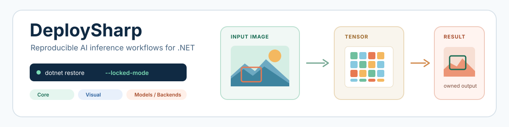

<picture>
  <source media="(prefers-color-scheme: dark)" srcset="docs/images/readme/hero-dark.svg">
  <source media="(prefers-color-scheme: light)" srcset="docs/images/readme/hero-light.svg">
  
</picture>

A modular .NET model deployment toolkit for reproducible vision, language, and multimodal inference across replaceable backends.

  
  
  
  
  

  
  
  

<strong>English</strong> | <a href="README_cn.md">简体中文</a>

# DeploySharp

DeploySharp V2 provides explicit contracts for model artifacts, typed tensors, sessions, visual pipelines, language/multimodal workflows, ModelPack integrity, ModelFactory acquisition, and replaceable inference backends. Applications own model files and native runtimes; DeploySharp keeps backend selection and execution boundaries visible.

## 📖 Introduction

- **Stable application contracts:** model identity, typed tensors, named inputs/outputs, sessions, diagnostics, cancellation, and disposal.
- **Typed workflows and extension points:** classification, detection, segmentation, pose, OBB, OCR, anomaly, promptable segmentation, vision-language, LLM, and multimodal paths, with model-level maturity documented separately.
- **Explicit backend ownership:** ONNX Runtime, OpenVINO, OpenCV DNN, TensorRT/CUDA, and LLamaSharp adapters without silently installing every vendor runtime.
- **Reproducible model delivery:** ModelPack manifests, artifact size/SHA-256 checks, versioned Release downloads, offline cache reuse, and a runnable model case.

The V2 API is a clean redesign and does not provide V1 source, binary, configuration, or behavior compatibility.

## ✨ Release Highlights

- Core, Visual, LLM, Multimodal, ModelPack, ModelFactory, five backend families, and seven grouped sample modules.
- The model catalog, model/backend verification matrix, and named-device measurements are maintained as public documents.
- Windows x64 verification for ONNX Runtime, OpenVINO, OpenCV DNN, and named TensorRT/CUDA environments.
- Session pools, batching, asynchronous visual inference, sliding-window detection, and repeatable benchmark tooling.

## 📢 Latest Update: 2.0.0

`2.0.0` is the first stable DeploySharp V2 release target, covering typed inference, visual workflows, PaddleOCR/PP-Structure, model downloads, and replaceable backends. Its release validation scope is Windows 10/11 x64; model and backend limits remain explicit. See the [2.0.0 release notes](docs/releases/2.0.0.md) for the complete scope and upgrade guidance.

The `2.0.0` release comes from the `DeploySharpV2.0` branch. The NuGet badges and [GitHub Releases](https://github.com/guojin-yan/DeploySharp/releases) show available packages and assets. Upgrade all DeploySharp packages together and recompile applications built against `2.0.0-alpha.1`; see the [upgrade guidance](docs/releases/2.0.0.md#从预览版升级) and [preview release notes](docs/releases/2.0.0-alpha.1.md) for version-specific changes.

## 🚀 Get Started In 30 Seconds

Install the Core layer and the backend you need at the same `2.0.0` version. Contributors can use project references to work with the source.

~~~powershell
dotnet add package JYPPX.DeploySharp.Core --version 2.0.0
dotnet add package JYPPX.DeploySharp.Backend.OnnxRuntime --version 2.0.0
dotnet add package Microsoft.ML.OnnxRuntime --version 1.28.0
~~~

Create a model artifact, register ONNX Runtime, create a named-tensor session, and run one typed input:

~~~csharp
using System.Threading;
using JYPPX.DeploySharp;
using JYPPX.DeploySharp.Backends.OnnxRuntime;
using JYPPX.DeploySharp.Models;
using JYPPX.DeploySharp.Registry;
using JYPPX.DeploySharp.Tensors;

using var backends = new BackendRegistry();
backends.UseOnnxRuntime();

var artifact = new ModelArtifact(
    new ModelId("examples/classifier"),
    "onnx",
    @"models\classifier.onnx",
    preferredBackend: OnnxRuntimeBackendProvider.BackendId);
var request = new BackendRequest(
    BackendCapabilities.TensorInference,
    OnnxRuntimeBackendProvider.BackendId,
    "cpu");
using IInferenceSession session = backends.CreateSession(
    artifact, request, SessionOptions.Default);

var input = new Tensor<float>(new TensorShape(1, 3), new[] { 0.1f, 0.2f, 0.7f });
InferenceOutputs outputs = session.Run(InferenceInputs.Create("images", input), CancellationToken.None);
Console.WriteLine(outputs.Count);
~~~

The code-first path, visual preparation, ModelFactory download flow, and model-specific examples are in the [usage tutorial](docs/articles/usage-tutorial.md) and [samples](samples/README.md).

## 📦 Package Layout

| Package family | Contents | Native runtime ownership |
| --- | --- | --- |
| <code>JYPPX.DeploySharp.Core</code> | Models, tensors, sessions, results, diagnostics, backend registration | None |
| <code>JYPPX.DeploySharp.Extensibility</code> | Plugin descriptors, runtime dependencies, options schemas, and native probes | None; host-owned probing |
| <code>JYPPX.DeploySharp.Visual</code> | Visual profiles, preprocessing metadata, decoders, canonical results | None |
| <code>JYPPX.DeploySharp.Visual.OpenCV</code> | OpenCV image loading and tensor preparation | Application selects OpenCV runtime |
| <code>JYPPX.DeploySharp.Visual.TensorRT</code> | CUDA preprocessing and device-resident TensorRT visual pipelines | Application provides TensorRT, CUDA, bridge, and engine |
| <code>JYPPX.DeploySharp.LLM</code> / <code>Multimodal</code> | Generation, chat, embeddings, ordered media, streaming | Application selects model runtime |
| <code>JYPPX.DeploySharp.ModelPack.Json</code> / <code>ModelFactory</code> | Manifests, integrity validation, catalog downloads, offline cache | None; model files stay application-owned |
| <code>JYPPX.DeploySharp.Backend.*</code> | ONNX Runtime, OpenVINO, OpenCV DNN, TensorRT, and LLamaSharp adapters | Backend-specific and explicit |

### Recommended Package Combinations

| Scenario | DeploySharp packages | Application-owned runtime |
| --- | --- | --- |
| ONNX Runtime visual inference | `Core` + `Visual` + `Visual.OpenCV` + `Backend.OnnxRuntime` | ONNX Runtime CPU/CUDA package and model files |
| OpenVINO or OpenCV DNN visual inference | `Core` + `Visual` + `Visual.OpenCV` + the matching `Backend.*` | Matching OpenVINO/OpenCV native runtime |
| TensorRT CUDA visual inference | `Core` + `Visual` + `Visual.TensorRT` + `Backend.TensorRT` | CUDA, cuDNN, TensorRT, bridge, and compatible Engine |
| LLM or multimodal inference | `Core` + `LLM` or `Multimodal` + the selected backend | GGUF/model files and selected native runtime |
| Model catalog/cache and plugin probing | `Core` + `ModelPack.Json` + `ModelFactory` and/or `Extensibility` | Application-owned catalog, cache, and probe host |

See the [detailed package combination and installation guide](docs/articles/package-combinations.md) for commands, TFM/RID notes, and runtime ownership.

## 🌐 Public Packages And Release Assets

The version column reads NuGet directly and includes previews. It shows the latest published version and updates automatically when `2.0.0` becomes available.

| Package | NuGet version | Purpose |
| --- | --- | --- |
| [`JYPPX.DeploySharp.Core`](https://www.nuget.org/packages/JYPPX.DeploySharp.Core/) |  | Core contracts and backend registration |
| [`JYPPX.DeploySharp.Extensibility`](https://www.nuget.org/packages/JYPPX.DeploySharp.Extensibility/) |  | Plugin descriptors, runtime probes, and options schemas |
| [`JYPPX.DeploySharp.Visual`](https://www.nuget.org/packages/JYPPX.DeploySharp.Visual/) |  | Visual profiles, preprocessing, and decoders |
| [`JYPPX.DeploySharp.Visual.OpenCV`](https://www.nuget.org/packages/JYPPX.DeploySharp.Visual.OpenCV/) |  | OpenCV image preparation |
| [`JYPPX.DeploySharp.Visual.TensorRT`](https://www.nuget.org/packages/JYPPX.DeploySharp.Visual.TensorRT/) |  | CUDA preprocessing and TensorRT visual pipelines |
| [`JYPPX.DeploySharp.LLM`](https://www.nuget.org/packages/JYPPX.DeploySharp.LLM/) |  | LLM generation and embedding contracts |
| [`JYPPX.DeploySharp.Multimodal`](https://www.nuget.org/packages/JYPPX.DeploySharp.Multimodal/) |  | Ordered multimodal orchestration |
| [`JYPPX.DeploySharp.ModelPack.Json`](https://www.nuget.org/packages/JYPPX.DeploySharp.ModelPack.Json/) |  | Model manifests and integrity validation |
| [`JYPPX.DeploySharp.ModelFactory`](https://www.nuget.org/packages/JYPPX.DeploySharp.ModelFactory/) |  | Catalog selection, download, cache, and offline reuse |
| [`JYPPX.DeploySharp.Backend.OnnxRuntime`](https://www.nuget.org/packages/JYPPX.DeploySharp.Backend.OnnxRuntime/) |  | ONNX Runtime named-tensor adapter |
| [`JYPPX.DeploySharp.Backend.OpenVINO`](https://www.nuget.org/packages/JYPPX.DeploySharp.Backend.OpenVINO/) |  | OpenVINO named-tensor adapter |
| [`JYPPX.DeploySharp.Backend.OpenCV`](https://www.nuget.org/packages/JYPPX.DeploySharp.Backend.OpenCV/) |  | OpenCV DNN adapter |
| [`JYPPX.DeploySharp.Backend.TensorRT`](https://www.nuget.org/packages/JYPPX.DeploySharp.Backend.TensorRT/) |  | TensorRT inference and ONNX-to-engine boundary |
| [`JYPPX.DeploySharp.Backend.LlamaSharp`](https://www.nuget.org/packages/JYPPX.DeploySharp.Backend.LlamaSharp/) |  | LLamaSharp GGUF generation and embeddings |

| Publication channel | Purpose | Assets |
| --- | --- | --- |
| [NuGet.org](https://www.nuget.org/packages?q=JYPPX.DeploySharp) | Primary package feed | Managed packages and symbols |
| [GitHub Packages](https://github.com/guojin-yan/DeploySharp/packages) | Stable package mirror | Managed packages |
| [GitHub Releases](https://github.com/guojin-yan/DeploySharp/releases) | Versioned release assets | Stable release packages/checksums and separate model releases |

### Default Test Images

Examples and benchmark tools use the dedicated [`test-assets.1` release](https://github.com/guojin-yan/DeploySharp/releases/tag/test-assets.1) when no local image is supplied. The task defaults are `bus.jpg` for detection/segmentation, `demo_7.jpg` for classification, `demo_9.jpg` for pose, `plane.png` for oriented detection, and `ocr-demo_1.jpg` for PaddleOCR. Files are SHA-256 verified and cached under `%LOCALAPPDATA%\DeploySharp\TestImages`; the full mapping and maintenance commands are in the [default test images guide](docs/articles/test-images.md).

### Application-Owned Runtime Packages

These are application dependencies/runtime packages used by Windows x64 applications. Referencing a DeploySharp managed package does not silently install them:

| Package | NuGet | Purpose |
| --- | --- | --- |
| [Microsoft.ML.OnnxRuntime](https://www.nuget.org/packages/Microsoft.ML.OnnxRuntime/) |  | ONNX Runtime CPU native execution |
| [JYPPX.OpenCV.runtime.win-x64](https://www.nuget.org/packages/JYPPX.OpenCV.runtime.win-x64/) |  | Windows x64 OpenCV native runtime |
| [OpenVINO.runtime.win](https://www.nuget.org/packages/OpenVINO.runtime.win/) |  | Windows OpenVINO native runtime |
| [JYPPX.TensorRT.CSharp.API](https://www.nuget.org/packages/JYPPX.TensorRT.CSharp.API/) |  | Managed TensorRT/CUDA API; NVIDIA libraries remain application-installed |
| [LLamaSharp.Backend.Cpu](https://www.nuget.org/packages/LLamaSharp.Backend.Cpu/) |  | CPU native backend for LLamaSharp GGUF workflows |

The managed package tables do not mean native dependencies are installed automatically. See [installation and runtime ownership](docs/articles/installation.md) before selecting a deployment RID.

## 🖥️ Platforms And Frameworks

| Platform | Build/package boundary | Inference verification |
| --- | --- | --- |
| Windows 10 x64 | 2.0.0 release scope | ONNX Runtime, OpenVINO, OpenCV DNN CPU; named TensorRT GPU evidence |
| Windows 11 x64 | 2.0.0 release scope | Same code path; named-device evidence is recorded separately |
| Windows ARM64, Linux, macOS, mobile, NPU | Outside the 2.0.0 validated release scope | No complete runtime compatibility claim for this release |

The complete framework list and backend evidence are in [platform and backend support](docs/articles/platform-support.md). Build compatibility is not the same as inference verification.

## 🤖 Supported Models

The table lists public model assets by task. "Backend verified" means that at least one exact model/backend combination has real inference evidence; it never means every backend is supported. Model files are downloaded separately and are not embedded in NuGet packages.

| Category | Complete model names | Current level |
| --- | --- | --- |
| Object detection | YOLOv5n Detect, YOLOv6s Detect, YOLOv7 Detect, YOLOv8n Detect, YOLOv9s Detect, YOLOv10n Detect, YOLO11n Detect, YOLO12n Detect, YOLOv13n Detect, YOLO26n Detect, DEIMv2 Detect, PP-YOLOE Plus CRN-L, RF-DETR Detect, Paddle RT-DETR R50vd decoded vector-count ONNX, Paddle RT-DETR R50vd decoded vector-count OpenVINO IR, RT-DETR R50vd raw-query ONNX | Backend verified; exact graph support varies |
| Image classification | YOLOv8s Classification | Backend verified |
| Instance segmentation | YOLOv5s Segmentation, YOLOv8n Segmentation, YOLOv9c Segmentation, YOLO11s Segmentation, YOLO26s Segmentation, RF-DETR Segment | Backend verified |
| Pose estimation | YOLOv8s Pose, YOLO11s Pose, YOLO26s Pose | Backend verified |
| Oriented detection | YOLOv8s Oriented Detection, YOLO11s Oriented Detection, YOLO26s Oriented Detection | Backend verified |
| Core OCR | PP-OCRv4_mobile_det, PP-OCRv4_server_det, PP-OCRv4_mobile_rec, PP-OCRv4_server_rec, ch_ppocr_mobile_v2.0_cls; PP-OCRv5_mobile_det, PP-OCRv5_server_det, PP-OCRv5_mobile_rec, PP-OCRv5_server_rec, PP-LCNet_x0_25_textline_ori, PP-LCNet_x1_0_textline_ori; PP-OCRv6_tiny_det, PP-OCRv6_tiny_rec, PP-OCRv6_small_det, PP-OCRv6_small_rec, PP-OCRv6_medium_det, PP-OCRv6_medium_rec | Backend verified; individual assets |
| Document preprocessing and layout | PP-LCNet_x1_0_doc_ori, UVDoc, PP-DocLayout_plus-L, PP-DocLayout-L, PP-DocLayout-M, PP-DocLayout-S, PP-DocBlockLayout, PicoDet_layout_1x, PicoDet_layout_1x_table, PicoDet-S_layout_3cls, PicoDet-L_layout_3cls, PicoDet-S_layout_17cls, PicoDet-L_layout_17cls, RT-DETR-H_layout_3cls, RT-DETR-H_layout_17cls | Backend verified; exact graph support varies |
| Tables, formulas, seals, and charts | SLANeXt_wired, SLANeXt_wireless, PP-LCNet_x1_0_table_cls, RT-DETR-L_wired_table_cell_det, RT-DETR-L_wireless_table_cell_det, PP-FormulaNet_plus-S, PP-FormulaNet_plus-M, PP-FormulaNet_plus-L, PP-FormulaNet-S, PP-FormulaNet-L, UniMERNet, PP-OCRv4_mobile_seal_det, PP-OCRv4_server_seal_det, PP-Chart2Table | Backend verified with documented importer limits |
| Experimental document VLM | PaddleOCR-VL 1.6 five-graph Bundle | Experimental; fixed-task backend evidence only |
| Anomaly and background removal | Anomalib PaDiM MVTec AD Bottle, BRIA RMBG 1.4, BRIA RMBG 2.0 | Backend verified; precision/backend limits apply |
| Promptable segmentation | Meta SAM ViT-B ONNX prompt segmentation bundle | Backend verified on ONNX Runtime CPU and OpenVINO CPU |
| Vision-language | OpenAI CLIP ViT-B/32 ONNX dual encoder, Salesforce BLIP Caption Base ONNX bundle | Backend verified on ONNX Runtime CPU and OpenVINO CPU |
| Local language model | Qwen2.5 0.5B Instruct Q4_K_M | Backend verified on LlamaSharp CPU |

Use the [model support guide](docs/articles/model-support.md) for the detailed current and planned scope, the [official catalog](docs/articles/model-catalog.md) for immutable assets, and the [model/backend matrix](docs/model-backend-verification-matrix.md) for exact runtime evidence. PaddleOCR and PP-Structure assets are individually downloadable from [`models-paddleocr`](https://github.com/guojin-yan/DeploySharp/releases/tag/models-paddleocr).

## 🧪 Example Series

| Module | Demonstration |
| --- | --- |
| <code>01-core</code> | Backend-neutral model/tensor lifecycle |
| <code>02-visual</code> | Visual profiles, preprocessing metadata, asynchronous inference, and sliding-window detection |
| <code>03-backends</code> | Native backend loading and named-tensor execution |
| <code>04-multimodal</code> | Ordered media, streaming, cancellation, and cleanup |
| <code>05-llm</code> | Conversation history and prompt formatting |
| <code>06-models</code> | Catalog selection, model cases, Release download/inference |
| <code>07-benchmarks</code> | Same-model backend/platform latency and throughput |

See the [sample learning path](samples/README.md).

## 📚 Documentation

| Resource | Link | Purpose |
| --- | --- | --- |
| Documentation index | [docs/index.md](docs/index.md) | Public DocFX entry point |
| Stable release notes | [2.0.0](docs/releases/2.0.0.md) | Complete V2 scope, preview upgrade guidance, and known boundaries |
| Usage tutorial | [Usage tutorial](docs/articles/usage-tutorial.md) | Code-first tensor and visual workflows |
| Custom visual models | [Custom model and preprocessing guide](docs/articles/visual-custom-model.md) | Typed preprocessing, result decoding, and geometry/normalization overrides |
| Platform/backend support | [Support table](docs/articles/platform-support.md) | Target framework and verification boundaries |
| Model support | [Model guide](docs/articles/model-support.md) | Catalog IDs, families, and status semantics |
| Device measurements | [Named-device results](docs/articles/device-performance-benchmarks.md) | Reproducible environment and timing records |
| Visual ROI | [ROI guide](docs/articles/visual-roi-configuration.md) · [Device benchmarks](docs/articles/device-performance-benchmarks.md#roi-与滑动窗口) | Geometry, crop/filter/sliding windows, JSON updates and video events; per-backend validation boundaries |

## 🔨 Build From Source

~~~powershell
dotnet restore DeploySharp.sln --locked-mode
dotnet build DeploySharp.sln -c Release --no-restore -m:1
dotnet test DeploySharp.sln -c Release --no-build --no-restore
~~~

## ⚖️ License

DeploySharp source code is licensed under the [Apache License 2.0](LICENSE.txt). Models and vendor runtimes are separate artifacts with their own runtime and distribution terms.

## 🤝 Contact And Sponsorship

For questions, issue reports, testing feedback, or sponsorship, please use the project homepage and issue tracker.

  

---

## ⚠️ Software Notice And Disclaimer

### 📜 1. Open Source License Notice

All open-source project code authored by the project author follows the **Apache License 2.0**.

*Special note: This project integrates several third-party libraries. If any third-party library uses a license that conflicts with or differs from Apache 2.0, the original license of that third-party library takes precedence. This project does not include or represent the license notices of those third-party libraries. Read and comply with the relevant third-party licenses before use.*

### 🤖 2. Code Development And Quality Notice

- **AI-assisted development**: AI assistance was used to generate and improve parts of this code during development; it was not written entirely line by line by a human.
- **Security statement**: **The author solemnly declares that this code contains no intentionally planted backdoors, viruses, Trojans, or malicious code intended to damage user devices or steal data.**
- **Technical limitations**: Due to the author's technical level and capabilities, the code may contain basic issues caused by insufficiently rigorous logic, incomplete optimization, or limited experience, including but not limited to memory leaks, occasional crashes, and unreleased resources. These issues are the result of limitations in ability and are not intentional.
- **Testing scope**: Because the author's time is limited, this software has not been fully tested across every scenario and edge case.

### 🚨 3. Important Disclaimer

**Before applying this code to any real-world project, especially a commercial, industrial, or mission-critical environment, you must perform thorough and rigorous independent testing and validation.** In view of the possible defects and limited test coverage described above, **the author accepts no responsibility for any direct or indirect loss caused by using this code, including but not limited to equipment failure, data loss, system outage, or loss of profits.** By using this code, you acknowledge these risks and agree to bear all consequences independently; related issues are not the responsibility of the author.

### 🔓 4. Scope Of Open Source Code

The core logic of this project is fully open source. However, the binary files, source code, and related resources of the third-party libraries mentioned above are outside this project's open-source obligations. Obtain and use them according to their respective instructions and licenses.

### 🤝 5. Community And Feedback

Despite these limitations, everyone is welcome to download and use the project, submit Issues, and participate in testing. If you find a bug, memory overflow, or improvement opportunity, please use the contact channels on the project homepage. We will do our best to provide assistance within the time available.
