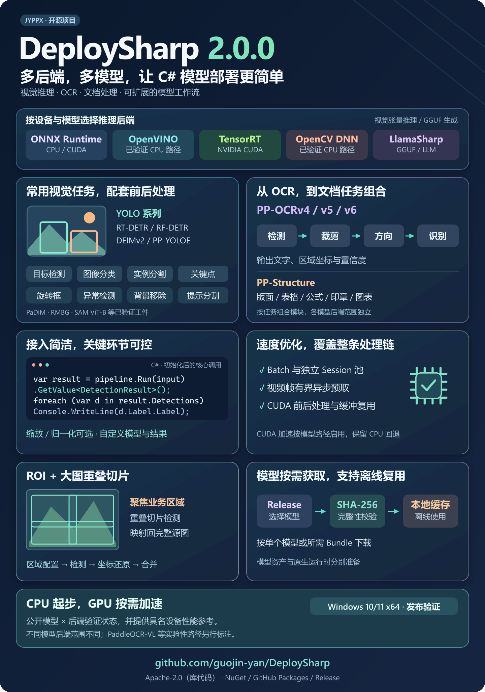
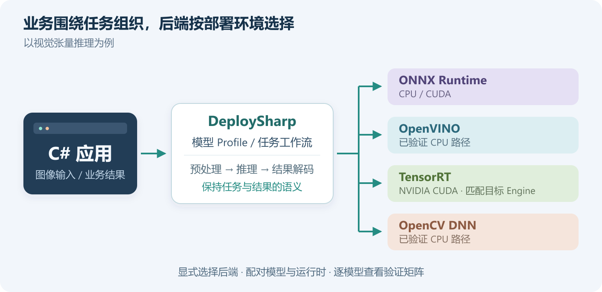
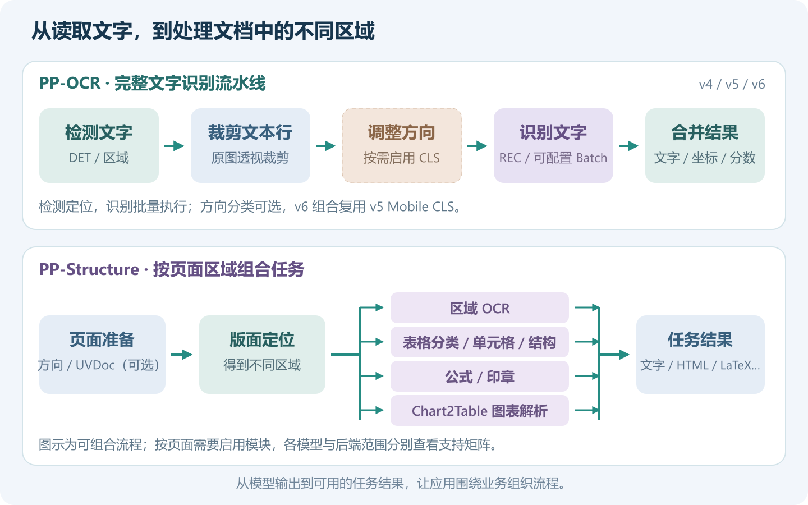
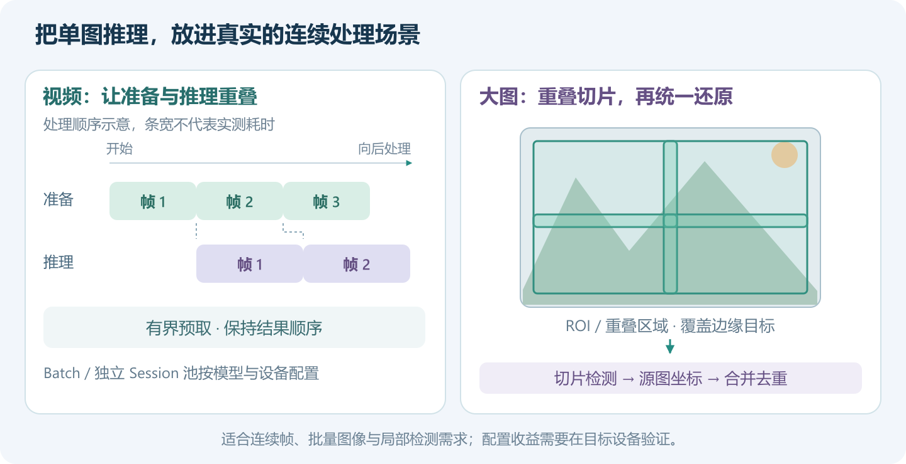

# DeploySharp 2.0.0 正式发布：多后端、多模型，让 C# 模型部署更简单

> DeploySharp 2.0.0 系列 · 第 01 篇发布总览。基于源码 Tag `v2.0.0`，创建与修订：2026-10-28。



在 C# 应用里用上一个模型，通常要同时处理图像、推理引擎、输出解析和部署环境。模型多起来以后，分类、检测、OCR 又各有一套处理方式。

**DeploySharp 2.0.0 正式发布了。** 这一版把常用模型的前后处理、可替换的推理后端，以及批量、视频和文档流程整理为可组合的 .NET 类库。希望让开发者更容易把模型接进自己的桌面软件、工业视觉和文档处理应用。

先看这个版本最值得关注的几个特点。

## 1. 多后端：根据设备选引擎，让业务围绕任务展开

同一个视觉任务，可以根据模型和部署环境选择 ONNX Runtime、OpenVINO、TensorRT 或 OpenCV DNN。应用侧围绕图像与任务结果组织代码，模型执行交给显式选择的后端。



- **CPU 起步方便：**可以先跑通检测或 OCR，再评估目标设备上的加速方案。
- **GPU 路径可选：**支持已验证模型的 ONNX Runtime CUDA、TensorRT，以及相应的 CUDA 视觉处理路径。
- **依赖按需组合：**图像适配器与推理后端分开选择，例如 OpenCV 负责读图、ONNX Runtime 负责推理。

本地语言模型另有 LlamaSharp 适配器，当前已验证 Qwen2.5 GGUF 的 CPU 生成路径。它与图中的视觉张量推理属于不同任务入口。

各模型的后端范围分别记录，选型时可以直接查看[验证矩阵](../../../model-backend-verification-matrix.md)。

## 2. 多模型：从常用视觉任务，延伸到 OCR 和文档处理

模型部署的工作量，常常集中在模型前后的处理。DeploySharp 为已接入模型提供配套的输入准备、输出解码和任务结果，让应用直接处理框、掩码、关键点、文字等信息。

| 你要完成的任务 | 当前已接入的代表模型 |
| --- | --- |
| 目标检测 | YOLOv5/v6/v7/v8/v9/v10、YOLO11/12/13/26 的具体型号；DEIMv2、RF-DETR、PP-YOLOE、RT-DETR |
| 分类、实例分割、关键点、旋转框 | YOLO 的相应任务工件，以及 RF-DETR Segment |
| 工业异常与背景移除 | PaDiM MVTec AD Bottle、BRIA RMBG 1.4/2.0 |
| 文字识别 | PP-OCRv4、v5、v6 的具体 DET/REC 与方向分类组合 |
| 版面、表格与文档区域 | PP-DocLayout、SLANeXt、UVDoc、PP-FormulaNet、UniMERNet、印章检测、PP-Chart2Table 等 |
| 提示分割、图文匹配与描述 | SAM ViT-B、CLIP ViT-B/32、BLIP Caption Base |
| 本地文本生成 | Qwen2.5 0.5B Instruct Q4_K_M |

这张表给出能力地图；精确型号、模型 ID 和状态见[模型支持指南](../../../articles/model-support.md)。同一模型族的不同规模、导出图和后端，仍需要分别确认。

## 3. OCR 与文档：把多个模型组织成能使用的流程

OCR 需要把文字检测、文本行裁剪、方向处理、识别和结果合并串起来。PP-Structure 还会面对页面里的表格、公式、印章和图表。

2.0 提供这些阶段的任务接口与组合流程，并为识别阶段加入 Batch 和独立 Session 调度。



**对普通 OCR，**你可以选择 Mobile、Server，或 v6 的 Tiny/Small/Medium 等具体组合，获得文字、区域坐标和置信度。

**对文档处理，**可以按需要组合页面准备、版面定位和区域任务。仓库已有区域 OCR、有线表格到 HTML 等案例，后续文章会展开完整过程。

当前 v6 OCR 组合复用 v5 Mobile CLS；文档模块各自的后端范围独立。详情见 [PaddleOCR](../../../articles/visual-ocr.md) 与 [PP-Structure 教程](../../../articles/visual-paddle-structure.md)。

## 4. 接入更直接，关键处理仍然由你控制

完成模型 Profile 和后端初始化后，核心检测调用可以保持得很短：

```csharp
using var input = new OpenCvVisualInputFactory()
    .CreateFromFile(imagePath, profile.VisualProfile);
var result = pipeline.Run(input).GetValue<DetectionResult>();

foreach (var item in result.Detections)
    Console.WriteLine($"{item.Label.Label}: {item.Label.Score:F3}");
```

这里的 `profile` 描述模型输入输出，`pipeline` 持有对应推理流程。片段展示的是初始化后的调用；包安装、模型下载、初始化和结果绘制会放到下一篇完整教程中。上述路径已经使用正式版 NuGet 包实际运行，[YOLOv8n 检测结果](assets/01-release-overview/yolov8n-cpu-result.jpg)可以直接查看。

对于自己的模型，接入方式也保留了选择：

| 实际需求 | 可以配置或扩展的部分 |
| --- | --- |
| 模型训练时使用了不同缩放方式 | Resize / Letterbox / CenterCrop |
| 输入颜色、归一化不同 | 通道顺序、布局、均值与缩放等预处理选项 |
| 输出结构或业务结果不同 | 自定义 decoder、前处理和结果类型 |

常用模型直接使用配套处理，自有模型沿用同一套工作流扩展。完整接入方式见[自定义模型指南](../../../articles/visual-custom-model.md)。

## 5. 面向连续帧与大图：把性能优化放进处理流程

真实应用还会遇到视频帧、批量图片和大尺寸图像。2.0 在这些场景中提供了相应的组织方式：



**批量与视频：**模型支持时使用真 Batch；多个任务可以通过独立 Session 池调度。视频帧支持有界异步预取，让后续帧准备与当前帧推理重叠，并保持结果顺序。

**ROI 与大图：**配置矩形、多边形等业务区域，或使用重叠滑动窗口检测大图，之后统一还原坐标、合并重复结果。

**TensorRT CUDA：**支持的路径可以在 GPU 上执行图像缩放、归一化和部分后处理，复用缓冲与 Stream，减少中间数据传输；其他处理保留 CPU 回退。

这些设计为应用留下了吞吐优化空间。实际收益取决于模型、输入和设备，可以参考[具名设备实测](../../../articles/device-performance-benchmarks.md)，再按目标环境选择 Batch、通道与预取配置。

## 6. 模型按需下载，也方便离线复用

公开模型已经按视觉、PaddleOCR、GGUF 等集合整理到 GitHub Release。可以选择单个模型或所需 Bundle，不必为了一个轻量模型下载整个集合。

ModelFactory 与专用下载器负责模型选择、大小和 SHA-256 校验、本地缓存与离线复用。模型、字典和 tokenizer 按配套清单获取，应用再准备所选后端的原生运行时。

完整流程见[模型获取教程](../../../articles/modelfactory-getting-started.md)与[安装组合](../../../articles/package-combinations.md)。

## 7. 从哪里开始，接下来会讲什么

2.0.0 已发布到 **NuGet.org、GitHub Packages 和 GitHub Release**，按实际任务选择需要的包即可。

| 你目前的目标 | 建议入口 |
| --- | --- |
| 先看项目全貌 | [中文 README](../../../../README_cn.md)、[2.0.0 版本说明](../../../releases/2.0.0.md) |
| 尽快跑通一个模型 | [使用教程](../../../articles/usage-tutorial.md)、[模型案例](../../../../samples/README.md) |
| 选择模型和后端 | [模型指南](../../../articles/model-support.md)、[验证矩阵](../../../model-backend-verification-matrix.md) |
| 从旧版本迁移 | [V1 迁移指南](../../../articles/v1-model-migration.md) |

后续系列先讲 **YOLOv8 完整部署、PaddleOCR 流水线、多后端与离线部署**，再展开 PP-Structure、自定义模型、并发、ROI、大图切片和 CUDA 优化。每篇围绕一个完整场景展开，主稿持续归档到[系列目录](../README.md)。

> 当前正式版主要验证 Windows 10/11 x64；模型与后端范围以矩阵为准。V2 是新的 API 设计，V1 需要迁移，Alpha 应用升级后需要重新编译。PaddleOCR-VL 等实验性路径单独标注。

如果你正在为 C# 软件加入模型能力，欢迎试用，也欢迎带着实际模型、设备和需求来交流。

**项目地址：**[github.com/guojin-yan/DeploySharp](https://github.com/guojin-yan/DeploySharp)

**获取版本：**[NuGet](https://www.nuget.org/packages/JYPPX.DeploySharp.Core/2.0.0) · [2.0.0 Release](https://github.com/guojin-yan/DeploySharp/releases/tag/v2.0.0) · [问题反馈](https://github.com/guojin-yan/DeploySharp/issues)

DeploySharp 库代码采用 Apache License 2.0，第三方库与模型遵循各自许可。AI 辅助开发说明、软件声明及联系方式见项目 README。
