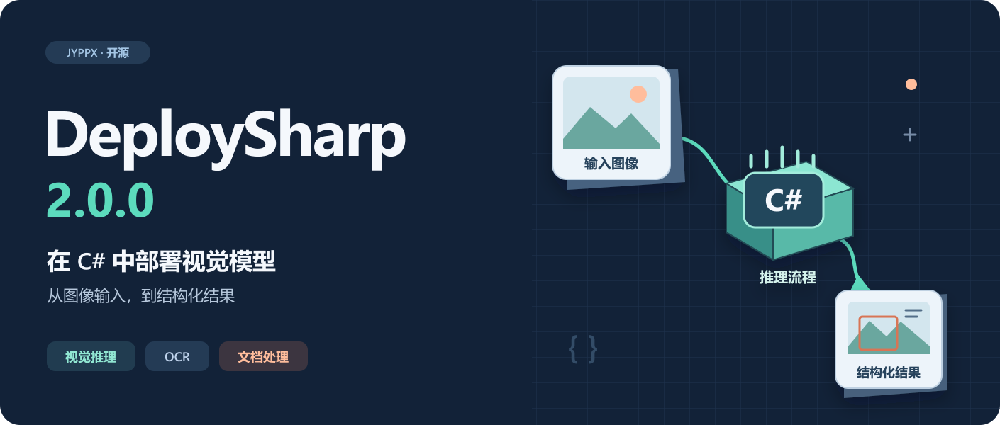

# DeploySharp 2.0.0 正式发布：在 C# 中部署视觉模型、OCR 与文档处理流程

> 基于 DeploySharp 2.0.0，源码 Tag：`v2.0.0`。创建与修订：2026-10-28。本文是系列第 01 篇。



DeploySharp 2.0.0 正式发布了。

这个版本面向使用 C#/.NET 开发桌面软件、工业视觉和模型部署应用的开发者，提供从图像准备、模型执行到结果解析的工作流，同时支持按需选择推理后端、下载模型和复用离线缓存。2.0.0 已经发布到 NuGet.org、GitHub Packages 和 GitHub Release，可以直接在自己的项目中引用。

做模型部署时，调用一次推理接口往往只是其中一步。图片应该保持比例补边，还是直接缩放？输出张量里的数值怎样变成框、掩码或文字？一张图检测出多行文本后，识别阶段如何批量执行？换到另一台电脑，又应该准备哪些原生库和模型文件？这些工程问题都会影响最终的正确性、速度和维护成本。

这次我把重点放在这些实际使用环节上。本文先介绍 2.0.0 的能力和使用边界，再用已发布的 NuGet 包完成一次 YOLOv8n CPU 检测。后续文章会分别展开 PaddleOCR、文档处理、自定义模型、并发调度、ROI 和 TensorRT 优化。

本版本的主要发布验证平台是 **Windows 10/11 x64**。模型和后端的支持状态分别记录，选择模型时需要同时查看对应工件与后端，不能仅凭模型名称判断是否可运行。

## 1. DeploySharp 是什么，2.0 为什么重新设计

DeploySharp 是一个面向 .NET 应用的模块化模型部署工具。应用选择模型和运行时，DeploySharp 提供统一的模型描述、输入输出、推理会话，以及视觉等任务的处理流程。

例如，目标检测的工作过程可以写成：

```text
图片 → 解码与缩放 → 通道和归一化 → 推理后端
     → 输出解码与 NMS → 还原源图坐标 → 框、类别和分数
```

不同模型的输入输出并不相同。即使都叫 YOLO，不同导出方式也可能包含不同的输出布局、是否内置 NMS、是否支持动态 Batch 等差异。2.0 用 Profile 描述一个具体模型的这些约定，让前处理、后处理和模型文件配套使用；后端 Session 则负责执行模型。

这种划分也保留了扩展空间。使用内置模型时，可以选择已有 Profile；接入自有模型时，可以定义输入、前处理、解码器和自己的结果类型。图像读取也不是 Core 的强制依赖，应用可以使用 OpenCV 适配器，或准备好张量后直接交给推理后端。

2.0.0 是 **V2 的首个正式版本**，项目此前已有 V1 和预览版本。V2 重新设计了 API 和包结构，因此升级需要迁移调用代码，不提供与 V1 的源码、二进制或配置兼容层。

## 2. 2.0.0 主要提供了哪些能力

这一版的核心变化可以按实际开发任务理解：

| 开发任务 | 2.0.0 提供的能力 | 对应用的作用 |
| --- | --- | --- |
| 执行模型 | 命名张量、明确的元素类型和 Shape、Session、取消与释放 | 将模型输入输出和执行资源管理放在明确的接口中 |
| 完成视觉任务 | 分类、检测、实例分割、关键点、旋转框、异常检测、背景移除等 | 获得任务结果，而不必在每个应用里重复解析张量 |
| 调整前后处理 | Resize、Letterbox、CenterCrop，颜色顺序、归一化与自定义 decoder | 适配实际训练和导出方式，接入自己的模型 |
| 运行 OCR 和文档流程 | PP-OCRv4/v5/v6 流水线，PP-Structure 任务与页面组合接口 | 组合检测、裁剪、方向、识别，以及区域和表格任务 |
| 批量与视频处理 | 真 Batch 的适配入口、独立 Session 池、有界异步预取 | 根据模型和设备选择延迟、吞吐与内存之间的配置 |
| 处理局部区域和大图 | ROI 配置与执行、坐标回映射、滑动窗口和结果合并 | 聚焦业务区域，或将大图拆成重叠切片检测 |
| 获取和部署模型 | ModelPack、ModelFactory、按需下载、大小和 SHA-256 校验、离线缓存 | 让模型、清单与应用使用的版本保持一致 |

### 2.1 OCR 从单个模型扩展为完整流程

常见的 OCR 流程包含多个阶段：先检测文字区域，再从原图裁剪文本行，按需要调整方向，最后识别并合并文字与坐标。2.0 为这条流程提供了组织和调度接口，并可以针对识别阶段配置 Batch 和多个独立推理 Session。

目前已接入 PP-OCRv4、v5、v6 的具体 DET/REC 模型和对应方向分类组合。需要注意，当前 v6 组合使用的是 v5 Mobile CLS，不存在一个可以从版本号推断出来的独立 v6 CLS。

PP-Structure 则面向页面中的不同区域：文档方向、UVDoc 矫正、版面检测、表格分类、单元格检测、表格结构、公式、印章文本检测和图表转表格。仓库提供了有线表格到 HTML、区域 OCR 等组合案例。每个模块的后端范围不同，页面编排接口也需要应用结合文档类型进行配置。

### 2.2 预处理可配置，也允许接入自定义结果

YOLO 检测的标准 Profile 默认使用保持比例的 Letterbox、RGB、NCHW、Float32 和除以 255 的归一化。应用可以显式改成直接 Resize 或 CenterCrop，也可以调整归一化、通道顺序和布局。

这些配置必须与训练和导出预期相符。改变缩放方式会改变图像内容与目标比例，改变归一化也会改变模型看到的数值分布。库会保存实际使用的图像变换，用于将检测等结果还原到源图；应用不需要再手动重复缩放坐标。

自定义模型可以使用 `VisualModelDefinitionBuilder` 等入口组织前处理和解码，返回业务需要的结果类型。内置模型和用户自有模型可以沿用同一套 Session、诊断和资源管理方式。具体接入会在后续专题中给出完整案例，也可以先阅读[自定义模型教程](../../../articles/visual-custom-model.md)。

### 2.3 批量、异步与区域处理服务于实际应用

批量图片、相机流和大图检测需要不同的调度方式。模型真 Batch 指一次输入多张图组成的张量；Session 池则创建多个独立推理实例，供并发任务调度。两者都需要考虑模型支持范围和设备内存，增加通道数并不保证一定更快。

视频处理可以使用有界预取，在当前帧推理期间准备后续帧，减少阶段之间的空等。ROI 可以保存矩形、旋转框、多边形或 Mask 区域配置，执行局部任务并回映射到源图。滑动窗口则将大图分成有重叠的切片，完成检测后进行坐标合并与跨窗口去重。

这些能力的使用方式和所有权要求，分别见[Batch 与 Session 并发指南](../../../articles/batch-session-concurrency.md)、[异步与滑动窗口教程](../../../articles/visual-async-and-sliding-window.md)和 [ROI 教程](../../../articles/visual-roi-configuration.md)。

## 3. 当前可以选择哪些模型和后端

下面列出已经有具体模型资产和运行证据的主要任务。表中的型号是实际工件，不代表同一模型族的每一种规模和导出方式都已验证。

| 任务 | 已验证模型举例 |
| --- | --- |
| 目标检测 | YOLOv5n、YOLOv6s、YOLOv7、YOLOv8n、YOLOv9s、YOLOv10n、YOLO11n、YOLO12n、YOLOv13n、YOLO26n；DEIMv2、PP-YOLOE Plus CRN-L、RF-DETR、Paddle RT-DETR R50vd |
| 图像分类 | YOLOv8s Classification |
| 实例分割 | YOLOv5s、YOLOv8n、YOLOv9c、YOLO11s、YOLO26s Segmentation；RF-DETR Segment |
| 关键点与旋转框 | YOLOv8s、YOLO11s、YOLO26s 的 Pose 和 Oriented Detection 工件 |
| OCR | PP-OCRv4 Mobile/Server、PP-OCRv5 Mobile/Server、PP-OCRv6 Tiny/Small/Medium 的具体检测与识别组合 |
| 文档处理 | PP-DocLayout、PicoDet/RT-DETR 版面模型、SLANeXt、UVDoc、PP-FormulaNet、UniMERNet、印章检测、PP-Chart2Table 等具体工件 |
| 工业异常与背景移除 | Anomalib PaDiM MVTec AD Bottle；BRIA RMBG 1.4、2.0 |
| 提示分割与视觉语言 | Meta SAM ViT-B；OpenAI CLIP ViT-B/32；Salesforce BLIP Caption Base |
| 本地语言模型 | Qwen2.5 0.5B Instruct Q4_K_M，已验证 LlamaSharp CPU 路径 |

完整名称、模型 ID 和未来方向集中维护在[模型支持指南](../../../articles/model-support.md)。下载模型前，再查看[模型与后端验证矩阵](../../../model-backend-verification-matrix.md)：`✓` 表示对应工件完成了真实推理和结果解码，`△` 表示局部证据，`✗` 表示已测组合不能完成，`—` 表示未测试或不适用。

推理后端按任务选择，当前使用起点如下：

| 后端 | 主要用途与已验证路径 | 部署时关注什么 |
| --- | --- | --- |
| ONNX Runtime | ONNX 模型；CPU 路径，以及具名 CUDA 环境 | CPU/GPU 包和 Provider 版本，CUDA/cuDNN 与驱动匹配 |
| OpenVINO | 已验证工件的 CPU 推理 | 托管 API 与原生 runtime，原图或派生兼容图的身份 |
| OpenCV DNN | 导入器支持的视觉模型 CPU 推理 | OpenCV 托管/原生库版本、算子及动态 Shape 限制 |
| TensorRT | 已验证模型的 NVIDIA CUDA 推理 | 目标 GPU、运行时、Engine、精度和 Shape Profile |
| LlamaSharp | 已验证 GGUF 的 CPU 生成 | GGUF、原生后端、上下文及资源生命周期 |

2.0.0 共发布 14 个 DeploySharp NuGet 包，应用按需组合即可。`Visual.OpenCV` 负责图像准备，`Backend.OpenCV` 负责 OpenCV DNN 执行；所以使用 OpenCV 读图、ONNX Runtime 推理也是正常组合。TensorRT 的视觉 CUDA 流程和通用执行后端也分别提供包。具体安装组合见[包组合指南](../../../articles/package-combinations.md)。

## 4. 从 NuGet 完成一次 YOLOv8n 检测

先走一条不需要 NVIDIA GPU 的路径：使用 ONNX Runtime CPU 执行 YOLOv8n，OpenCV 负责读图、预处理和保存可视化结果。下面的命令和完整 `Program.cs` 已使用公开的 2.0.0 包实际运行。

### 4.1 环境和包安装

本例环境为 Windows x64、.NET 8。安装 .NET 8 SDK 或支持该目标框架的较新 SDK，然后在 PowerShell 中创建控制台项目：

```powershell
dotnet new console -n DeploySharpReleaseDemo --framework net8.0
cd DeploySharpReleaseDemo
dotnet add package JYPPX.DeploySharp.Visual.OpenCV --version 2.0.0
dotnet add package JYPPX.DeploySharp.Backend.OnnxRuntime --version 2.0.0
dotnet add package Microsoft.ML.OnnxRuntime --version 1.28.0
dotnet add package JYPPX.OpenCV.runtime.win-x64 --version 5.0.0
```

`Visual.OpenCV` 会传递引用本例需要的 Visual、Core 和 OpenCV 托管 API；ONNX Runtime 与 OpenCV 的 Windows 原生组件由上面对应的运行时包提供。本例没有安装 OpenCV DNN 后端，也不需要 CUDA。

如果原生库加载失败，先确认进程是 x64、NuGet 原生文件已复制，并检查 Windows 的 Microsoft Visual C++ x64 运行库。不同机器的环境问题应先通过最小 CPU 示例定位，再增加 GPU 后端。

### 4.2 下载配套模型和测试图片

在刚创建的项目目录运行：

```powershell
New-Item -ItemType Directory -Path models,images -Force | Out-Null
Invoke-WebRequest 'https://github.com/guojin-yan/DeploySharp/releases/download/models-visual.1/yolo-v8-detect-n.model.onnx' -OutFile 'models/yolov8n.onnx'
Invoke-WebRequest 'https://github.com/guojin-yan/DeploySharp/releases/download/test-assets.1/bus.jpg' -OutFile 'images/bus.jpg'

$expectedHashes = @{
    'models/yolov8n.onnx' = '50e299e848bb2586ca7fc5bfebd42eda43d43566cbb9a3ed7a3375243b0dbdf4'
    'images/bus.jpg' = '33b198a1d2839bb9ac4c65d61f9e852196793cae9a0781360859425f6022b69c'
}
foreach ($assetPath in $expectedHashes.Keys) {
    if ((Get-FileHash -LiteralPath $assetPath -Algorithm SHA256).Hash -ne $expectedHashes[$assetPath]) {
        throw "文件校验失败：$assetPath"
    }
}
```

这里固定了模型与图片的 SHA-256，便于以后复现同一个结果。模型对应输入 `images`、`[1,3,640,640]`，输出 `output0`、`[1,84,N]`，采用 COCO 80 类标签和 ONNX opset 19。代码中的导出版本、源码修订与模型哈希来自该工件的 [ModelPack 清单](https://github.com/guojin-yan/DeploySharp/releases/download/models-visual.1/yolo-v8-detect-n.modelpack.json)，不能直接套用到任意同名模型。

应用需要自动选择和缓存模型时，可以进一步使用 ModelFactory；本例直接下载固定工件，让第一次运行的文件和处理过程更容易看清。

### 4.3 编写完整检测代码

将 `Program.cs` 替换为以下内容。前半部分创建模型 Profile、注册 CPU 后端并执行检测；后半部分读取源图，把返回的框、类别和分数画到图片中。

```csharp
using JYPPX.DeploySharp;
using JYPPX.DeploySharp.Backends.OnnxRuntime;
using JYPPX.DeploySharp.Models;
using JYPPX.DeploySharp.Registry;
using JYPPX.DeploySharp.Results.Vision;
using JYPPX.DeploySharp.Visual;
using JYPPX.DeploySharp.Visual.Models.Yolo;
using JYPPX.DeploySharp.Visual.OpenCV;
using JYPPX.OpenCvSharp.Core;
using JYPPX.OpenCvSharp.ImgProc;
using ImageCodecs = JYPPX.OpenCvSharp.ImgCodecs.Cv2;
using Drawing = JYPPX.OpenCvSharp.ImgProc.Cv2;

string modelPath = Path.GetFullPath(Path.Combine("models", "yolov8n.onnx"));
string imagePath = Path.GetFullPath(Path.Combine("images", "bus.jpg"));
var profile = YoloDetectionProfiles.Create(
    YoloDetectionFamily.YoloV8,
    new ModelId("yolo/v8/detect/n"),
    "50e299e848bb2586ca7fc5bfebd42eda43d43566cbb9a3ed7a3375243b0dbdf4",
    YoloLabelSets.Coco80,
    "1367566337fb8056223a1aeb469360747f1b1bcd",
    "8.3.78",
    new YoloDetectionProfileOptions(
        opset: 19,
        decoderOptions: new YoloDetectionDecoderOptions(
            scoreThreshold: 0.25f, iouThreshold: 0.45f)));

using var backends = new BackendRegistry();
backends.UseOnnxRuntime();
var profiles = new VisualProfileRegistry();
profiles.Register(profile.VisualProfile);
profiles.Freeze();
var request = new BackendRequest(
    BackendCapabilities.TensorInference,
    OnnxRuntimeBackendProvider.BackendId, "cpu");
var artifact = profile.CreateArtifact(modelPath);
using var pipeline = new VisualPipeline(
    backends,
    profiles.Select(artifact, backends, request, VisualTaskId.ObjectDetection),
    request);
using PreparedVisualInput input = new OpenCvVisualInputFactory()
    .CreateFromFile(imagePath, profile.VisualProfile);
DetectionResult result = pipeline.Run(input).GetValue<DetectionResult>();

using Mat canvas = ImageCodecs.ImRead(imagePath);
Console.WriteLine($"detections={result.Detections.Count}");
foreach (Detection item in result.Detections)
{
    var box = item.Box;
    string label = FormattableString.Invariant($"{item.Label.Label} {item.Label.Score:F3}");
    Console.WriteLine(FormattableString.Invariant(
        $"{label} box=({box.X:F1},{box.Y:F1},{box.Width:F1},{box.Height:F1})"));
    var topLeft = new Point((int)box.X, (int)box.Y);
    var bottomRight = new Point((int)box.Right, (int)box.Bottom);
    Size textSize = Drawing.GetTextSize(label, HersheyFonts.HersheySimplex, 0.8, 2, out _);
    var caption = new Point(
        Math.Clamp(topLeft.X, 3, Math.Max(3, canvas.Cols - textSize.Width - 16)),
        Math.Max(textSize.Height + 4, topLeft.Y - 8));
    Drawing.Rectangle(canvas, topLeft, bottomRight, new Scalar(80, 210, 30), 3);
    Drawing.PutText(canvas, label, caption, HersheyFonts.HersheySimplex,
        0.8, new Scalar(20, 20, 20), 5);
    Drawing.PutText(canvas, label, caption, HersheyFonts.HersheySimplex,
        0.8, new Scalar(255, 255, 255), 2);
}
if (!ImageCodecs.ImWrite("result.jpg", canvas))
    throw new IOException("Could not write result.jpg.");
Console.WriteLine("saved=result.jpg");
```

`CreateFromFile` 根据 Profile 完成 640×640 Letterbox、RGB 转换、NCHW 排列和归一化，并保存图像变换。Decoder 对输出执行分数过滤与按类别 NMS，返回的 `Box` 已经处于源图坐标系。`box=(x,y,width,height)` 表示左上角与宽高，不是两个角点。

`Path.GetFullPath` 将项目内的相对路径转换成图像输入接口要求的绝对路径，不需要写死作者机器目录。`using` 管理输入、推理流水线、后端注册表和绘图 Mat；流水线释放自己创建的 Session，注册表由应用单独释放。

### 4.4 运行并查看真实结果

在项目目录运行：

```powershell
dotnet run -c Release -p:PlatformTarget=x64
```

2026-10-28，我在 Windows x64 `10.0.26200`、AMD Ryzen 7 5800H、.NET 8.0.31 环境，用上面的 NuGet 版本和公开下载文件完成了实际运行。CPU 检测输出如下，未启用 CUDA：

```text
detections=5
person 0.901 box=(671.0,378.0,139.0,501.8)
person 0.884 box=(221.4,407.6,122.1,448.2)
person 0.876 box=(50.4,398.1,193.7,506.7)
bus 0.842 box=(34.3,229.3,761.2,539.2)
person 0.436 box=(0.4,550.6,59.9,317.4)
saved=result.jpg
```

生成的 `result.jpg` 如下。这张图是正文代码的真实输出，展示了从模型加载、图像准备到结果解码、源图绘制的完整路径。


不同运行时可能产生少量浮点差异。这里的单张图片验证用于确认部署链路和坐标处理，不代表数据集准确率评测，也没有用单次运行时间作为性能结论。

## 5. 如何理解当前的验证与性能数据

正式发布的源码 Tag 为 `v2.0.0`，对应提交 `f07ed7f7d7e2e53ccb443e1517f34ebfc4f743c6`。[发布工作流](https://github.com/guojin-yan/DeploySharp/actions/runs/40619151530)中的不依赖外部模型的测试记录为 1141 项通过、66 项跳过、0 项失败，并完成文档构建、包与 API 检查。它说明发布检查的结果，具体模型能否在某个后端运行，还需要读取真实模型验证矩阵。

性能同样需要先看测量范围。一次 Session 执行时间、复用输入的流水线时间、从读文件开始的端到端时间，包含的工作量不同。下面摘录开发期的 **PaddleOCR 历史实测参考**，用于说明已有优化和调度配置；这些数值没有在本文用新发布的 2.0.0 NuGet 包重新测量，不能直接标成发布包的正式基准。

设备为 Ryzen 7 5800H、RTX 3060 Laptop 6 GiB，驱动 `576.02`，CUDA 12.9、cuDNN 9.22，Engine 在目标设备以 TensorRT 10.11 重建。固定 OCR 输入产生 16 个文本区域，5 次预热、50 次测量；识别 Batch 为 8、两个独立阶段 Session。计时复用已准备的输入，覆盖检测、裁剪、方向、识别和合并，不包含模型下载、Engine 构建或原图文件读取与解码。GPU 未主动锁频。

| OCR 组合 | 流水线 P50（ms） | 流水线 P95（ms） |
| --- | ---: | ---: |
| PP-OCRv4 Mobile | 29.775 | 34.304 |
| PP-OCRv5 Mobile | 46.474 | 55.036 |
| PP-OCRv6 Tiny | 16.743 | 18.399 |
| PP-OCRv6 Small | 27.311 | 36.788 |

P50 是这些样本的中位数，P95 表示约 95% 样本不超过的耗时。这些结果反映的是指定模型、输入和调度组合；文本行数量、长文本比例、输入尺寸、设备状态都会改变实际延迟。各阶段的 P50/P95 也不能直接相加得到总流水线分位数。

原有汇总见[设备性能实测](../../../articles/device-performance-benchmarks.md)。其中缺少完整提交或精度身份的旧行应作为历史参考阅读；需要做设备选型或版本对比时，应固定模型和输入哈希、精度、运行时、计时范围，再在目标设备统一复测。后续性能专题会集中说明这些条件，不把不同测量口径的数字混在一起排名。

## 6. V1 和预览版用户怎样升级

对于新项目，可以按任务直接引用 2.0.0。对于已有应用，建议先选择一个代表模型迁移，确认输入、输出和坐标一致后，再切换批量、视频或文档流程。

| 当前应用 | 升级时需要做的事情 |
| --- | --- |
| DeploySharp V1 | 按 V2 的模型 Profile、后端 Session 和任务结果重新接入；旧类型、配置与调用代码不能直接沿用 |
| 2.0.0-alpha.1 | 将使用的 DeploySharp 包一起升级到 2.0.0，并重新编译应用；部分构造函数和图像输入接口签名已变化 |
| 自定义模型/输入 | 复核张量名称和 Shape、前处理、decoder、自定义 OCR 图像输入合同以及资源所有权 |
| TensorRT 应用 | 检查运行时和桥接库，在目标 GPU 上准备匹配的 Engine 与动态 Shape Profile |

所有 DeploySharp 包应保持同一版本。NuGet 能还原某个目标框架，表示存在对应程序集资产，不代表原生运行时、模型和功能范围完全一致。例如 Visual 的 `net46`/`net461` 不包含 ROI 和滑动窗口；TensorRT 两个包目前提供 `net8.0` 资产。新应用可以优先评估 .NET 10，需要兼容现有环境时使用 .NET 8；本文采用后者进行验证。

迁移步骤见 [V1 迁移指南](../../../articles/v1-model-migration.md)，目标框架和原生依赖见[平台与后端支持](../../../articles/platform-support.md)。

## 7. 当前边界与接下来的系列文章

正式版仍保留具体使用范围。OpenCV DNN 存在导入器、算子和动态 Shape 限制；SLANeXt 的 OpenVINO 路径使用单独的派生兼容图，TensorRT 当前不支持。无线表格案例在单元格对齐不可靠时会跳过逐格 OCR，需要应用检查结果状态。

公式和 Chart2Table 已有生成、终止和解析路径，但这些执行证据不能替代公式语义或图表数据集准确率评测。PaddleOCR-VL 1.6 保持实验性。SAM2/SAM3 原生视频、Whisper 完整公共 Bundle、Donut 多页，以及部分更大的视觉语言模型路径，也不作为本次稳定、完整的多后端能力承诺。

模型下载也需要保持文件配套。PP-OCRv5 的 ModelFactory 主目录使用 `models-visual.1`，完整 OCR/PP-Structure 集合使用 `models-paddleocr`；两套目录的部分 Server 权重不同，应使用同一次获取返回的模型和清单。TensorRT Engine 则与设备、运行时和输入 Profile 绑定，换设备时需要重新构建或验证。

后续文章会先完成三个上手入口：YOLOv8 检测详解、PaddleOCR 完整流水线、多后端与离线部署；再展开视觉多任务、PP-Structure、自定义模型、并发、ROI、大图切片和 CUDA 优化。各篇以一个能实际运行并得到结果的场景组织，主稿和配图在[2.0.0 系列目录](../README.md)持续归档。

## 8. 项目入口与反馈

如果你正在给 C# 应用加入视觉检测、OCR 或文档处理，可以先运行本文的 CPU 案例，确认模型、图像和结果路径，再选择目标设备上的后端。已有项目则可以从一个实际使用的模型开始迁移，避免同时改变模型、运行时和处理方式而难以定位差异。

- [GitHub 项目](https://github.com/guojin-yan/DeploySharp)与[中文 README](../../../../README_cn.md)
- [2.0.0 正式 Release](https://github.com/guojin-yan/DeploySharp/releases/tag/v2.0.0)与[完整版本说明](../../../releases/2.0.0.md)
- [NuGet 包入口](https://www.nuget.org/packages/JYPPX.DeploySharp.Core/2.0.0)与[安装组合](../../../articles/package-combinations.md)
- [使用教程](../../../articles/usage-tutorial.md)、[完整示例](../../../../samples/README.md)与[模型支持指南](../../../articles/model-support.md)
- [GitHub Issues](https://github.com/guojin-yan/DeploySharp/issues)

DeploySharp 自身代码采用 Apache License 2.0；第三方库和模型遵循各自的许可。项目使用了 AI 辅助开发，软件声明和联系方式见项目 README。欢迎大家试用、反馈问题或参与完善；提交问题时请附上包版本、操作系统、后端运行时、精确模型和最小复现代码，方便定位到实际部署环节。
