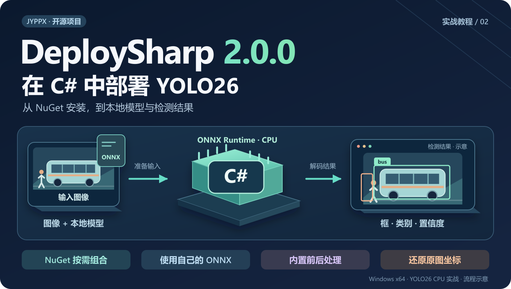
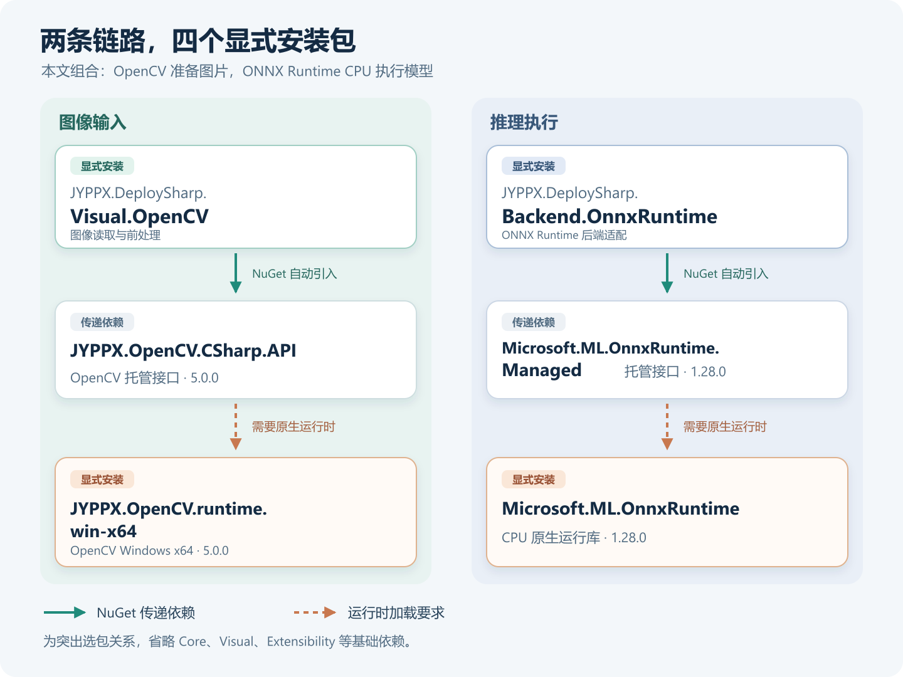
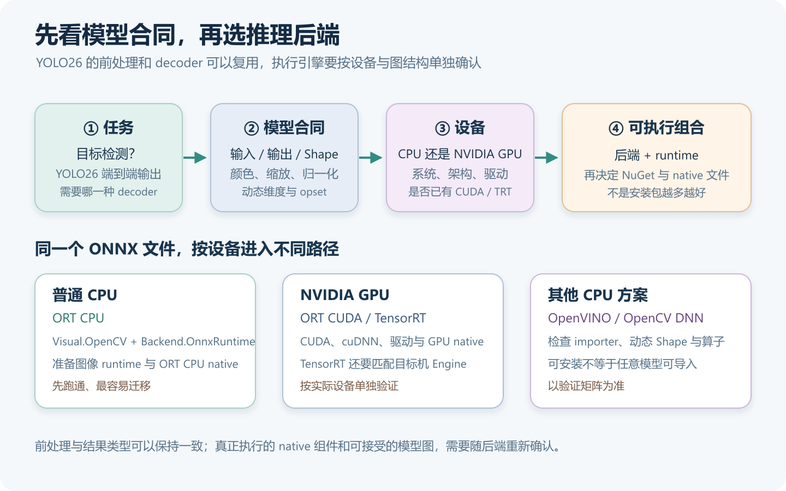
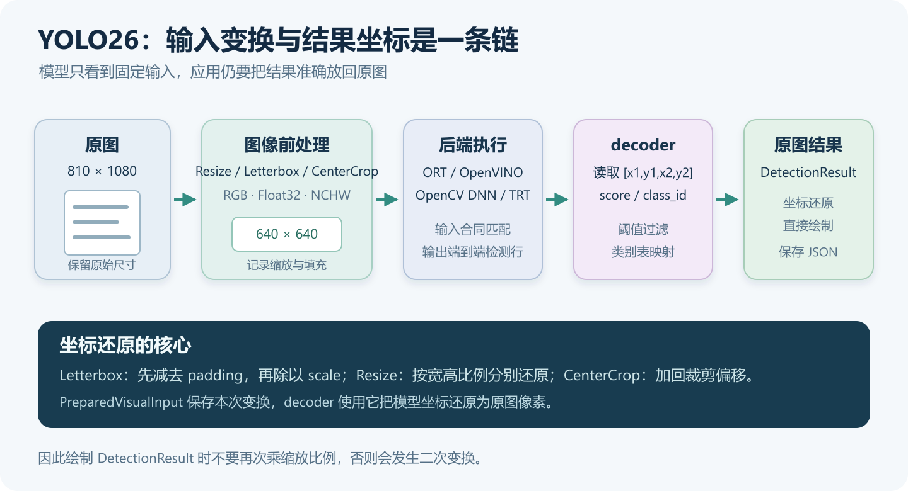
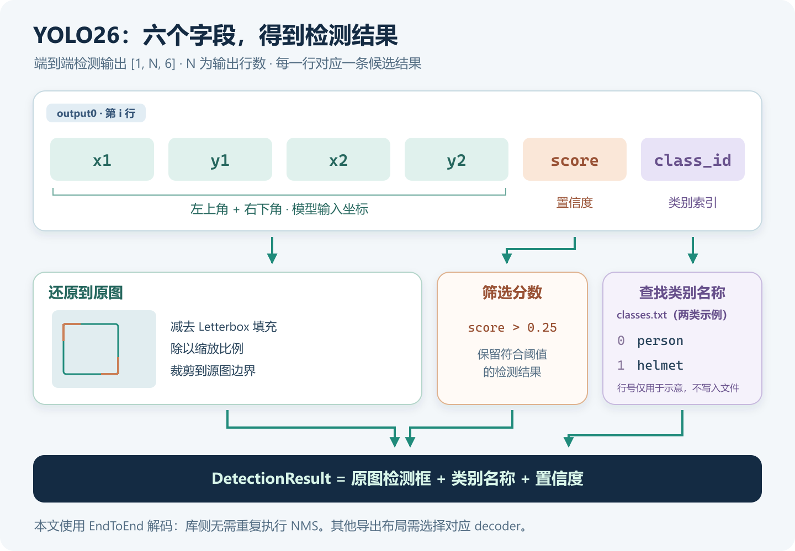
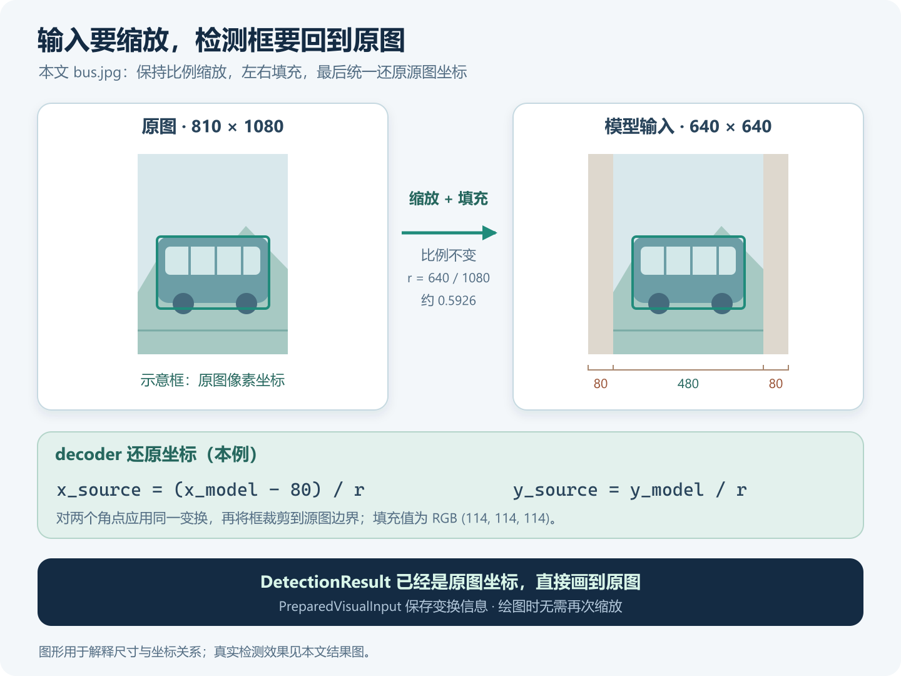
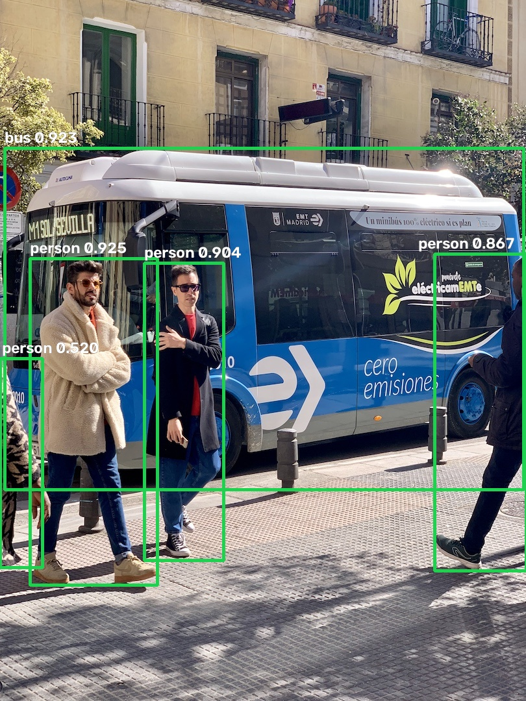
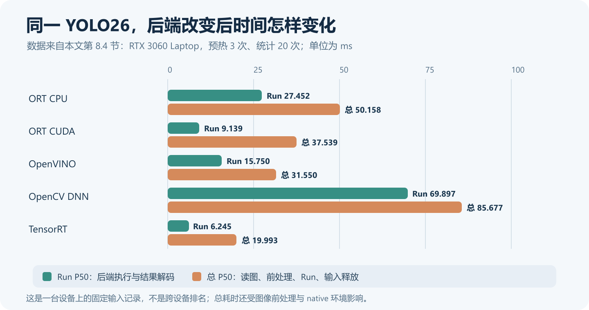

# 在 C# 中使用 DeploySharp 部署 YOLO26：从 NuGet 安装到检测结果

> DeploySharp 2.0.0 系列 · 第 02 篇实战教程。基于正式版 NuGet `2.0.0`、源码 Tag `v2.0.0`，创建与修订：2026-10-28。



## 一、DeploySharp 项目简介

**DeploySharp** 是一个面向 **C#/.NET 开发者**的开源模型部署框架，由「椒颜皮皮虾」开发，项目源码遵循 **Apache License 2.0**。它基于 **ONNX Runtime、OpenVINO、TensorRT、OpenCV DNN** 等推理引擎，提供模型加载、图像前处理、推理执行和结果后处理接口，方便大家在桌面软件、工业视觉和文档应用中接入模型。

目前，项目已接入 YOLO 等目标检测模型，以及分类、分割、关键点、旋转框、异常检测和背景移除等视觉任务；同时提供 **PP-OCRv4/v5/v6、PP-Structure 文档处理**和部分图文、本地语言模型的使用入口。

常用模型可以直接复用配套前后处理，自有模型可以配置输入规格、类别、缩放与归一化方式，或进一步自定义解码和结果类型。大家可以按任务选择组件，再根据设备选择已经验证的推理后端。

**项目地址：**

```text
https://github.com/guojin-yan/DeploySharp/tree/DeploySharpV2.0
```

**NuGet 包：**在包管理器中搜索 `JYPPX.DeploySharp`，按场景选择所需组件。

```text
https://www.nuget.org/packages?q=JYPPX.DeploySharp
```

当前 2.0.0 正式版主要验证 Windows 10/11 x64。不同模型、后端与组件的支持范围分别记录，可通过仓库中的模型支持指南和验证矩阵查看。

## 二、2.0 新特性与本篇实战

### 2.1 新版本主要带来了什么

DeploySharp 2.0 在模型接入和实际应用流程上做了扩展，主要包括：

| 新版能力 | 在项目中怎样使用 |
| --- | --- |
| 多后端与按需安装 | 图像处理、推理后端和原生运行时分别选择，按模型与设备准备部署组合 |
| 更多视觉、OCR 与文档任务 | 复用已接入模型的前后处理，组合文字检测识别、区域 OCR 和表格等流程 |
| 自定义模型与预处理配置 | 设置输入输出、类别、Resize / Letterbox / CenterCrop、颜色与归一化，接入自己的模型 |
| 批量、视频和区域处理 | 根据模型能力组合 Batch、独立 Session 池、异步预取、ROI 与大图重叠切片 |

支持的 TensorRT 路径还提供 CUDA 前后处理和缓冲复用。各项加速能力按具体模型与任务启用，详细使用方式会在相应专题中展开。

### 2.2 这篇先完成一次 YOLO26 检测

接下来从一个空的 C# 控制台项目开始，使用 **YOLO26n + ONNX Runtime CPU** 完成目标检测，并把类别、置信度和检测框画到原图上。本文选用 YOLO26 的端到端 ONNX 检测输出，直接读取框、分数和类别，再完成筛选与坐标还原。使用正式发布的 NuGet 包即可运行，无需先编译 DeploySharp 源码。

我们会依次完成 **选择 NuGet → 准备模型和图片 → 编写检测代码 → 查看与保存结果**，再演示替换自有模型与类别表。第八节还会在同一台 Windows 设备上切换 ORT CUDA、OpenVINO、OpenCV DNN 和 TensorRT，检查结果与耗时。模型直接从本地路径加载，重点放在输入输出与前后处理配置上。

## 三、准备环境，创建控制台项目

### 3.1 本文使用的环境

我在下面的环境中运行了本文完整代码，使用的是 CPU 推理：

| 项目 | 实际环境 |
| --- | --- |
| 操作系统 | Windows 11 x64，系统版本 `10.0.26200` |
| CPU | AMD Ryzen 7 5800H，8 核 16 线程 |
| .NET | SDK `10.0.401`，运行时 `10.0.12`，目标框架 `net10.0` |
| 应用架构 | `x64` |
| DeploySharp | `2.0.0` |
| ONNX Runtime | CPU `1.28.0` |
| OpenCV | JYPPX 托管包与 Windows x64 runtime 均为 `5.0.0` |
| 模型与输入 | YOLO26n ONNX，输入 `640 × 640`；测试图片 `bus.jpg` |

这条 CPU 路径不需要 NVIDIA 显卡、CUDA 或 TensorRT。准备好 .NET 10 SDK 即可创建工程；Visual Studio 用户也可以新建 .NET 10 控制台应用，再进行后面的包安装。

```text
.NET SDK 下载：
https://dotnet.microsoft.com/download/dotnet/10.0
```

### 3.2 创建项目

打开 PowerShell，在你准备存放案例的目录执行：

```powershell
dotnet new console -n DeploySharpYoloDemo -f net10.0
cd DeploySharpYoloDemo
```

后续安装、下载和运行命令都在 `DeploySharpYoloDemo` 项目目录中执行。已有 WPF、WinForms 或其他 C# 工程，也可以按相同组合添加依赖；先用控制台确认模型与环境，再接入自己的界面更方便排错。

## 四、NuGet 应该装哪些？按部署场景选择

### 4.1 先分清任务组件、后端与原生运行时

DeploySharp 的包按职责划分。选包时可以依次确定：**做什么任务、用哪个推理引擎、在哪个系统和设备上运行。**

| 组件 | 负责什么 | 什么时候需要 |
| --- | --- | --- |
| `JYPPX.DeploySharp.Core` | 模型、张量、会话和结果等基础接口 | 其他任务包会自动引入；直接开发张量推理时可显式引用 |
| `JYPPX.DeploySharp.Visual` | 视觉任务、Profile、解码及 OCR/区域等流程 | 视觉适配器会自动引入 |
| `JYPPX.DeploySharp.Visual.OpenCV` | 读取图像，执行图像前处理并准备视觉输入 | 使用本文这种 OpenCV 图像输入方式 |
| `JYPPX.DeploySharp.Backend.*` | 调用所选推理引擎 | 按实际引擎选择一个或多个后端 |
| 第三方 runtime 包或厂商运行库 | 提供真正执行计算的原生 DLL | 根据后端、操作系统和进程架构准备 |

**`Visual.OpenCV` 负责图像输入，`Backend.OpenCV` 负责 OpenCV DNN 推理。** 即使推理使用 ONNX Runtime，仍然可以使用 `Visual.OpenCV` 读图和前处理。

下图以本文 CPU 组合为例，展示需要显式安装的四个包，以及 NuGet 自动引入的主要托管依赖。实线表示 NuGet 传递依赖，虚线表示执行时需要匹配的原生运行时；基础包依赖在图中省略。



上图解决“这几个包分别做什么”的问题；真正决定后端的顺序还要再往前一步：先看任务和模型合同，再看目标设备。下面的决策图把这条选择路径压缩成一次检查，避免把 CPU、CUDA 和 TensorRT 的 native 文件混装到同一个输出目录。



所有 **DeploySharp 包统一使用 `2.0.0`**。第三方运行时有自己的版本号，不要把它们也改成 `2.0.0`。

### 4.2 场景一：普通 CPU 视觉推理——本文使用这一组

适合先完成 YOLO 检测、分类、分割等已接入模型的 CPU 案例。显式安装下面四个包：

```powershell
dotnet add package JYPPX.DeploySharp.Visual.OpenCV --version 2.0.0
dotnet add package JYPPX.DeploySharp.Backend.OnnxRuntime --version 2.0.0
dotnet add package Microsoft.ML.OnnxRuntime --version 1.28.0
dotnet add package JYPPX.OpenCV.runtime.win-x64 --version 5.0.0
```

| 显式安装的包 | 在本文中的用途 |
| --- | --- |
| `JYPPX.DeploySharp.Visual.OpenCV` | 图像读取、Letterbox、颜色转换、归一化与输入张量准备 |
| `JYPPX.DeploySharp.Backend.OnnxRuntime` | 把 DeploySharp 的推理请求交给 ONNX Runtime |
| `Microsoft.ML.OnnxRuntime` | 提供 ONNX Runtime CPU 原生运行库 |
| `JYPPX.OpenCV.runtime.win-x64` | 提供 OpenCV 读图、图像处理和绘制需要的 Windows x64 原生库 |

`Core`、`Visual`、`Extensibility`、`JYPPX.OpenCV.CSharp.API` 和 `Microsoft.ML.OnnxRuntime.Managed` 等依赖由 NuGet 自动解析，本文无需逐个添加。这里特别区分 **`Microsoft.ML.OnnxRuntime.Managed` 与 CPU runtime 包**：有托管接口，仍需要对应的原生运行库才能真正推理。

**先跟着本文跑通 CPU 时，到这里就完成选包了，可以直接进入第五节。** 下面按场景说明其他组合；第 8.4 节提供 Windows 四种推理引擎、五条执行路径的实际结果与可运行对照工程，更完整的设备和离线部署在后续专题展开。

### 4.3 场景二：NVIDIA 显卡，使用 ONNX Runtime CUDA

适合希望继续使用 ONNX 模型，同时通过 ONNX Runtime CUDA Provider 执行推理的 Windows 应用。

```powershell
dotnet add package JYPPX.DeploySharp.Visual.OpenCV --version 2.0.0
dotnet add package JYPPX.DeploySharp.Backend.OnnxRuntime --version 2.0.0
dotnet add package Microsoft.ML.OnnxRuntime.Gpu.Windows --version 1.28.0
dotnet add package JYPPX.OpenCV.runtime.win-x64 --version 5.0.0
```

这一组选择 GPU runtime。已有 CPU 工程切换时，先移除原来的显式 `Microsoft.ML.OnnxRuntime` 引用，再添加 GPU 包，避免两套原生文件在输出目录中互相覆盖。`Microsoft.ML.OnnxRuntime.Managed` 仍会作为依赖存在。

此外还需要目标显卡驱动，以及 **与该 ONNX Runtime 原生发行包匹配的 CUDA、cuDNN**。GPU 包不会替你安装全部 NVIDIA 环境。正式版适配器依赖 Managed `1.28.0`，原生库也要保持 `1.28.0`。

这里还要区分 **CUDA 主版本**：本次使用的 `Gpu.Windows 1.28.0` NuGet 原生文件依赖 CUDA 13。本机驱动 `576.02` 支持到 CUDA `12.9`，直接使用它会在 `cudaSetDevice` 报错 801；安装 CUDA 13 Toolkit 不能代替更新驱动。

**本机已通过官方同版本 CUDA 12 发行包跑通 ORT CUDA。** 对这类已有 CUDA 12 环境的设备，可以改用 `Microsoft.ML.OnnxRuntime.Managed 1.28.0` 加官方 `onnxruntime-win-x64-gpu_cuda12-1.28.0.zip`，完整部署其中的原生库，不必降级托管包。第 8.4 节提供了下载、发布和运行命令；对照工程会在两种原生来源中只选择一种。

安装完成后，程序还要显式配置 CUDA Provider 和设备请求。直接运行本文的 CPU 初始化代码，使用的仍然是 CPU。环境对应关系可以从官方说明中核对：

```text
https://onnxruntime.ai/docs/execution-providers/CUDA-ExecutionProvider.html
https://github.com/microsoft/onnxruntime/releases/tag/v1.28.0
https://docs.nvidia.com/deploy/cuda-compatibility/minor-version-compatibility.html
```

### 4.4 场景三：使用 OpenVINO 执行视觉推理

适合评估 OpenVINO 在目标 CPU 上的部署效果。当前 DeploySharp 2.0.0 的这个适配器接受 **CPU** 设备；本文不把它写成已经验证 Intel GPU/NPU。使用 OpenCV 准备图片，使用 OpenVINO 执行模型：

```powershell
dotnet add package JYPPX.DeploySharp.Visual.OpenCV --version 2.0.0
dotnet add package JYPPX.DeploySharp.Backend.OpenVINO --version 2.0.0
dotnet add package JYPPX.OpenCV.runtime.win-x64 --version 5.0.0
dotnet add package OpenVINO.runtime.win --version 2026.2.1
```

后端自动引入 `JYPPX.OpenVINO.CSharp.API` 托管接口。OpenCV runtime 与 OpenVINO runtime 分别服务于读图和推理，两者都需要准备。

推理时还需注册 OpenVINO 后端并请求 `CPU`，确认具体模型是否已经在该后端验证。不能仅凭 OpenVINO 官方引擎支持某种设备，就认为当前适配器也已经开放相同入口。

### 4.5 场景四：使用 OpenCV DNN 执行视觉推理

如果应用已经依赖 OpenCV，并且模型在 OpenCV DNN 的 importer 中可用，可以选择下面的组合：

```powershell
dotnet add package JYPPX.DeploySharp.Visual.OpenCV --version 2.0.0
dotnet add package JYPPX.DeploySharp.Backend.OpenCV --version 2.0.0
dotnet add package JYPPX.OpenCV.runtime.win-x64 --version 5.0.0
```

这里的两个 DeploySharp OpenCV 包分别负责图像准备和 DNN 执行，共用匹配的 OpenCV 原生运行时。这条路径无需安装 ONNX Runtime 或 OpenVINO。

OpenCV DNN 对模型算子、动态 Shape 和导出图有自己的限制，具体型号需要查看验证矩阵。**后端包可安装，不代表任意 ONNX 模型都能导入。**

### 4.6 场景五：使用 TensorRT 或 CUDA 视觉加速

TensorRT 的通用推理与视觉 CUDA 处理也分别提供组件。

如果你准备好输入张量，只需要加载 Engine、执行推理或使用 ONNX 转 Engine 接口，可以选择：

```powershell
dotnet add package JYPPX.DeploySharp.Backend.TensorRT --version 2.0.0
```

它会自动引入 `Core` 等基础依赖。采用 CPU 图像准备时，再添加 `Visual.OpenCV` 和匹配的 OpenCV runtime。

如果需要使用支持模型的 **CUDA 图像前处理与相应视觉执行路径**，选择：

```powershell
dotnet add package JYPPX.DeploySharp.Visual.TensorRT --version 2.0.0
dotnet add package JYPPX.DeploySharp.Backend.TensorRT --version 2.0.0
dotnet add package JYPPX.OpenCV.runtime.win-x64 --version 5.0.0
```

`Visual.TensorRT` 会引入 `Visual`、`Visual.OpenCV` 和 TensorRT 后端；上面显式列出后端，是为了把应用选择的引擎写清楚。还需要匹配的 bridge 原生包。仓库使用的一组 bridge 标识如下，安装前应先核对目标机的运行环境：

```powershell
dotnet add package JYPPX.TensorRT.CSharp.API.Runtime.win-x64.trt10.11.cuda12.9.cudnn9.22.Bridge --version 4.0.0
```

**bridge 包提供桥接层，目标机仍要准备兼容的 NVIDIA 驱动、CUDA、cuDNN 和 TensorRT。** 本文四包 CPU 组合不需要这些依赖。

TensorRT 两个 DeploySharp 包发布 `net8.0` 托管资产，本文的 `net10.0` 工程可以引用。模型还需要与目标设备、TensorRT 版本和输入 Shape Profile 匹配的 Engine；可在目标设备转换，不能把某台机器生成的 Engine 当作所有显卡都通用的文件。CUDA 前后处理也按具体模型和任务提供支持。

### 4.7 场景六：应用要自动下载、校验和缓存模型

本文使用手动下载，下载接口并非必装。需要在自己的应用中按模型目录选择工件、校验并缓存时，再添加：

```powershell
dotnet add package JYPPX.DeploySharp.ModelFactory --version 2.0.0
```

`ModelFactory` 自动引入 `ModelPack.Json` 与 `Core`。如果只需要读取自己提供的 ModelPack JSON，不使用目录下载和缓存功能，可以单独引用：

```powershell
dotnet add package JYPPX.DeploySharp.ModelPack.Json --version 2.0.0
```

这些组件负责模型文件的描述和获取，**推理仍需任务包、后端与原生运行时**。模型下载和后端环境安装是两项工作。

### 4.8 其他任务：张量、OCR、LLM 与扩展

下面几种需求可以沿用相同的选择方式：

| 你的需求 | 应该选择什么 |
| --- | --- |
| 自己准备张量，自己解析输出 | `Core` + 一个 `Backend.*` + 对应 runtime；无需为了张量接口安装图像适配器 |
| PP-OCR / PP-Structure | 使用 `Visual` 工作流，按所选后端搭配图像适配器和 runtime；再准备 DET/REC/CLS、字典或其他任务模型；没有需要另装的独立 PaddleOCR NuGet 包 |
| 本地 GGUF 文本生成 | `LLM` + `Backend.LlamaSharp` + 选定的 LLamaSharp 原生后端 + GGUF |
| 多模态任务编排 | 在具体模型和后端组合上加入 `Multimodal`；安装它不会自动完成任意 VLM 的接入 |
| 自己开发插件发现与运行时探测宿主 | 按需直接引用 `Extensibility`，并实现宿主的加载、探测和配置逻辑 |

例如，已验证 Qwen2.5 GGUF 的 CPU 文本生成组合可以这样安装：

```powershell
dotnet add package JYPPX.DeploySharp.LLM --version 2.0.0
dotnet add package JYPPX.DeploySharp.Backend.LlamaSharp --version 2.0.0
dotnet add package LLamaSharp.Backend.Cpu --version 0.27.0
```

模型和推理调用将在相应专题介绍。需要查看完整组合时，可以使用下面的文档地址：

```text
https://github.com/guojin-yan/DeploySharp/blob/DeploySharpV2.0/docs/articles/package-combinations.md
```

## 五、检查工程配置，准备模型和图片

### 5.1 锁定 x64 与依赖版本

回到本文主线，使用第 4.2 节的 **CPU 四包组合**。把项目文件 `DeploySharpYoloDemo.csproj` 检查为下面的配置，其中 `PlatformTarget` 明确设为 `x64`：

```xml
<Project Sdk="Microsoft.NET.Sdk">
  <PropertyGroup>
    <OutputType>Exe</OutputType>
    <TargetFramework>net10.0</TargetFramework>
    <ImplicitUsings>enable</ImplicitUsings>
    <Nullable>enable</Nullable>
    <PlatformTarget>x64</PlatformTarget>
  </PropertyGroup>
  <ItemGroup>
    <PackageReference Include="JYPPX.DeploySharp.Visual.OpenCV" Version="2.0.0" />
    <PackageReference Include="JYPPX.DeploySharp.Backend.OnnxRuntime" Version="2.0.0" />
    <PackageReference Include="Microsoft.ML.OnnxRuntime" Version="1.28.0" />
    <PackageReference Include="JYPPX.OpenCV.runtime.win-x64" Version="5.0.0" />
  </ItemGroup>
</Project>
```

也可以在 Visual Studio 的“管理 NuGet 程序包”中添加同名同版本的包。OpenCV 使用本项目对应的 `JYPPX.OpenCV.*` 包，后面的命名空间是 `JYPPX.OpenCvSharp.*`，请与其他 OpenCvSharp 包区分。

### 5.2 准备模型和测试图片

已有自己的 YOLO26 检测模型和图片，可以直接放入工程，按后面的配置使用。想先复现本文结果，可以在项目目录执行下面的 PowerShell 命令，下载示例模型和测试图片，分别保存到 `models` 和 `images`：

```powershell
New-Item -ItemType Directory -Force -Path .\models, .\images

Invoke-WebRequest `
  -Uri 'https://github.com/guojin-yan/DeploySharp/releases/download/models-visual.1/yolo-v26-detect-n.model.onnx' `
  -OutFile '.\models\yolo26n.onnx'

Invoke-WebRequest `
  -Uri 'https://github.com/guojin-yan/DeploySharp/releases/download/test-assets.1/bus.jpg' `
  -OutFile '.\images\bus.jpg'
```

你也可以把命令中的完整 URL 复制到浏览器下载，再按下面的名称存放：

```text
DeploySharpYoloDemo/
  DeploySharpYoloDemo.csproj
  Program.cs
  models/
    yolo26n.onnx
  images/
    bus.jpg
```

示例模型的输入输出如下，使用自有模型时按实际导出配置调整：

| 配置 | 值 |
| --- | --- |
| 模型来源与类别 | Ultralytics YOLO26n，COCO 80 类 |
| 输入 | `images`，`1 × 3 × 640 × 640`，Float32，RGB，NCHW |
| 输出 | `output0`，端到端检测输出 `[1, N, 6]`；每行依次为 `x1、y1、x2、y2、score、class_id` |
| 前处理 | Letterbox，填充值 `114`，像素值除以 `255` |
| 输出解码 | 按分数阈值 `0.25` 筛选，类别映射并还原原图坐标，库侧无需重复执行 NMS |

DeploySharp 库代码采用 Apache 2.0；本文 YOLO26 模型遵循其自身的 AGPL-3.0-only 许可。模型与第三方库的许可需分别遵守。

## 六、编写完整检测代码

下面这份代码直接加载本地 ONNX，通过 `VisualModelProfile` 描述输入输出和图像预处理，并复用内置的 YOLO 检测解码器。替换项目中的 `Program.cs` 即可运行，下一节再解释关键部分。

```csharp
using JYPPX.DeploySharp;
using JYPPX.DeploySharp.Backends.OnnxRuntime;
using JYPPX.DeploySharp.Models;
using JYPPX.DeploySharp.Registry;
using JYPPX.DeploySharp.Results.Vision;
using JYPPX.DeploySharp.Tensors;
using JYPPX.DeploySharp.Visual;
using JYPPX.DeploySharp.Visual.Models.Yolo;
using JYPPX.DeploySharp.Visual.OpenCV;
using JYPPX.OpenCvSharp.Core;
using JYPPX.OpenCvSharp.ImgProc;
using ImageCodecs = JYPPX.OpenCvSharp.ImgCodecs.Cv2;
using Drawing = JYPPX.OpenCvSharp.ImgProc.Cv2;

string modelPath = Path.GetFullPath(
    args.Length > 1 ? args[1] : Path.Combine("models", "yolo26n.onnx"));
string imagePath = Path.GetFullPath(
    args.Length > 0 ? args[0] : Path.Combine("images", "bus.jpg"));
IReadOnlyList<string> classNames = args.Length > 2
    ? File.ReadAllLines(args[2])
    : YoloLabelSets.Coco80;
var modelSize = new VisualSize(640, 640);
const string inputName = "images";
const string outputName = "output0";

if (!File.Exists(modelPath))
    throw new FileNotFoundException("找不到 ONNX 模型。", modelPath);
if (!File.Exists(imagePath))
    throw new FileNotFoundException("找不到输入图片。", imagePath);

// 声明 YOLO26 端到端检测模型的输入输出，复用内置解码器。
var modelId = new ModelId("local/yolo26-detect");
var profile = new VisualModelProfile(
    "yolo26.detect.local", modelId, VisualTaskId.ObjectDetection, "1", "onnx",
    new VisualInputBinding(inputName, TensorElementType.Float32,
        new TensorShape(1, 3, modelSize.Height, modelSize.Width), VisualTensorLayout.Nchw),
    new[] { new VisualOutputBinding(outputName, TensorElementType.Float32,
        new TensorShape(1, -1, 6)) },
    classNames.Select((name, index) => new VisualLabel(index, name)),
    new YoloDetectionDecoder(
        new YoloDetectionOutputContract(outputName,
            YoloDetectionOutputKind.EndToEnd, classNames.Count),
        new YoloDetectionDecoderOptions(scoreThreshold: 0.25f)),
    preprocessing: new VisualPreprocessingOptions(
        modelSize, VisualResizeMode.Letterbox, VisualColorOrder.Rgb,
        VisualNormalizationOptions.Scale(255f),
        paddingColor: new VisualRgbColor(114, 114, 114)));

// 选择 ONNX Runtime CPU，并注册视觉任务配置。
using var backends = new BackendRegistry();
backends.UseOnnxRuntime();
var profiles = new VisualProfileRegistry();
profiles.Register(profile);
profiles.Freeze();
var request = new BackendRequest(
    BackendCapabilities.TensorInference,
    OnnxRuntimeBackendProvider.BackendId, "cpu");
var artifact = new ModelArtifact(modelId, "onnx", modelPath);

using var pipeline = new VisualPipeline(
    backends,
    profiles.Select(artifact, backends, request, VisualTaskId.ObjectDetection),
    request);
using PreparedVisualInput input = new OpenCvVisualInputFactory()
    .CreateFromFile(imagePath, profile);
DetectionResult result = pipeline.Run(input).GetValue<DetectionResult>();

// 结果坐标已经还原到原图，直接在原图上绘制。
using Mat canvas = ImageCodecs.ImRead(imagePath);
Console.WriteLine("backend=onnxruntime;device=cpu");
Console.WriteLine($"detections={result.Detections.Count}");
foreach (Detection item in result.Detections)
{
    var box = item.Box;
    string label = FormattableString.Invariant(
        $"{item.Label.Label} {item.Label.Score:F3}");
    Console.WriteLine(FormattableString.Invariant(
        $"{label} box=({box.X:F1},{box.Y:F1},{box.Width:F1},{box.Height:F1})"));

    var topLeft = new Point((int)box.X, (int)box.Y);
    var bottomRight = new Point((int)box.Right, (int)box.Bottom);
    Size textSize = Drawing.GetTextSize(
        label, HersheyFonts.HersheySimplex, 0.8, 2, out _);
    var caption = new Point(
        Math.Clamp(topLeft.X, 3, Math.Max(3, canvas.Cols - textSize.Width - 16)),
        Math.Max(textSize.Height + 4, topLeft.Y - 8));

    Drawing.Rectangle(canvas, topLeft, bottomRight, new Scalar(80, 210, 30), 3);
    Drawing.PutText(canvas, label, caption, HersheyFonts.HersheySimplex,
        0.8, new Scalar(20, 20, 20), 5);
    Drawing.PutText(canvas, label, caption, HersheyFonts.HersheySimplex,
        0.8, new Scalar(255, 255, 255), 2);
}
if (!ImageCodecs.ImWrite("result.jpg", canvas))
    throw new IOException("无法保存 result.jpg。");
Console.WriteLine("saved=result.jpg");
```

## 七、关键配置与调用说明

从一次完整调用看，前处理、后端、decoder 和坐标还原是连续的数据流。先看这张总图，再分别阅读输入输出合同和 Letterbox 的细节，会更容易理解为什么 `DetectionResult` 可以直接画回原图。



### 7.1 声明模型输入输出，复用内置解码器

`ModelArtifact` 接收本地模型路径，`VisualModelProfile` 描述模型应该怎样运行。代码将输入名称、尺寸、颜色和归一化集中写清楚，再用 `YoloDetectionDecoder` 将本文 YOLO26 端到端输出转换为 `DetectionResult`，不需要自己重写 YOLO 后处理。

`classNames` 默认使用 COCO 80 类，也支持读取自己的类别文件。本文模型输出 `[1, N, 6]`，每一行包含左上角、右下角、分数和类别索引；`-1` 表示输出行数 `N` 可以变化。`local/yolo26-detect` 是应用内的逻辑标识，用于让模型与 Profile 对应。

下面这张图把输出字段与类别文件放在一起：`class_id` 对应类别文件中的行号，坐标仍需要经过图像变换信息还原。



`scoreThreshold: 0.25f` 用于过滤低分结果。这里选择 `YoloDetectionOutputKind.EndToEnd`，按 YOLO26 的端到端输出解码，库侧无需再次执行非极大值抑制（NMS）。因此本文只配置分数阈值，后面的日志对应这一设置。

替换自己的 YOLO26 模型时，主要调整模型路径、类别表和输入尺寸；输入输出名称不同，再修改 `inputName`、`outputName`。第 8.3 节提供完整的替换方式。

### 7.2 Letterbox 与结果坐标怎样对应

本文显式设置 `VisualResizeMode.Letterbox`。它保持宽高比例缩放，再用边缘填充补齐目标尺寸。RGB 转换、Float32 张量布局与除以 `255` 的归一化由配套前处理完成。

`bus.jpg` 原图为 `810 × 1080`，缩放到 `480 × 640` 后，左右分别填充 `80` 像素，得到模型需要的 `640 × 640` 输入。输入对象保存了这次变换信息，decoder 据此还原原图坐标。

下图展示了这次缩放、填充，以及检测框从模型坐标返回原图的过程：



因此，代码中的 `item.Box.X/Y/Width/Height` 已经对应原图像素，可以直接绘制到 `canvas`。**绘制时再次乘以原图与模型尺寸的比例，会把坐标缩放两次。**

如果自有模型训练时采用强制缩放，把预处理中的几何方式改为 `VisualResizeMode.Resize` 即可；需要居中裁剪时可以选择 `VisualResizeMode.CenterCrop`。颜色与归一化也在同一处配置。切换方式要与模型训练和导出约定一致，自定义模型专题会进一步演示这些设置。

### 7.3 后端注册与执行设备都显式指定

`UseOnnxRuntime()` 注册 ONNX Runtime 后端，`BackendRequest` 指定 `TensorInference` 能力、ONNX Runtime 后端 ID 和 `"cpu"` 设备。这样可以清楚知道本次推理交给谁执行。

`VisualProfileRegistry` 注册并冻结视觉配置，`Select` 为当前模型、后端和目标检测任务选择匹配流程。随后 `VisualPipeline` 持有推理会话，执行模型并调用配套 decoder。

所以，改用另一种引擎时，需要一起调整后端注册、设备请求以及对应的模型工件；安装另一组 NuGet 包只完成了环境准备。

### 7.4 资源释放与多张图片复用

代码中通过 `using` 管理 `BackendRegistry`、`VisualPipeline`、`PreparedVisualInput` 和 OpenCV `Mat`。输入在本次 `Run` 完成后释放，pipeline 在使用结束后释放，注册表最后退出，保持依赖资源的正确生命周期。

本文为了展示检测框，重新读取一次原图作为绘图画布。推理前处理与绘图输入分别持有自己的图像资源，读起来更直观；连续帧或高吞吐应用可以复用已解码图像和相应输入接口，减少重复读图。

处理多张图片时，把 Profile、后端注册和 pipeline 初始化放在循环外，为每张图创建并及时释放输入对象即可。视频、Batch 和多个独立推理器的并发调度，会在后续专题展开。

## 八、运行程序，检查实际结果

### 8.1 使用默认测试图片

在项目目录运行：

```powershell
dotnet run -c Release
```

本文在前述环境中的实际输出如下，共检测到 **4 个行人和 1 辆公交车**：

```text
backend=onnxruntime;device=cpu
detections=5
person 0.925 box=(46.3,398.4,195.8,503.5)
bus 0.923 box=(7.3,228.7,799.2,525.3)
person 0.904 box=(222.5,405.2,122.2,458.0)
person 0.867 box=(669.3,391.5,140.7,487.8)
person 0.520 box=(0.0,553.0,65.7,321.1)
saved=result.jpg
```

下面是这段代码真实生成的 `result.jpg`，可以看到检测框已经落在原图中的行人和车辆位置：



坐标输出依次是 `X、Y、Width、Height`，分数保留三位小数。换用不同图片、模型、阈值或后端后，结果数量与分数可能变化。本节展示固定输入的检测结果；同设备的多后端对照见第 8.4 节。

### 8.2 换成自己的图片

把图片放到项目中，通过第一个命令行参数指定：

```powershell
dotnet run -c Release -- .\images\my-image.jpg
```

程序仍使用同一份 COCO 80 类模型，输出文件仍是项目当前目录中的 `result.jpg`，再次运行会覆盖前一次结果。需要识别自定义类别时，换图片还不够，还需使用训练了对应类别的模型和匹配 Profile。

### 8.3 换成自己的 YOLO26 模型

把训练后导出的模型保存为 `models/best.onnx`。如果使用了自己的类别，在 `models/classes.txt` 中按训练时的类别索引顺序填写名称，每行一个，从索引 `0` 开始，不要加入序号、表头或空行。例如，两类模型的文件可以是：

```text
person
helmet
```

程序的三个可选参数依次为 **图片路径、模型路径、类别文件路径**。在项目目录执行：

```powershell
dotnet run -c Release -- .\images\my-image.jpg .\models\best.onnx .\models\classes.txt
```

这样就会直接使用你提供的模型和类别。若导出时仍采用 `640 × 640`、`images` 输入与 `output0` 输出，其他配置可以沿用；规格不同时，按下表修改代码顶部和预处理配置：

| 自有模型的变化 | 修改位置 |
| --- | --- |
| 模型与输入图片位置不同 | 通过命令行参数指定，或修改 `modelPath`、`imagePath` 的默认值 |
| 自定义类别 | 提供 `classes.txt`；类别数量与顺序必须和模型输出一致 |
| 输入尺寸不同，例如宽 1280、高 736 | 修改 `modelSize = new VisualSize(1280, 736)`，输入 Shape 和前处理尺寸会一起更新 |
| 输入输出名称不同 | 修改 `inputName` 与 `outputName` |
| 模型使用强制缩放或不同归一化 | 修改 `VisualPreprocessingOptions` 中的几何、颜色或归一化配置 |
| 需要改变结果筛选 | 修改 `scoreThreshold`；端到端输出不重复执行 NMS |

这里复用的是 **YOLO26 端到端检测输出 `[1, N, 6]`** 的解码方式。使用自有模型时，类别文件仍要与训练类别一一对应。若关闭端到端输出，导出的是原始检测头，或者使用分割、Pose 等任务，则需要选择对应的输出合同与 decoder。先确认实际输出结构，再选择处理方式。

### 8.4 在 Windows 上切换后端，结果是否一致

上面的完整代码保留最容易开始的 ORT CPU 路径。我另外用正式版 NuGet 建立了一个**后端对照工程**，复用相同模型、Letterbox、阈值和 decoder；切换的部分集中在引擎注册、设备请求与 Engine 准备中。

测试仍在第 3.1 节的 Windows 设备上进行，GPU 是 **RTX 3060 Laptop，6 GB**，驱动 `576.02`。ORT CUDA 使用 Managed `1.28.0` 与官方同版本 CUDA 12 原生发行包，配合 CUDA `12.9`、cuDNN `9.22.0`；为便于与 CPU 比较，显式设置 `use_tf32=0`。TensorRT 使用 `10.11.0.33` 和 `4.0.0` bridge，复用上述 CUDA/cuDNN，在本机由 ONNX 构建 **FP32 Engine**；OpenVINO 使用 `2026.2.1` CPU，并选择 `Latency` 提示。图像准备统一由 OpenCV CPU 完成。

| 后端与执行设备 | 运行结果 | `Run` P50 / ms | 总 P50 / ms | 总 P95 / ms |
| --- | --- | ---: | ---: | ---: |
| ORT `1.28.0` CPU | 4 person + 1 bus | 27.452 | 50.158 | 68.378 |
| ORT `1.28.0` CUDA 12，关闭 TF32 | 4 person + 1 bus | 9.139 | 37.539 | 39.947 |
| OpenVINO `2026.2.1` CPU | 4 person + 1 bus | 15.750 | 31.550 | 36.833 |
| OpenCV DNN `5.0.0` CPU | 4 person + 1 bus | 69.897 | 85.677 | 111.027 |
| TensorRT `10.11.0.33` CUDA，FP32 | 4 person + 1 bus | 6.245 | 19.993 | 21.863 |

表格中的 `Run` 和“总”容易在长文里被混在一起看。下面把同一组数字画成两条横向条形，绿色是 `Run P50`，橙色是“从读图开始”的总 P50；图只改变呈现方式，没有加入新的测量结果。



**五条路径的类别与结果顺序一致**，相对 ORT CPU 的最大分数差小于 `0.000002`，框的 `X/Y/Width/Height` 最大差小于 `0.001` 像素。另一次独立的 ORT Profiling 检查记录到 `CUDAExecutionProvider` 的节点执行，确认这条路径确实使用 GPU；该诊断运行不纳入计时表。这说明本次切换保持了检测结果；它不是在完整数据集上的精度评测，也不代表其他模型自动兼容。

计时采用 **预热 3 次、统计 20 次、nearest-rank P50/P95**。`Run` 包含后端执行和结果解码；“总”从每次读图、Letterbox、归一化开始，到检测完成及本次输入释放结束。两者都不含模型/Session 初始化、Engine 构建、绘图和文件写出。各引擎使用上述默认或 Latency 配置，没有统一锁频，因此表格是这台设备上的教程运行记录，不是所有 CPU/GPU 的性能排名；总 P50 也不能由各阶段 P50 相加得到。

想直接切换运行，可以下载下面目录中的 `Program.cs` 和 `Yolo26Backends.csproj` 到一个新文件夹，**这个工程已经引用四个后端的托管组件与 Windows runtime**。已有本文模型和图片，直接传入路径即可：

```text
Windows YOLO26 后端对照工程：
https://github.com/guojin-yan/DeploySharp/tree/DeploySharpV2.0/docs/blog/2.0.0/2026-10/examples/02-yolo26-backends
```

例如在这个工程目录中，先运行三个 CPU 后端：

```powershell
foreach ($backend in @('ort-cpu', 'openvino', 'opencv-dnn')) {
  $env:DEPLOYSHARP_DEMO_BACKEND = $backend
  dotnet run -c Release -- .\images\bus.jpg .\models\yolo26n.onnx
}
```

示例程序在测量循环外创建 Session，再执行预热与测量；输出分别保存在 `results/<backend>/` 的 JSON 和图片中。第三个程序参数仍可传入类别文件。这里的“创建一次”指一次程序运行，三个命令不会共享同一个原生 Session。

以 OpenVINO 为例，先替换基础代码中的 `UseOnnxRuntime()` 与 `request` 定义，关键变化就是下面两部分，而前后处理和调用保持相同：

```csharp
// 文件顶部增加 using JYPPX.DeploySharp.Backends.OpenVINO;
backends.UseOpenVino(new OpenVinoOptions(
    performanceHint: OpenVinoPerformanceHint.Latency));
var request = new BackendRequest(BackendCapabilities.TensorInference,
    OpenVinoBackendProvider.BackendId, "CPU");
```

TensorRT 还要切换为 `tensorrt-engine` 模型格式，并在目标机生成 Engine。对照工程已经包含构建代码；设置好自己安装目录后运行：

```powershell
$env:JYPPX_TENSORRT_ROOT = '你的 TensorRT 安装目录'
$cudaBin = '你的 CUDA 12.9 bin 目录'
$cudnnBin = '你的 cuDNN 9.22 bin 目录'
$env:PATH = "$env:JYPPX_TENSORRT_ROOT\lib;$cudaBin;$cudnnBin;$env:PATH"
$env:DEPLOYSHARP_DEMO_BACKEND = 'tensorrt'
dotnet run -c Release -- .\images\bus.jpg .\models\yolo26n.onnx
```

这些路径请替换为真实目录；需要加入搜索路径的是**实际包含 DLL 的目录**。有些 CUDA 安装把 DLL 放在 `bin/x64`，不能只看文件夹名称。本例首次转换可能需要等待，随后复用 ONNX 旁的 `.win-trt10.engine`。更换模型、GPU 或 TensorRT 版本时，应使用新的 Engine 文件名重新构建。这里加速的是模型执行，未启用 `Visual.TensorRT` 的 CUDA 前后处理。

本机 ORT CUDA 采用 **Managed 1.28.0 + 官方 CUDA 12 原生发行包**。先在对照工程目录下载并解压；已有这个官方包时，直接将 `$ortLib` 指向其 `lib` 目录即可：

```powershell
New-Item -ItemType Directory -Force .\native | Out-Null
$ortZip = '.\native\onnxruntime-win-x64-gpu_cuda12-1.28.0.zip'
Invoke-WebRequest -Uri 'https://github.com/microsoft/onnxruntime/releases/download/v1.28.0/onnxruntime-win-x64-gpu_cuda12-1.28.0.zip' -OutFile $ortZip
Expand-Archive -LiteralPath $ortZip -DestinationPath .\native
$ortLib = (Resolve-Path '.\native\onnxruntime-win-x64-gpu_cuda12-1.28.0\lib').Path
```

发布时传入 `OrtCuda12NativeDir`，工程会引用 Managed 包，并自动复制 `onnxruntime.dll`、`onnxruntime_providers_shared.dll`、`onnxruntime_providers_cuda.dll`，不会再引入 NuGet 的 CUDA 13 原生文件。请使用新的独立输出目录：

```powershell
dotnet publish -c Release "-p:OrtCuda12NativeDir=$ortLib" -o .\cuda12-runtime
$env:CUDA_PATH = '你的 CUDA 12.9 安装目录'
$env:CUDNN_PATH = '你的 cuDNN 9.22 CUDA 12 版安装目录'
$env:CUDNN_ROOT = $env:CUDNN_PATH
$cudaBin = Join-Path $env:CUDA_PATH 'bin'
$cudnnBin = Join-Path $env:CUDNN_PATH 'bin'
$env:DEPLOYSHARP_ONNXRUNTIME_CUDA_DLL_DIRECTORIES = "$cudaBin;$cudnnBin"
$env:PATH = "$cudaBin;$cudnnBin;$env:PATH"
$env:DEPLOYSHARP_DEMO_BACKEND = 'ort-cuda'
dotnet .\cuda12-runtime\Yolo26Backends.dll .\images\bus.jpg .\models\yolo26n.onnx
```

`$cudaBin` 应实际包含 `cudart64_12.dll`、`cublas64_12.dll` 和 `cublasLt64_12.dll`，`$cudnnBin` 应来自 CUDA 12 版 cuDNN。不要只替换某一个 ORT DLL，也不要将 CUDA 12 与 CUDA 13 的 Provider 混在一个输出目录中。这里配置的是当前进程环境，不修改系统全局设置。

代码中的 CUDA 分支显式选择 `OnnxRuntimeExecutionProvider.Cuda`，并通过 `cudaProviderOptions` 设置 `use_tf32=0`。后者用于本次结果对照，启用 TF32 后应重新比较精度和计时。若目标机已具备匹配 CUDA 13 的驱动与依赖，也可以省略 `OrtCuda12NativeDir`，使用 `-p:UseCuda=true -o .\cuda-runtime` 选择 NuGet GPU 包；这条 CUDA 13 组合未计入本机通过范围。

## 九、常见问题与检查方法

| 现象 | 先检查什么 | 处理方法 |
| --- | --- | --- |
| 提示没有 `net10.0` 或无法识别目标框架 | 当前 SDK 与 IDE 是否支持 .NET 10 | 用 `dotnet --list-sdks` 检查，安装 .NET 10 SDK，更新 IDE |
| `DllNotFoundException` 或 OpenCV 原生库加载失败 | 是否安装 OpenCV runtime、进程是否 x64、原生依赖是否能加载 | 对齐 `JYPPX.OpenCV.CSharp.API` 与 runtime `5.0.0`，检查 `x64` 以及输出目录；异常指向 MSVC 依赖时安装对应 x64 运行库 |
| ONNX Runtime 提示缺少原生库 | 是否只还原了 Managed，或 CPU/GPU 原生包混用 | CPU 案例保留匹配的 `Microsoft.ML.OnnxRuntime 1.28.0`，移除多余原生包，清理本案例生成的 `bin/obj` 后重新还原 |
| 找不到 `Mat`、`Cv2` 或 `HersheyFonts` | 包与命名空间是否属于同一套 OpenCV API | 使用本文的 `JYPPX.OpenCvSharp.*`，保留 `ImgProc` 的 using 和两个 `Cv2` 别名 |
| 提示找不到模型或图片 | 是否从项目目录运行、相对文件是否存在 | 按目录结构存放文件，检查实际工作目录和传入图片路径 |
| 提示张量名称、Shape 或类别数不匹配 | `inputName`、`outputName`、`modelSize` 和类别文件是否符合实际模型 | 按第 8.3 节修改输入输出配置，确认是 `[1, N, 6]` 的 YOLO26 端到端检测导出 |
| 框整体偏移或尺寸不对 | 缩放方式、填充、颜色和输出格式是否配套 | 先使用本文模型与 Letterbox 配置复现；绘图直接使用源图坐标 |
| 装了 GPU 包，仍显示 CPU | Provider 与 `BackendRequest` 是否仍使用 CPU 配置 | 按 GPU 后端教程配置 CUDA Provider，并核对实际可用设备 |
| `cudaSetDevice` 报错 801 | 本机驱动与 ORT 原生包的 CUDA 主版本是否兼容 | 本文 CUDA 12 设备按第 8.4 节选择同版本官方 CUDA 12 包，并同步配置 CUDA/cuDNN 目录 |

后端选择需要同时看模型和运行环境，可以先核对以下入口，再根据完整异常信息排查：

```text
安装与原生依赖：
https://github.com/guojin-yan/DeploySharp/blob/DeploySharpV2.0/docs/articles/installation.md

ONNX Runtime 教程：
https://github.com/guojin-yan/DeploySharp/blob/DeploySharpV2.0/docs/articles/onnxruntime-getting-started.md

模型与后端验证矩阵：
https://github.com/guojin-yan/DeploySharp/blob/DeploySharpV2.0/docs/model-backend-verification-matrix.md
```

## 十、总结与后续

这篇完成了从空项目、按场景选择 NuGet、下载模型和图片，到 YOLO26 检测及结果绘制的完整过程。CPU 入门显式安装四个包；随后在同一台 Windows 设备跑通 ORT CPU、ORT CUDA、OpenVINO CPU、OpenCV DNN 与 TensorRT，对照了实际结果与计时，也说明了 CUDA 主版本与原生包的选择。

接入自己的应用时，可以先保留这条已经跑通的路径，再通过模型路径、图片路径和类别文件切换到实际数据。输入尺寸与前后处理按训练和导出约定配置，pipeline 则可以在多次推理中复用。

下一篇会继续使用实际图片，介绍 **PaddleOCR v4/v5/v6 的模型选择、检测与识别组合、文字和区域结果读取**。多后端部署、自定义模型、视频并发与大图处理，也会分别用完整案例展开。

```text
本文主稿与配图：
https://github.com/guojin-yan/DeploySharp/blob/DeploySharpV2.0/docs/blog/2.0.0/2026-10/2026-10-28-02-yolo26-quickstart.md

系列目录：
https://github.com/guojin-yan/DeploySharp/blob/DeploySharpV2.0/docs/blog/2.0.0/README.md

功能与模型案例：
https://github.com/guojin-yan/DeploySharp/blob/DeploySharpV2.0/samples/README.md

问题反馈：
https://github.com/guojin-yan/DeploySharp/issues
```
