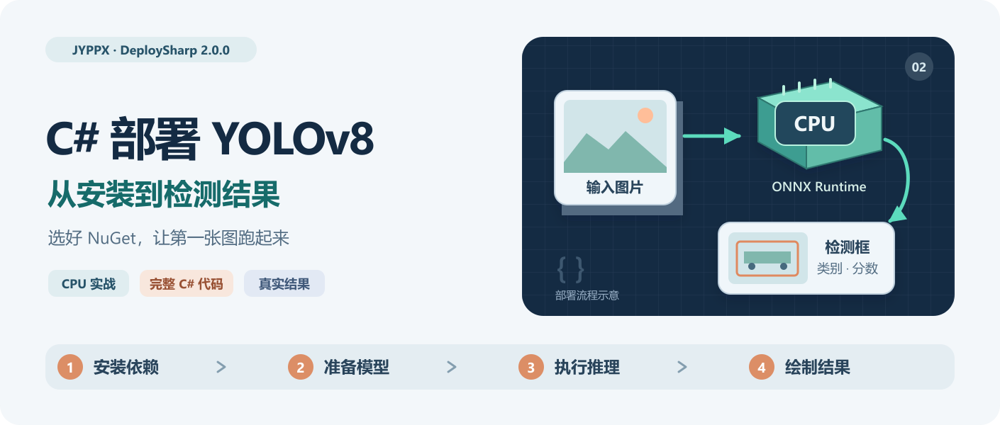
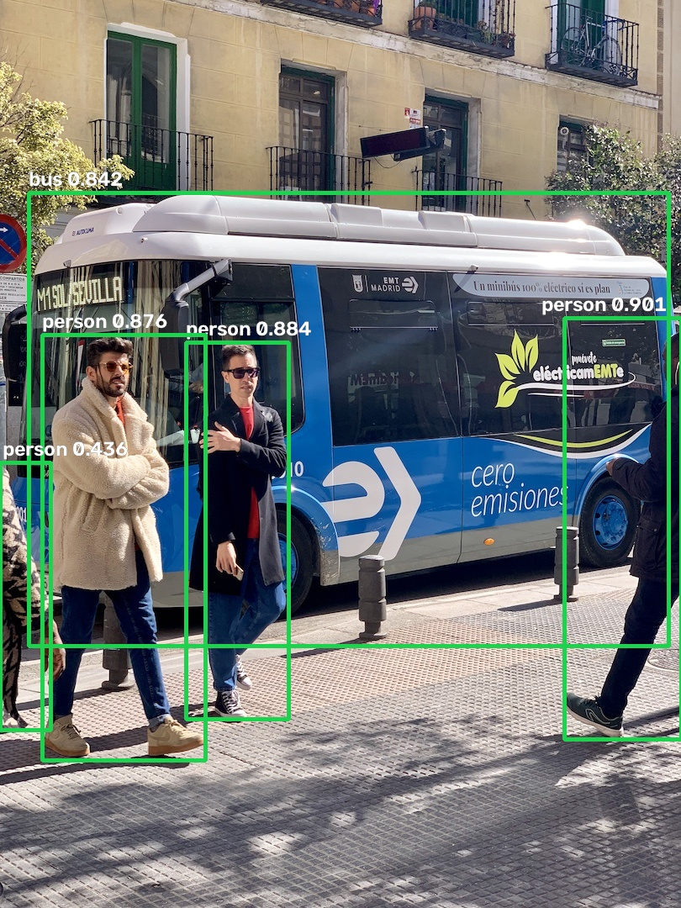

# 在 C# 中使用 DeploySharp 部署 YOLOv8：从 NuGet 安装到检测结果

> DeploySharp 2.0.0 系列 · 第 02 篇实战教程。基于正式版 NuGet `2.0.0`、源码 Tag `v2.0.0`，创建与修订：2026-10-28。



上一篇介绍了 DeploySharp 2.0.0 的主要功能。这一篇我们从一个空的 C# 控制台项目开始，使用 **YOLOv8n + ONNX Runtime CPU** 完成一次目标检测，最后把类别、置信度和检测框画到原图上。

部署模型时，大家容易卡在两个地方：一个是包比较多，不知道应该装哪些；另一个是模型虽然能运行，前处理和坐标还原却没有配对，结果框的位置不正确。所以本文会把 **NuGet 选择、模型准备、完整代码和结果检查** 一起讲清楚。

本文使用正式发布的 NuGet 包，无需先编译 DeploySharp 源码。项目地址如下：

```text
https://github.com/guojin-yan/DeploySharp/tree/DeploySharpV2.0
```

## 一、准备环境，创建控制台项目

### 1.1 本文使用的环境

我在下面的环境中运行了本文完整代码，使用的是 CPU 推理：

| 项目 | 实际环境 |
| --- | --- |
| 操作系统 | Windows 11 x64，系统版本 `10.0.26200` |
| CPU | AMD Ryzen 7 5800H，8 核 16 线程 |
| .NET | SDK `10.0.401`，运行时 `10.0.12`，目标框架 `net10.0` |
| 应用架构 | `x64` |
| DeploySharp | `2.0.0` |
| ONNX Runtime | CPU `1.28.0` |
| OpenCV | JYPPX 托管包与 Windows x64 runtime 均为 `5.0.0` |
| 模型与输入 | YOLOv8n ONNX，输入 `640 × 640`；测试图片 `bus.jpg` |

这条 CPU 路径不需要 NVIDIA 显卡、CUDA 或 TensorRT。准备好 .NET 10 SDK 即可创建工程；Visual Studio 用户也可以新建 .NET 10 控制台应用，再进行后面的包安装。

```text
.NET SDK 下载：
https://dotnet.microsoft.com/download/dotnet/10.0
```

### 1.2 创建项目

打开 PowerShell，在你准备存放案例的目录执行：

```powershell
dotnet new console -n DeploySharpYoloDemo -f net10.0
cd DeploySharpYoloDemo
```

后续安装、下载和运行命令都在 `DeploySharpYoloDemo` 项目目录中执行。已有 WPF、WinForms 或其他 C# 工程，也可以按相同组合添加依赖；先用控制台确认模型与环境，再接入自己的界面更方便排错。

## 二、NuGet 应该装哪些？按部署场景选择

### 2.1 先分清任务组件、后端与原生运行时

DeploySharp 的包按职责划分。选包时可以依次确定：**做什么任务、用哪个推理引擎、在哪个系统和设备上运行。**

| 组件 | 负责什么 | 什么时候需要 |
| --- | --- | --- |
| `JYPPX.DeploySharp.Core` | 模型、张量、会话和结果等基础接口 | 其他任务包会自动引入；直接开发张量推理时可显式引用 |
| `JYPPX.DeploySharp.Visual` | 视觉任务、Profile、解码及 OCR/区域等流程 | 视觉适配器会自动引入 |
| `JYPPX.DeploySharp.Visual.OpenCV` | 读取图像，执行图像前处理并准备视觉输入 | 使用本文这种 OpenCV 图像输入方式 |
| `JYPPX.DeploySharp.Backend.*` | 调用所选推理引擎 | 按实际引擎选择一个或多个后端 |
| 第三方 runtime 包或厂商运行库 | 提供真正执行计算的原生 DLL | 根据后端、操作系统和进程架构准备 |

**`Visual.OpenCV` 负责图像输入，`Backend.OpenCV` 负责 OpenCV DNN 推理。** 即使推理使用 ONNX Runtime，仍然可以使用 `Visual.OpenCV` 读图和前处理。

下图以本文 CPU 组合为例，展示需要显式安装的四个包，以及 NuGet 自动引入的主要托管依赖。实线表示 NuGet 传递依赖，虚线表示执行时需要匹配的原生运行时；基础包依赖在图中省略。


所有 **DeploySharp 包统一使用 `2.0.0`**。第三方运行时有自己的版本号，不要把它们也改成 `2.0.0`。

### 2.2 场景一：普通 CPU 视觉推理——本文使用这一组

适合先完成 YOLO 检测、分类、分割等已接入模型的 CPU 案例。显式安装下面四个包：

```powershell
dotnet add package JYPPX.DeploySharp.Visual.OpenCV --version 2.0.0
dotnet add package JYPPX.DeploySharp.Backend.OnnxRuntime --version 2.0.0
dotnet add package Microsoft.ML.OnnxRuntime --version 1.28.0
dotnet add package JYPPX.OpenCV.runtime.win-x64 --version 5.0.0
```

| 显式安装的包 | 在本文中的用途 |
| --- | --- |
| `JYPPX.DeploySharp.Visual.OpenCV` | 图像读取、Letterbox、颜色转换、归一化与输入张量准备 |
| `JYPPX.DeploySharp.Backend.OnnxRuntime` | 把 DeploySharp 的推理请求交给 ONNX Runtime |
| `Microsoft.ML.OnnxRuntime` | 提供 ONNX Runtime CPU 原生运行库 |
| `JYPPX.OpenCV.runtime.win-x64` | 提供 OpenCV 读图、图像处理和绘制需要的 Windows x64 原生库 |

`Core`、`Visual`、`Extensibility`、`JYPPX.OpenCV.CSharp.API` 和 `Microsoft.ML.OnnxRuntime.Managed` 等依赖由 NuGet 自动解析，本文无需逐个添加。这里特别区分 **`Microsoft.ML.OnnxRuntime.Managed` 与 CPU runtime 包**：有托管接口，仍需要对应的原生运行库才能真正推理。

**跟着本文运行时，到这里就完成选包了，可以直接进入第三节。** 下面几组供你在其他项目中选择；每个后端的初始化与运行细节会在多后端专题中展开。本篇实际运行验证的是上面的 CPU 组合。

### 2.3 场景二：NVIDIA 显卡，使用 ONNX Runtime CUDA

适合希望继续使用 ONNX 模型，同时通过 ONNX Runtime CUDA Provider 执行推理的 Windows 应用。

```powershell
dotnet add package JYPPX.DeploySharp.Visual.OpenCV --version 2.0.0
dotnet add package JYPPX.DeploySharp.Backend.OnnxRuntime --version 2.0.0
dotnet add package Microsoft.ML.OnnxRuntime.Gpu.Windows --version 1.28.0
dotnet add package JYPPX.OpenCV.runtime.win-x64 --version 5.0.0
```

这一组选择 GPU runtime。已有 CPU 工程切换时，先移除原来的显式 `Microsoft.ML.OnnxRuntime` 引用，再添加 GPU 包，避免两套原生文件在输出目录中互相覆盖。`Microsoft.ML.OnnxRuntime.Managed` 仍会作为依赖存在。

此外还需要目标显卡驱动，以及 **与该 ONNX Runtime 版本匹配的 CUDA、cuDNN**。GPU 包不会替你安装全部 NVIDIA 环境。正式版适配器依赖 Managed `1.28.0`，选用的原生包也应保持匹配。

安装完成后，程序还要显式配置 CUDA Provider 和设备请求。直接运行本文的 CPU 初始化代码，使用的仍然是 CPU。环境对应关系可以从官方说明中核对：

```text
https://onnxruntime.ai/docs/execution-providers/CUDA-ExecutionProvider.html
```

### 2.4 场景三：使用 OpenVINO 执行视觉推理

适合评估 OpenVINO 在目标 CPU 或受支持 Intel 设备上的部署效果。使用 OpenCV 准备图片，使用 OpenVINO 执行模型：

```powershell
dotnet add package JYPPX.DeploySharp.Visual.OpenCV --version 2.0.0
dotnet add package JYPPX.DeploySharp.Backend.OpenVINO --version 2.0.0
dotnet add package JYPPX.OpenCV.runtime.win-x64 --version 5.0.0
dotnet add package OpenVINO.runtime.win --version 2026.2.1
```

后端自动引入 `JYPPX.OpenVINO.CSharp.API` 托管接口。OpenCV runtime 与 OpenVINO runtime 分别服务于读图和推理，两者都需要准备。

推理时还需注册 OpenVINO 后端，选择目标设备，并确认具体模型是否已经在该后端验证。GPU/NPU 的设备驱动和插件要求另行核对，不能仅凭安装包成功判断设备可用。

### 2.5 场景四：使用 OpenCV DNN 执行视觉推理

如果应用已经依赖 OpenCV，并且模型在 OpenCV DNN 的 importer 中可用，可以选择下面的组合：

```powershell
dotnet add package JYPPX.DeploySharp.Visual.OpenCV --version 2.0.0
dotnet add package JYPPX.DeploySharp.Backend.OpenCV --version 2.0.0
dotnet add package JYPPX.OpenCV.runtime.win-x64 --version 5.0.0
```

这里的两个 DeploySharp OpenCV 包分别负责图像准备和 DNN 执行，共用匹配的 OpenCV 原生运行时。这条路径无需安装 ONNX Runtime 或 OpenVINO。

OpenCV DNN 对模型算子、动态 Shape 和导出图有自己的限制，具体型号需要查看验证矩阵。**后端包可安装，不代表任意 ONNX 模型都能导入。**

### 2.6 场景五：使用 TensorRT 或 CUDA 视觉加速

TensorRT 的通用推理与视觉 CUDA 处理也分别提供组件。

如果你准备好输入张量，只需要加载 Engine、执行推理或使用 ONNX 转 Engine 接口，可以选择：

```powershell
dotnet add package JYPPX.DeploySharp.Backend.TensorRT --version 2.0.0
```

它会自动引入 `Core` 等基础依赖。采用 CPU 图像准备时，再添加 `Visual.OpenCV` 和匹配的 OpenCV runtime。

如果需要使用支持模型的 **CUDA 图像前处理与相应视觉执行路径**，选择：

```powershell
dotnet add package JYPPX.DeploySharp.Visual.TensorRT --version 2.0.0
dotnet add package JYPPX.DeploySharp.Backend.TensorRT --version 2.0.0
dotnet add package JYPPX.OpenCV.runtime.win-x64 --version 5.0.0
```

`Visual.TensorRT` 会引入 `Visual`、`Visual.OpenCV` 和 TensorRT 后端；上面显式列出后端，是为了把应用选择的引擎写清楚。还需要匹配的 bridge 原生包。仓库使用的一组 bridge 标识如下，安装前应先核对目标机的运行环境：

```powershell
dotnet add package JYPPX.TensorRT.CSharp.API.Runtime.win-x64.trt10.11.cuda12.9.cudnn9.22.Bridge --version 4.0.0
```

**bridge 包提供桥接层，目标机仍要准备兼容的 NVIDIA 驱动、CUDA、cuDNN 和 TensorRT。** 本文四包 CPU 组合不需要这些依赖。

TensorRT 两个 DeploySharp 包发布 `net8.0` 托管资产，本文的 `net10.0` 工程可以引用。模型还需要与目标设备、TensorRT 版本和输入 Shape Profile 匹配的 Engine；可在目标设备转换，不能把某台机器生成的 Engine 当作所有显卡都通用的文件。CUDA 前后处理也按具体模型和任务提供支持。

### 2.7 场景六：应用要自动下载、校验和缓存模型

本文使用手动下载，下载接口并非必装。需要在自己的应用中按模型目录选择工件、校验并缓存时，再添加：

```powershell
dotnet add package JYPPX.DeploySharp.ModelFactory --version 2.0.0
```

`ModelFactory` 自动引入 `ModelPack.Json` 与 `Core`。如果只需要读取自己提供的 ModelPack JSON，不使用目录下载和缓存功能，可以单独引用：

```powershell
dotnet add package JYPPX.DeploySharp.ModelPack.Json --version 2.0.0
```

这些组件负责模型文件的描述和获取，**推理仍需任务包、后端与原生运行时**。模型下载和后端环境安装是两项工作。

### 2.8 其他任务：张量、OCR、LLM 与扩展

下面几种需求可以沿用相同的选择方式：

| 你的需求 | 应该选择什么 |
| --- | --- |
| 自己准备张量，自己解析输出 | `Core` + 一个 `Backend.*` + 对应 runtime；无需为了张量接口安装图像适配器 |
| PP-OCR / PP-Structure | 使用 `Visual` 工作流，按所选后端搭配图像适配器和 runtime；再准备 DET/REC/CLS、字典或其他任务模型；没有需要另装的独立 PaddleOCR NuGet 包 |
| 本地 GGUF 文本生成 | `LLM` + `Backend.LlamaSharp` + 选定的 LLamaSharp 原生后端 + GGUF |
| 多模态任务编排 | 在具体模型和后端组合上加入 `Multimodal`；安装它不会自动完成任意 VLM 的接入 |
| 自己开发插件发现与运行时探测宿主 | 按需直接引用 `Extensibility`，并实现宿主的加载、探测和配置逻辑 |

例如，已验证 Qwen2.5 GGUF 的 CPU 文本生成组合可以这样安装：

```powershell
dotnet add package JYPPX.DeploySharp.LLM --version 2.0.0
dotnet add package JYPPX.DeploySharp.Backend.LlamaSharp --version 2.0.0
dotnet add package LLamaSharp.Backend.Cpu --version 0.27.0
```

模型和推理调用将在相应专题介绍。需要查看完整组合时，可以使用下面的文档地址：

```text
https://github.com/guojin-yan/DeploySharp/blob/DeploySharpV2.0/docs/articles/package-combinations.md
```

## 三、检查工程配置，准备模型和图片

### 3.1 锁定 x64 与依赖版本

回到本文主线，使用第二节的 **CPU 四包组合**。把项目文件 `DeploySharpYoloDemo.csproj` 检查为下面的配置，其中 `PlatformTarget` 明确设为 `x64`：

```xml
<Project Sdk="Microsoft.NET.Sdk">
  <PropertyGroup>
    <OutputType>Exe</OutputType>
    <TargetFramework>net10.0</TargetFramework>
    <ImplicitUsings>enable</ImplicitUsings>
    <Nullable>enable</Nullable>
    <PlatformTarget>x64</PlatformTarget>
  </PropertyGroup>
  <ItemGroup>
    <PackageReference Include="JYPPX.DeploySharp.Visual.OpenCV" Version="2.0.0" />
    <PackageReference Include="JYPPX.DeploySharp.Backend.OnnxRuntime" Version="2.0.0" />
    <PackageReference Include="Microsoft.ML.OnnxRuntime" Version="1.28.0" />
    <PackageReference Include="JYPPX.OpenCV.runtime.win-x64" Version="5.0.0" />
  </ItemGroup>
</Project>
```

也可以在 Visual Studio 的“管理 NuGet 程序包”中添加同名同版本的包。OpenCV 使用本项目对应的 `JYPPX.OpenCV.*` 包，后面的命名空间是 `JYPPX.OpenCvSharp.*`，请与其他 OpenCvSharp 包区分。

### 3.2 下载本文对应的模型和测试图片

在项目目录执行下面的 PowerShell 命令，分别保存到 `models` 和 `images`：

```powershell
New-Item -ItemType Directory -Force -Path .\models, .\images

Invoke-WebRequest `
  -Uri 'https://github.com/guojin-yan/DeploySharp/releases/download/models-visual.1/yolo-v8-detect-n.model.onnx' `
  -OutFile '.\models\yolov8n.onnx'

Invoke-WebRequest `
  -Uri 'https://github.com/guojin-yan/DeploySharp/releases/download/test-assets.1/bus.jpg' `
  -OutFile '.\images\bus.jpg'
```

你也可以把命令中的完整 URL 复制到浏览器下载，再按下面的名称存放：

```text
DeploySharpYoloDemo/
  DeploySharpYoloDemo.csproj
  Program.cs
  models/
    yolov8n.onnx
  images/
    bus.jpg
```

本文固定使用这一份模型，相关参数如下：

| 配置 | 值 |
| --- | --- |
| 模型 ID | `yolo/v8/detect/n` |
| 模型来源与类别 | Ultralytics YOLOv8n，COCO 80 类 |
| 导出版本 | Ultralytics `8.3.78`，ONNX opset `19` |
| 输入 | `images`，`1 × 3 × 640 × 640`，Float32，RGB，NCHW |
| 前处理 | Letterbox，填充值 `114`，像素值除以 `255` |
| 输出解码 | YOLOv8 检测输出，分数阈值 `0.25`，NMS IoU 阈值 `0.45` |
| 模型大小 | `12,836,453` 字节 |

模型 SHA-256：

```text
50e299e848bb2586ca7fc5bfebd42eda43d43566cbb9a3ed7a3375243b0dbdf4
```

测试图片 SHA-256：

```text
33b198a1d2839bb9ac4c65d61f9e852196793cae9a0781360859425f6022b69c
```

需要自行检查时，执行 `Get-FileHash .\models\yolov8n.onnx -Algorithm SHA256` 和 `Get-FileHash .\images\bus.jpg -Algorithm SHA256` 即可。下面的程序也会在初始化时校验模型，避免把不同导出文件与当前 Profile 混用。

DeploySharp 库代码采用 Apache 2.0；本文 YOLOv8 模型遵循其自身的 AGPL-3.0-only 许可。模型与第三方库的许可需分别遵守。

## 四、编写完整检测代码

下面这份代码完成模型校验、Profile 配置、CPU 后端初始化、图像前处理、推理、结果解码和原图绘制。直接替换项目中的 `Program.cs` 即可运行，下一节再解释关键部分。

```csharp
using System.Security.Cryptography;
using JYPPX.DeploySharp;
using JYPPX.DeploySharp.Backends.OnnxRuntime;
using JYPPX.DeploySharp.Models;
using JYPPX.DeploySharp.Registry;
using JYPPX.DeploySharp.Results.Vision;
using JYPPX.DeploySharp.Visual;
using JYPPX.DeploySharp.Visual.Models.Yolo;
using JYPPX.DeploySharp.Visual.OpenCV;
using JYPPX.OpenCvSharp.Core;
using JYPPX.OpenCvSharp.ImgProc;
using ImageCodecs = JYPPX.OpenCvSharp.ImgCodecs.Cv2;
using Drawing = JYPPX.OpenCvSharp.ImgProc.Cv2;

const string modelSha256 =
    "50e299e848bb2586ca7fc5bfebd42eda43d43566cbb9a3ed7a3375243b0dbdf4";
string modelPath = Path.GetFullPath(Path.Combine("models", "yolov8n.onnx"));
string imagePath = Path.GetFullPath(
    args.Length > 0 ? args[0] : Path.Combine("images", "bus.jpg"));

if (!File.Exists(modelPath))
    throw new FileNotFoundException("请先下载本文对应的 YOLOv8n 模型。", modelPath);
if (!File.Exists(imagePath))
    throw new FileNotFoundException("找不到输入图片。", imagePath);

using (var stream = File.OpenRead(modelPath))
{
    string actualHash = Convert.ToHexString(SHA256.HashData(stream));
    if (!string.Equals(actualHash, modelSha256, StringComparison.OrdinalIgnoreCase))
        throw new InvalidDataException("模型与本文 Profile 不匹配，请检查下载文件。");
}

// 绑定本文的具体模型、类别表、导出信息和前后处理配置。
var profile = YoloDetectionProfiles.Create(
    YoloDetectionFamily.YoloV8,
    new ModelId("yolo/v8/detect/n"),
    modelSha256,
    YoloLabelSets.Coco80,
    "1367566337fb8056223a1aeb469360747f1b1bcd",
    "8.3.78",
    new YoloDetectionProfileOptions(
        opset: 19,
        modelSize: new VisualSize(640, 640),
        resizeMode: YoloImageResizeMode.Letterbox,
        decoderOptions: new YoloDetectionDecoderOptions(
            scoreThreshold: 0.25f, iouThreshold: 0.45f)));

// 选择 ONNX Runtime CPU，并注册视觉任务配置。
using var backends = new BackendRegistry();
backends.UseOnnxRuntime();
var profiles = new VisualProfileRegistry();
profiles.Register(profile.VisualProfile);
profiles.Freeze();
var request = new BackendRequest(
    BackendCapabilities.TensorInference,
    OnnxRuntimeBackendProvider.BackendId, "cpu");
var artifact = profile.CreateArtifact(modelPath);

using var pipeline = new VisualPipeline(
    backends,
    profiles.Select(artifact, backends, request, VisualTaskId.ObjectDetection),
    request);
using PreparedVisualInput input = new OpenCvVisualInputFactory()
    .CreateFromFile(imagePath, profile.VisualProfile);
DetectionResult result = pipeline.Run(input).GetValue<DetectionResult>();

// 结果坐标已经还原到原图，直接在原图上绘制。
using Mat canvas = ImageCodecs.ImRead(imagePath);
Console.WriteLine("backend=onnxruntime;device=cpu");
Console.WriteLine($"detections={result.Detections.Count}");
foreach (Detection item in result.Detections)
{
    var box = item.Box;
    string label = FormattableString.Invariant(
        $"{item.Label.Label} {item.Label.Score:F3}");
    Console.WriteLine(FormattableString.Invariant(
        $"{label} box=({box.X:F1},{box.Y:F1},{box.Width:F1},{box.Height:F1})"));

    var topLeft = new Point((int)box.X, (int)box.Y);
    var bottomRight = new Point((int)box.Right, (int)box.Bottom);
    Size textSize = Drawing.GetTextSize(
        label, HersheyFonts.HersheySimplex, 0.8, 2, out _);
    var caption = new Point(
        Math.Clamp(topLeft.X, 3, Math.Max(3, canvas.Cols - textSize.Width - 16)),
        Math.Max(textSize.Height + 4, topLeft.Y - 8));

    Drawing.Rectangle(canvas, topLeft, bottomRight, new Scalar(80, 210, 30), 3);
    Drawing.PutText(canvas, label, caption, HersheyFonts.HersheySimplex,
        0.8, new Scalar(20, 20, 20), 5);
    Drawing.PutText(canvas, label, caption, HersheyFonts.HersheySimplex,
        0.8, new Scalar(255, 255, 255), 2);
}
if (!ImageCodecs.ImWrite("result.jpg", canvas))
    throw new IOException("无法保存 result.jpg。");
Console.WriteLine("saved=result.jpg");
```

## 五、关键配置与调用说明

### 5.1 Profile 把模型文件与前后处理绑定起来

`YoloDetectionProfiles.Create` 描述这份 YOLOv8n 模型如何使用。这里明确提供模型 ID、SHA-256、COCO 类别表、导出源码 revision、导出版本、opset 和输入大小，方便把模型身份与处理配置对应起来。

其中 `scoreThreshold: 0.25f` 用于过滤低分候选，`iouThreshold: 0.45f` 用于非极大值抑制（NMS），去除同类目标中高度重叠的重复候选框。调整它们会改变保留的结果，本文后面的输出对应这两个固定值。

如果替换为自己的 YOLOv8 模型，类别数量、类别名称、输入尺寸、输出格式和导出信息都要一起确认，再创建对应 Profile。仅把文件名改成 `yolov8n.onnx`，并不会让不同模型拥有相同的输入输出约定。

### 5.2 Letterbox 与结果坐标怎样对应

本文显式设置 `YoloImageResizeMode.Letterbox`。它保持宽高比例缩放，再用边缘填充补齐目标尺寸。RGB 转换、Float32 张量布局与除以 `255` 的归一化由配套前处理完成。

`bus.jpg` 原图为 `810 × 1080`，缩放到 `480 × 640` 后，左右分别填充 `80` 像素，得到模型需要的 `640 × 640` 输入。输入对象保存了这次变换信息，decoder 据此还原原图坐标。

因此，代码中的 `item.Box.X/Y/Width/Height` 已经对应原图像素，可以直接绘制到 `canvas`。**绘制时再次乘以原图与模型尺寸的比例，会把坐标缩放两次。**

如果自有模型训练时采用强制缩放，可以在创建相应 Profile 时选择 `YoloImageResizeMode.Resize`；更通用的视觉预处理还提供 Resize、Letterbox、CenterCrop，以及颜色和归一化配置。切换方式要与模型训练和导出约定一致。自定义模型专题会进一步演示这些设置。

### 5.3 后端注册与执行设备都显式指定

`UseOnnxRuntime()` 注册 ONNX Runtime 后端，`BackendRequest` 指定 `TensorInference` 能力、ONNX Runtime 后端 ID 和 `"cpu"` 设备。这样可以清楚知道本次推理交给谁执行。

`VisualProfileRegistry` 注册并冻结视觉配置，`Select` 为当前模型、后端和目标检测任务选择匹配流程。随后 `VisualPipeline` 持有推理会话，执行模型并调用配套 decoder。

所以，改用另一种引擎时，需要一起调整后端注册、设备请求以及对应的模型工件；安装另一组 NuGet 包只完成了环境准备。

### 5.4 资源释放与多张图片复用

代码中通过 `using` 管理 `BackendRegistry`、`VisualPipeline`、`PreparedVisualInput` 和 OpenCV `Mat`。输入在本次 `Run` 完成后释放，pipeline 在使用结束后释放，注册表最后退出，保持依赖资源的正确生命周期。

本文为了展示检测框，重新读取一次原图作为绘图画布。推理前处理与绘图输入分别持有自己的图像资源，读起来更直观；连续帧或高吞吐应用可以复用已解码图像和相应输入接口，减少重复读图。

处理多张图片时，把模型校验、Profile、后端注册和 pipeline 初始化放在循环外，为每张图创建并及时释放输入对象即可。视频、Batch 和多个独立推理器的并发调度，会在后续专题展开。

## 六、运行程序，检查实际结果

### 6.1 使用默认测试图片

在项目目录运行：

```powershell
dotnet run -c Release
```

本文在前述环境中的实际输出如下，共检测到 **4 个行人和 1 辆公交车**：

```text
backend=onnxruntime;device=cpu
detections=5
person 0.901 box=(671.0,378.0,139.0,501.8)
person 0.884 box=(221.4,407.6,122.1,448.2)
person 0.876 box=(50.4,398.1,193.7,506.7)
bus 0.842 box=(34.3,229.3,761.2,539.2)
person 0.436 box=(0.4,550.6,59.9,317.4)
saved=result.jpg
```

下面是这段代码真实生成的 `result.jpg`，可以看到检测框已经落在原图中的行人和车辆位置：



坐标输出依次是 `X、Y、Width、Height`，分数保留三位小数。换用不同图片、模型、阈值或后端后，结果数量与分数可能变化。本文只展示这组固定输入的检测结果，不以一次运行时间评价后端性能。

### 6.2 换成自己的图片

把图片放到项目中，通过第一个命令行参数指定：

```powershell
dotnet run -c Release -- .\images\my-image.jpg
```

程序仍使用同一份 COCO 80 类模型，输出文件仍是项目当前目录中的 `result.jpg`，再次运行会覆盖前一次结果。需要识别自定义类别时，换图片还不够，还需使用训练了对应类别的模型和匹配 Profile。

## 七、常见问题与检查方法

| 现象 | 先检查什么 | 处理方法 |
| --- | --- | --- |
| 提示没有 `net10.0` 或无法识别目标框架 | 当前 SDK 与 IDE 是否支持 .NET 10 | 用 `dotnet --list-sdks` 检查，安装 .NET 10 SDK，更新 IDE |
| `DllNotFoundException` 或 OpenCV 原生库加载失败 | 是否安装 OpenCV runtime、进程是否 x64、原生依赖是否能加载 | 对齐 `JYPPX.OpenCV.CSharp.API` 与 runtime `5.0.0`，检查 `x64` 以及输出目录；异常指向 MSVC 依赖时安装对应 x64 运行库 |
| ONNX Runtime 提示缺少原生库 | 是否只还原了 Managed，或 CPU/GPU 原生包混用 | CPU 案例保留匹配的 `Microsoft.ML.OnnxRuntime 1.28.0`，移除多余原生包，清理本案例生成的 `bin/obj` 后重新还原 |
| 找不到 `Mat`、`Cv2` 或 `HersheyFonts` | 包与命名空间是否属于同一套 OpenCV API | 使用本文的 `JYPPX.OpenCvSharp.*`，保留 `ImgProc` 的 using 和两个 `Cv2` 别名 |
| 提示找不到模型或图片 | 是否从项目目录运行、相对文件是否存在 | 按目录结构存放文件，检查实际工作目录和传入图片路径 |
| 提示模型与 Profile 不匹配 | 下载文件的 SHA-256 是否一致 | 使用本文工件；自有模型需重新创建匹配的身份和输入输出配置 |
| 框整体偏移或尺寸不对 | 缩放方式、填充、颜色和输出格式是否配套 | 先使用本文模型与 Letterbox 配置复现；绘图直接使用源图坐标 |
| 装了 GPU 包，仍显示 CPU | Provider 与 `BackendRequest` 是否仍使用 CPU 配置 | 按 GPU 后端教程配置 CUDA Provider，并核对实际可用设备 |

后端选择需要同时看模型和运行环境，可以先核对以下入口，再根据完整异常信息排查：

```text
安装与原生依赖：
https://github.com/guojin-yan/DeploySharp/blob/DeploySharpV2.0/docs/articles/installation.md

ONNX Runtime 教程：
https://github.com/guojin-yan/DeploySharp/blob/DeploySharpV2.0/docs/articles/onnxruntime-getting-started.md

模型与后端验证矩阵：
https://github.com/guojin-yan/DeploySharp/blob/DeploySharpV2.0/docs/model-backend-verification-matrix.md
```

## 八、总结与后续

这篇完成了从空项目、按场景选择 NuGet、下载模型和图片，到 YOLOv8 CPU 检测及结果绘制的完整过程。对本文案例，显式安装四个包就能准备好图像与推理依赖；换成其他后端时，再按设备要求调整相应适配器、原生运行时和初始化代码。

接入自己的应用时，可以先保留这条已经跑通的路径，再替换图片、接入界面和业务逻辑。模型与前后处理需要一起配置，pipeline 则可以在多次推理中复用。

下一篇会继续使用实际图片，介绍 **PaddleOCR v4/v5/v6 的模型选择、检测与识别组合、文字和区域结果读取**。多后端部署、自定义模型、视频并发与大图处理，也会分别用完整案例展开。

```text
本文主稿与配图：
https://github.com/guojin-yan/DeploySharp/blob/DeploySharpV2.0/docs/blog/2.0.0/2026-10/2026-10-28-02-yolov8-quickstart.md

系列目录：
https://github.com/guojin-yan/DeploySharp/blob/DeploySharpV2.0/docs/blog/2.0.0/README.md

功能与模型案例：
https://github.com/guojin-yan/DeploySharp/blob/DeploySharpV2.0/samples/README.md

问题反馈：
https://github.com/guojin-yan/DeploySharp/issues
```
