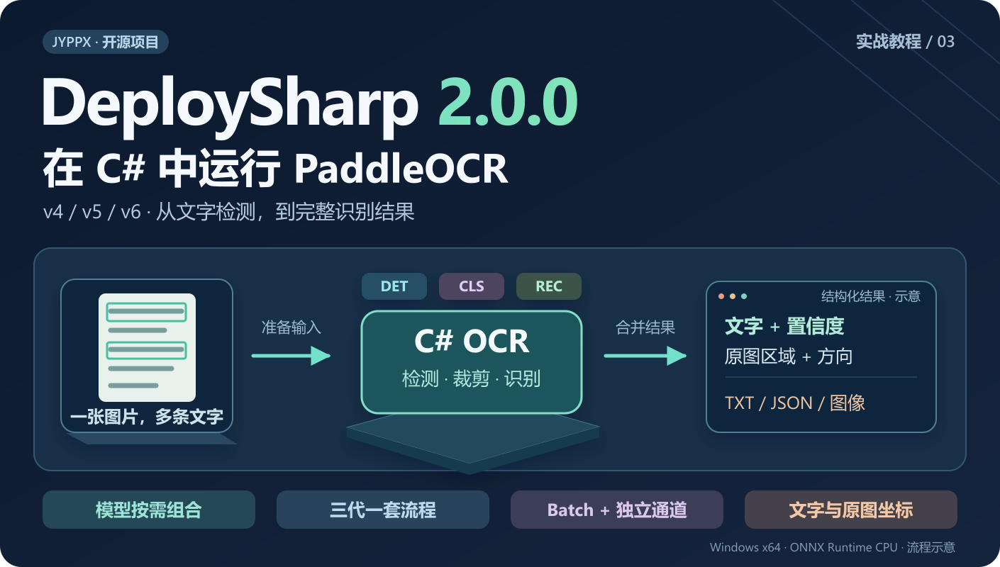
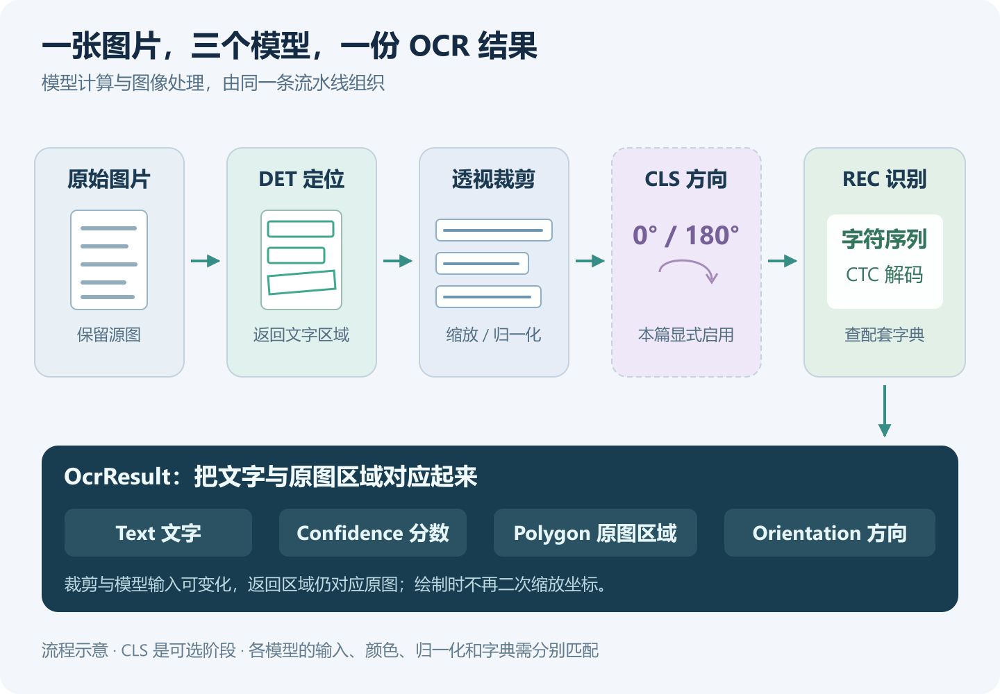
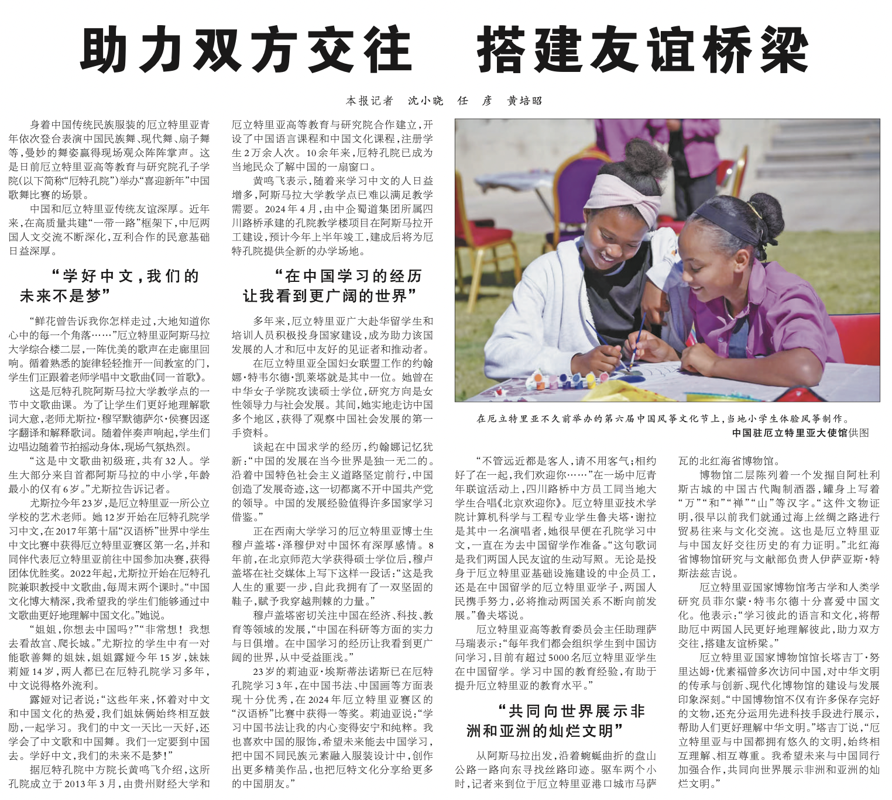
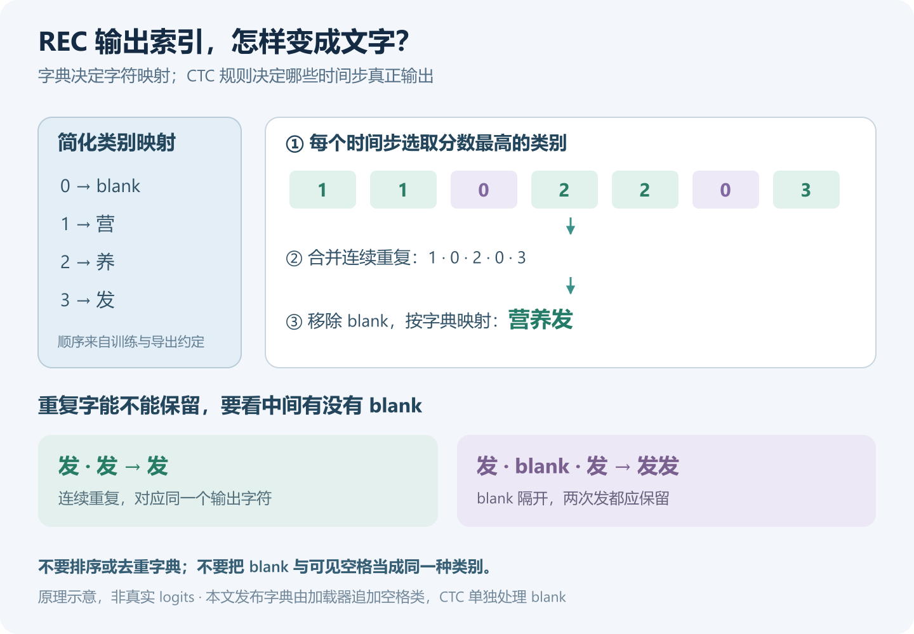
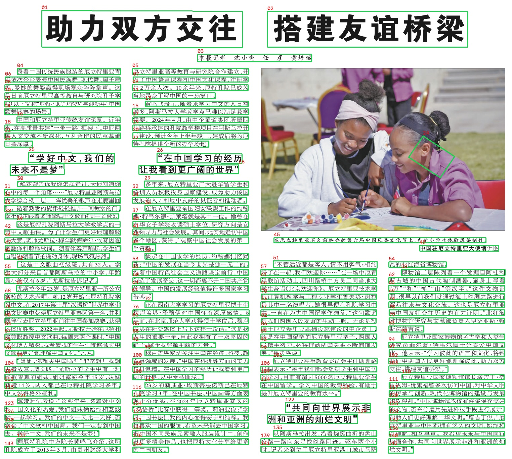
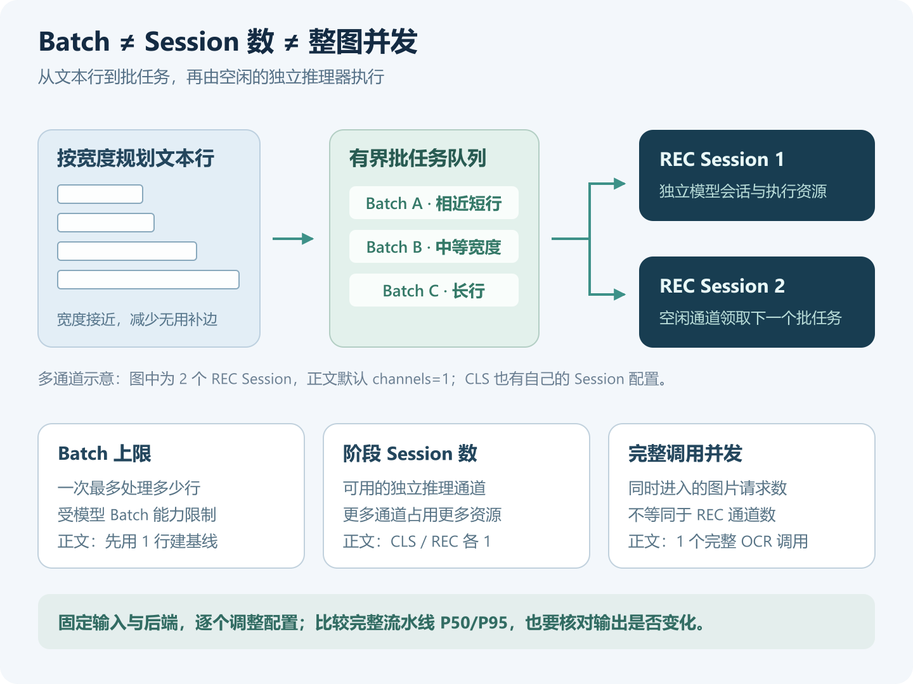

# 在 C# 中运行 PaddleOCR v4/v5/v6：从文字检测到完整识别结果

> DeploySharp 2.0.0 系列 · 第 03 篇实战教程。基于正式版 NuGet `2.0.0`、源码 Tag `v2.0.0`，创建与修订：2026-10-28。



## 一、DeploySharp 项目简介

**DeploySharp** 是一个面向 **C#/.NET 开发者**的开源模型部署框架，由「椒颜皮皮虾」开发，项目源码遵循 **Apache License 2.0**。它基于 **ONNX Runtime、OpenVINO、TensorRT、OpenCV DNN** 等推理引擎，提供模型加载、图像前处理、推理执行和结果后处理接口，方便大家把模型接入桌面软件、工业视觉和文档应用。

项目已经接入 YOLO 等目标检测模型，以及分类、分割、关键点、旋转框、异常检测和背景移除等视觉任务；同时提供 **PP-OCRv4/v5/v6、PP-Structure 文档处理**和部分图文、本地语言模型的使用入口。常用模型可以复用配套处理，自有模型则可以配置输入、缩放、颜色与归一化，进一步自定义输出解码和结果类型。

**项目地址：**

```text
https://github.com/guojin-yan/DeploySharp/tree/DeploySharpV2.0
```

**NuGet 包：**在包管理器中搜索 `JYPPX.DeploySharp`，按任务与后端选择组件。

```text
https://www.nuget.org/packages?q=JYPPX.DeploySharp
```

当前 2.0.0 正式版主要验证 Windows 10/11 x64。各模型和后端分别记录支持范围，使用前可以查阅仓库中的模型支持指南与验证矩阵。

## 二、2.0 新特性与本篇 OCR 实战

### 2.1 从模型调用，走到完整应用流程

上一篇用 YOLO26 展示了单个视觉模型的部署。这一篇继续使用正式版 NuGet，把多个模型组合起来，完成一次**文字检测、文本行裁剪、方向处理和文字识别**。

先简要看一下与本篇有关的新版能力：

| 新版能力 | 对 OCR 应用有什么用 |
| --- | --- |
| 多后端与按需安装 | 图像处理与推理引擎分别选择，先用 CPU 跑通，再评估目标设备 |
| v4/v5/v6 核心模型目录 | 根据模型 ID 取得配套输入输出与解码配置，减少逐版本手工填写 |
| 完整 `OcrPipeline` | 组织检测、透视裁剪、方向分类、识别及结果合并，返回原图区域与文字 |
| 动态 Batch 与独立 Session 池 | 多条文本行可以分批识别，也可以交给多个独立推理器调度 |
| 可配置的区域处理 | 按需要接入长文本策略、ROI 和文档区域工作流 |

支持的 TensorRT 路径还提供 CUDA 裁剪、前后处理和缓冲复用。本篇先完成 **ONNX Runtime CPU** 路径；GPU 部署和完整 PP-Structure 页面处理会在对应专题展开。

### 2.2 为什么 OCR 需要一条流水线

一张图片里的文字数量、大小、角度都不固定。识别模型通常接收一条已经裁好的文本行，直接把整张商品图交给 REC，并不能替代完整 OCR。

这次使用三个模型，各自负责一件事：

| 阶段 | 作用 | 结果怎样传给下一步 |
| --- | --- | --- |
| DET：文字检测 | 找到图片中的文字位置 | 返回原图文字区域，用于透视裁剪 |
| CLS：文本行方向分类 | 判断裁好的文字行是否需要旋转 180° | 按方向处理后，再准备识别输入 |
| REC：文字识别 | 将文本行转换为字符序列 | CTC 解码得到文字和置信度 |

中间还有裁剪、缩放、归一化、Batch 组织和坐标对应。下图把整条处理过程放在一起，图中的多个文本行来自同一张原图：



本文默认使用 **PP-OCRv5 Mobile DET + Mobile CLS + Mobile REC**，识别一张包含**大标题、多栏小字、照片、图注和引语**的中文报纸页面，并生成三个文件：`result.txt`、`result.json`、`result.jpg`。随后用同一份代码切换到 v4 Mobile 和 v6 Tiny，讲清模型、字典和方向分类怎样配对。

下面是实际使用的输入，来自 PaddleOCR 官方 PP-Structure 示例，原图为 `1524 × 1368`。本篇借用它验证通用 OCR；尚未运行版面分析，也不把 OCR 文本行拼接当作完整文章阅读顺序。



## 三、v4、v5、v6 应该怎样选择

### 3.1 先按部署需求选择组合

DeploySharp 已为以下七组核心组合提供目录与流水线配置。代码使用右侧参数选择组合，不需要为每个版本重写检测与裁剪流程：

| 版本与组合 | 主要选择方向 | 本文命令行参数 |
| --- | --- | --- |
| PP-OCRv4 Mobile | 已有 v4 轻量化项目，继续使用对应模型与字典 | `v4-mobile` |
| PP-OCRv4 Server | 评估 v4 Server 组合，允许更大的模型和计算开销 | `v4-server` |
| PP-OCRv5 Mobile | 本文默认组合，先完成完整部署与结果使用 | `v5-mobile` |
| PP-OCRv5 Server | 在目标图像上评估 v5 Server 组合 | `v5-server` |
| PP-OCRv6 Tiny | 从较小模型开始，评估设备延迟与识别效果 | `v6-tiny` |
| PP-OCRv6 Small | 进一步评估模型规模与效果之间的取舍 | `v6-small` |
| PP-OCRv6 Medium | 允许更大的模型，按实际数据评估效果 | `v6-medium` |

**版本号和模型大小不能直接替代业务测试。** 小字、低对比度、特殊字体、竖排和长文本，都会影响实际效果。本文新实跑的是 v4 Mobile、v5 Mobile 和 v6 Tiny；其他组合的已有后端证据见验证矩阵。

### 3.2 DET、CLS、REC 和字典要配套

三种版本的方向分类和识别字典存在差异：

| 组合 | 方向分类器 | REC 配套字典 |
| --- | --- | --- |
| v4 Mobile / Server | legacy 0°/180° CLS | `ppocrv4_keys.txt` |
| v5 Mobile / Server | 对应 Mobile / Server 的 PP-LCNet 文本行方向模型 | `ppocrv5_dict.txt` |
| v6 Tiny / Small / Medium | **复用 v5 Mobile CLS** | 对应规模的 `PP-OCRv6_*_rec_dict.txt` |

当前 v6 组合没有单独命名为 v6 的 CLS，代码会明确选择 `paddleocr/ppocrv5/mobile-cls`。也要区分**文本行方向分类**和整页文档的四方向分类：本篇选择的是文本行 0°/180° 模型。

识别字典决定“输出类别索引对应哪个字符”，必须与 REC 一起准备。不要因为都是中文模型，就把 v4、v5、v6 的字典混用；也不要自行排序、去重或删除字典中的字符。

## 四、创建项目与安装 NuGet

### 4.1 本文实际运行环境

本篇继续使用普通 CPU 环境，完整代码通过 NuGet 包运行，没有引用 DeploySharp 源码项目：

| 项目 | 实际环境 |
| --- | --- |
| 操作系统 | Windows 11 x64，系统版本 `10.0.26200` |
| CPU | AMD Ryzen 7 5800H，8 核 16 线程 |
| .NET | SDK `10.0.401`，运行时 `10.0.12`，目标框架 `net10.0` |
| 应用架构 | `x64` |
| DeploySharp | 正式版 `2.0.0` |
| 推理引擎 | ONNX Runtime CPU `1.28.0` |
| 图像组件 | JYPPX OpenCV 托管包与 Windows x64 runtime `5.0.0` |
| 输入 | `pp_structure_v3_demo.png`，原图 `1524 × 1368`，官方多栏报纸页面 |

准备 .NET 10 SDK，然后在 PowerShell 中创建项目：

```powershell
dotnet new console -n DeploySharpOcrDemo -f net10.0
cd DeploySharpOcrDemo
```

后续命令均在这个项目目录执行。使用 Visual Studio 的朋友，也可以创建 .NET 10 控制台应用，再从 NuGet 管理器安装相同依赖。

### 4.2 CPU 完整 OCR 安装这四个包

OCR 编排、DB 检测后处理和 CTC 解码由视觉组件提供，`Visual.OpenCV` 负责图片和文本行处理，ONNX Runtime 后端执行模型。**不需要再寻找单独的 PaddleOCR NuGet 包，也不需要安装 Python 或 PaddlePaddle 才能运行本篇的 ONNX 模型。**

```powershell
dotnet add package JYPPX.DeploySharp.Visual.OpenCV --version 2.0.0
dotnet add package JYPPX.DeploySharp.Backend.OnnxRuntime --version 2.0.0
dotnet add package Microsoft.ML.OnnxRuntime --version 1.28.0
dotnet add package JYPPX.OpenCV.runtime.win-x64 --version 5.0.0
```

| 显式安装的包 | 在 OCR 中负责什么 |
| --- | --- |
| `JYPPX.DeploySharp.Visual.OpenCV` | 解码原图、检测前处理、文本行透视裁剪、缩放与归一化 |
| `JYPPX.DeploySharp.Backend.OnnxRuntime` | 将 DET、CLS、REC 推理交给 ONNX Runtime |
| `Microsoft.ML.OnnxRuntime` | 提供 CPU 原生推理运行库 |
| `JYPPX.OpenCV.runtime.win-x64` | 提供图像处理、绘制与保存所需的原生库 |

`Core`、`Visual` 等基础依赖由 NuGet 自动引入。这里的 OpenCV 用于图像处理，推理仍交给 ONNX Runtime；**`Visual.OpenCV` 和 `Backend.OpenCV` 的作用不同**。

### 4.3 其他场景怎样选包

如果已有其他后端环境，可以按下面的方向准备组件，但还要配置对应后端注册和设备请求：

| 部署场景 | 主要变化 |
| --- | --- |
| ONNX Runtime CUDA | 保留 ORT 适配器，选择匹配的 GPU runtime 与 CUDA/cuDNN，显式启用 CUDA Provider |
| OpenVINO | 选择 `Backend.OpenVINO`，准备匹配的 OpenVINO runtime |
| OpenCV DNN | 选择 `Backend.OpenCV`，确认实际导出图的 Batch 与动态宽度支持 |
| TensorRT CUDA OCR | 使用 `Visual.TensorRT` 与 `Backend.TensorRT` 的相应流程，在目标 GPU 构建匹配 Engine |
| 应用内自动下载模型 | 按需增加 `ModelFactory`，使用 `PaddleOcrReleaseClient` |

**本地文件加载不要求安装 ModelFactory。** 各种场景的详细安装命令已在第二篇列出；CPU/GPU 原生包不要混装到同一个输出目录。本篇完整代码的后端固定为 CPU，安装其他包后还需要相应修改初始化。

```text
按场景选择 NuGet（第二篇第四节）：
https://github.com/guojin-yan/DeploySharp/blob/DeploySharpV2.0/docs/blog/2.0.0/2026-10/2026-10-28-02-yolo26-quickstart.md

TensorRT CUDA OCR：
https://github.com/guojin-yan/DeploySharp/blob/DeploySharpV2.0/docs/articles/tensorrt-cuda-ocr.md
```

### 4.4 检查项目配置

本文使用的 `.csproj` 完整内容如下。显式设置 `x64`，避免进程架构和原生运行库不一致：

```xml
<Project Sdk="Microsoft.NET.Sdk">
  <PropertyGroup>
    <OutputType>Exe</OutputType>
    <TargetFramework>net10.0</TargetFramework>
    <ImplicitUsings>enable</ImplicitUsings>
    <Nullable>enable</Nullable>
    <PlatformTarget>x64</PlatformTarget>
  </PropertyGroup>
  <ItemGroup>
    <PackageReference Include="JYPPX.DeploySharp.Visual.OpenCV" Version="2.0.0" />
    <PackageReference Include="JYPPX.DeploySharp.Backend.OnnxRuntime" Version="2.0.0" />
    <PackageReference Include="Microsoft.ML.OnnxRuntime" Version="1.28.0" />
    <PackageReference Include="JYPPX.OpenCV.runtime.win-x64" Version="5.0.0" />
  </ItemGroup>
</Project>
```

## 五、按需准备模型和测试图片

### 5.1 只下载当前组合需要的文件

PaddleOCR 模型放在独立的 **`models-paddleocr` Release** 中。每个 DET、CLS、REC 和字典均可单独下载，使用轻量组合时，不需要把全部模型打包下载。

下面命令默认下载 v5 Mobile 的三个 ONNX 和一个字典。想切换组合，修改第一行 `$variant`，其余文件名会相应变化：

```powershell
$variant = 'v5-mobile'
$prefix = $variant -replace '^v', 'ppocrv'
switch -Regex ($variant) {
  '^v4-(mobile|server)$' {
    $cls = 'ppocrv4-legacy-cls.onnx'
    $dictionary = 'ppocrv4_keys.txt'
    break
  }
  '^v5-(mobile|server)$' {
    $cls = "$prefix-cls.onnx"
    $dictionary = 'ppocrv5_dict.txt'
    break
  }
  '^v6-(tiny|small|medium)$' {
    $cls = 'ppocrv5-mobile-cls.onnx'
    $size = $variant.Substring(3)
    $dictionary = "PP-OCRv6_${size}_rec_dict.txt"
    break
  }
  default { throw '请选择本文支持的七种组合之一。' }
}
New-Item -ItemType Directory -Force -Path .\models, .\images | Out-Null
$modelBase = 'https://github.com/guojin-yan/DeploySharp/releases/download/models-paddleocr'
foreach ($file in @("$prefix-det.onnx", $cls, "$prefix-rec.onnx", $dictionary)) {
  Invoke-WebRequest -Uri "$modelBase/$file" -OutFile (Join-Path '.\models' $file)
}
Invoke-WebRequest `
  -Uri 'https://paddle-model-ecology.bj.bcebos.com/paddlex/imgs/demo_image/pp_structure_v3_demo.png' `
  -OutFile '.\images\pp_structure_v3_demo.png'
```

如果命令行下载不方便，也可以在 Release 页面选择对应文件下载。已有本地模型和图片，直接按名称放入目录即可。本文选用的默认文件是：

| 文件 | 用途 |
| --- | --- |
| `ppocrv5-mobile-det.onnx` | 文字检测 |
| `ppocrv5-mobile-cls.onnx` | 文本行 0°/180° 方向分类 |
| `ppocrv5-mobile-rec.onnx` | 文本行识别 |
| `ppocrv5_dict.txt` | v5 REC 字符索引表 |
| `pp_structure_v3_demo.png` | 官方中文多栏报纸输入图片 |

```text
PaddleOCR 单文件模型：
https://github.com/guojin-yan/DeploySharp/releases/tag/models-paddleocr

默认测试图片：
https://paddle-model-ecology.bj.bcebos.com/paddlex/imgs/demo_image/pp_structure_v3_demo.png
```

模型 Release 中还包含 PP-Structure 和 PaddleOCR-VL 等其他任务的资产，不能因为文件出现在同一个 Release 中，就把它当作本篇的 DET/CLS/REC。这里使用的是目录明确登记的核心 PP-OCR 工件。

### 5.2 项目目录

默认组合下载完成后，目录如下。其他组合可以放在同一个 `models` 目录，程序只会加载所选组合：

```text
DeploySharpOcrDemo/
  DeploySharpOcrDemo.csproj
  Program.cs
  models/
    ppocrv5-mobile-det.onnx
    ppocrv5-mobile-cls.onnx
    ppocrv5-mobile-rec.onnx
    ppocrv5_dict.txt
  images/
    pp_structure_v3_demo.png
```

## 六、编写完整 OCR 程序

下面代码可以直接替换 `Program.cs`。它根据组合选择模型，加载本地文件和配套字典，创建三阶段流水线，最后保存文字、结构化结果和原图文字框。

为方便切换，三个可选命令行参数依次为：**图片路径、模型组合、模型目录**。这里先使用 `batch=1`、`channels=1` 建立逐行识别基线，后面再说明怎样评估 Batch 和通道；密集页面的检测后处理与流水线区域上限都显式设为 512。

```csharp
using System.Diagnostics;
using System.Text;
using System.Text.Encodings.Web;
using System.Text.Json;
using JYPPX.DeploySharp;
using JYPPX.DeploySharp.Backends.OnnxRuntime;
using JYPPX.DeploySharp.Models;
using JYPPX.DeploySharp.Registry;
using JYPPX.DeploySharp.Visual;
using JYPPX.DeploySharp.Visual.Models.PaddleOcr;
using JYPPX.DeploySharp.Visual.OpenCV;
using JYPPX.OpenCvSharp.Core;
using JYPPX.OpenCvSharp.ImgProc;
using ImageCodecs = JYPPX.OpenCvSharp.ImgCodecs.Cv2;
using Drawing = JYPPX.OpenCvSharp.ImgProc.Cv2;

Console.OutputEncoding = Encoding.UTF8;
string imagePath = Path.GetFullPath(args.Length > 0 ? args[0] : "images/pp_structure_v3_demo.png");
string variant = args.Length > 1 ? args[1].ToLowerInvariant() : "v5-mobile";
string modelRoot = Path.GetFullPath(args.Length > 2 ? args[2] : "models");
const int batch = 1;
const int channels = 1;

var ids = variant switch
{
    "v4-mobile" => ("ppocrv4/mobile-det", "ppocrv4/legacy-cls", "ppocrv4/mobile-rec"),
    "v4-server" => ("ppocrv4/server-det", "ppocrv4/legacy-cls", "ppocrv4/server-rec"),
    "v5-mobile" => ("ppocrv5/mobile-det", "ppocrv5/mobile-cls", "ppocrv5/mobile-rec"),
    "v5-server" => ("ppocrv5/server-det", "ppocrv5/server-cls", "ppocrv5/server-rec"),
    "v6-tiny" => ("ppocrv6/tiny-det", "ppocrv5/mobile-cls", "ppocrv6/tiny-rec"),
    "v6-small" => ("ppocrv6/small-det", "ppocrv5/mobile-cls", "ppocrv6/small-rec"),
    "v6-medium" => ("ppocrv6/medium-det", "ppocrv5/mobile-cls", "ppocrv6/medium-rec"),
    _ => throw new ArgumentException("版本应为 v4-mobile/server、v5-mobile/server 或 v6-tiny/small/medium。")
};
PaddleOcrModelDescriptor detRow = Find(ids.Item1);
PaddleOcrModelDescriptor clsRow = Find(ids.Item2);
PaddleOcrModelDescriptor recRow = Find(ids.Item3);
string dictionaryPath = Require(recRow.ReleaseArtifact!.DictionaryAssetName!);
OcrCharacterSet characters = PaddleOcrProfiles.LoadCharacterSet(
    dictionaryPath, "local." + variant, "1", useSpaceCharacter: true);
PaddleOcrProfile det = CreateProfile(detRow, maximumBatch: 1);
PaddleOcrProfile cls = CreateProfile(clsRow, maximumBatch: batch);
PaddleOcrProfile rec = CreateProfile(recRow, maximumBatch: batch, characters);

using var backends = new BackendRegistry();
backends.UseOnnxRuntime();
var profiles = new VisualProfileRegistry();
profiles.Register(det.VisualProfile);
profiles.Register(cls.VisualProfile);
profiles.Register(rec.VisualProfile);
profiles.Freeze();
var request = new BackendRequest(BackendCapabilities.TensorInference,
    OnnxRuntimeBackendProvider.BackendId, "cpu");

using var pipeline = new OcrPipeline(
    backends,
    Select(det, detRow), request,
    Select(cls, clsRow), request, cls.CropProfile!,
    Select(rec, recRow), request, rec.CropProfile!,
    new OcrPipelineOptions(maximumConcurrency: 1, maximumRegions: 512,
        maximumRecognitionBatch: batch, maximumRecognitionPaddingRatio: 1.0,
        autoRotateVerticalText: true),
    detectionSessionOptions: new SessionOptions(1),
    orientationSessionOptions: new SessionOptions(channels),
    recognitionSessionOptions: new SessionOptions(channels),
    orientationRejectionPolicy: OcrOrientationRejectionPolicy.UseZeroDegrees);

// 此 Mat 只用于取得原图尺寸及绘图；OCR 输入在内部保留自己的源图。
if (!File.Exists(imagePath)) throw new FileNotFoundException("找不到图片。", imagePath);
using Mat canvas = ImageCodecs.ImRead(imagePath);
if (canvas.Empty) throw new IOException("无法解码输入图片。");
var sourceSize = new VisualSize(canvas.Cols, canvas.Rows);
var prepare = Stopwatch.StartNew();
using OpenCvOcrImageInput input = new OpenCvOcrImageInputFactory().CreateFromFile(
    imagePath, det.VisualProfile.Input.Name,
    OpenCvStage19Preprocessing.CreatePaddleOcrOfficialInferenceDetectionOptions(sourceSize, resizeLong: 1600));
prepare.Stop();
using var cancellation = new CancellationTokenSource();
Console.CancelKeyPress += (_, e) => { e.Cancel = true; cancellation.Cancel(); };
var run = Stopwatch.StartNew();
OcrResult result = await pipeline.RunAsync(input,
    new OcrExecutionOptions(timeout: TimeSpan.FromSeconds(60)), cancellation.Token);
run.Stop();

Console.WriteLine($"backend=onnxruntime;device=cpu;variant={variant};batch={batch};channels={channels}");
Console.WriteLine($"regions={result.Regions.Count}");
Console.WriteLine(FormattableString.Invariant(
    $"prepare_ms={prepare.Elapsed.TotalMilliseconds:F1};run_ms={run.Elapsed.TotalMilliseconds:F1}"));
for (int i = 0; i < result.Regions.Count; i++)
{
    OcrRegionResult item = result.Regions[i];
    Console.WriteLine(FormattableString.Invariant(
        $"[{i + 1:D2}] score={item.Recognition.Confidence:F3};angle={OrientationDegrees(item.Region.Orientation)};{item.Recognition.Text}"));
    var points = item.Region.Polygon.Vertices;
    for (int j = 0; j < points.Count; j++)
    {
        var a = points[j];
        var b = points[(j + 1) % points.Count];
        Drawing.Line(canvas, new Point((int)a.X, (int)a.Y), new Point((int)b.X, (int)b.Y),
            new Scalar(80, 210, 30), 2);
    }
    var first = points[0];
    Drawing.PutText(canvas, (i + 1).ToString("D2"),
        new Point(Math.Clamp((int)first.X, 0, Math.Max(0, canvas.Cols - 35)),
            Math.Clamp((int)first.Y - 4, 18, Math.Max(18, canvas.Rows - 1))),
        HersheyFonts.HersheySimplex, 0.5, new Scalar(10, 10, 230), 1);
}
File.WriteAllLines("result.txt", result.Regions.Select(x => x.Recognition.Text), new UTF8Encoding(false));
var report = new
{
    variant, backend = "onnxruntime", device = "cpu", batch, channels,
    sourceSize = new { width = result.SourceSize.Width, height = result.SourceSize.Height },
    timing = new { prepareMs = prepare.Elapsed.TotalMilliseconds, runMs = run.Elapsed.TotalMilliseconds },
    regions = result.Regions.Select((x, i) => new
    {
        index = i + 1, text = x.Recognition.Text, confidence = x.Recognition.Confidence,
        detectionScore = x.Region.Score, angle = OrientationDegrees(x.Region.Orientation),
        polygon = x.Region.Polygon.Vertices.Select(p => new { x = p.X, y = p.Y })
    })
};
File.WriteAllText("result.json", JsonSerializer.Serialize(report, new JsonSerializerOptions
{
    WriteIndented = true, Encoder = JavaScriptEncoder.UnsafeRelaxedJsonEscaping
}), new UTF8Encoding(false));
if (!ImageCodecs.ImWrite("result.jpg", canvas)) throw new IOException("无法保存结果图。");
Console.WriteLine("saved=result.txt,result.json,result.jpg");

static int OrientationDegrees(TextOrientation orientation) => orientation switch
{
    TextOrientation.Degrees0 => 0,
    TextOrientation.Clockwise90 => 90,
    TextOrientation.Degrees180 => 180,
    TextOrientation.CounterClockwise90 => 270,
    _ => throw new ArgumentOutOfRangeException(nameof(orientation))
};

PaddleOcrModelDescriptor Find(string id) => PaddleOcrModelCatalog.Find(new ModelId("paddleocr/" + id));

string Require(string file)
{
    string path = Path.Combine(modelRoot, file);
    return File.Exists(path) ? path : throw new FileNotFoundException("缺少模型或字典。", path);
}

PaddleOcrProfile CreateProfile(PaddleOcrModelDescriptor row, int maximumBatch, OcrCharacterSet? dictionary = null)
{
    // 本地加载：使用目录中的模型规格，不要求填写模型来源元数据。
    var contract = new PaddleOcrArtifactContract(row.ReleaseArtifact!.Opset,
        "", "", "", "Apache-2.0", "local-input-v1", "local-output-v1");
    if (row.Family == "det")
        return PaddleOcrProfiles.CreateDetection(row.ModelId, contract, row.InputName, row.OutputName,
            postprocess: new PaddleDbPostprocessOptions(maximumRegions: 512), maximumBatch: maximumBatch);
    return PaddleOcrModelCatalog.CreateProfile(row, contract, dictionary, maximumBatch);
}

VisualProfileSelection Select(PaddleOcrProfile profile, PaddleOcrModelDescriptor row) =>
    profiles.Select(profile.CreateArtifact(Require(row.ReleaseArtifact!.AssetName)),
        backends, request, profile.VisualProfile.Task);
```

## 七、关键实现：从三个模型到一个结果

### 7.1 目录选择和本地文件加载

代码中的 `PaddleOcrModelCatalog` 用于查找模型规格，例如 v4 Mobile DET 的输出名与 v5 Mobile DET 并不相同。通过目录选择 Profile，便可以复用对应的检测解码、方向类别和识别配置。

`ReleaseArtifact` 在这里仅提供已知文件名和模型规格，**不会自动联网下载**。`Require` 检查本地文件存在，`CreateArtifact` 把实际路径交给后端。`PaddleOcrArtifactContract` 中的可选来源字段留空，前后处理版本用本地标识，用户可以直接准备文件并运行。

`CreateProfile` 为 DET 声明单图输入；CLS 和 REC 的 Batch 上限由顶部的 `batch` 控制，本文默认逐行运行。这里选择的是实际支持相应输入的发布工件；只在代码中把 Batch 改大，不能让固定 Batch 模型自动变成动态模型。

**密集页面要同时检查两个区域上限。** DB 后处理的 `PaddleDbPostprocessOptions.maximumRegions` 默认是 128，即使只把 `OcrPipelineOptions.maximumRegions` 调到 512，前面仍可能只返回 128 个区域。因此示例为 DET 显式创建后处理配置，将两处上限一起设为 512。本图修改前返回 128 个，修改后返回 144 个；不能把“刚好到达默认上限”直接理解为整页已经处理完整。

### 7.2 检测前处理与文本行裁剪

检测输入使用 `CreatePaddleOcrOfficialInferenceDetectionOptions`。为保留这张页面中的小字，本文显式传入 `resizeLong: 1600`；`1524 × 1368` 原图按该方法的尺寸对齐规则准备为 `1536 × 1408`。使用 BGR 与配套均值、标准差归一化，**不是沿用 YOLO 的 640×640 Letterbox 配置**。更大的检测输入会增加计算与内存开销，换图时应按文字大小与设备能力调整。

DET 的 DB 后处理将概率图转换为文字区域，默认采用概率阈值 `0.3`、框阈值 `0.6` 和扩张比例 `1.5`。随后，`OcrPipeline` 从 OCR 输入保留的同一张原图中透视裁剪文本行，再按 CLS 和 REC 各自的配置准备输入。

REC 默认按高度 48 保持比例准备动态宽度，组批时为同一批文本行补齐宽度。方向分类则有不同配置：legacy CLS 使用 BGR、48×192；本篇 v5 CLS 使用 RGB、80×160。它们由对应 Profile 处理，不需要在主程序中手工旋转每一行。

本文为获取尺寸和绘图单独读了一份 `canvas`，OCR 输入也持有自己的源图。**重复读图发生在演示画布与 OCR 输入之间，文本行裁剪会复用 OCR 源图，不会每一行重新读取整张图片。** 连续帧应用应把解码、绘图与推理资源按实际需要复用。

### 7.3 字典和 CTC 为什么必须对应

REC 输出的每个时间步包含各字符类别的分数。CTC（Connectionist Temporal Classification）解码先选择类别，再按规则合并相邻重复项、移除 blank，最后按字典映射成文字。

下面用一段示意序列说明字典和 CTC 的关系；它表达解码原理，不是本篇模型的真实中间张量：



`LoadCharacterSet` 按字典原有顺序读取字符，本文这组发布字典使用 `useSpaceCharacter: true`，由加载器追加模型所需的空格类别。blank 则由 CTC 配置单独管理，**不要再往字典开头添加一个 blank，也不要在已经包含空格类的自有字典上重复追加空格**。

REC 的类别数量与字典对应不上时，应先检查模型、字典和空格配置。仅修改字典让维度“对上”，可能会让程序运行却输出错误文字。自有模型是否输出概率、blank 的索引、输入高度与字典格式，也要按实际导出约定配置。

### 7.4 方向、坐标、异步和资源释放

本例为普通文本行启用 CLS，并显式开启 `autoRotateVerticalText`：对于高宽比至少为 1.5 的细长文字框，流水线先按几何规则逆时针旋转 90°，其余区域执行文本行 0°/180° 分类。它适合侧着印刷的长条文字，不等同于完整的中文竖排阅读分析。

`UseZeroDegrees` 表示 CLS 被拒识时，明确按 0° 继续识别；默认方向拒识阈值为 `0.9`。这是一种应用选择，并不证明低置信度文本行一定正向。需要严格暴露方向问题时，可以使用 `Fail` 策略。

`item.Region.Polygon` 返回原图像素坐标，绘制时直接使用。`Region.Orientation` 表示文本行的离散方向处理，不是文字框倾斜角，也不代表本篇具备整页四方向自动矫正。

程序使用 `RunAsync` 等待完整结果，设置 60 秒调用超时，控制台 `Ctrl+C` 可以请求取消。调用方仍要等待任务结束后再释放输入；这个接口本身不代表三阶段可以任意并行，也不把不同图片自动拼成一个模型 Batch。

输入、流水线、后端注册表和 `Mat` 均通过 `using` 释放。`OpenCvOcrImageInput` 在调用期间保留原图及裁剪工作区；`OcrResult` 中的文字与坐标为托管结果，不包含必须继续保留的原生 `Mat`。批量处理图片时应复用 Profile、注册表和流水线，为每张图创建并释放输入对象。

## 八、运行程序，查看实际识别结果

### 8.1 默认 v5 Mobile 的真实输出

在项目目录执行：

```powershell
dotnet run -c Release
```

这次输入是前面的中文报纸页面，程序返回 **144 个文字区域**。下面完整列出当次控制台输出，没有省略中间区域；文字、分数、编号均来自实际运行，没有手工修正成“标准答案”。

```text
backend=onnxruntime;device=cpu;variant=v5-mobile;batch=1;channels=1
regions=144
prepare_ms=107.2;run_ms=5879.9
[01] score=0.997;angle=0;助力双方交往
[02] score=0.999;angle=0;搭建友谊桥梁
[03] score=0.955;angle=0;本报记者沈小晓任彦黄培昭
[04] score=0.999;angle=0;身着中国传统民族服装的厄立特里亚青
[05] score=0.998;angle=0;厄立特里亚高等教育与研究院合作建立，开
[06] score=0.996;angle=0;年依次登台表演中国民族舞、现代舞、扇子舞
[07] score=0.997;angle=0;设了中国语言课程和中国文化课程，注册学
[08] score=0.997;angle=0;等，曼妙的舞姿赢得现场观众阵阵掌声。这
[09] score=0.998;angle=0;生2万余人次。10余年来，厄特孔院已成为
[10] score=0.999;angle=0;是日前厄立特里亚高等教育与研究院孔子学
[11] score=0.998;angle=0;当地民众了解中国的一扇窗口。
[12] score=0.943;angle=0;院（以下简称“厄特孔院”)举办“喜迎新年”中国
[13] score=0.997;angle=0;黄鸣飞表示，随着来学习中文的人日益
[14] score=1.000;angle=0;歌舞比赛的场景。
[15] score=0.996;angle=0;增多，阿斯马拉大学教学点已难以满足教学
[16] score=0.999;angle=0;中国和厄立特里亚传统友谊深厚。近年
[17] score=0.999;angle=0;需要。2024年4月，由中企蜀道集团所属四
[18] score=0.978;angle=0;来，在高质量共建“一带一路”框架下，中厄两
[19] score=0.999;angle=0;川路桥承建的孔院教学楼项目在阿斯马拉开
[20] score=0.979;angle=0;工建设，预计今年上半年竣工，建成后将为厄
[21] score=0.998;angle=0;国人文交流不断深化，互利合作的民意基础
[22] score=1.000;angle=0;特孔院提供全新的办学场地。
[23] score=1.000;angle=0;日益深厚。
[24] score=0.234;angle=0;90-
[25] score=0.994;angle=0;“学好中文，我们的
[26] score=0.998;angle=0;“在中国学习的经历
[27] score=0.958;angle=0;未来不是梦”
[28] score=0.979;angle=0;让我看到更广阔的世界”
[29] score=0.998;angle=0;多年来，厄立特里亚广大赴华留学生和
[30] score=0.992;angle=0;“鲜花曾告诉我你怎样走过，大地知道你
[31] score=0.953;angle=0;心中的每一个角落……”厄立特里亚阿斯马拉
[32] score=0.999;angle=0;培训人员积极投身国家建设，成为助力该国
[33] score=0.998;angle=0;大学综合楼二层，一阵优美的歌声在走廊里回
[34] score=1.000;angle=0;发展的人才和厄中友好的见证者和推动者。
[35] score=0.999;angle=0;响。循着熟悉的旋律轻轻推开一间教室的门，
[36] score=0.996;angle=0;在厄立特里亚全国妇女联盟工作的约翰
[37] score=0.982;angle=0;娜·特韦尔德·凯莱塔就是其中一位。她曾在
[38] score=0.996;angle=0;学生们正跟着老师学唱中文歌曲《同一首歌》。
[39] score=0.999;angle=0;这是厄特孔院阿斯马拉大学教学点的一
[40] score=0.995;angle=0;中华女子学院攻读硕士学位，研究方向是女
[41] score=0.996;angle=0;性领导力与社会发展。其间，她实地走访中国
[42] score=1.000;angle=0;节中文歌曲课。为了让学生们更好地理解歌
[43] score=0.996;angle=0;多个地区，获得了观察中国社会发展的第一
[44] score=0.981;angle=0;词大意，老师尤斯拉·穆罕默德萨尔·侯赛因逐
[45] score=0.995;angle=0;在厄立特里亚不久前举办的第六届中国风筝文化节上，当地小学生体验风筝制作。
[46] score=1.000;angle=0;手资料。
[47] score=0.997;angle=0;字翻译和解释歌词。随着伴奏声响起，学生们
[48] score=0.999;angle=0;中国驻厄立特里亚大使馆供图
[49] score=0.992;angle=0;边唱边随着节拍摇动身体，现场气氛热烈。
[50] score=0.998;angle=0;谈起在中国求学的经历，约翰娜记忆犹
[51] score=0.975;angle=0;“不管远近都是客人，请不用客气；相约
[52] score=0.991;angle=0;“这是中文歌曲初级班，共有32人。学
[53] score=0.993;angle=0;新：“中国的发展在当今世界是独一无二的。
[54] score=0.998;angle=0;瓦的北红海省博物馆。
[55] score=0.996;angle=0;生大部分来自首都阿斯马拉的中小学，年龄
[56] score=0.997;angle=0;沿着中国特色社会主义道路坚定前行，中国
[57] score=0.955;angle=0;好了在一起，我们欢迎你……”在一场中厄青
[58] score=0.996;angle=0;博物馆二层陈列着一个发掘自阿杜利
[59] score=0.993;angle=0;最小的仅有6岁。”尤斯拉告诉记者。
[60] score=0.996;angle=0;创造了发展奇迹，这一切都离不开中国共产党
[61] score=0.999;angle=0;年联谊活动上，四川路桥中方员工同当地大
[62] score=0.997;angle=0;斯古城的中国古代陶制酒器，罐身上写着
[63] score=0.983;angle=0;“万”“和”“禅”“山”等汉字。“这件文物证
[64] score=1.000;angle=0;的领导。中国的发展经验值得许多国家学习
[65] score=0.996;angle=0;尤斯拉今年23岁，是厄立特里亚一所公立
[66] score=1.000;angle=0;学生合唱《北京欢迎你》。厄立特里亚技术学
[67] score=0.955;angle=0;借鉴。”
[68] score=0.999;angle=0;学校的艺术老师。她12岁开始在厄特孔院学
[69] score=0.993;angle=0;明，很早以前我们就通过海上丝绸之路进行
[70] score=0.992;angle=0;院计算机科学与工程专业学生鲁夫塔·谢拉
[71] score=0.981;angle=0;习中文，在2017年第十届“汉语桥”世界中学生
[72] score=0.988;angle=0;正在西南大学学习的厄立特里亚博士生
[73] score=0.997;angle=0;是其中一名演唱者，她很早便在孔院学习中
[74] score=0.999;angle=0;贸易往来与文化交流。这也是厄立特里亚
[75] score=0.995;angle=0;中文比赛中获得厄立特里亚赛区第一名，并和
[76] score=0.990;angle=0;穆卢盖塔·泽穆伊对中国怀有深厚感情。8
[77] score=0.996;angle=0;文，一直在为去中国留学作准备。“这句歌词
[78] score=0.992;angle=0;与中国友好交往历史的有力证明。”北红海
[79] score=0.990;angle=0;省博物馆研究与文献部负责人伊萨亚斯·特
[80] score=0.998;angle=0;同伴代表厄立特里亚前往中国参加决赛，获得
[81] score=0.994;angle=0;年前，在北京师范大学获得硕士学位后，穆卢
[82] score=0.998;angle=0;是我们两国人民友谊的生动写照。无论是投
[83] score=0.999;angle=0;斯法兹吉说。
[84] score=0.997;angle=0;团体优胜奖。2022年起，尤斯拉开始在厄特孔
[85] score=0.994;angle=0;盖塔在社交媒体上写下这样一段话：“这是我
[86] score=0.998;angle=0;身于厄立特里亚基础设施建设的中企员工，
[87] score=0.993;angle=0;院兼职教授中文歌曲，每周末两个课时。“中国
[88] score=0.998;angle=0;人生的重要一步，自此我拥有了一双坚固的
[89] score=0.998;angle=0;还是在中国留学的厄立特里亚学子，两国人
[90] score=0.999;angle=0;厄立特里亚国家博物馆考古学和人类学
[91] score=0.998;angle=0;文化博大精深，我希望我的学生们能够通过中
[92] score=0.949;angle=0;鞋子，赋予我穿越荆棘的力量。“
[93] score=0.997;angle=0;民携手努力，必将推动两国关系不断向前发
[94] score=0.970;angle=0;研究员菲尔蒙·特韦尔德十分喜爱中国文
[95] score=0.998;angle=0;穆卢盖塔密切关注中国在经济、科技、教
[96] score=0.991;angle=0;展。”鲁夫塔说。
[97] score=0.983;angle=0;化。他表示：“学习彼此的语言和文化，将帮
[98] score=0.983;angle=0;文歌曲更好地理解中国文化。”她说。
[99] score=0.983;angle=0;“姐姐，你想去中国吗?”“非常想！我想
[100] score=0.997;angle=0;育等领域的发展，“中国在科研等方面的实力
[101] score=0.999;angle=0;厄立特里亚高等教育委员会主任助理萨
[102] score=0.998;angle=0;助厄中两国人民更好地理解彼此，助力双方
[103] score=0.974;angle=0;交往，搭建友谊桥梁。”
[104] score=0.989;angle=0;去看故宫、爬长城。”尤斯拉的学生中有一对
[105] score=0.999;angle=0;与日俱增。在中国学习的经历让我看到更广
[106] score=0.992;angle=0;马瑞表示：“每年我们都会组织学生到中国访
[107] score=0.993;angle=0;能歌善舞的姐妹，姐姐露娅今年15岁，妹妹
[108] score=0.957;angle=0;阔的世界，从中受益匪浅。“
[109] score=0.993;angle=0;问学习，目前有超过5000名厄立特里亚学生
[110] score=0.984;angle=0;厄立特里亚国家博物馆馆长塔吉丁·努
[111] score=0.974;angle=0;里达姆·优素福曾多次访问中国，对中华文明
[112] score=0.997;angle=0;莉娅14岁，两人都已在厄特孔院学习多年，
[113] score=0.992;angle=0;23岁的莉迪亚·埃斯蒂法诺斯已在厄特
[114] score=0.999;angle=0;在中国留学。学习中国的教育经验，有助于
[115] score=0.999;angle=0;中文说得格外流利。
[116] score=0.997;angle=0;孔院学习3年，在中国书法、中国画等方面表
[117] score=0.999;angle=0;的传承与创新、现代化博物馆的建设与发展
[118] score=0.967;angle=0;提升厄立特里亚的教育水平。”
[119] score=0.999;angle=0;现十分优秀，在2024年厄立特里亚赛区的
[120] score=0.997;angle=0;印象深刻。“中国博物馆不仅有许多保存完好
[121] score=0.991;angle=0;露娅对记者说：“这些年来，怀着对中文
[122] score=0.997;angle=0;“共同向世界展示非
[123] score=0.998;angle=0;和中国文化的热爱，我们姐妹俩始终相互鼓
[124] score=0.993;angle=0;“汉语桥”比赛中获得一等奖。莉迪亚说：“学
[125] score=0.997;angle=0;的文物，还充分运用先进科技手段进行展示，
[126] score=0.995;angle=0;励，一起学习。我们的中文一天比一天好，还
[127] score=0.999;angle=0;习中国书法让我的内心变得安宁和纯粹。我
[128] score=0.986;angle=0;帮助人们更好理解中华文明。”塔吉丁说，“厄
[129] score=0.973;angle=0;洲和亚洲的灿烂文明”
[130] score=0.999;angle=0;学会了中文歌和中国舞。我们一定要到中国
[131] score=0.997;angle=0;也喜欢中国的服饰，希望未来能去中国学习，
[132] score=0.994;angle=0;立特里亚与中国都拥有悠久的文明，始终相
[133] score=0.981;angle=0;去。学好中文，我们的未来不是梦！”
[134] score=0.999;angle=0;把中国不同民族元素融入服装设计中，创作
[135] score=0.990;angle=0;从阿斯马拉出发，沿着蜿蜒曲折的盘山
[136] score=0.999;angle=0;互理解、相互尊重。我希望未来与中国同行
[137] score=0.998;angle=0;据厄特孔院中方院长黄鸣飞介绍，这所
[138] score=0.998;angle=0;出更多精美作品，也把厄特文化分享给更多
[139] score=0.999;angle=0;公路一路向东寻找丝路印迹。驱车两个小
[140] score=0.997;angle=0;加强合作，共同向世界展示非洲和亚洲的灿
[141] score=0.998;angle=0;时，记者来到位于厄立特里亚港口城市马萨
[142] score=0.941;angle=0;烂文明。”
[143] score=0.998;angle=0;孔院成立于2013年3月，由贵州财经大学和
[144] score=0.976;angle=0;的中国朋友。”
saved=result.txt,result.json,result.jpg
```

这是**未预热的单次功能运行**，计时范围见下一章，不能据此比较模型性能。这里的 144 是模型返回的区域数，不代表人工真值中的总行数，也不代表每条文字都正确。

下图是同次运行生成的 `result.jpg`。绿色线标出区域，红色编号与上面的完整输出、JSON 中的 `index` 对应，结果保留原图 `1524 × 1368` 尺寸：



可以看到，大标题、密集正文和长图注都进入了识别结果。第 24 区域位于照片内，输出 `90-`，识别分数仅为 `0.234`，应当作为低置信度候选检查，不能当作已确认文字。引号、标点和个别字也仍需校验；本篇保留这些实际结果，便于大家复现和判断。

**这是一页多栏排版，编号不是文章的语义阅读顺序。** 当前通用 OCR 主要按几何位置排序，因此相近高度的左右栏文字会穿插。需要“先读完左栏，再读下一栏”、区分标题/正文/图注或还原整页文档时，应进一步使用版面分析与区域 OCR；这部分会在 PP-Structure 专题展开。

### 8.2 三种输出文件怎样使用

| 文件 | 保存内容 | 使用方式 |
| --- | --- | --- |
| `result.txt` | 按结果顺序保存的逐区域文字，UTF-8 | 查看文本、复制到后续业务 |
| `result.json` | 文字、识别分数、检测分数、方向、原图 polygon 和计时 | 与区域编号关联，接入业务或界面 |
| `result.jpg` | 原图上的文字框和编号 | 检查定位、漏检、误检及坐标 |

JSON 的每个区域同时保留 `confidence` 和 `detectionScore`：前者是识别置信度，后者是文字检测区域分数，两者不是同一个指标。示例将方向枚举转换为顺时针角度 `0/90/180/270`，写入 `angle`；它表示识别前的离散旋转处理，不是文字框的倾斜角。`polygon` 是原图坐标。

绘图使用 OpenCV 内置 Hershey 字体，只写数字编号；该字体不适合直接绘制中文。需要在界面显示中文时，可以用 WPF/WinForms、SkiaSharp 或其他支持中文字体的绘制组件，按相同编号关联文字。

编号对应当前流水线的区域顺序。对于复杂多栏文档，不能把逐行拼接直接当作完整的语义阅读顺序；版面区域与多页组织会在 PP-Structure 专题中展开。

### 8.3 切换 v4、v6 或自己的图片

先把第五节下载命令中的 `$variant` 改为所需组合，下载对应文件，再通过第二个程序参数选择相同组合：

```powershell
dotnet run -c Release -- .\images\pp_structure_v3_demo.png v4-mobile .\models
dotnet run -c Release -- .\images\pp_structure_v3_demo.png v6-tiny .\models
```

同一份正文代码在三种组合上的功能验证结果如下，均使用 ORT CPU，执行了 DET、裁剪、CLS、REC 和结果合并：

| 本篇新实跑组合 | 返回区域数 | 第一行识别文字 | 运行结果 |
| --- | ---: | --- | --- |
| v4 Mobile + legacy CLS | 143 | 助力双方交往 | 完整运行并保存三个结果文件 |
| v5 Mobile + Mobile CLS | 144 | 助力双方交往 | 完整运行并保存三个结果文件 |
| v6 Tiny + v5 Mobile CLS | 145 | 助力双方交往 | 完整运行并保存三个结果文件 |

不同 DET 返回的候选区域、文字和分数均可能不同，区域数更多也不代表准确率更高。本表说明在同一张复杂页面上的版本切换与完整流程已经跑通，不作 CER/WER 或速度排名。

换自己的图片和模型目录时，传入实际路径：

```powershell
dotnet run -c Release -- .\images\my-document.jpg v5-mobile .\my-models
```

程序按模型目录中的标准文件名加载。若使用自己训练或重新导出的模型，需要同时检查张量名称、输入高度、颜色、归一化、动态宽度/Batch 和配套字典。已知 PP-OCR 输出结构可以使用相应的 `PaddleOcrProfiles` 工厂，传入真实输入输出名；结构不同则需要自定义 Profile 或 decoder。给模型改名不会改变它的输入输出约定。

三个结果文件会写到当前工作目录，再次运行会覆盖前一次。需要保留多个版本或多张图的结果时，应按图片或组合名称设置各自的输出目录。

## 九、Batch、推理通道与时间应该怎样看

### 9.1 一张图，多条文字行

本例 DET 对整张图执行一次。检测完成后，CLS 和 REC 面对的是多条文本行：**Batch 控制一次送入多少行，Session 数量控制同时有多少个独立推理器处理批任务。**

下面把三个不同配置维度放在一起，避免把它们都理解成“线程数”：



| 配置 | 本文值 | 控制什么 |
| --- | ---: | --- |
| `maximumRecognitionBatch` | 1 | 一个识别批次最多包含多少条文本行 |
| CLS/REC Profile 的 `maximumBatch` | 1 | 声明对应模型允许的最大 Batch，要与实际导出能力匹配 |
| `orientationSessionOptions` / `recognitionSessionOptions` | 各 1 | 各阶段独立 Session 的数量 |
| `maximumConcurrency` | 1 | 同时进入这条流水线的完整 OCR 调用上限 |
| `maximumRecognitionPaddingRatio` | 1.0 | 宽度组批时允许的补边计算比例 |

想评估两个独立 CLS/REC 通道，可以将代码顶部的 `channels` 改为 `2`。这会创建独立推理会话，增加内存或显存开销；CPU 后端本身也可能使用多线程，因此增加通道不一定更快。

评估批处理时，可以将顶部 `batch` 从 `1` 改为 `8`，相应 Profile 与流水线会使用同一个上限；它**不保证每一批恰好有 8 行**。程序会考虑文本行宽度和补边比例，较短的文字与超长行放在同一批，可能浪费补边计算。本文保留默认补边比例 `1.0`；放宽到 `1.5` 会改变分组与实际输入，应同时对照每行文字，不能只比较耗时。

Batch 也可能影响识别结果。在一张商品图的对照测试中，v5 Mobile 使用 `batch=8 / paddingRatio=1.5` 时，价格行出现漏字；改为逐行识别后，该行恢复。因此本篇先采用逐行基线，再讨论吞吐调优，不把一个批处理配置当作通用最优组合。换用其他模型、补边方式或后端，都要重新验证，并核对补边归一化与模型的预期是否一致。

### 9.2 本文记录的时间包含什么

代码的两个计时器边界如下：

| 字段 | 包含内容 | 未包含内容 |
| --- | --- | --- |
| `prepare_ms` | 创建 OCR 输入时的图片解码、检测前处理和输入准备 | 模型加载、绘图画布的单独解码 |
| `run_ms` | 等待完整 `RunAsync`：DET、文本行准备、CLS、REC、解码与结果合并 | 模型/Session 构建、前面的输入创建、绘图、TXT/JSON/JPG 写出 |

两个数都来自一次未预热运行，**不是应用启动耗时，也不是稳态完整性能指标**。进一步定位时，可以读取 `result.Timing` 中的 `Detection`、`OrientationClassification`、`Recognition` 等阶段信息。

`Timing.Details` 中部分字段记录多个批次累计的准备或推理工作时间；阶段存在并发时，工作时间之和不能当作墙钟总耗时。也不要把不同测试的 P50/P95 分别相加得到一个“总时间”。

正式比较应固定图片、模型、输入规格、后端、Batch 和通道配置，先预热，再重复测量 P50/P95，并同时检查结果是否变化。仓库中的设备实测包含 OCR 完整流水线与相应组合，GPU 历史结果不应直接标成这台 CPU 的结果。

```text
Batch、Session 池和并发：
https://github.com/guojin-yan/DeploySharp/blob/DeploySharpV2.0/docs/articles/batch-session-concurrency.md

设备性能实测：
https://github.com/guojin-yan/DeploySharp/blob/DeploySharpV2.0/docs/articles/device-performance-benchmarks.md

性能测试方法：
https://github.com/guojin-yan/DeploySharp/blob/DeploySharpV2.0/docs/articles/performance-benchmarking.md
```

### 9.3 长文本、低分行与区域 OCR

本篇先使用基础配置。实际数据有超长文本时，可按需要选择动态宽度、宽度分桶、溢出拒绝或有重叠的长行窗口；低分行也可以评估方向重试、宽度重试和裁剪增强。这些策略会改变计算量和输出，应使用自己的标注数据评估，不能简单地把所有增强全部打开。

已有外部文字框、表格单元格或版面区域时，也不必再次运行整页 DET。可以使用仅识别流水线，按给定区域执行 REC。复杂表格、公式、印章和图表属于 PP-Structure 的后续案例，本篇的通用 OCR 不会自动把表格文字还原成 HTML 结构。

## 十、常见问题与处理方法

| 现象 | 优先检查 | 处理方向 |
| --- | --- | --- |
| 找不到模型、字典或图片 | 工作目录、所选 `variant`、第三个参数的模型根目录 | 按第五节下载所选组合，保留对应标准文件名 |
| 原生 DLL 加载失败 | `x64`、OpenCV runtime、ORT CPU 原生包和本机依赖 | 使用本文同版本组合；缺少 MSVC 运行库时按异常提示补齐 |
| 输出张量名称不匹配 | 模型是否来自本文这组 Release，是否替换了导出图 | 对照实际张量名配置 Profile，不只修改文件名 |
| REC 类别数不一致或文字乱码 | 模型和字典是否配套、空格与 blank 的处理 | 保持字典顺序，确认空格类是否由加载器追加 |
| 图片里有字，但没有框 | 检测输入尺寸、颜色、归一化及 DB 阈值 | 先用示例模型和图片复现，再针对小字与低对比度逐项调整 |
| 文字被截断或长行错误较多 | 文本框边界、裁剪比例、识别最大宽度与溢出策略 | 对照原图检查；按需要评估长行窗口或宽度策略 |
| 中文在结果图上显示问号 | 是否使用 OpenCV 内置 Hershey 字体画中文 | 保留编号，中文在界面或支持中文字库的组件中绘制 |
| 加大 Batch 或 Session 后更慢 | 宽度补边、CPU 线程争抢、模型固定 Batch、内存占用 | 固定输入比较完整流水线，逐个调整配置 |
| 换成 TensorRT/OpenCV 后不能原样运行 | Engine、后端注册、Batch/Shape 与适配路径 | 按具体后端教程准备，先核对精确模型验证状态 |

遇到异常时保留完整错误及所在阶段。检测导入失败、裁剪失败和字典不匹配，需要处理的是不同部分；盲目降低阈值通常不能解决加载或输入输出问题。

```text
OCR 基础教程：
https://github.com/guojin-yan/DeploySharp/blob/DeploySharpV2.0/docs/articles/visual-ocr.md

PaddleOCR 三模型流水线：
https://github.com/guojin-yan/DeploySharp/blob/DeploySharpV2.0/docs/articles/visual-paddle-ocr3.md

模型与后端验证矩阵：
https://github.com/guojin-yan/DeploySharp/blob/DeploySharpV2.0/docs/model-backend-verification-matrix.md
```

## 十一、总结与后续

这篇完成了从空项目、按需准备模型，到 **DET → 文本行裁剪 → CLS → REC → 原图区域与文字结果** 的完整流程。使用正式版 NuGet，应用可以复用配套处理，同时保留模型选择、字典、Batch、独立通道和区域结果的控制。

大家可以先用 v5 Mobile 复现，再按自己的设备和图像评估 v4、v6 或 Server 组合；有了文字与原图坐标，就可以继续接入界面、业务规则或文档区域处理。模型部署成功后，仍要用实际数据检查文字是否正确，特别是小字、低分行和长文本。

接下来会展开多后端与离线部署，再进入 PP-Structure 的版面区域、表格结构与 HTML 输出，以及更完整的页面任务组合。

```text
本文主稿与配图：
https://github.com/guojin-yan/DeploySharp/blob/DeploySharpV2.0/docs/blog/2.0.0/2026-10/2026-10-28-03-paddleocr-pipeline.md

系列目录：
https://github.com/guojin-yan/DeploySharp/blob/DeploySharpV2.0/docs/blog/2.0.0/README.md

问题反馈：
https://github.com/guojin-yan/DeploySharp/issues
```

DeploySharp 库代码采用 Apache License 2.0；PaddleOCR 模型、字典和第三方运行库遵循各自许可。反馈问题时请附上组合、后端、环境、输入与最小复现代码，方便定位。
