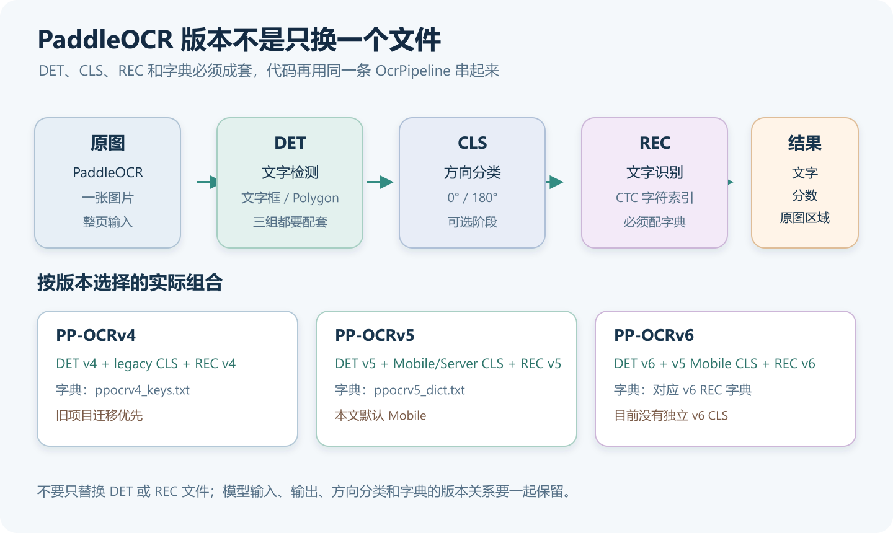
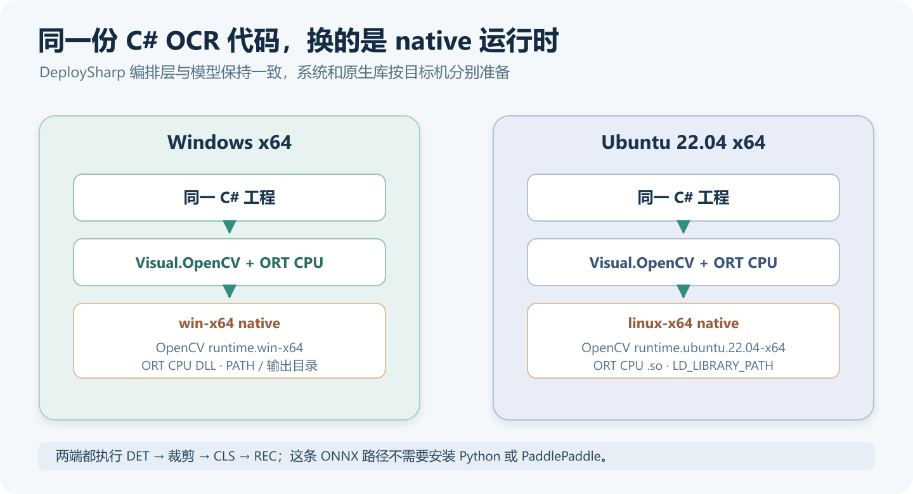
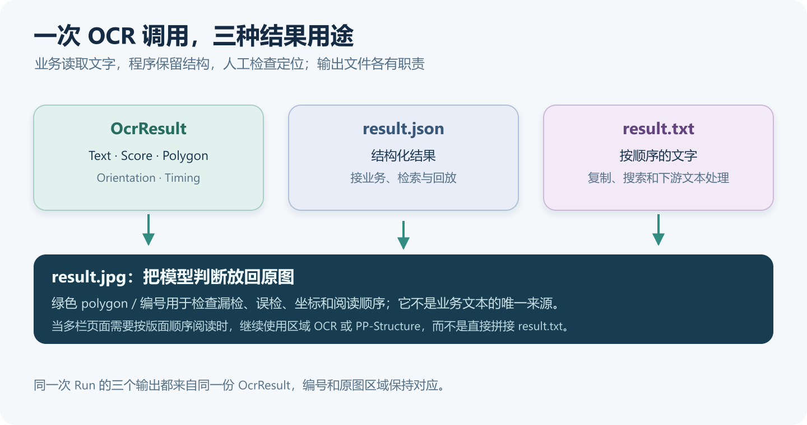
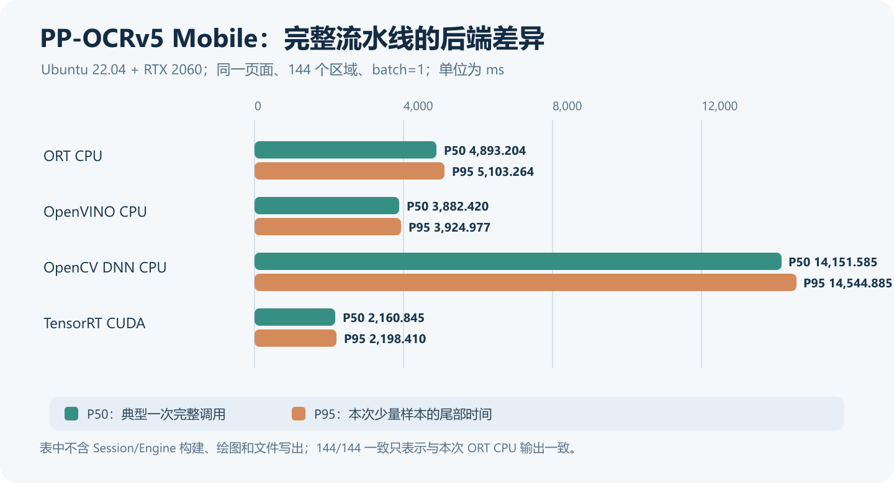

# 在 C# 中运行 PaddleOCR v4/v5/v6：从文字检测到完整识别结果

> DeploySharp 2.0.0 系列 · 第 03 篇实战教程，使用正式 NuGet `2.0.0`。


## 一、DeploySharp 项目简介

**DeploySharp** 是一个面向 **C#/.NET 开发者**的开源模型部署框架，由「椒颜皮皮虾」开发，项目源码遵循 **Apache License 2.0**。它基于 **ONNX Runtime、OpenVINO、TensorRT、OpenCV DNN** 等推理引擎，提供模型加载、图像前处理、推理执行和结果后处理接口，方便大家把模型接入桌面软件、工业视觉和文档应用。

项目已经接入目标检测、分类、分割、关键点、旋转框、异常检测和背景移除等视觉任务，也提供 **PP-OCRv4/v5/v6、PP-Structure 文档处理**和部分图文、本地语言模型的使用入口。常用模型有配套前后处理，自有模型可以通过扩展接口接入。

**项目地址：**

```text
https://github.com/guojin-yan/DeploySharp/tree/DeploySharpV2.0
```

**NuGet 包：**在包管理器中搜索 `JYPPX.DeploySharp`，按任务与后端选择组件。

```text
https://www.nuget.org/packages?q=JYPPX.DeploySharp
```

## 二、2.0 新特性与本篇 OCR 实战

### 2.1 从模型调用，走到完整应用流程

上一篇用 YOLO26 完成了目标检测。这一篇把多个模型组合起来，在 C# 中完成**文字检测、文本行裁剪、方向处理和文字识别**。

2.0 版本为 OCR 准备了以下功能：

| 新版能力 | 对 OCR 应用有什么用 |
| --- | --- |
| 多后端与按需安装 | 图像处理与推理引擎分别选择，先用 CPU 跑通，再评估目标设备 |
| v4/v5/v6 核心模型目录 | 根据模型 ID 取得配套输入输出与解码配置，减少逐版本手工填写 |
| 完整 `OcrPipeline` | 组织检测、透视裁剪、方向分类、识别及结果合并，返回原图区域与文字 |
| 动态 Batch 与独立 Session 池 | 多条文本行可以分批识别，也可以交给多个独立推理器调度 |
| 可配置的区域处理 | 按需要接入长文本策略、ROI 和文档区域工作流 |

下面先用 **ONNX Runtime CPU** 完成基础程序，再把相同图片和模型放到 **Ubuntu 22.04** 上，分别运行 ORT、OpenVINO、OpenCV DNN 和 TensorRT。CUDA 专用前后处理和 PP-Structure 页面处理会在对应专题中介绍。

### 2.2 为什么 OCR 需要一条流水线

一张图片里的文字数量、大小和角度都不固定，而识别模型通常以一条裁好的文本行为输入。因此，需要先找到文字，再裁剪、调整方向，最后识别内容。

这次使用三个模型，各自负责一件事：

| 阶段 | 作用 | 结果怎样传给下一步 |
| --- | --- | --- |
| DET：文字检测 | 找到图片中的文字位置 | 返回原图文字区域，用于透视裁剪 |
| CLS：文本行方向分类 | 判断裁好的文字行是否需要旋转 180° | 按方向处理后，再准备识别输入 |
| REC：文字识别 | 将文本行转换为字符序列 | CTC 解码得到文字和置信度 |

中间还有裁剪、缩放、归一化、Batch 组织和坐标对应。下图把整条处理过程放在一起，图中的多个文本行来自同一张原图：


本文默认使用 **PP-OCRv5 Mobile DET + Mobile CLS + Mobile REC**，识别一张包含**大标题、多栏小字、照片、图注和引语**的中文报纸页面，并生成三个文件：`result.txt`、`result.json`、`result.jpg`。随后用同一份代码切换到 v4 Mobile 和 v6 Tiny，讲清模型、字典和方向分类怎样配对。

下面是本次输入，来自 PaddleOCR 官方 PP-Structure 示例，原图大小为 `1524 × 1368`。


## 三、v4、v5、v6 应该怎样选择

### 3.1 先按部署需求选择组合

DeploySharp 为以下七组核心组合提供了模型目录与流水线配置，通过右侧参数即可切换：

| 版本与组合 | 主要选择方向 | 本文命令行参数 |
| --- | --- | --- |
| PP-OCRv4 Mobile | 已有 v4 轻量化项目，继续使用对应模型与字典 | `v4-mobile` |
| PP-OCRv4 Server | 评估 v4 Server 组合，允许更大的模型和计算开销 | `v4-server` |
| PP-OCRv5 Mobile | 本文默认组合，先完成完整部署与结果使用 | `v5-mobile` |
| PP-OCRv5 Server | 在目标图像上评估 v5 Server 组合 | `v5-server` |
| PP-OCRv6 Tiny | 从较小模型开始，评估设备延迟与识别效果 | `v6-tiny` |
| PP-OCRv6 Small | 进一步评估模型规模与效果之间的取舍 | `v6-small` |
| PP-OCRv6 Medium | 允许更大的模型，按实际数据评估效果 | `v6-medium` |

本篇运行了 v4 Mobile、v5 Mobile 和 v6 Tiny 三组模型。选型时可以先从轻量组合开始，再用自己的小字、低对比度、特殊字体或长文本图片比较效果。其他组合的后端测试情况可以查看仓库验证矩阵。

### 3.2 DET、CLS、REC 和字典要配套

三种版本的方向分类和识别字典存在差异：

| 组合 | 方向分类器 | REC 配套字典 |
| --- | --- | --- |
| v4 Mobile / Server | legacy 0°/180° CLS | `ppocrv4_keys.txt` |
| v5 Mobile / Server | 对应 Mobile / Server 的 PP-LCNet 文本行方向模型 | `ppocrv5_dict.txt` |
| v6 Tiny / Small / Medium | **复用 v5 Mobile CLS** | 对应规模的 `PP-OCRv6_*_rec_dict.txt` |

v6 组合复用 `paddleocr/ppocrv5/mobile-cls`。这里使用的 CLS 负责文本行 0°/180° 分类，整页文档的四方向分类则由另一类模型处理。

各版本的流水线阶段相同，具体的模型和字典配对如下：



识别字典负责将输出类别索引映射为字符。下载 REC 时一起准备对应字典，并保留原有顺序，才能得到正确文字。

## 四、创建项目与安装 NuGet

### 4.1 同一份 C# 代码，在 Windows 与 Ubuntu 运行

我分别在 Windows 和 Ubuntu 上运行了这套程序，使用相同的模型、字典和报纸页面，环境如下：

| 项目 | Windows 本机 | Ubuntu 测试设备 |
| --- | --- | --- |
| 系统 | Windows 11 x64，`10.0.26200` | Ubuntu `22.04.5 LTS` x64，内核 `6.8.0-138-generic` |
| CPU | Ryzen 7 5800H，8 核 16 线程 | Core i7-1165G7，4 核 8 线程 |
| GPU | 本文 Windows 基线只使用 CPU | NVIDIA RTX 2060，6 GB；驱动 `580.178.04` |
| .NET | SDK `10.0.401` / 运行时 `10.0.12` | SDK `10.0.301` / 运行时 `10.0.9` |
| 应用与 DeploySharp | `net10.0`、`x64`、NuGet `2.0.0` | 同左 |
| 基础图像与推理组件 | OpenCV `5.0.0`、ORT CPU `1.28.0` | OpenCV `5.0.0`、ORT CPU `1.28.0` |
| 输入 | `pp_structure_v3_demo.png`，`1524 × 1368` | 相同图片、模型和字典 |



准备 .NET 10 SDK，然后在 PowerShell 或 Ubuntu Bash 中创建项目：

```shell
dotnet new console -n DeploySharpOcrDemo -f net10.0
cd DeploySharpOcrDemo
```

后续命令均在这个项目目录执行。使用 Visual Studio 的朋友，也可以创建 .NET 10 控制台应用，再从 NuGet 管理器安装相同依赖。

### 4.2 按操作系统安装 CPU 依赖

OCR 编排、DB 检测后处理和 CTC 解码由视觉组件提供，`Visual.OpenCV` 负责图片和文本行处理，ONNX Runtime 后端执行模型。这套 C# ONNX 程序可以直接运行，无需安装 Python 或 PaddlePaddle。

三个托管/推理包在两种系统中相同，先安装：

```shell
dotnet add package JYPPX.DeploySharp.Visual.OpenCV --version 2.0.0
dotnet add package JYPPX.DeploySharp.Backend.OnnxRuntime --version 2.0.0
dotnet add package Microsoft.ML.OnnxRuntime --version 1.28.0
```

**Windows x64** 再安装图像原生库：

```powershell
dotnet add package JYPPX.OpenCV.runtime.win-x64 --version 5.0.0
```

**Ubuntu 22.04 x64** 选择相应的原生库：

```bash
dotnet add package JYPPX.OpenCV.runtime.ubuntu.22.04-x64 --version 5.0.0
```

| 显式安装的包 | 在 OCR 中负责什么 |
| --- | --- |
| `JYPPX.DeploySharp.Visual.OpenCV` | 解码原图、检测前处理、文本行透视裁剪、缩放与归一化 |
| `JYPPX.DeploySharp.Backend.OnnxRuntime` | 将 DET、CLS、REC 推理交给 ONNX Runtime |
| `Microsoft.ML.OnnxRuntime` | 提供 CPU 原生推理运行库 |
| 对应操作系统的 `JYPPX.OpenCV.runtime.*` | 提供图像处理、绘制与保存所需的原生库，两种系统择一 |

`Core`、`Visual` 等基础依赖由 NuGet 自动引入。

Ubuntu 下还需让系统找到 OpenCV 的 `.so` 及其同目录依赖。本例使用默认 NuGet 缓存目录，在完成还原后设置：

```bash
dotnet restore
opencv_native="$HOME/.nuget/packages/jyppx.opencv.runtime.ubuntu.22.04-x64/5.0.0/runtimes/ubuntu.22.04-x64/native"
export LD_LIBRARY_PATH="$opencv_native:${LD_LIBRARY_PATH:-}"
```

修改过 `NUGET_PACKAGES` 时，将 `$HOME/.nuget/packages` 换成自己的缓存根目录，并在启动程序前设置好搜索路径。若出现 `NETSDK1206` 警告，检查对应目录中的原生文件及其依赖是否能被加载。

### 4.3 其他场景怎样选包

使用其他后端时，按下表安装组件，并配置对应的后端注册和设备请求：

| 部署场景 | 主要变化 |
| --- | --- |
| ONNX Runtime CUDA | 保留 ORT 适配器，选择匹配的 GPU runtime 与 CUDA/cuDNN，显式启用 CUDA Provider |
| OpenVINO | 选择 `Backend.OpenVINO`，准备匹配的 OpenVINO runtime |
| OpenCV DNN | 选择 `Backend.OpenCV`，确认实际导出图的 Batch 与动态宽度支持 |
| TensorRT 执行 DET/CLS/REC | 选择 `Backend.TensorRT`、匹配 bridge 和厂商运行库，在目标 GPU 构建 Engine；第八节有 Ubuntu 实跑 |
| TensorRT CUDA 专用 OCR | 进一步使用 `Visual.TensorRT` 的 CUDA 裁剪与专用处理路径，按任务单独验证 |
| 应用内自动下载模型 | 按需增加 `ModelFactory`，使用 `PaddleOcrReleaseClient` |

直接加载本地文件时，使用前面的依赖即可；需要自动下载时再增加 ModelFactory。Windows 的后端安装见第二篇，Ubuntu 的运行方式见第八节。不同的 ORT CPU/GPU 原生包应使用独立输出目录。

```text
按场景选择 NuGet（第二篇第四节）：
https://github.com/guojin-yan/DeploySharp/blob/DeploySharpV2.0/docs/blog/2.0.0/2026-10/2026-10-28-02-yolo26-quickstart.md

TensorRT CUDA OCR：
https://github.com/guojin-yan/DeploySharp/blob/DeploySharpV2.0/docs/articles/tensorrt-cuda-ocr.md
```

### 4.4 检查项目配置

本文使用的 `.csproj` 完整内容如下。显式设置 `x64`，避免进程架构和原生运行库不一致：

```xml
<Project Sdk="Microsoft.NET.Sdk">
  <PropertyGroup>
    <OutputType>Exe</OutputType>
    <TargetFramework>net10.0</TargetFramework>
    <ImplicitUsings>enable</ImplicitUsings>
    <Nullable>enable</Nullable>
    <PlatformTarget>x64</PlatformTarget>
  </PropertyGroup>
  <ItemGroup>
    <PackageReference Include="JYPPX.DeploySharp.Visual.OpenCV" Version="2.0.0" />
    <PackageReference Include="JYPPX.DeploySharp.Backend.OnnxRuntime" Version="2.0.0" />
    <PackageReference Include="Microsoft.ML.OnnxRuntime" Version="1.28.0" />
    <PackageReference Include="JYPPX.OpenCV.runtime.win-x64" Version="5.0.0" Condition="'$(OS)' == 'Windows_NT'" />
    <PackageReference Include="JYPPX.OpenCV.runtime.ubuntu.22.04-x64" Version="5.0.0" Condition="$([MSBuild]::IsOSPlatform('Linux'))" />
  </ItemGroup>
</Project>
```

## 五、按需准备模型和测试图片

### 5.1 只下载当前组合需要的文件

PaddleOCR 模型放在独立的 **`models-paddleocr` Release** 中。每个 DET、CLS、REC 和字典均可单独下载，使用轻量组合时，不需要把全部模型打包下载。

下面分别给出 Bash 和 PowerShell 命令，按当前终端选择一组。默认下载 v5 Mobile 的三个 ONNX 和一个字典。

**Ubuntu Bash：** 修改 `variant` 可选择七种组合之一。

```bash
variant=v5-mobile
prefix="ppocr${variant}"
case "$variant" in
  v4-mobile|v4-server)
    cls=ppocrv4-legacy-cls.onnx; dictionary=ppocrv4_keys.txt ;;
  v5-mobile|v5-server)
    cls="$prefix-cls.onnx"; dictionary=ppocrv5_dict.txt ;;
  v6-tiny|v6-small|v6-medium)
    cls=ppocrv5-mobile-cls.onnx
    dictionary="PP-OCRv6_${variant#v6-}_rec_dict.txt" ;;
  *) printf '不支持的组合：%s\n' "$variant"; exit 1 ;;
esac
mkdir -p models images
model_base='https://github.com/guojin-yan/DeploySharp/releases/download/models-paddleocr'
for file in "$prefix-det.onnx" "$cls" "$prefix-rec.onnx" "$dictionary"; do
  curl -fL --retry 2 "$model_base/$file" -o "models/$file"
done
curl -fL --retry 2 \
  'https://paddle-model-ecology.bj.bcebos.com/paddlex/imgs/demo_image/pp_structure_v3_demo.png' \
  -o images/pp_structure_v3_demo.png
```

**Windows PowerShell：** 修改 `$variant` 选择相同组合。

```powershell
$variant = 'v5-mobile'
$prefix = $variant -replace '^v', 'ppocrv'
switch -Regex ($variant) {
  '^v4-(mobile|server)$' {
    $cls = 'ppocrv4-legacy-cls.onnx'
    $dictionary = 'ppocrv4_keys.txt'
    break
  }
  '^v5-(mobile|server)$' {
    $cls = "$prefix-cls.onnx"
    $dictionary = 'ppocrv5_dict.txt'
    break
  }
  '^v6-(tiny|small|medium)$' {
    $cls = 'ppocrv5-mobile-cls.onnx'
    $size = $variant.Substring(3)
    $dictionary = "PP-OCRv6_${size}_rec_dict.txt"
    break
  }
  default { throw '请选择本文支持的七种组合之一。' }
}
New-Item -ItemType Directory -Force -Path .\models, .\images | Out-Null
$modelBase = 'https://github.com/guojin-yan/DeploySharp/releases/download/models-paddleocr'
foreach ($file in @("$prefix-det.onnx", $cls, "$prefix-rec.onnx", $dictionary)) {
  Invoke-WebRequest -Uri "$modelBase/$file" -OutFile (Join-Path '.\models' $file)
}
Invoke-WebRequest `
  -Uri 'https://paddle-model-ecology.bj.bcebos.com/paddlex/imgs/demo_image/pp_structure_v3_demo.png' `
  -OutFile '.\images\pp_structure_v3_demo.png'
```

如果命令行下载不方便，也可以在 Release 页面选择对应文件下载。已有本地模型和图片，直接按名称放入目录即可。本文选用的默认文件是：

| 文件 | 用途 |
| --- | --- |
| `ppocrv5-mobile-det.onnx` | 文字检测 |
| `ppocrv5-mobile-cls.onnx` | 文本行 0°/180° 方向分类 |
| `ppocrv5-mobile-rec.onnx` | 文本行识别 |
| `ppocrv5_dict.txt` | v5 REC 字符索引表 |
| `pp_structure_v3_demo.png` | 官方中文多栏报纸输入图片 |

```text
PaddleOCR 单文件模型：
https://github.com/guojin-yan/DeploySharp/releases/tag/models-paddleocr

默认测试图片：
https://paddle-model-ecology.bj.bcebos.com/paddlex/imgs/demo_image/pp_structure_v3_demo.png
```

### 5.2 项目目录

默认组合下载完成后，目录如下。其他组合可以放在同一个 `models` 目录，程序只会加载所选组合：

```text
DeploySharpOcrDemo/
  DeploySharpOcrDemo.csproj
  Program.cs
  models/
    ppocrv5-mobile-det.onnx
    ppocrv5-mobile-cls.onnx
    ppocrv5-mobile-rec.onnx
    ppocrv5_dict.txt
  images/
    pp_structure_v3_demo.png
```

## 六、编写完整 OCR 程序

下面代码可以直接替换 `Program.cs`。它根据组合选择模型，加载本地文件和配套字典，创建三阶段流水线，最后保存文字、结构化结果和原图文字框。

为方便切换，三个可选命令行参数依次为：**图片路径、模型组合、模型目录**。这里先使用 `batch=1`、`channels=1` 建立逐行识别基线，后面再说明怎样评估 Batch 和通道；密集页面的检测后处理与流水线区域上限都显式设为 512。

```csharp
using System.Diagnostics;
using System.Text;
using System.Text.Encodings.Web;
using System.Text.Json;
using JYPPX.DeploySharp;
using JYPPX.DeploySharp.Backends.OnnxRuntime;
using JYPPX.DeploySharp.Models;
using JYPPX.DeploySharp.Registry;
using JYPPX.DeploySharp.Visual;
using JYPPX.DeploySharp.Visual.Models.PaddleOcr;
using JYPPX.DeploySharp.Visual.OpenCV;
using JYPPX.OpenCvSharp.Core;
using JYPPX.OpenCvSharp.ImgProc;
using ImageCodecs = JYPPX.OpenCvSharp.ImgCodecs.Cv2;
using Drawing = JYPPX.OpenCvSharp.ImgProc.Cv2;

Console.OutputEncoding = Encoding.UTF8;
string imagePath = Path.GetFullPath(args.Length > 0 ? args[0] : "images/pp_structure_v3_demo.png");
string variant = args.Length > 1 ? args[1].ToLowerInvariant() : "v5-mobile";
string modelRoot = Path.GetFullPath(args.Length > 2 ? args[2] : "models");
const int batch = 1;
const int channels = 1;

var ids = variant switch
{
    "v4-mobile" => ("ppocrv4/mobile-det", "ppocrv4/legacy-cls", "ppocrv4/mobile-rec"),
    "v4-server" => ("ppocrv4/server-det", "ppocrv4/legacy-cls", "ppocrv4/server-rec"),
    "v5-mobile" => ("ppocrv5/mobile-det", "ppocrv5/mobile-cls", "ppocrv5/mobile-rec"),
    "v5-server" => ("ppocrv5/server-det", "ppocrv5/server-cls", "ppocrv5/server-rec"),
    "v6-tiny" => ("ppocrv6/tiny-det", "ppocrv5/mobile-cls", "ppocrv6/tiny-rec"),
    "v6-small" => ("ppocrv6/small-det", "ppocrv5/mobile-cls", "ppocrv6/small-rec"),
    "v6-medium" => ("ppocrv6/medium-det", "ppocrv5/mobile-cls", "ppocrv6/medium-rec"),
    _ => throw new ArgumentException("版本应为 v4-mobile/server、v5-mobile/server 或 v6-tiny/small/medium。")
};
PaddleOcrModelDescriptor detRow = Find(ids.Item1);
PaddleOcrModelDescriptor clsRow = Find(ids.Item2);
PaddleOcrModelDescriptor recRow = Find(ids.Item3);
string dictionaryPath = Require(recRow.ReleaseArtifact!.DictionaryAssetName!);
OcrCharacterSet characters = PaddleOcrProfiles.LoadCharacterSet(
    dictionaryPath, "local." + variant, "1", useSpaceCharacter: true);
PaddleOcrProfile det = CreateProfile(detRow, maximumBatch: 1);
PaddleOcrProfile cls = CreateProfile(clsRow, maximumBatch: batch);
PaddleOcrProfile rec = CreateProfile(recRow, maximumBatch: batch, characters);

using var backends = new BackendRegistry();
backends.UseOnnxRuntime();
var profiles = new VisualProfileRegistry();
profiles.Register(det.VisualProfile);
profiles.Register(cls.VisualProfile);
profiles.Register(rec.VisualProfile);
profiles.Freeze();
var request = new BackendRequest(BackendCapabilities.TensorInference,
    OnnxRuntimeBackendProvider.BackendId, "cpu");

using var pipeline = new OcrPipeline(
    backends,
    Select(det, detRow), request,
    Select(cls, clsRow), request, cls.CropProfile!,
    Select(rec, recRow), request, rec.CropProfile!,
    new OcrPipelineOptions(maximumConcurrency: 1, maximumRegions: 512,
        maximumRecognitionBatch: batch, maximumRecognitionPaddingRatio: 1.0,
        autoRotateVerticalText: true),
    detectionSessionOptions: new SessionOptions(1),
    orientationSessionOptions: new SessionOptions(channels),
    recognitionSessionOptions: new SessionOptions(channels),
    orientationRejectionPolicy: OcrOrientationRejectionPolicy.UseZeroDegrees);

// 此 Mat 只用于取得原图尺寸及绘图；OCR 输入在内部保留自己的源图。
if (!File.Exists(imagePath)) throw new FileNotFoundException("找不到图片。", imagePath);
using Mat canvas = ImageCodecs.ImRead(imagePath);
if (canvas.Empty) throw new IOException("无法解码输入图片。");
var sourceSize = new VisualSize(canvas.Cols, canvas.Rows);
var prepare = Stopwatch.StartNew();
using OpenCvOcrImageInput input = new OpenCvOcrImageInputFactory().CreateFromFile(
    imagePath, det.VisualProfile.Input.Name,
    OpenCvStage19Preprocessing.CreatePaddleOcrOfficialInferenceDetectionOptions(sourceSize, resizeLong: 1600));
prepare.Stop();
using var cancellation = new CancellationTokenSource();
Console.CancelKeyPress += (_, e) => { e.Cancel = true; cancellation.Cancel(); };
var run = Stopwatch.StartNew();
OcrResult result = await pipeline.RunAsync(input,
    new OcrExecutionOptions(timeout: TimeSpan.FromSeconds(60)), cancellation.Token);
run.Stop();

Console.WriteLine($"backend=onnxruntime;device=cpu;variant={variant};batch={batch};channels={channels}");
Console.WriteLine($"regions={result.Regions.Count}");
Console.WriteLine(FormattableString.Invariant(
    $"prepare_ms={prepare.Elapsed.TotalMilliseconds:F1};run_ms={run.Elapsed.TotalMilliseconds:F1}"));
for (int i = 0; i < result.Regions.Count; i++)
{
    OcrRegionResult item = result.Regions[i];
    Console.WriteLine(FormattableString.Invariant(
        $"[{i + 1:D2}] score={item.Recognition.Confidence:F3};angle={OrientationDegrees(item.Region.Orientation)};{item.Recognition.Text}"));
    var points = item.Region.Polygon.Vertices;
    for (int j = 0; j < points.Count; j++)
    {
        var a = points[j];
        var b = points[(j + 1) % points.Count];
        Drawing.Line(canvas, new Point((int)a.X, (int)a.Y), new Point((int)b.X, (int)b.Y),
            new Scalar(80, 210, 30), 2);
    }
    var first = points[0];
    Drawing.PutText(canvas, (i + 1).ToString("D2"),
        new Point(Math.Clamp((int)first.X, 0, Math.Max(0, canvas.Cols - 35)),
            Math.Clamp((int)first.Y - 4, 18, Math.Max(18, canvas.Rows - 1))),
        HersheyFonts.HersheySimplex, 0.5, new Scalar(10, 10, 230), 1);
}
File.WriteAllLines("result.txt", result.Regions.Select(x => x.Recognition.Text), new UTF8Encoding(false));
var report = new
{
    variant, backend = "onnxruntime", device = "cpu", batch, channels,
    sourceSize = new { width = result.SourceSize.Width, height = result.SourceSize.Height },
    timing = new { prepareMs = prepare.Elapsed.TotalMilliseconds, runMs = run.Elapsed.TotalMilliseconds },
    regions = result.Regions.Select((x, i) => new
    {
        index = i + 1, text = x.Recognition.Text, confidence = x.Recognition.Confidence,
        detectionScore = x.Region.Score, angle = OrientationDegrees(x.Region.Orientation),
        polygon = x.Region.Polygon.Vertices.Select(p => new { x = p.X, y = p.Y })
    })
};
File.WriteAllText("result.json", JsonSerializer.Serialize(report, new JsonSerializerOptions
{
    WriteIndented = true, Encoder = JavaScriptEncoder.UnsafeRelaxedJsonEscaping
}), new UTF8Encoding(false));
if (!ImageCodecs.ImWrite("result.jpg", canvas)) throw new IOException("无法保存结果图。");
Console.WriteLine("saved=result.txt,result.json,result.jpg");

static int OrientationDegrees(TextOrientation orientation) => orientation switch
{
    TextOrientation.Degrees0 => 0,
    TextOrientation.Clockwise90 => 90,
    TextOrientation.Degrees180 => 180,
    TextOrientation.CounterClockwise90 => 270,
    _ => throw new ArgumentOutOfRangeException(nameof(orientation))
};

PaddleOcrModelDescriptor Find(string id) => PaddleOcrModelCatalog.Find(new ModelId("paddleocr/" + id));

string Require(string file)
{
    string path = Path.Combine(modelRoot, file);
    return File.Exists(path) ? path : throw new FileNotFoundException("缺少模型或字典。", path);
}

PaddleOcrProfile CreateProfile(PaddleOcrModelDescriptor row, int maximumBatch, OcrCharacterSet? dictionary = null)
{
    // 本地加载：使用目录中的模型规格，不要求填写模型来源元数据。
    var contract = new PaddleOcrArtifactContract(row.ReleaseArtifact!.Opset,
        "", "", "", "Apache-2.0", "local-input-v1", "local-output-v1");
    if (row.Family == "det")
        return PaddleOcrProfiles.CreateDetection(row.ModelId, contract, row.InputName, row.OutputName,
            postprocess: new PaddleDbPostprocessOptions(maximumRegions: 512), maximumBatch: maximumBatch);
    return PaddleOcrModelCatalog.CreateProfile(row, contract, dictionary, maximumBatch);
}

VisualProfileSelection Select(PaddleOcrProfile profile, PaddleOcrModelDescriptor row) =>
    profiles.Select(profile.CreateArtifact(Require(row.ReleaseArtifact!.AssetName)),
        backends, request, profile.VisualProfile.Task);
```

## 七、关键实现：从三个模型到一个结果

### 7.1 目录选择和本地文件加载

代码中的 `PaddleOcrModelCatalog` 用于查找模型规格，例如 v4 Mobile DET 的输出名与 v5 Mobile DET 并不相同。通过目录选择 Profile，便可以复用对应的检测解码、方向类别和识别配置。

`ReleaseArtifact` 提供文件名和模型规格，`Require` 检查本地文件，`CreateArtifact` 将路径交给后端。模型使用前面下载到 `models` 目录中的文件。

`CreateProfile` 为 DET 声明单图输入，CLS 和 REC 的 Batch 上限由顶部的 `batch` 控制，默认逐行运行。调整 Batch 时，需要所用模型支持对应的批次大小。

测试这张密集报纸时，我把两个区域上限都设为了 512：一个是 DB 后处理的 `PaddleDbPostprocessOptions.maximumRegions`，另一个是 `OcrPipelineOptions.maximumRegions`。DB 后处理默认最多返回 128 个区域，单独调大流水线的上限，前面仍会截断。本图调整后返回了 144 个区域。

### 7.2 检测前处理与文本行裁剪

检测输入使用 `CreatePaddleOcrOfficialInferenceDetectionOptions`。为了保留页面中的小字，这里传入 `resizeLong: 1600`，`1524 × 1368` 原图经过尺寸对齐后为 `1536 × 1408`，使用 BGR 和配套均值、标准差归一化。检测尺寸会影响小字效果和计算开销，换图时可以结合文字大小与设备能力调整。

DET 的 DB 后处理将概率图转换为文字区域，默认采用概率阈值 `0.3`、框阈值 `0.6` 和扩张比例 `1.5`。随后，`OcrPipeline` 从 OCR 输入保留的同一张原图中透视裁剪文本行，再按 CLS 和 REC 各自的配置准备输入。

REC 默认按高度 48 保持比例准备动态宽度，组批时为同一批文本行补齐宽度。方向分类则有不同配置：legacy CLS 使用 BGR、48×192；本篇 v5 CLS 使用 RGB、80×160。它们由对应 Profile 处理，不需要在主程序中手工旋转每一行。

程序另外读取一份 `canvas`，用于获取尺寸和绘图。OCR 输入持有自己的源图，所有文本行裁剪都复用这张图。

### 7.3 字典和 CTC 为什么必须对应

REC 输出的每个时间步包含各字符类别的分数。CTC（Connectionist Temporal Classification）解码先选择类别，再按规则合并相邻重复项、移除 blank，最后按字典映射成文字。

下面用一段示意序列说明 CTC 的解码过程：


`LoadCharacterSet` 按字典顺序读取字符。本例使用 `useSpaceCharacter: true`，由加载器追加模型需要的空格类别；blank 由 CTC 配置管理。使用自有字典时，按模型约定配置空格和 blank，保留它们各自的索引。

如果 REC 类别数不匹配或输出乱码，先核对模型与字典是否配套，再检查空格配置、blank 索引和输出是否已经过 Softmax。

### 7.4 方向、坐标、异步和资源释放

本例启用 CLS 和 `autoRotateVerticalText`。高宽比至少为 1.5 的细长文字框先逆时针旋转 90°，其余区域执行文本行 0°/180° 分类。前者用于处理侧着印刷的长条文字；中文竖排的阅读分析需要另行处理。

方向分类的默认拒识阈值为 `0.9`。这里选择 `UseZeroDegrees`，低置信度时按 0° 继续识别；如果业务要求方向不确定就报错，可以改用 `Fail`。

`item.Region.Polygon` 返回原图像素坐标，可以直接绘制。`Region.Orientation` 记录文本行在识别前采用的离散旋转方向。

程序通过 `RunAsync` 等待完整结果，调用超时设为一分钟，按 `Ctrl+C` 可以取消。等待调用结束后，再释放输入资源。

输入、流水线、后端注册表和 `Mat` 都通过 `using` 释放。`OpenCvOcrImageInput` 持有原图和裁剪工作区，返回的文字与坐标则是独立的托管结果。批量处理图片时，可以复用 Profile、注册表和流水线，为每张图分别创建、释放输入。

## 八、运行程序，查看实际识别结果

### 8.1 默认 v5 Mobile 的真实输出

在项目目录执行：

```shell
dotnet run -c Release
```

Windows ORT CPU 返回了 **144 个文字区域**。下面节选部分输出，完整文字保存在 `result.txt`，全部区域、分数和坐标保存在 `result.json`。Ubuntu 的运行结果与后端对照见第 8.4、8.5 节。

```text
backend=onnxruntime;device=cpu;variant=v5-mobile;batch=1;channels=1
regions=144
prepare_ms=107.2;run_ms=5879.9
[01] score=0.997;angle=0;助力双方交往
[02] score=0.999;angle=0;搭建友谊桥梁
[03] score=0.955;angle=0;本报记者沈小晓任彦黄培昭
[04] score=0.999;angle=0;身着中国传统民族服装的厄立特里亚青
[05] score=0.998;angle=0;厄立特里亚高等教育与研究院合作建立，开
[06] score=0.996;angle=0;年依次登台表演中国民族舞、现代舞、扇子舞
[07] score=0.997;angle=0;设了中国语言课程和中国文化课程，注册学
[08] score=0.997;angle=0;等，曼妙的舞姿赢得现场观众阵阵掌声。这
...（第 09—23 项省略）...
[24] score=0.234;angle=0;90-
...（第 25—44 项省略）...
[45] score=0.995;angle=0;在厄立特里亚不久前举办的第六届中国风筝文化节上，当地小学生体验风筝制作。
...（第 46—144 项省略）...
saved=result.txt,result.json,result.jpg
```

控制台时间来自一次未预热运行，`prepare_ms` 和 `run_ms` 的计时范围见第 9.2 节；预热后的多后端对照放在第 8.5 节。

下图是同次运行生成的 `result.jpg`。绿色线标出区域，红色编号与控制台编号、JSON 中的 `index` 对应，结果保留原图 `1524 × 1368` 尺寸：


可以看到，大标题、密集正文和长图注都进入了识别结果。照片内的第 24 区域输出了 `90-`，分数只有 `0.234`，属于需要复核的低置信度候选；引号、标点和个别字也有进一步校正的空间。

这页采用多栏排版，当前 OCR 按几何位置排序，相近高度的左右栏文字会穿插。要按栏目组织文字、区分标题和图注，可以先做版面分析，再在各区域内运行 OCR，第六篇会介绍这种处理方式。

### 8.2 三种输出文件怎样使用

| 文件 | 保存内容 | 使用方式 |
| --- | --- | --- |
| `result.txt` | 按结果顺序保存的逐区域文字，UTF-8 | 查看文本、复制到后续业务 |
| `result.json` | 文字、识别分数、检测分数、方向、原图 polygon 和计时 | 与区域编号关联，接入业务或界面 |
| `result.jpg` | 原图上的文字框和编号 | 检查定位、漏检、误检及坐标 |

查看文字时用 TXT，接入业务时读取 JSON，检查定位时打开图片。三种输出与 `OcrResult` 字段的关系如下：



JSON 中的 `confidence` 是识别置信度，`detectionScore` 是文字区域的检测分数。`angle` 将方向枚举转换为顺时针 `0/90/180/270`，记录识别前的离散旋转处理；`polygon` 保存原图坐标。

绘图使用 OpenCV 内置 Hershey 字体，只写数字编号；该字体不适合直接绘制中文。需要在界面显示中文时，可以用 WPF/WinForms、SkiaSharp 或其他支持中文字体的绘制组件，按相同编号关联文字。

### 8.3 切换 v4、v6 或自己的图片

先把第五节下载命令中的 `variant`（PowerShell 为 `$variant`）改为所需组合，下载对应文件，再通过第二个程序参数选择相同组合。下面的正斜杠路径可用于 Bash 和 PowerShell：

```shell
dotnet run -c Release -- ./images/pp_structure_v3_demo.png v4-mobile ./models
dotnet run -c Release -- ./images/pp_structure_v3_demo.png v6-tiny ./models
```

同一份代码在三个组合上的结果如下，均使用 ORT CPU，执行 DET、裁剪、CLS、REC 和结果合并：

| 模型组合 | 返回区域数 | 第一行识别文字 | 运行结果 |
| --- | ---: | --- | --- |
| v4 Mobile + legacy CLS | 143 | 助力双方交往 | 完整运行并保存三个结果文件 |
| v5 Mobile + Mobile CLS | 144 | 助力双方交往 | 完整运行并保存三个结果文件 |
| v6 Tiny + v5 Mobile CLS | 145 | 助力双方交往 | 完整运行并保存三个结果文件 |

三个组合都识别出了页面标题，检测区域数略有不同。可以打开各自的 JSON 和结果图，继续比较小字、标点和低分区域的识别效果。

换自己的图片和模型目录时，传入实际路径：

```shell
dotnet run -c Release -- ./images/my-document.jpg v5-mobile ./my-models
```

程序按标准文件名加载模型。使用自己训练或重新导出的模型时，同步配置张量名称、输入高度、颜色、归一化、动态宽度、Batch 和字典。符合 PP-OCR 输出结构的模型可以使用 `PaddleOcrProfiles` 工厂，传入对应输入输出名；其他结构则编写自己的 Profile 或 Decoder。

三个结果文件会写到当前工作目录，再次运行会覆盖前一次。需要保留多个版本或多张图的结果时，应按图片或组合名称设置各自的输出目录。

### 8.4 放到 Ubuntu，同一份代码怎样运行

在 Ubuntu 上安装 .NET 10，按第 4.2 节准备 Linux OpenCV runtime，再下载模型和图片。使用第六节的 C# 主程序，在工程目录执行：

```bash
dotnet run -c Release -- ./images/pp_structure_v3_demo.png v5-mobile ./models
```

Ubuntu ORT CPU 同样返回 **144 个区域**，逐区域文字与 Windows 结果一致，并写出 `result.txt/result.json/result.jpg`。

程序直接保存文件，可以在没有图形桌面的服务器或边缘设备上运行，再把结果取回开发机查看。

### 8.5 Ubuntu 上运行 OpenVINO、OpenCV DNN 与 TensorRT

我把多后端版本整理成了一个独立工程，为 DET、CLS、REC 分别配置后端注册表。切换引擎时，保持**字典、原图、检测尺寸、DB 阈值、裁剪和 CTC 解码**相同。

```text
Ubuntu PaddleOCR 后端对照工程：
https://github.com/guojin-yan/DeploySharp/tree/DeploySharpV2.0/docs/blog/2.0.0/2026-10/examples/03-paddleocr-backends
```

将该目录中的 `Program.cs` 与 `PaddleOcrBackends.csproj` 下载到一个与基础案例**并列的新目录**。工程里已引用各后端包；下面列出这次使用的引擎与原生环境，方便核对：

| 后端 | 本次环境与准备 |
| --- | --- |
| ORT CPU | `Microsoft.ML.OnnxRuntime 1.28.0` |
| OpenVINO CPU | `OpenVINO.runtime.ubuntu.22-x86_64 2026.3.1`，选择 Latency 提示 |
| OpenCV DNN CPU | 与图像组件共用 `JYPPX.OpenCV.runtime.ubuntu.22.04-x64 5.0.0` |
| TensorRT CUDA | TensorRT `11.0.0.114`、CUDA `12.9`、cuDNN `9.22.0`、RTX 2060 |
| TensorRT bridge | `JYPPX.TensorRT.CSharp.API.Runtime.linux-x64.ubuntu22.04.trt11.0.cuda12.9.cudnn9.22.Bridge 4.0.0` |

OpenVINO 原生库还依赖同目录的版本化 `.so`。先还原包，再为当前进程设置 OpenCV、OpenVINO 和 CUDA 搜索路径，在后端对照工程目录执行：

```bash
dotnet restore
opencv_native="$HOME/.nuget/packages/jyppx.opencv.runtime.ubuntu.22.04-x64/5.0.0/runtimes/ubuntu.22.04-x64/native"
openvino_native="$HOME/.nuget/packages/openvino.runtime.ubuntu.22-x86_64/2026.3.1/runtimes/linux-x64/native"
cuda_native=/usr/local/cuda-12.9/lib64
export LD_LIBRARY_PATH="$opencv_native:$openvino_native:$cuda_native:${LD_LIBRARY_PATH:-}"

image=../DeploySharpOcrDemo/images/pp_structure_v3_demo.png
models=../DeploySharpOcrDemo/models
dotnet run -c Release -- "$image" v5-mobile "$models" openvino
dotnet run -c Release -- "$image" v5-mobile "$models" opencv-dnn
dotnet run -c Release -- "$image" v5-mobile "$models" tensorrt
```

这里假定基础案例叫 `DeploySharpOcrDemo`；按自己的实际位置修改 `image/models`，CUDA 安装目录不同也要相应修改。需要重新运行 ORT CPU 时，最后一个参数使用 `ort-cpu`。结果按后端与组合写入 `results/<backend>/<variant>/`，控制台只打印前 10 个区域，完整文字和区域继续写入 TXT/JSON。

TensorRT 首次运行会通过库的 `TensorRtOnnxEngineBuilder` **在 Ubuntu 目标 GPU 上构建三份 Engine**，以后复用模型旁的 `.ubuntu-trt11.engine`。本次 Profile 如下：

| 阶段 | Engine 接受的输入 |
| --- | --- |
| DET | 固定 `1 × 3 × 1408 × 1536`，对应本文页面的前处理 |
| CLS | 固定 `1 × 3 × 80 × 160` |
| REC | `1 × 3 × 48 × W`，`W` 的 min/opt/max 为 `48/320/3200` |

代码选择 `TensorRtApiVersion.TensorRt11`，Profile 和工件格式都设为 `tensorrt-engine`。TensorRT 11 使用强类型网络，这里保留 Float32 图并关闭 TF32。Engine 在 Ubuntu 目标 GPU 上构建；更换模型、输入尺寸、GPU 或 TensorRT 版本后，重新生成匹配的文件。

下面是同一 Ubuntu 设备上的完整流程结果。四条路径都执行 **DET → 透视裁剪 → CLS → REC → 合并**，统一 `batch=1 / channels=1 / paddingRatio=1.0 / maximumRegions=512 / resizeLong=1600`：

| 后端 | 区域数 | 相对 ORT CPU 的逐区域文字 | 完整调用 P50 / ms | P95 / ms |
| --- | ---: | --- | ---: | ---: |
| ORT CPU `1.28.0` | 144 | 基线 | 4893.204 | 5103.264 |
| OpenVINO CPU `2026.3.1` | 144 | 144/144 一致 | 3882.420 | 3924.977 |
| OpenCV DNN CPU `5.0.0` | 144 | 144/144 一致 | 14151.585 | 14544.885 |
| TensorRT `11.0.0.114` CUDA | 144 | 144/144 一致 | 2160.845 | 2198.410 |

将四种后端的完整调用时间画成图，可以更直观地看出差异：



本次**预热 2 次、统计 5 次，按 nearest-rank 计算 P50/P95**。计时从读图、检测前处理开始，到完整 `RunAsync` 返回结束，不包含 Session/Engine 构建、绘图和文件写出。样本数为 5，因此 P95 取本次最大值；评估长期运行性能时，需要增加采样次数。

这页包含 144 个候选区域，检测输入较大，而且采用逐行识别。TensorRT 执行 DET、CLS、REC，裁剪和结果解码仍在 CPU。若继续优化，可以从文本行 Batch、独立通道和 CUDA 专用裁剪、CTC 路径入手，再测完整调用时间。

OpenCV DNN 在这页上耗时较高。工程保留动态识别宽度，Shape 缓存容量为 16，宽度种类多时可能反复专门化和导入网络。固定宽度或宽度分桶可以作为调优方向，测试时同时检查补边对识别文字的影响。

四种后端的 144 条区域文字与 ORT CPU 一致，照片内的低分候选、标点和多栏排序问题也保留在结果中。后端对照之后，还需要用标注数据评估识别准确率。

## 九、Batch、推理通道与时间应该怎样看

### 9.1 一张图，多条文字行

本例 DET 对整张图执行一次。检测完成后，CLS 和 REC 面对的是多条文本行：**Batch 控制一次送入多少行，Session 数量控制同时有多少个独立推理器处理批任务。**

文本行组批、Session 调度和图片级并发的关系如下：


| 配置 | 本文值 | 控制什么 |
| --- | ---: | --- |
| `maximumRecognitionBatch` | 1 | 一个识别批次最多包含多少条文本行 |
| CLS/REC Profile 的 `maximumBatch` | 1 | 声明对应模型允许的最大 Batch，要与实际导出能力匹配 |
| `orientationSessionOptions` / `recognitionSessionOptions` | 各 1 | 各阶段独立 Session 的数量 |
| `maximumConcurrency` | 1 | 同时进入这条流水线的完整 OCR 调用上限 |
| `maximumRecognitionPaddingRatio` | 1.0 | 宽度组批时允许的补边计算比例 |

想评估两个独立 CLS/REC 通道，可以将代码顶部的 `channels` 改为 `2`。这会创建独立推理会话，增加内存或显存开销；CPU 后端本身也可能使用多线程，因此增加通道不一定更快。

评估批处理时，可以将顶部 `batch` 从 `1` 改为 `8`，Profile 和流水线会使用同一个上限。实际批次还会考虑文本行宽度和补边比例，较短的文字与超长行通常需要分组。本例的补边比例为 `1.0`，放宽到 `1.5` 后，可以容纳更多宽度不同的文本行。

我在另一张商品图上测试时，v5 Mobile 使用 `batch=8 / paddingRatio=1.5`，价格行出现了漏字，改回逐行识别后恢复。因此这里先用逐行配置建立基线。后续调整 Batch 和补边时，把每行文字与基线一起比较，检查补边和归一化是否符合模型要求。

### 9.2 本文记录的时间包含什么

基础程序分别记录输入准备和流水线执行时间：

| 字段 | 包含内容 | 未包含内容 |
| --- | --- | --- |
| `prepare_ms` | 创建 OCR 输入时的图片解码、检测前处理和输入准备 | 模型加载、绘图画布的单独解码 |
| `run_ms` | 等待完整 `RunAsync`：DET、文本行准备、CLS、REC、解码与结果合并 | 模型/Session 构建、前面的输入创建、绘图、TXT/JSON/JPG 写出 |

基础程序打印一次运行的 `prepare_ms` 和 `run_ms`；第 8.5 节的对照工程则预热后重复测量完整调用。进一步分析时，可以读取 `result.Timing` 中的 `Detection`、`OrientationClassification` 和 `Recognition` 阶段信息。

`Timing.Details` 的部分字段累计了多个批次的准备或推理工作时间。并发阶段会重叠，端到端耗时应单独计时，再计算完整调用的 P50/P95。

比较性能时，固定图片、模型、输入规格、后端、Batch 和通道，先预热，再重复采样，同时比较文字结果。仓库的设备实测文档还记录了其他设备上的 OCR 完整流水线与对应配置：

```text
Batch、Session 池和并发：
https://github.com/guojin-yan/DeploySharp/blob/DeploySharpV2.0/docs/articles/batch-session-concurrency.md

设备性能实测：
https://github.com/guojin-yan/DeploySharp/blob/DeploySharpV2.0/docs/articles/device-performance-benchmarks.md

性能测试方法：
https://github.com/guojin-yan/DeploySharp/blob/DeploySharpV2.0/docs/articles/performance-benchmarking.md
```

### 9.3 长文本、低分行与区域 OCR

遇到超长文本，可以选择动态宽度、宽度分桶、溢出拒绝或重叠长行窗口。低分行可以尝试方向重试、宽度重试和裁剪增强，逐项比较准确率与耗时，选择适合自己数据的组合。

已有文字行框或表格单元格区域时，可以用仅识别流水线直接执行 REC。版面区域通常还需要区域内的文字检测，表格 HTML 则需要结构识别，这些会在 PP-Structure 案例中继续介绍。

## 十、常见问题与处理方法

| 现象 | 优先检查 | 处理方向 |
| --- | --- | --- |
| 找不到模型、字典或图片 | 工作目录、所选 `variant`、第三个参数的模型根目录 | 按第五节下载所选组合，保留对应标准文件名 |
| 原生 DLL 加载失败 | `x64`、OpenCV runtime、ORT CPU 原生包和本机依赖 | 使用本文同版本组合；缺少 MSVC 运行库时按异常提示补齐 |
| Ubuntu 提示 `.so` 或版本化依赖找不到 | 对应 Linux runtime 是否已还原、native 目录是否在进程搜索路径 | 按第 4.2/8.5 节设置 `LD_LIBRARY_PATH`，结合 `ldd` 补齐依赖 |
| 输出张量名称不匹配 | 模型是否来自本文这组 Release，是否替换了导出图 | 对照实际张量名配置 Profile |
| REC 类别数不一致或文字乱码 | 模型和字典是否配套、空格与 blank 的处理 | 保持字典顺序，确认空格类是否由加载器追加 |
| 图片里有字，但没有框 | 检测输入尺寸、颜色、归一化及 DB 阈值 | 先用示例模型和图片复现，再针对小字与低对比度逐项调整 |
| 文字被截断或长行错误较多 | 文本框边界、裁剪比例、识别最大宽度与溢出策略 | 对照原图检查；按需要评估长行窗口或宽度策略 |
| 中文在结果图上显示问号 | 是否使用 OpenCV 内置 Hershey 字体画中文 | 保留编号，中文在界面或支持中文字库的组件中绘制 |
| 加大 Batch 或 Session 后更慢 | 宽度补边、CPU 线程争抢、模型固定 Batch、内存占用 | 固定输入比较完整流水线，逐个调整配置 |
| 换成 TensorRT/OpenCV 后不能原样运行 | Engine、后端注册、Batch/Shape 与适配路径 | 按具体后端教程准备，先核对精确模型验证状态 |

排查异常时，先根据完整错误定位到模型加载、裁剪还是解码阶段，再检查对应配置。

```text
OCR 基础教程：
https://github.com/guojin-yan/DeploySharp/blob/DeploySharpV2.0/docs/articles/visual-ocr.md

PaddleOCR 三模型流水线：
https://github.com/guojin-yan/DeploySharp/blob/DeploySharpV2.0/docs/articles/visual-paddle-ocr3.md

模型与后端验证矩阵：
https://github.com/guojin-yan/DeploySharp/blob/DeploySharpV2.0/docs/model-backend-verification-matrix.md
```

## 十一、总结与后续

本篇从创建项目、下载模型开始，完成了 **DET → 文本行裁剪 → CLS → REC → 文字与原图区域** 的流程。同一份基础代码在 Windows 和 Ubuntu 上运行，Ubuntu 还对照了四种推理后端。

大家可以先用 v5 Mobile 运行示例，再换成自己的图片，比较 v4、v6 或 Server 组合。得到文字和原图坐标后，就可以继续接入界面、业务规则和文档处理。

接下来会展开多后端与离线部署，再进入 PP-Structure 的版面区域、表格结构与 HTML 输出，以及更完整的页面任务组合。

```text
本文主稿与配图：
https://github.com/guojin-yan/DeploySharp/blob/DeploySharpV2.0/docs/blog/2.0.0/2026-10/2026-10-28-03-paddleocr-pipeline.md

系列目录：
https://github.com/guojin-yan/DeploySharp/blob/DeploySharpV2.0/docs/blog/2.0.0/README.md

问题反馈：
https://github.com/guojin-yan/DeploySharp/issues
```

DeploySharp 库代码采用 Apache License 2.0；PaddleOCR 模型、字典和第三方运行库遵循各自许可。反馈问题时请附上组合、后端、环境、输入与最小复现代码，方便定位。
