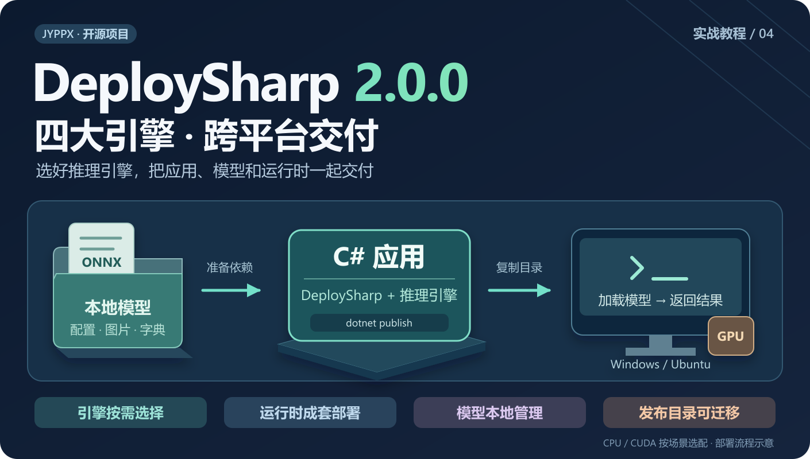
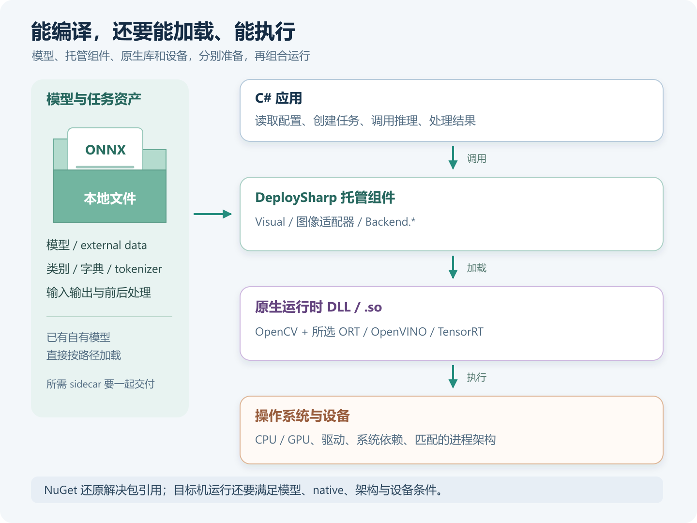
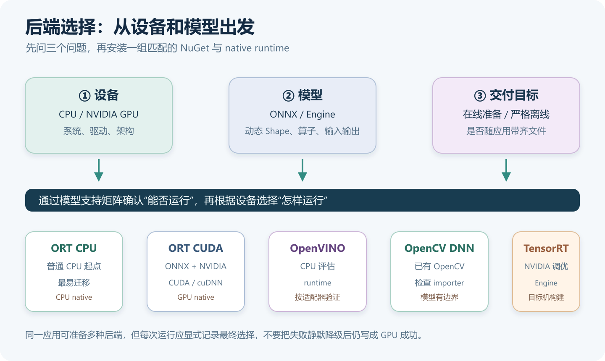
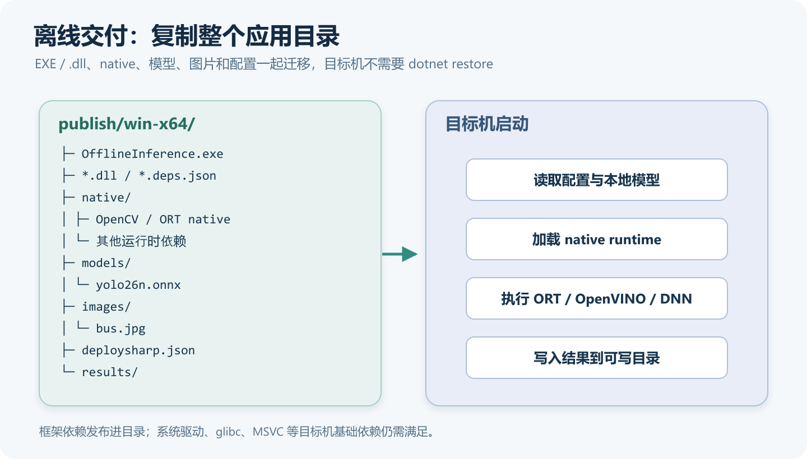
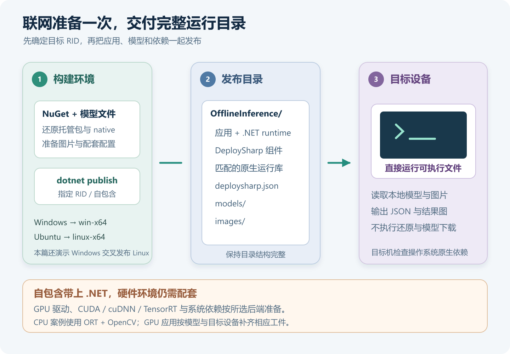
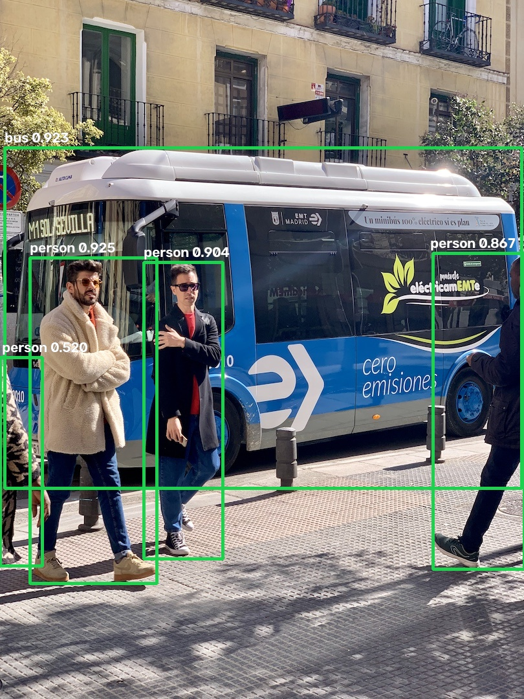
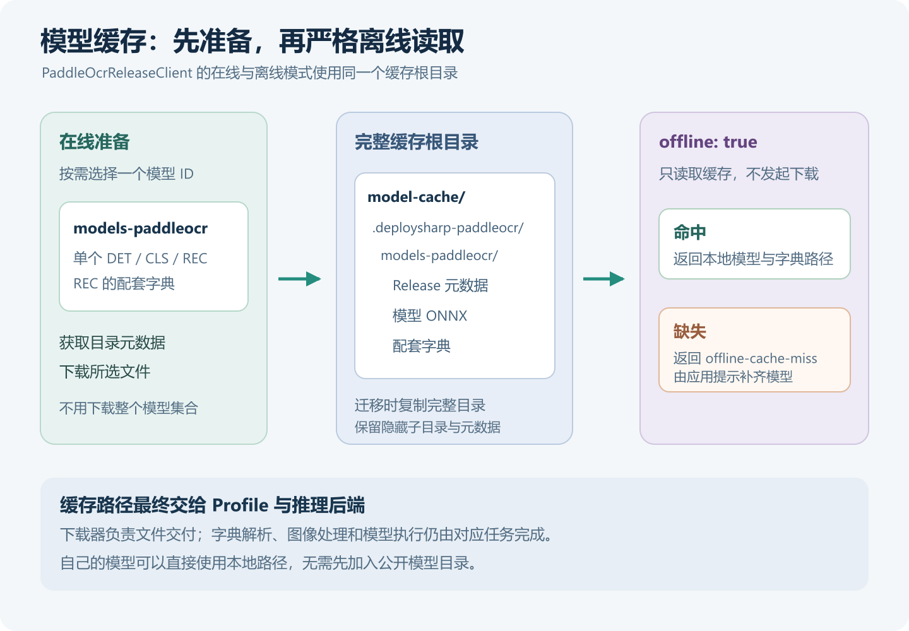
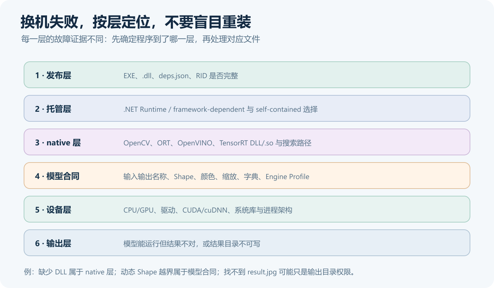

# DeploySharp 多后端部署：选择推理引擎，准备运行时与离线模型

> DeploySharp 2.0.0 系列 · 第 04 篇实战教程，使用正式 NuGet `2.0.0`。



## 一、DeploySharp 项目简介

**DeploySharp** 是一个面向 **C#/.NET 开发者**的开源模型部署框架，由「椒颜皮皮虾」开发，项目源码遵循 **Apache License 2.0**。它基于 **ONNX Runtime、OpenVINO、TensorRT、OpenCV DNN** 等推理引擎，提供模型加载、图像前处理、推理执行和结果后处理接口，方便大家在桌面软件、工业视觉和文档应用中接入模型。

项目已经接入目标检测、分类、分割、关键点、旋转框、异常检测和背景移除等视觉任务，也提供 **PP-OCRv4/v5/v6、PP-Structure 文档处理**和部分图文、本地语言模型的使用入口。常用模型有配套前后处理，自有模型可以通过扩展接口接入。

**项目地址：**

```text
https://github.com/guojin-yan/DeploySharp/tree/DeploySharpV2.0
```

**NuGet 包：**在包管理器中搜索 `JYPPX.DeploySharp`，按任务与推理后端选择组件。

```text
https://www.nuget.org/packages?q=JYPPX.DeploySharp
```

## 二、2.0 新特性与本篇部署实战

### 2.1 从开发机运行，走到目标设备运行

前两篇实战已经完成 YOLO26 检测和 PaddleOCR。开发机上运行之后，接下来就要把程序交给目标设备，准备模型、运行库和配置，并让它在离线环境中运行。

2.0 版本把这些组件分开管理，部署时可以按需组合：

| 新版能力 | 交付应用时怎样使用 |
| --- | --- |
| 视觉任务与推理后端分开 | 保留配套前后处理，按已验证模型与设备选择执行引擎 |
| 托管适配器与 native runtime 分开 | 按操作系统和架构准备 DLL / `.so`，明确最终应用的依赖 |
| 本地模型与按需获取并存 | 自有模型直接用路径；公开模型可先下载、再缓存和离线复用 |
| 配置与任务流程可组合 | 把模型、类别、输入输出和业务参数一起交付，减少换机后的手工改代码 |

本篇先完成运行环境和目录交付。Batch、独立 Session 池、异步预取、ROI 和大图切片，可以在此基础上继续加入。

### 2.2 本篇会完成什么

下面先介绍 **ORT CPU / ORT CUDA / OpenVINO / OpenCV DNN / TensorRT** 的依赖和使用场景，再把一个 YOLO26 程序发布成完整目录，分别在 **Windows 和 Ubuntu** 运行，最后介绍 PaddleOCR 模型的在线下载和离线缓存。

主案例使用 **ORT CPU**，直接加载本地模型和图片；GPU 应用则在相同交付流程上增加对应的驱动、运行库和 Engine。

## 三、先选模型和设备，再选推理后端

### 3.1 应用交付，需要准备哪些部分

`Visual.OpenCV` 负责图片输入和前处理，`Backend.*` 负责调用推理引擎。NuGet 解析了托管引用之后，执行计算仍需要对应的原生库，模型文件和配套字典也需要随应用准备。

下面把这些关系放在一起。应用调用沿中间向下执行，模型与任务资产从左侧参与加载；GPU 场景还要满足设备驱动和厂商运行库的条件。



**.NET Runtime** 负责运行 C# 应用，**原生运行库**提供 OpenCV、ORT、OpenVINO、TensorRT 等计算能力。后面的自包含发布会带上 .NET Runtime，图像和推理原生库则通过 NuGet 包或厂商文件一起部署。

### 3.2 按实际场景选择

| 设备与需求 | 可以优先评估 | 准备重点 |
| --- | --- | --- |
| 普通 x64 CPU，先完成部署 | ONNX Runtime CPU | 匹配的 ORT CPU 原生包和图像 runtime |
| 希望继续使用 ONNX，在 NVIDIA GPU 执行 | ONNX Runtime CUDA | ORT 原生发行包、CUDA/cuDNN 与驱动；代码显式选择 CUDA |
| 评估 CPU 上的模型执行效果 | OpenVINO CPU | OpenVINO runtime；当前 2.0.0 适配器使用 CPU 设备入口 |
| 已经依赖 OpenCV，模型图可以被 DNN 导入 | OpenCV DNN CPU | OpenCV 原生库、实际输出合同及 Shape/importer 兼容性 |
| NVIDIA GPU，需要进一步调优 | TensorRT | 匹配的 bridge、TensorRT/CUDA/cuDNN、输入 Profile 和目标机 Engine |

选型时先看目标设备，再确认模型的输入输出、算子和动态尺寸是否能被后端处理，最后比较速度与部署成本。选择过程如下：



第二篇在 Windows 上运行了 **YOLO26n + ORT CPU / ORT CUDA / OpenVINO / OpenCV DNN / TensorRT**；第三篇在 Ubuntu 上运行了 **PP-OCRv5 Mobile 完整流水线 + ORT CPU / OpenVINO / OpenCV DNN / TensorRT**。可以先参考这两组配置，其他模型的具体状态见验证矩阵：

```text
模型支持指南：
https://github.com/guojin-yan/DeploySharp/blob/DeploySharpV2.0/docs/articles/model-support.md

模型与后端验证矩阵：
https://github.com/guojin-yan/DeploySharp/blob/DeploySharpV2.0/docs/model-backend-verification-matrix.md
```

## 四、NuGet 与原生运行库，按场景分开准备

### 4.1 图像输入部分先保持一致

下面以 **Windows x64 视觉应用**为例。先安装公共图像组件，再从后续几节选择一组推理依赖。ORT CPU 和 GPU 原生包分别使用独立输出目录，避免同名库冲突。

```powershell
dotnet add package JYPPX.DeploySharp.Visual.OpenCV --version 2.0.0
dotnet add package JYPPX.OpenCV.runtime.win-x64 --version 5.0.0
```

`Visual`、`Core`、OpenCV 托管接口等依赖由 NuGet 自动引入。这里的 OpenCV 用于读图和图像处理，模型可以交给其他引擎执行。

### 4.2 普通 CPU：ONNX Runtime

在公共图像组件之外，增加后端适配器和 CPU runtime：

```powershell
dotnet add package JYPPX.DeploySharp.Backend.OnnxRuntime --version 2.0.0
dotnet add package Microsoft.ML.OnnxRuntime --version 1.28.0
```

注册后端并请求 CPU：

```csharp
backends.UseOnnxRuntime();
var request = new BackendRequest(BackendCapabilities.TensorInference,
    OnnxRuntimeBackendProvider.BackendId, "cpu");
```

后面的完整离线案例采用这一组。所有 DeploySharp 包统一使用 `2.0.0`；OpenCV 和 ORT 使用各自的版本号。

### 4.3 NVIDIA GPU：ONNX Runtime CUDA

下面是 Windows CUDA 13 的安装组合，还需配套的驱动、CUDA 和 cuDNN。本系列实测使用的是下文的 CUDA 12 组合：

```powershell
dotnet add package JYPPX.DeploySharp.Backend.OnnxRuntime --version 2.0.0
dotnet add package Microsoft.ML.OnnxRuntime.Gpu.Windows --version 1.28.0
```

已有 CPU 工程改用 GPU 时，先移除显式的 `Microsoft.ML.OnnxRuntime` CPU 包，再选择 GPU 原生来源。`Microsoft.ML.OnnxRuntime.Managed` 作为托管依赖继续保留。初始化时还要显式启用 CUDA：

```csharp
backends.UseOnnxRuntime(new OnnxRuntimeOptions(
    executionProvider: OnnxRuntimeExecutionProvider.Cuda,
    cudaDeviceId: 0));
var request = new BackendRequest(BackendCapabilities.TensorInference,
    OnnxRuntimeBackendProvider.BackendId, "cuda");
```

已有 CUDA 12 环境时，可以使用对应的官方原生发行包。第二篇在 RTX 3060 Laptop、驱动 `576.02` 上，使用 Managed `1.28.0` 加 `onnxruntime-win-x64-gpu_cuda12-1.28.0.zip`，配套 CUDA `12.9` 和 cuDNN `9.22.0`，完成了 YOLO26 推理。

这种方式使用下面的托管组合，再部署官方包中的三份 ORT 原生 DLL；它与上面的 `Gpu.Windows` 原生来源二选一：

```powershell
dotnet add package JYPPX.DeploySharp.Backend.OnnxRuntime --version 2.0.0
dotnet add package Microsoft.ML.OnnxRuntime.Managed --version 1.28.0
```

```text
官方 CUDA 12 发行包：
https://github.com/microsoft/onnxruntime/releases/download/v1.28.0/onnxruntime-win-x64-gpu_cuda12-1.28.0.zip

同一 lib 目录中成套部署：
onnxruntime.dll
onnxruntime_providers_shared.dll
onnxruntime_providers_cuda.dll

完整下载、发布、搜索路径与实跑命令，见第二篇 8.4 节：
https://github.com/guojin-yan/DeploySharp/blob/DeploySharpV2.0/docs/blog/2.0.0/2026-10/2026-10-28-02-yolo26-quickstart.md
```

选择 CUDA 主版本时，同时核对原生发行包和驱动要求。三份 ORT DLL 使用同一发行包中的文件，并与其他 CPU/GPU 输出目录分开。

### 4.4 CPU 的另一种选择：OpenVINO

公共图像组件之外，增加：

```powershell
dotnet add package JYPPX.DeploySharp.Backend.OpenVINO --version 2.0.0
dotnet add package OpenVINO.runtime.win --version 2026.2.1
```

初始化关键部分如下，文件顶部增加 `using JYPPX.DeploySharp.Backends.OpenVINO;`：

```csharp
backends.UseOpenVino(new OpenVinoOptions(
    performanceHint: OpenVinoPerformanceHint.Latency));
var request = new BackendRequest(BackendCapabilities.TensorInference,
    OpenVinoBackendProvider.BackendId, "CPU");
```

这一组加载 ONNX，前后处理沿用对应 Profile，当前适配器使用 CPU 设备入口。

### 4.5 共用 OpenCV 图像库：OpenCV DNN

在公共图像组件之外增加：

```powershell
dotnet add package JYPPX.DeploySharp.Backend.OpenCV --version 2.0.0
```

DNN 后端还需要模型输入输出合同。例如第二篇的 YOLO26n，声明 Float32 `images: [1,3,640,640]` 与 `output0: [1,-1,6]`，再使用 `UseOpenCvDnn(...)` 注册，请求 `OpenCvDnnBackendProvider.BackendId` 和 `"cpu"`。完整代码已经放在第二篇后端工程中。

OpenCV DNN 对动态宽度、辅助输入和不同 opset 的支持存在差异，部署前先运行对应模型，确认网络导入和输出结果。

### 4.6 NVIDIA GPU 调优：TensorRT

Windows TensorRT 10.11 安装以下组件：

```powershell
dotnet add package JYPPX.DeploySharp.Backend.TensorRT --version 2.0.0
dotnet add package JYPPX.TensorRT.CSharp.API.Runtime.win-x64.trt10.11.cuda12.9.cudnn9.22.Bridge --version 4.0.0
```

然后准备 **NVIDIA 驱动、TensorRT `10.11.0.33`、CUDA `12.9` 和 cuDNN `9.22.0`**。bridge 将托管 API 连接到这些厂商库。需要 CUDA 图像前后处理时，再按任务增加 `JYPPX.DeploySharp.Visual.TensorRT 2.0.0`；普通图像读取仍使用 OpenCV 组件。

与 ONNX 直接加载不同，TensorRT 通常先在目标 GPU 上从 ONNX 构建 Engine。第二篇的构建代码使用 `TensorRtOnnxEngineBuilder`，同时把 **Profile 与 ModelArtifact 的格式都设为 `tensorrt-engine`**，并请求 TensorRT 后端的 `cuda` 设备。

交付 TensorRT 应用时，需要把这些文件分清楚：

| 文件或环境 | 应该怎样准备 |
| --- | --- |
| ONNX 源模型 | 保留用于目标机转换，所有 external data 一起准备 |
| Engine 与动态输入 Profile | 在目标 GPU 和对应运行时上构建，覆盖实际 Batch、尺寸与宽度范围 |
| bridge + TensorRT/CUDA/cuDNN | 版本、系统、架构成套匹配；路径指向实际包含 DLL / `.so` 的目录 |
| NVIDIA 驱动 | 在目标机安装，确认设备及所选 CUDA 版本可用 |

Engine 与构建时的 GPU、TensorRT 和输入配置有关，换设备或运行时后重新构建。本系列分别在 Windows TensorRT 10 和 Ubuntu TensorRT 11 环境生成各自的 Engine。

上面介绍了各后端的安装和初始化。完整工程可以参考 Windows YOLO26 和 Ubuntu OCR 两个示例，其中包含后端注册、设备选择和模型格式配置：

```text
Windows YOLO26 后端对照工程：
https://github.com/guojin-yan/DeploySharp/tree/DeploySharpV2.0/docs/blog/2.0.0/2026-10/examples/02-yolo26-backends

Ubuntu PaddleOCR 后端对照工程：
https://github.com/guojin-yan/DeploySharp/tree/DeploySharpV2.0/docs/blog/2.0.0/2026-10/examples/03-paddleocr-backends
```

## 五、准备离线案例：模型、图片和配置一起管理

### 5.1 创建工程，按本地路径使用模型

下面回到 **YOLO26n + ORT CPU** 主线。创建控制台项目：

```shell
dotnet new console -n OfflineInference -f net10.0
cd OfflineInference
```

本文也提供完整工程，可直接下载其中的 `.csproj`、`Program.cs` 和 `deploysharp.json`，再准备模型与图片：

```text
https://github.com/guojin-yan/DeploySharp/tree/DeploySharpV2.0/docs/blog/2.0.0/2026-10/examples/04-offline-inference
```

在 Windows PowerShell 中获取公开示例：

```powershell
New-Item -ItemType Directory -Force -Path .\models, .\images | Out-Null
Invoke-WebRequest -Uri 'https://github.com/guojin-yan/DeploySharp/releases/download/models-visual.1/yolo-v26-detect-n.model.onnx' -OutFile .\models\yolo26n.onnx
Invoke-WebRequest -Uri 'https://github.com/guojin-yan/DeploySharp/releases/download/test-assets.1/bus.jpg' -OutFile .\images\bus.jpg
```

在 Ubuntu Bash 中准备源码工程时，使用：

```bash
mkdir -p models images
curl -fL 'https://github.com/guojin-yan/DeploySharp/releases/download/models-visual.1/yolo-v26-detect-n.model.onnx' -o models/yolo26n.onnx
curl -fL 'https://github.com/guojin-yan/DeploySharp/releases/download/test-assets.1/bus.jpg' -o images/bus.jpg
```

已有本地模型和图片时，直接复制到目录中即可。后面的程序从本地路径加载，可以通过参数换成自己的输入。

### 5.2 用配置文件记录模型约定

创建 `deploysharp.json`：

```json
{
  "ModelPath": "models/yolo26n.onnx",
  "ImagePath": "images/bus.jpg",
  "ClassNamesPath": null,
  "OutputDirectory": "results",
  "InputName": "images",
  "OutputName": "output0",
  "ModelWidth": 640,
  "ModelHeight": 640,
  "ScoreThreshold": 0.25
}
```

本文模型是 COCO 80 类的 YOLO26n 端到端检测导出，输入为 Float32 NCHW `1×3×640×640`，RGB、Letterbox、填充值 `114`、像素除以 `255`；输出 `[1,N,6]`，每行依次是 `x1/y1/x2/y2/score/class_id`，解码时不重复执行 NMS。

`ClassNamesPath` 为 `null` 时使用 COCO 标签。使用自己的同结构模型时，将它改为 `"models/classes.txt"`，每行填写一个类别，保持训练索引顺序，再按导出配置调整尺寸、张量名和阈值。输出结构或前处理不同的模型，需要同时替换对应 Profile。

最终源码目录如下：

```text
OfflineInference/
  OfflineInference.csproj
  Program.cs
  deploysharp.json
  models/
    yolo26n.onnx
    classes.txt        # 自有类别时才需要
  images/
    bus.jpg
```

发布时，.NET 和原生依赖会一起进入输出目录。下图展示完整目录结构及启动时的加载关系，交付时按这个结构整体复制：



## 六、编写可以随目录迁移的推理程序

### 6.1 项目文件：按目标系统选择 native，并复制资产

将 `OfflineInference.csproj` 替换为下面的完整内容。`DeploymentRid` 选择图像原生包，发布命令中的 `-r` 选择 .NET 目标运行时，两者保持一致；从 Windows 交叉发布 Linux 时，后文会显式传入这两个值。

```xml
<Project Sdk="Microsoft.NET.Sdk">
  <PropertyGroup>
    <OutputType>Exe</OutputType>
    <TargetFramework>net10.0</TargetFramework>
    <ImplicitUsings>enable</ImplicitUsings>
    <Nullable>enable</Nullable>
    <PlatformTarget>x64</PlatformTarget>
    <ManagePackageVersionsCentrally>false</ManagePackageVersionsCentrally>
    <RestorePackagesWithLockFile>false</RestorePackagesWithLockFile>
    <TreatWarningsAsErrors>false</TreatWarningsAsErrors>
    <GenerateDocumentationFile>false</GenerateDocumentationFile>
    <IsPackable>false</IsPackable>
    <DefaultItemExcludes>$(DefaultItemExcludes);publish/**</DefaultItemExcludes>
    <DeploymentRid Condition="'$(RuntimeIdentifier)' != ''">$(RuntimeIdentifier)</DeploymentRid>
    <DeploymentRid Condition="'$(DeploymentRid)' == '' and '$(OS)' == 'Windows_NT'">win-x64</DeploymentRid>
    <DeploymentRid Condition="'$(DeploymentRid)' == '' and $([MSBuild]::IsOSPlatform('Linux'))">linux-x64</DeploymentRid>
  </PropertyGroup>
  <ItemGroup>
    <PackageReference Include="JYPPX.DeploySharp.Visual.OpenCV" Version="2.0.0" />
    <PackageReference Include="JYPPX.DeploySharp.Backend.OnnxRuntime" Version="2.0.0" />
    <PackageReference Include="Microsoft.ML.OnnxRuntime" Version="1.28.0" />
    <PackageReference Include="JYPPX.OpenCV.runtime.win-x64" Version="5.0.0" Condition="'$(DeploymentRid)' == 'win-x64'" />
    <PackageReference Include="JYPPX.OpenCV.runtime.ubuntu.22.04-x64" Version="5.0.0" Condition="'$(DeploymentRid)' == 'linux-x64'" GeneratePathProperty="true" />
    <None Update="deploysharp.json;models/**/*;images/**/*" CopyToOutputDirectory="PreserveNewest" CopyToPublishDirectory="PreserveNewest" />
  </ItemGroup>
  <!-- .NET 10 的通用 linux-x64 RID 不会自动选择发行版专用的 OpenCV native 资产。 -->
  <ItemGroup Condition="'$(DeploymentRid)' == 'linux-x64'">
    <Content Include="$(PkgJYPPX_OpenCV_runtime_ubuntu_22_04-x64)/runtimes/ubuntu.22.04-x64/native/*">
      <Link>native/opencv/%(Filename)%(Extension)</Link>
      <CopyToOutputDirectory>PreserveNewest</CopyToOutputDirectory>
      <CopyToPublishDirectory>PreserveNewest</CopyToPublishDirectory>
    </Content>
  </ItemGroup>
  <Target Name="ValidateDeploymentRid" BeforeTargets="PrepareForBuild">
    <Error Condition="'$(DeploymentRid)' != 'win-x64' and '$(DeploymentRid)' != 'linux-x64'" Text="本教程仅配置了 Windows x64 与 Ubuntu 22.04 x64 的原生依赖。" />
    <Error Condition="'$(DeploymentRid)' == 'linux-x64' and !Exists('$(PkgJYPPX_OpenCV_runtime_ubuntu_22_04-x64)/runtimes/ubuntu.22.04-x64/native/libJYPPX.OpenCV.Native.so')" Text="缺少 Ubuntu OpenCV 原生包；交叉发布请同时指定 -r linux-x64 -p:DeploymentRid=linux-x64。" />
  </Target>
</Project>
```

`CopyToPublishDirectory` 将模型、图片和配置带入发布目录。Linux OpenCV 包中的整组 `.so` 另行复制到 `native/opencv/`。`GeneratePathProperty` 用于获取包路径，也适用于自定义 `NUGET_PACKAGES` 的环境。

这里按普通目录发布，保留独立的原生库和模型文件，方便替换模型与排查加载问题。

### 6.2 主程序：路径从应用目录解析，推理直接用本地文件

把下面代码放入 `Program.cs`。YOLO26 的 Profile 与第二篇相同，本篇增加了 JSON 配置、相对路径解析和运行环境输出。

```csharp
using System.Runtime.InteropServices;
using System.Text.Json;
using JYPPX.DeploySharp;
using JYPPX.DeploySharp.Backends.OnnxRuntime;
using JYPPX.DeploySharp.Models;
using JYPPX.DeploySharp.Registry;
using JYPPX.DeploySharp.Results.Vision;
using JYPPX.DeploySharp.Tensors;
using JYPPX.DeploySharp.Visual;
using JYPPX.DeploySharp.Visual.Models.Yolo;
using JYPPX.DeploySharp.Visual.OpenCV;
using JYPPX.OpenCvSharp.Core;
using JYPPX.OpenCvSharp.ImgProc;
using ImageCodecs = JYPPX.OpenCvSharp.ImgCodecs.Cv2;
using Drawing = JYPPX.OpenCvSharp.ImgProc.Cv2;

// 相对路径统一从程序目录解析，从其他目录启动也能找到模型、配置和图片。
string baseDirectory = AppContext.BaseDirectory;
string Resolve(string value) => Path.GetFullPath(value, baseDirectory);
var config = JsonSerializer.Deserialize<DeploymentConfig>(
    File.ReadAllText(Resolve("deploysharp.json")))
    ?? throw new InvalidDataException("deploysharp.json 不能为空。");
string imagePath = Resolve(args.Length > 0 ? args[0] : config.ImagePath);
string modelPath = Resolve(args.Length > 1 ? args[1] : config.ModelPath);
string outputDirectory = Resolve(args.Length > 2 ? args[2] : config.OutputDirectory);
foreach (string path in new[] { imagePath, modelPath })
    if (!File.Exists(path)) throw new FileNotFoundException("找不到输入文件。", path);
IReadOnlyList<string> labels = string.IsNullOrWhiteSpace(config.ClassNamesPath)
    ? YoloLabelSets.Coco80
    : File.ReadAllLines(Resolve(config.ClassNamesPath));
if (labels.Count == 0 || labels.Any(string.IsNullOrWhiteSpace))
    throw new InvalidDataException("类别文件需要每行一个名称，按训练索引排列，不含空行。");
Directory.CreateDirectory(outputDirectory);

var size = new VisualSize(config.ModelWidth, config.ModelHeight);
var modelId = new ModelId("local/yolo26-offline");
var profile = new VisualModelProfile(
    "yolo26.detect.offline", modelId, VisualTaskId.ObjectDetection, "1", "onnx",
    new VisualInputBinding(config.InputName, TensorElementType.Float32,
        new TensorShape(1, 3, size.Height, size.Width), VisualTensorLayout.Nchw),
    new[] { new VisualOutputBinding(config.OutputName, TensorElementType.Float32,
        new TensorShape(1, -1, 6)) },
    labels.Select((name, index) => new VisualLabel(index, name)),
    new YoloDetectionDecoder(
        new YoloDetectionOutputContract(config.OutputName,
            YoloDetectionOutputKind.EndToEnd, labels.Count),
        new YoloDetectionDecoderOptions(scoreThreshold: config.ScoreThreshold)),
    preprocessing: new VisualPreprocessingOptions(
        size, VisualResizeMode.Letterbox, VisualColorOrder.Rgb,
        VisualNormalizationOptions.Scale(255f),
        paddingColor: new VisualRgbColor(114, 114, 114)));

using var backends = new BackendRegistry();
backends.UseOnnxRuntime();
var profiles = new VisualProfileRegistry();
profiles.Register(profile);
profiles.Freeze();
var request = new BackendRequest(BackendCapabilities.TensorInference,
    OnnxRuntimeBackendProvider.BackendId, "cpu");
var artifact = new ModelArtifact(modelId, "onnx", modelPath);
using var pipeline = new VisualPipeline(backends,
    profiles.Select(artifact, backends, request, VisualTaskId.ObjectDetection), request);
using PreparedVisualInput input = new OpenCvVisualInputFactory()
    .CreateFromFile(imagePath, profile);
DetectionResult result = pipeline.Run(input).GetValue<DetectionResult>();

using Mat canvas = ImageCodecs.ImRead(imagePath);
foreach (Detection item in result.Detections)
{
    var box = item.Box;
    string caption = FormattableString.Invariant($"{item.Label.Label} {item.Label.Score:F3}");
    Size textSize = Drawing.GetTextSize(caption, HersheyFonts.HersheySimplex, 0.75, 2, out _);
    var captionPoint = new Point(
        Math.Clamp((int)box.X, 3, Math.Max(3, canvas.Cols - textSize.Width - 12)),
        Math.Max(textSize.Height + 4, (int)box.Y - 8));
    Drawing.Rectangle(canvas, new Point((int)box.X, (int)box.Y),
        new Point((int)box.Right, (int)box.Bottom), new Scalar(80, 210, 30), 3);
    Drawing.PutText(canvas, caption, captionPoint,
        HersheyFonts.HersheySimplex, 0.75, new Scalar(20, 20, 20), 5);
    Drawing.PutText(canvas, caption, captionPoint,
        HersheyFonts.HersheySimplex, 0.75, new Scalar(255, 255, 255), 2);
}
if (!ImageCodecs.ImWrite(Path.Combine(outputDirectory, "result.jpg"), canvas))
    throw new IOException("无法写入结果图片，请使用有写权限的输出目录。");

var report = new
{
    backend = "onnxruntime", device = "cpu", deploySharp = "2.0.0",
    os = RuntimeInformation.OSDescription,
    framework = RuntimeInformation.FrameworkDescription,
    runtimeDirectory = RuntimeEnvironment.GetRuntimeDirectory(),
    baseDirectory, modelPath, imagePath,
    detections = result.Detections.Select(item => new
    {
        label = item.Label.Label, score = item.Label.Score,
        x = item.Box.X, y = item.Box.Y, width = item.Box.Width, height = item.Box.Height
    })
};
File.WriteAllText(Path.Combine(outputDirectory, "result.json"),
    JsonSerializer.Serialize(report, new JsonSerializerOptions { WriteIndented = true }));
Console.WriteLine($"backend=onnxruntime;device=cpu;detections={result.Detections.Count}");
Console.WriteLine("labels=" + string.Join(",", result.Detections.Select(item => item.Label.Label)));
Console.WriteLine("framework=" + report.framework);
Console.WriteLine("runtime_directory=" + report.runtimeDirectory);
Console.WriteLine("saved=" + outputDirectory);

internal sealed class DeploymentConfig
{
    public string ModelPath { get; set; } = "models/yolo26n.onnx";
    public string ImagePath { get; set; } = "images/bus.jpg";
    public string? ClassNamesPath { get; set; }
    public string OutputDirectory { get; set; } = "results";
    public string InputName { get; set; } = "images";
    public string OutputName { get; set; } = "output0";
    public int ModelWidth { get; set; } = 640;
    public int ModelHeight { get; set; } = 640;
    public float ScoreThreshold { get; set; } = 0.25f;
}
```

`AppContext.BaseDirectory` 是程序所在目录，`Environment.CurrentDirectory` 是启动时的工作目录。从快捷方式或计划任务启动时，工作目录可能变化，因此这里统一按程序目录解析配置、模型、图片和默认输出路径。

三个可选参数依次是 **图片、模型、输出目录**。相对路径仍按程序目录解析，绝对路径直接使用。例如把输出参数指向一个有写权限的目录，就不必向安装目录写文件。自定义类别文件通过 JSON 指定。

输入、OpenCV 图像、pipeline 和后端注册表通过 `using` 释放，输入在推理结束后释放，pipeline 最后释放 Session。绘图时另外读取一次原图。

## 七、发布为完整目录，再交给目标设备

### 7.1 先区分两种 .NET 发布方式

| 发布方式 | 目录是否包含 .NET Runtime | 目标机需要什么 |
| --- | --- | --- |
| 框架依赖：`--self-contained false` | 不包含 | 安装匹配的 .NET Runtime，再准备同样的模型和 native 依赖 |
| 自包含：`--self-contained true` | 包含目标 RID 的运行时 | 不需要另装 .NET SDK/Runtime，仍需满足原生库与系统依赖 |

本篇使用 **自包含、非单文件、不裁剪**。联网准备与离线运行分别在两个阶段完成：构建时可以还原 NuGet、获取模型，目标机直接运行发布的程序。



### 7.2 Windows x64：发布后直接启动 EXE

在源码项目目录执行：

```powershell
dotnet publish -c Release -r win-x64 -p:DeploymentRid=win-x64 `
  --self-contained true -p:PublishSingleFile=false -p:PublishTrimmed=false `
  -o .\publish\win-x64

& .\publish\win-x64\OfflineInference.exe
```

发布目录包含 `OfflineInference.exe`、应用 DLL、.NET 运行时、DeploySharp 和第三方组件，以及模型、图片和配置。**将整个目录复制到目标机，保留子目录结构，直接运行 EXE。**

例如已经进入复制后的程序目录，想使用自己的图片、模型和输出位置：

```powershell
.\OfflineInference.exe .\images\my-image.jpg .\models\best.onnx .\results
```

相对路径按 EXE 所在目录解析。安装目录不可写时，第三个参数传入有写权限的绝对路径。如果 OpenCV 或 ORT 提示缺少 MSVC 等系统依赖，再按异常安装对应的 x64 运行库。

### 7.3 Ubuntu 22.04 x64：同一份代码，发布另一套 native

这份项目可以在 Windows 构建 Linux 目录，也可以直接在 Ubuntu 构建。执行下面的发布命令，区别是目标 RID 和对应 OpenCV 原生包：

```shell
dotnet publish -c Release -r linux-x64 -p:DeploymentRid=linux-x64 --self-contained true -p:PublishSingleFile=false -p:PublishTrimmed=false -o ./publish/linux-x64
```

`DeploymentRid=linux-x64` 同时参与 NuGet 还原，让 Windows 交叉发布时也能选择 Linux OpenCV 包。

把 `publish/linux-x64` 的**全部内容**传到目标机。进入该目录后，在 Bash 中运行：

```bash
chmod +x ./OfflineInference
app_dir="$(pwd)"
LD_LIBRARY_PATH="$app_dir/native/opencv" "$app_dir/OfflineInference"
```

发布目录已包含 .NET、ORT Linux 原生库和 OpenCV `.so`。启动时为当前进程设置 OpenCV 搜索路径；使用其他后端时，再合并对应的库目录。

Ubuntu 系统本身的动态加载器、glibc、libstdc++ 等依赖仍需具备。遇到加载问题，可以检查：

```bash
LD_LIBRARY_PATH="$app_dir/native/opencv" ldd "$app_dir/native/opencv/libJYPPX.OpenCV.Native.so"
```

`ldd` 输出中的 `not found` 可以定位缺失依赖。OpenCV 按 native 目录成组复制，`chmod` 则恢复文件传输后可能丢失的执行权限。

### 7.4 换成 GPU 应用，交付时还要加什么

上面的自包含目录只配置了 **ORT CPU + OpenCV**。使用 GPU 方案时，继续在相应后端工程中准备完整依赖：

| GPU 路径 | 除应用和模型外，还需要 |
| --- | --- |
| ORT CUDA | 成套 ORT GPU 原生库、匹配 CUDA/cuDNN、目标机驱动；启动前配置实际 DLL / `.so` 目录 |
| TensorRT | bridge、TensorRT/CUDA/cuDNN、目标机驱动；匹配 Engine，或 ONNX 与目标机转换流程 |
| TensorRT CUDA 前后处理 | 对应 Visual.TensorRT 组件及其任务支持条件，并保留实际使用的输入与缓冲配置 |

`dotnet publish` 复制项目中声明的文件。依赖开发机 PATH 的厂商库，需要另外声明为发布资产，或者在目标机安装并设置搜索路径。

## 八、实际运行：Windows 与 Ubuntu 的可迁移目录

### 8.1 本次验证条件

这次使用上面的同一份源码与模型，分别发布为两套自包含目录：

| 项目 | Windows 运行 | Ubuntu 运行 |
| --- | --- | --- |
| 系统 | Windows 11 x64，`10.0.26200` | Ubuntu `22.04.5 LTS` x64，内核 `6.8.0-138-generic` |
| CPU | AMD Ryzen 7 5800H | Intel Core i7-1165G7 |
| 构建工具 | .NET SDK `10.0.401` | 由左侧 Windows SDK 交叉发布后传输 |
| 发布与执行 | `win-x64` 自包含 EXE | `linux-x64` 自包含可执行文件 |
| 执行引擎 | ORT CPU `1.28.0` | ORT CPU `1.28.0` |
| 图像 runtime | OpenCV `5.0.0` Windows x64 | OpenCV `5.0.0` Ubuntu 22.04 x64 |
| 模型与输入 | YOLO26n、`640×640` 输入；`bus.jpg` 原图 `810×1080` | 相同模型与图片 |

我分别从**程序目录之外**启动，两套程序都能找到配置和模型。JSON 中的 `runtimeDirectory` 指向各自发布目录，运行的是随包携带的 .NET。

两台设备已具备原生库所需的系统依赖。新设备部署时，可以按前面的 `ldd` 或加载异常补齐缺失项。

### 8.2 输出与结果图

两条路径都返回 **4 个行人和 1 辆公交车**。控制台共同输出如下，实际保存位置随目标目录变化：

```text
backend=onnxruntime;device=cpu;detections=5
labels=person,bus,person,person,person
framework=.NET 10.0.12
```

程序还会打印 `runtime_directory` 与 `saved` 的完整路径，并生成 `result.json` 和 `result.jpg`。下面是本篇 Windows 自包含程序实际生成的图片：



JSON 保存了框、类别、分数、模型路径、运行环境和程序目录，可以随业务日志一起保留，方便定位设备上的实际配置。

## 九、模型较多时：在线准备与严格离线缓存

### 9.1 本地模型目录与下载缓存，按需求选择

只有一两个自有模型时，前面的 `models/` 目录就够用了。需要在应用中按模型 ID 获取公开模型，或者管理多组 OCR/文档模型时，再使用 **`JYPPX.DeploySharp.ModelFactory`**。

这个包里有两类入口：

| 入口 | 使用范围 |
| --- | --- |
| `ModelFactoryClient` | 依据模型目录快照选择工件，获取对应 ModelPack 并复用缓存 |
| `PaddleOcrReleaseClient` | 面向 `models-paddleocr` Release，按需下载独立 PP-OCR / PP-Structure 模型及配套文件 |

`ModelFactoryClient` 使用随包提供的模型目录快照，`PaddleOcrReleaseClient` 使用 PaddleOCR Release 的专用目录。两类入口各有对应的缓存结构，按所用客户端管理即可。

下载客户端负责准备文件并返回本地路径，应用再用对应 Profile 和后端创建推理会话。自有模型则继续按前面的本地路径方式加载。

### 9.2 一个可以直接运行的 PaddleOCR 缓存示例

创建一个单独的控制台工程，只安装下载组件：

```shell
dotnet new console -n ModelCache -f net10.0
cd ModelCache
dotnet add package JYPPX.DeploySharp.ModelFactory --version 2.0.0
```

将下面代码写入 `Program.cs`。默认准备一个 v5 Mobile 文本行方向模型，`--offline` 控制是否允许联网：

```csharp
using JYPPX.DeploySharp.ModelFactory;

bool offline = args.Contains("--offline");
string[] positional = args.Where(value => value != "--offline").ToArray();
string cacheRoot = Path.GetFullPath(positional.Length > 0 ? positional[0] : "model-cache");
string modelId = positional.Length > 1 ? positional[1] : "paddleocr/ppocrv5/mobile-cls";
using var cancellation = new CancellationTokenSource();
Console.CancelKeyPress += (_, eventArgs) =>
{
    eventArgs.Cancel = true;
    cancellation.Cancel();
};
using var client = new PaddleOcrReleaseClient(
    new PaddleOcrReleaseClientOptions(cacheRoot, offline: offline));
try
{
    PaddleOcrReleaseModelMaterialization model =
        await client.GetModelAsync(modelId, cancellationToken: cancellation.Token);
    Console.WriteLine($"offline={offline};model={modelId}");
    Console.WriteLine("model_path=" + model.ModelPath);
    Console.WriteLine("dictionary_path=" + (model.DictionaryPath ?? "(none)"));
}
catch (ModelFactoryException exception)
{
    foreach (var diagnostic in exception.Diagnostics)
        Console.Error.WriteLine($"{diagnostic.Code}: {diagnostic.Message}");
    Environment.ExitCode = 1;
}
catch (OperationCanceledException)
{
    Console.Error.WriteLine("模型准备已取消。");
    Environment.ExitCode = 2;
}
```

第一次在联网环境运行，之后用同一个目录离线读取：

```shell
dotnet run -c Release -- ./model-cache paddleocr/ppocrv5/mobile-cls
dotnet run -c Release -- ./model-cache paddleocr/ppocrv5/mobile-cls --offline
```

本次实际输出中，第一次是 `offline=False`，第二次是 `offline=True`；两次均返回 `ppocrv5-mobile-cls.onnx` 的本地路径。CLS 没有识别字典，所以 `dictionary_path=(none)`。

需要第三篇的 v5 Mobile 全流程时，再分别准备 DET 与 REC：

```shell
dotnet run -c Release -- ./model-cache paddleocr/ppocrv5/mobile-det
dotnet run -c Release -- ./model-cache paddleocr/ppocrv5/mobile-rec
```

REC 会同时取得对应字典，应用用返回的 `ModelPath` 和 `DictionaryPath` 继续创建相应 OCR Profile。Ctrl+C 可取消正在进行的调用；程序等待调用结束后再释放下载客户端。

完整缓存示例源码：

```text
https://github.com/guojin-yan/DeploySharp/tree/DeploySharpV2.0/docs/blog/2.0.0/2026-10/examples/04-model-cache
```

### 9.3 缓存怎样带到离线设备

客户端先在线准备缓存，离线时直接返回本地路径；缺少文件或元数据则报告缓存未命中。处理过程如下：



离线交付时，复制**整个 `model-cache` 根目录**，保留 `.deploysharp-paddleocr/models-paddleocr/` 下的模型、字典和目录元数据，客户端需要这些信息定位缓存。

缓存程序也按第七节发布后交付。目标机已安装 .NET Runtime 时，可以用框架依赖发布；否则选择对应 RID 的自包含发布，直接启动可执行文件。

用空目录运行 `--offline` 时，程序返回 `model-factory.offline-cache-miss`。应用可以据此提示用户先准备所选模型，或选择已有的本地文件。

## 十、换机失败时，按哪个方向检查

### 10.1 先看失败发生在哪一层

| 现象 | 优先检查 | 处理方向 |
| --- | --- | --- |
| 编译通过，启动找不到 OpenCV/ORT DLL | 原生包、x64、发布子目录与同目录依赖 | 复制完整发布目录；根据异常检查实际缺失文件 |
| 自包含程序仍提示找不到入口文件 | 是否只复制了 DLL/EXE、RID 是否正确 | 使用对应系统的整个发布目录，Windows 执行 EXE，Linux 恢复可执行权限 |
| 从快捷方式启动后找不到模型 | 相对路径是否依赖工作目录 | 按 `AppContext.BaseDirectory` 解析，或在配置中填写实际绝对路径 |
| 可以加载模型，框或文字却不对 | 模型的输入输出、颜色、缩放、字典或类别是否配套 | 对照示例输入，核对模型与 Profile |
| ORT CUDA 初始化失败或报错 801 | 原生包的 CUDA 主版本、驱动、CUDA/cuDNN 与文件搜索路径 | 使用与设备匹配的完整官方发行包；不混放 CPU/CUDA 12/CUDA 13 文件 |
| OpenCV DNN 报导入或动态 Shape 错误 | 导出图、opset、输入规格和 importer | 使用兼容的模型导出，或选择支持该模型的其他后端 |
| TensorRT 反序列化失败或动态尺寸超范围 | Engine 与目标设备/版本、输入 Profile | 在目标环境重新构建，检查真实 Batch 和所有动态维度 |
| Linux 报 `.so` 或版本化依赖缺失 | `native/opencv` 是否完整、`LD_LIBRARY_PATH`、系统库 | 用 `ldd` 查缺失项，补齐实际依赖，保持整组 `.so` |
| 离线缓存未命中 | 缓存根目录、元数据、所选模型 ID 与文件是否完整 | 在联网准备端补齐后重新复制，或直接使用已有本地模型路径 |
| 结果无法写出 | 程序安装目录是否可写 | 第三个参数指定应用有权限的输出目录 |

排障时按加载顺序检查：发布目录、原生库、模型输入输出，再到设备和输出权限。下图可以作为快速参考：



后端和设备在启动时选择，并写入日志。业务需要 CPU 降级时，也在启动逻辑中处理，记录最终使用的设备，方便排查现场问题。

### 10.2 从教程运行走向业务部署

交付前，先确认程序目录中具备所选模型、配套文件和 native 依赖；再从实际启动入口运行一张业务输入，检查图像/文字结果与保存位置。模型或后端升级时，重新核对对应输入输出与结果；TensorRT 还要处理 Engine 的构建与缓存。

各后端的细节可以按问题继续查阅：

```text
NuGet 安装组合：
https://github.com/guojin-yan/DeploySharp/blob/DeploySharpV2.0/docs/articles/package-combinations.md

安装与运行时：
https://github.com/guojin-yan/DeploySharp/blob/DeploySharpV2.0/docs/articles/installation.md

ONNX Runtime：
https://github.com/guojin-yan/DeploySharp/blob/DeploySharpV2.0/docs/articles/onnxruntime-getting-started.md

OpenVINO：
https://github.com/guojin-yan/DeploySharp/blob/DeploySharpV2.0/docs/articles/openvino-getting-started.md

ModelFactory：
https://github.com/guojin-yan/DeploySharp/blob/DeploySharpV2.0/docs/articles/modelfactory-getting-started.md
```

## 十一、总结与后续

本篇介绍了五种后端的安装组合，并将同一份 YOLO26 CPU 程序发布为 Windows 和 Ubuntu 自包含目录。模型较多时，可以用 ModelFactory 在线准备文件，再将完整缓存带到离线设备。

大家可以先用随文工程生成发布目录，再替换自己的模型和输入。部署到 GPU 时，在对应后端工程中补齐运行库和 Engine，沿用相同的目录管理与发布方式。

下一篇继续回到视觉任务，介绍**分类、分割、关键点与旋转框**：根据任务选模型、配置前处理，读取不同的结果类型，并把它们正确展示到原图上。

```text
本文主稿与配图：
https://github.com/guojin-yan/DeploySharp/blob/DeploySharpV2.0/docs/blog/2.0.0/2026-10/2026-10-28-04-multi-backend-offline.md

系列目录：
https://github.com/guojin-yan/DeploySharp/blob/DeploySharpV2.0/docs/blog/2.0.0/README.md

问题反馈：
https://github.com/guojin-yan/DeploySharp/issues
```

DeploySharp 库代码采用 Apache License 2.0；示例 YOLO26 模型、PaddleOCR 模型与第三方运行库遵循各自许可。反馈部署问题时，附上系统、进程架构、模型、后端、原生库版本与完整异常，方便定位。
