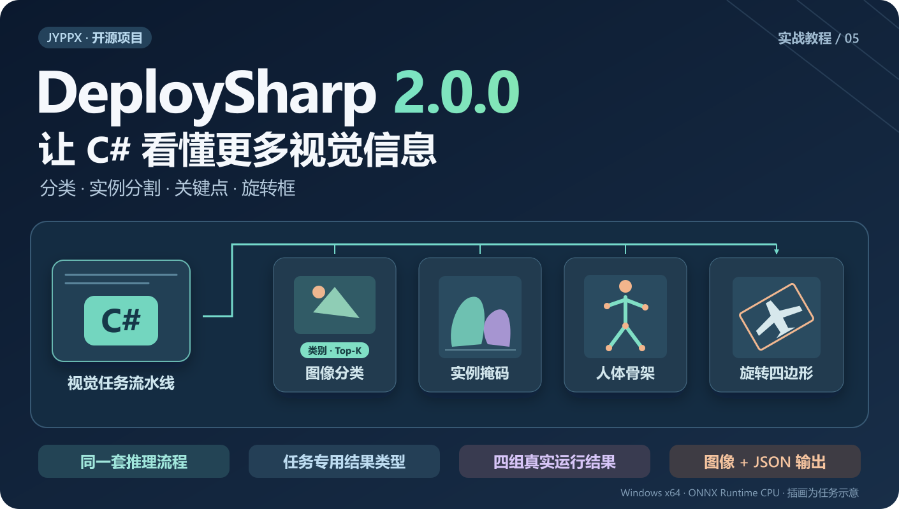
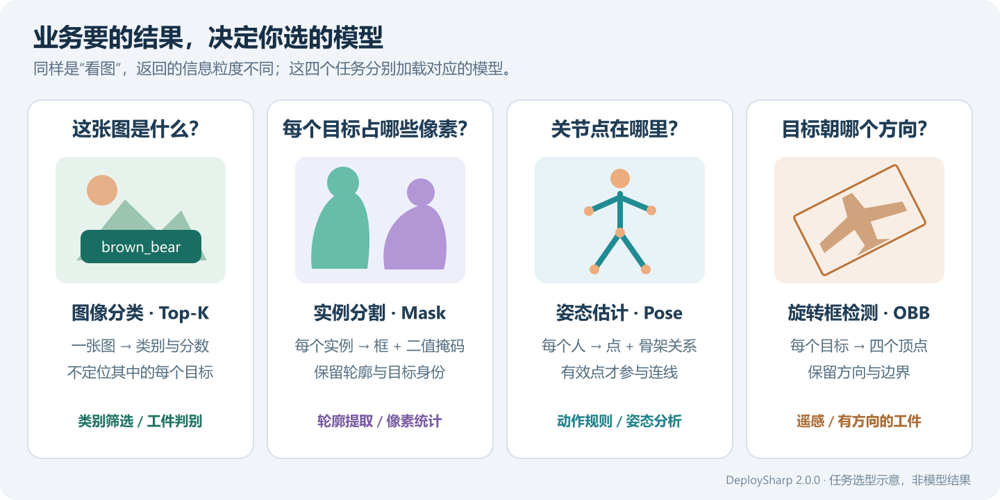
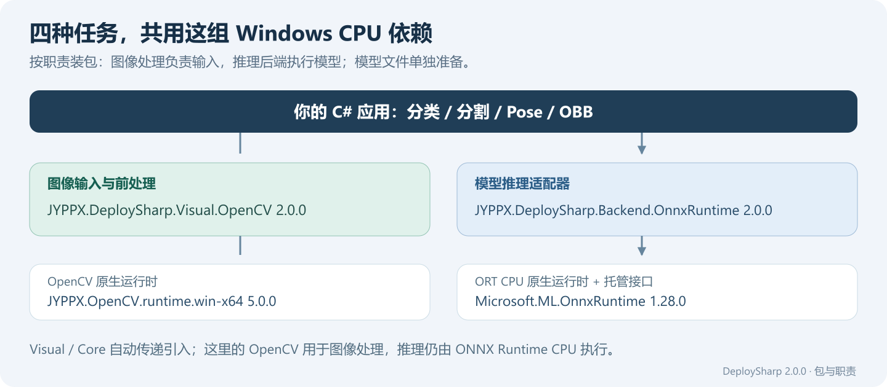
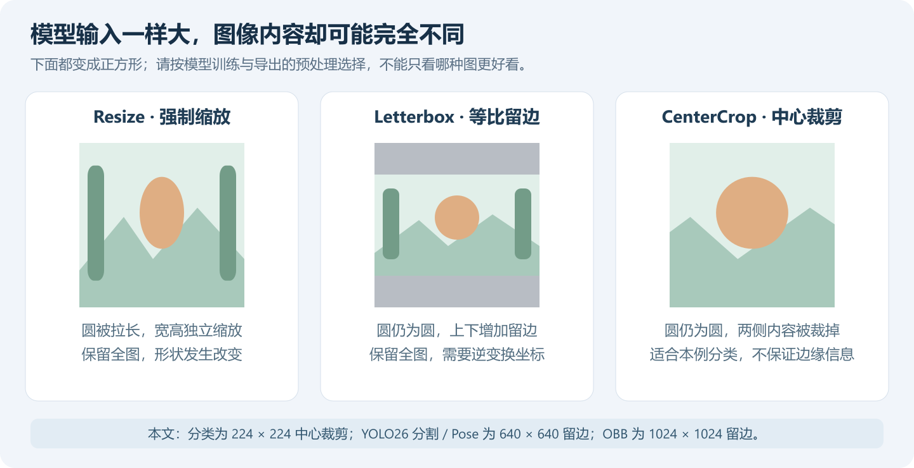
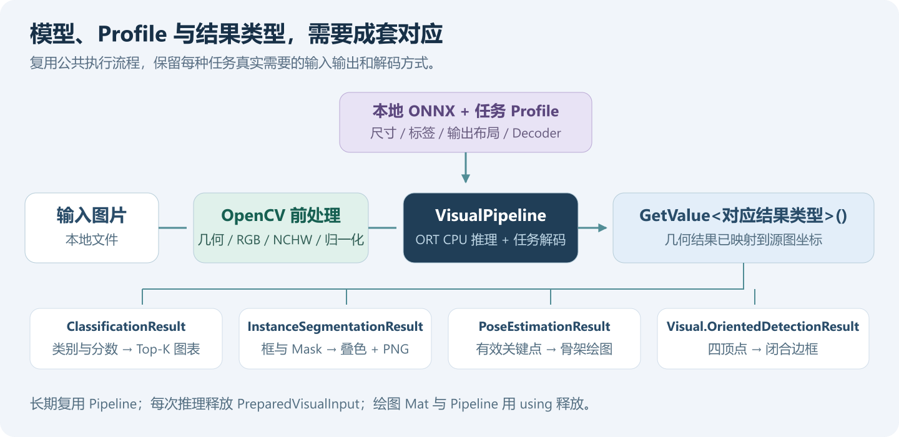
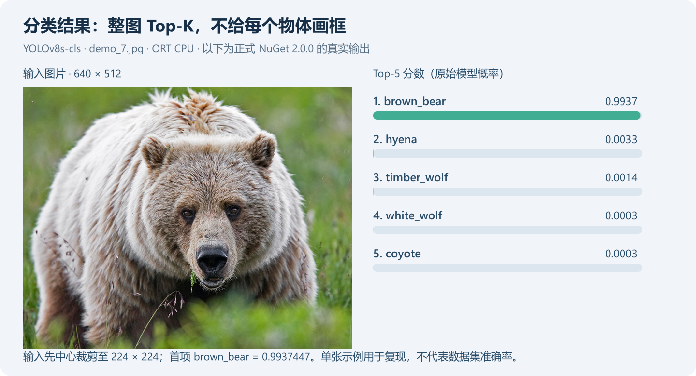
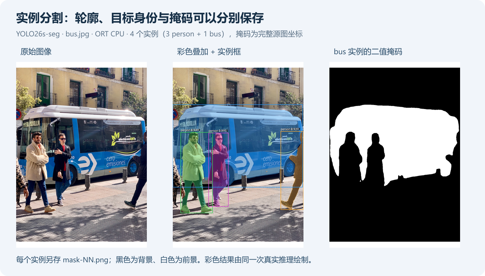
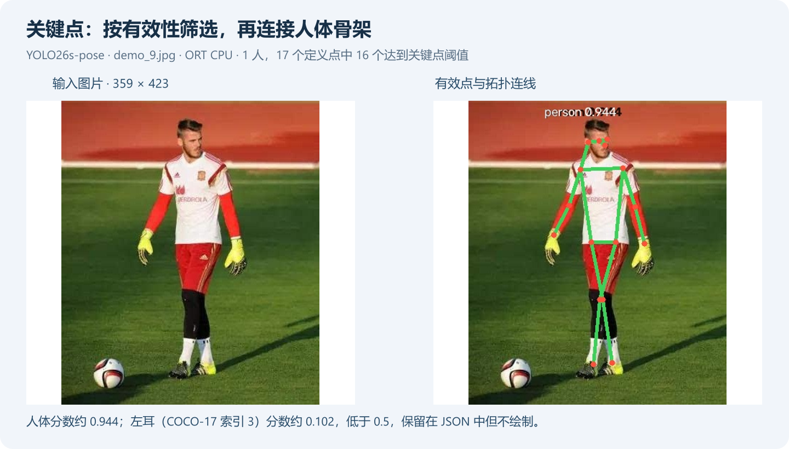
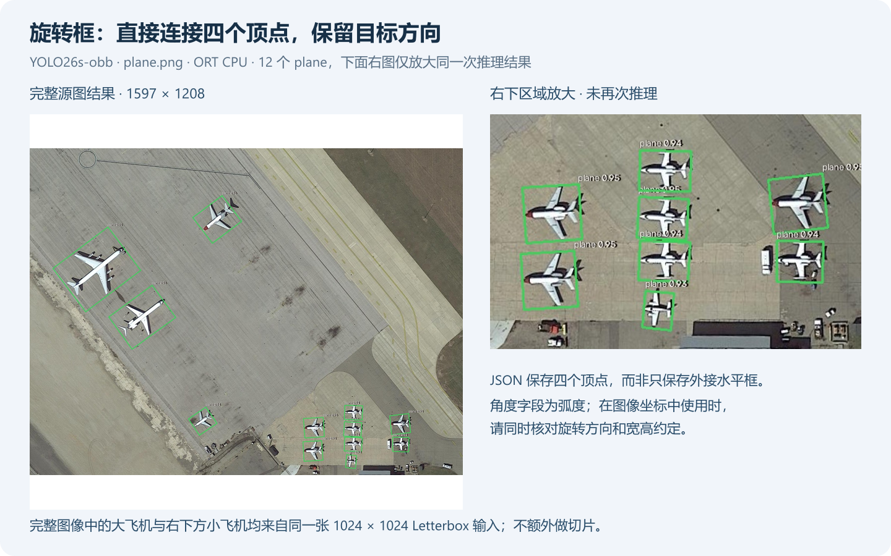

# DeploySharp 视觉多任务实战：在 C# 中完成分类、实例分割、关键点与旋转框检测

> DeploySharp 2.0.0 系列 · 第 05 篇实战教程。基于正式版 NuGet `2.0.0`、源码 Tag `v2.0.0`，创建与修订：2026-10-29。



## 一、DeploySharp 项目简介

**DeploySharp** 是一个面向 **C#/.NET 开发者**的开源模型部署框架，由「椒颜皮皮虾」开发，项目源码遵循 **Apache License 2.0**。它基于 **ONNX Runtime、OpenVINO、TensorRT、OpenCV DNN** 等推理引擎，把模型加载、图像前处理、推理执行和结果后处理组织成可复用的接口，方便大家在桌面软件、工业视觉和文档应用中接入模型。

项目已接入目标检测、图像分类、实例分割、关键点、旋转框、异常检测和背景移除等视觉任务，同时提供 **PP-OCRv4/v5/v6、PP-Structure 文档处理**及部分图文、本地语言模型的使用入口。常用模型可以直接使用配套前后处理，自有模型可以配置输入输出、类别、缩放和归一化方式，也可以扩展自己的解码器和结果类型。

2.0 版本进一步提供了按需组合的 NuGet 包、批量与独立 Session 池、异步输入处理、ROI 和大图重叠切片等能力。支持的 TensorRT 路径还可以使用 CUDA 前后处理与缓冲复用；具体能力按模型、任务和后端分别启用。

**项目源码与 NuGet：**

```text
项目源码：
https://github.com/guojin-yan/DeploySharp/tree/DeploySharpV2.0

NuGet（搜索 JYPPX.DeploySharp）：
https://www.nuget.org/packages?q=JYPPX.DeploySharp
```

当前正式版主要验证 Windows 10/11 x64；其他系统及具体模型的后端状态以仓库验证矩阵为准。库代码与第三方引擎、模型分别遵循各自的许可，使用模型时也要查看其上游说明。

前面几篇已经完成 YOLO26 检测、PaddleOCR 和多后端部署。这一篇继续解决一个实际问题：**当业务需要的不只是一个水平检测框，怎样用同一套 C# 工程获得不同的视觉结果？**

## 二、先看业务需要什么，再选择模型

### 2.1 四种任务，解决四类问题

给整张图判定类别、提取目标轮廓、寻找人体关节、识别带方向的工件，虽然都属于视觉任务，但需要的模型和输出并不相同。下面这张图先把选择依据放到一起。



| 业务想获得什么 | 使用的任务 | 本文模型 | 主要返回信息 |
| --- | --- | --- | --- |
| 这张图片最可能是什么类别 | 图像分类 | YOLOv8s Classification | Top-K 类别索引、名称和分数 |
| 每个目标具体占据哪些像素 | 实例分割 | YOLO26s Segmentation | 每个实例的类别、框、分数与二值掩码 |
| 人体各个关节的位置 | 关键点 / Pose | YOLO26s Pose | 人体分数、17 个关键点及其有效性、骨架拓扑 |
| 倾斜目标的范围与方向 | 旋转框 / OBB | YOLO26s OBB | 类别、分数与源图上的四个顶点 |

这里的“多任务”指 **DeploySharp 对不同视觉任务提供统一的执行方式**，本文仍然分别加载四个专用模型。分类用的是当前公共 Release 中可直接下载的 YOLOv8s；分割、Pose 和 OBB 都使用 YOLO26，没有把尚未在该 Release 提供的 YOLO26 分类模型写成默认资源。

### 2.2 本篇最终会保存什么

我们使用同一个控制台工程，通过 `classify / segment / pose / obb` 参数切换任务。每次执行后都会得到 `result.jpg` 和 `result.json`，分割任务还会把每个实例保存为独立的 `mask-NN.png`。

图片方便观察效果，JSON 方便接入业务。比如，分类用于产品分拣，掩码用于前景像素统计，关键点用于姿态规则，旋转四边形用于定位与方向计算。需要注意的是，掩码像素数量不等于实际面积，工业测量还需要相机标定与尺度换算。

## 三、创建工程：四种任务共用一组依赖

### 3.1 本文实际运行环境

| 项目 | 本次验证环境 |
| --- | --- |
| 操作系统 | Windows 11 x64，`10.0.26200` |
| CPU | AMD Ryzen 7 5800H，8 核 16 线程 |
| .NET | SDK `10.0.401`，运行时 `10.0.12`，目标框架 `net10.0` |
| DeploySharp | 正式 NuGet `2.0.0` |
| 推理引擎 | ONNX Runtime CPU `1.28.0` |
| 图像组件 | JYPPX OpenCV 托管接口及 Windows x64 runtime `5.0.0` |
| 执行方式 | 四个静态 Batch=1 模型，分别进行单图推理与结果保存 |

本文先把任务配置和结果使用讲清楚，四组结果均来自 **ORT CPU**。不需要安装 CUDA 或 TensorRT；也不把这次结果当作四个模型在所有后端上的验证结论。后端准备和离线发布可结合第 04 篇操作。

### 3.2 新建控制台并安装 NuGet

在 PowerShell 中执行以下命令：

```powershell
dotnet new console -n DeploySharpVisualDemo -f net10.0
cd DeploySharpVisualDemo

dotnet add package JYPPX.DeploySharp.Visual.OpenCV --version 2.0.0
dotnet add package JYPPX.DeploySharp.Backend.OnnxRuntime --version 2.0.0
dotnet add package Microsoft.ML.OnnxRuntime --version 1.28.0
dotnet add package JYPPX.OpenCV.runtime.win-x64 --version 5.0.0
```

在生成的 `.csproj` 的 `PropertyGroup` 中增加 `<PlatformTarget>x64</PlatformTarget>`。Visual、Core 等依赖会自动引入，不需要为分类、分割、Pose、OBB 各安装一个任务包。

这组依赖的职责如下。**使用 OpenCV 读图，不等于使用 OpenCV DNN 推理**，本文执行模型的是 ONNX Runtime CPU。



如果你准备部署到 NVIDIA GPU，或者换成 OpenVINO、OpenCV DNN，保持任务配置与结果使用的思路，再按后端准备对应适配器和 runtime。不要只把设备字符串改成 `cuda` 就认为已经切换成功。

### 3.3 取得完整随文代码

为了让主程序聚焦在调用流程，示例将 **任务配置放入 `Profiles.cs`，绘图与结果导出放入 `ResultWriter.cs`**。分类的 1000 类标签保存在 `imagenet-labels.json`，索引来自本文默认分类 ONNX 的 `names` 元数据。

可直接从下面目录下载完整工程：

```text
https://github.com/guojin-yan/DeploySharp/tree/DeploySharpV2.0/docs/blog/2.0.0/2026-10/examples/05-visual-multitask
```

也可以在刚才创建的项目目录执行以下命令，取得四个配套文件。它会替换空控制台的 `Program.cs`；第五节会完整展示主程序的内容。

```powershell
$codeBase = "https://raw.githubusercontent.com/guojin-yan/DeploySharp/DeploySharpV2.0/docs/blog/2.0.0/2026-10/examples/05-visual-multitask"
foreach ($file in @("Program.cs", "Profiles.cs", "ResultWriter.cs", "imagenet-labels.json")) {
    Invoke-WebRequest "$codeBase/$file" -OutFile $file
}
```

在 `.csproj` 中增加下面这一项，让类别文件随程序进入输出目录：

```xml
<ItemGroup>
  <None Update="imagenet-labels.json" CopyToOutputDirectory="PreserveNewest" />
</ItemGroup>
```

这些辅助文件就是公开的 C# 示例代码，读者可以直接修改。运行程序不需要编译 DeploySharp 源码，也不需要先跑模型验证脚本。

## 四、准备四组模型与图片，确认预处理方式

### 4.1 下载默认资源

本文使用项目公共模型与测试图片 Release 中的文件，模型直接从本地路径加载。下面的下载命令会整理好程序默认使用的文件名。

```powershell
New-Item -ItemType Directory -Force -Path models, images | Out-Null

$modelBase = "https://github.com/guojin-yan/DeploySharp/releases/download/models-visual.1"
$models = @(
    @{ Remote = "yolo-v8-classify-s.model.onnx"; Local = "yolov8s-cls.onnx" },
    @{ Remote = "yolo-v26-segment-s.model.onnx"; Local = "yolo26s-seg.onnx" },
    @{ Remote = "yolo-v26-pose-s.model.onnx"; Local = "yolo26s-pose.onnx" },
    @{ Remote = "yolo-v26-obb-s.model.onnx"; Local = "yolo26s-obb.onnx" }
)
foreach ($model in $models) {
    Invoke-WebRequest "$modelBase/$($model.Remote)" -OutFile "models/$($model.Local)"
}

$imageBase = "https://github.com/guojin-yan/DeploySharp/releases/download/test-assets.1"
foreach ($image in @("demo_7.jpg", "bus.jpg", "demo_9.jpg", "plane.png")) {
    Invoke-WebRequest "$imageBase/$image" -OutFile "images/$image"
}
```

公开资源入口也列在这里，方便按需选择文件：

```text
视觉模型：
https://github.com/guojin-yan/DeploySharp/releases/tag/models-visual.1

测试图片：
https://github.com/guojin-yan/DeploySharp/releases/tag/test-assets.1
```

如果只使用某一种任务，只下载相应模型和图片即可。已有本地模型时，后面通过命令行传入自己的路径，无需沿用这里的目录。

### 4.2 为什么分类和检测族不能照搬同一套缩放

先看输入配置。本文四个模型都是 **Float32、RGB、NCHW、像素除以 255**，但几何处理和输出规格不同。

| 任务 | 输入 `images` | 图像几何 | 实际输出合同 |
| --- | --- | --- | --- |
| 分类 | `[1,3,224,224]` | CenterCrop | `output0 [1,1000]`，已输出类别概率 |
| 实例分割 | `[1,3,640,640]` | Letterbox，填充 114 | `output0 [1,300,38]`，`output1 [1,32,160,160]` |
| Pose | `[1,3,640,640]` | Letterbox，填充 114 | `output0 [1,300,57]` |
| OBB | `[1,3,1024,1024]` | Letterbox，填充 114 | `output0 [1,300,7]` |

`NCHW` 表示批次、通道、高度、宽度的顺序。分割输出包含 300 条端到端候选及 32 通道的原型掩码；Pose 的每条候选包含 17 组关键点信息；OBB 的每条候选还带有角度。这些模型不能按普通检测的 6 个字段直接读取。

三种常用几何方式的区别如下，图中的圆和两侧标记可以直观看到内容如何变化。



**CenterCrop** 等比缩放后取中心区域，适用于本文分类模型，但边缘内容可能被裁掉。**Letterbox** 等比缩放并留边，保留完整视野，再由坐标变换还原结果。**Resize** 直接缩放到目标尺寸，宽高比可能发生改变。

DeploySharp 可以配置这些模式，也可以配置颜色、归一化和插值。**能够切换参数，不代表可以任意切换模型的输入语义。** 先与训练、导出和上游推理流程保持一致，再评估是否需要调整。本文分类图已经输出概率，因此使用 `ClassificationScoreMode.Probabilities`，不再额外做一次 Softmax。

## 五、共用推理流程，让任务配置决定解码方式

### 5.1 把公共部分和任务差异分开理解

四种任务共用“注册后端 → 选择 Profile → 准备图像 → 推理解码 → 获取结果”的流程。`Profile` 保存输入名称与尺寸、标签、输出规格、预处理和解码器；`ModelArtifact` 指向本地模型。两者与实际导出匹配后，才知道怎样解释输出。



`Profiles.Create(task)` 已封装第四节四个公开模型的配置。其中分割、Pose 与 OBB 复用 `YoloMultiTaskProfiles` 内置工厂，分类使用通用 `ClassificationDecoder`。后处理默认使用目标分数阈值 `0.25`、掩码阈值 `0.5`、关键点阈值 `0.5`；分割临时工作区上限设置为 `512 MiB`，这是上限，并非每次固定申请这么多内存。

### 5.2 完整主程序

下面是随文工程的 `Program.cs`。将其与前面取得的配置、绘图和标签文件放在一起，即可编译运行。

```csharp
using System.Text.Json;
using JYPPX.DeploySharp;
using JYPPX.DeploySharp.Backends.OnnxRuntime;
using JYPPX.DeploySharp.Models;
using JYPPX.DeploySharp.Registry;
using JYPPX.DeploySharp.Results.Vision;
using JYPPX.DeploySharp.Visual;
using JYPPX.DeploySharp.Visual.OpenCV;
using OrientedDetectionResult = JYPPX.DeploySharp.Visual.OrientedDetectionResult;

string task = args.Length > 0 ? args[0].ToLowerInvariant() : "all";
if (task == "all" && args.Length > 1)
    throw new ArgumentException("自定义模型和图片路径请使用单个任务，不要使用 all。");
string[] tasks = task == "all" ? ["classify", "segment", "pose", "obb"] : [task];
using var backends = new BackendRegistry();
backends.UseOnnxRuntime();
var request = new BackendRequest(BackendCapabilities.TensorInference,
    OnnxRuntimeBackendProvider.BackendId, "cpu");

foreach (string current in tasks)
{
    var defaults = current switch
    {
        "classify" => (Model: "yolov8s-cls.onnx", Image: "demo_7.jpg"),
        "segment" => (Model: "yolo26s-seg.onnx", Image: "bus.jpg"),
        "pose" => (Model: "yolo26s-pose.onnx", Image: "demo_9.jpg"),
        "obb" => (Model: "yolo26s-obb.onnx", Image: "plane.png"),
        _ => throw new ArgumentException("任务应为 all / classify / segment / pose / obb。")
    };
    string modelPath = Path.GetFullPath(args.Length > 1 ? args[1] : Path.Combine("models", defaults.Model));
    string imagePath = Path.GetFullPath(args.Length > 2 ? args[2] : Path.Combine("images", defaults.Image));
    if (!File.Exists(modelPath)) throw new FileNotFoundException("找不到本地模型。", modelPath);
    if (!File.Exists(imagePath)) throw new FileNotFoundException("找不到输入图片。", imagePath);

    VisualModelProfile profile = Profiles.Create(current, args.Length > 3 ? args[3] : null);
    var profiles = new VisualProfileRegistry();
    profiles.Register(profile);
    profiles.Freeze();
    var artifact = new ModelArtifact(profile.ModelId, "onnx", modelPath);
    using var pipeline = new VisualPipeline(backends,
        profiles.Select(artifact, backends, request, profile.Task), request);
    using PreparedVisualInput input = new OpenCvVisualInputFactory().CreateFromFile(imagePath, profile);
    VisualInferenceResult result = pipeline.Run(input);

    string directory = Path.GetFullPath(Path.Combine("results", current));
    Directory.CreateDirectory(directory);
    object details = current switch
    {
        "classify" => ResultWriter.Classification(imagePath, directory, result.GetValue<ClassificationResult>()),
        "segment" => ResultWriter.Segmentation(imagePath, directory, result.GetValue<InstanceSegmentationResult>()),
        "pose" => ResultWriter.Pose(imagePath, directory, result.GetValue<PoseEstimationResult>()),
        "obb" => ResultWriter.Obb(imagePath, directory, result.GetValue<OrientedDetectionResult>()),
        _ => throw new InvalidOperationException()
    };
    File.WriteAllText(Path.Combine(directory, "result.json"), JsonSerializer.Serialize(new
    {
        task = current, backend = "onnxruntime", device = "cpu", packageVersion = "2.0.0",
        model = Path.GetFileName(modelPath), image = Path.GetFileName(imagePath),
        environment = new
        {
            os = System.Runtime.InteropServices.RuntimeInformation.OSDescription,
            runtime = System.Runtime.InteropServices.RuntimeInformation.FrameworkDescription
        },
        preprocessing = new { size = profile.Input.ShapePattern.ToString(),
            resize = profile.Preprocessing!.ResizeMode.ToString(), color = "RGB", scaleDivisor = 255 },
        outputs = profile.Outputs.Select(o => new { o.Name, shape = o.ShapePattern.ToString() }),
        result = details
    }, new JsonSerializerOptions { WriteIndented = true }));
    Console.WriteLine($"{current}: saved={directory}");
}
```

主程序通过 `GetValue<T>()` 取得任务结果。**切换任务时，模型、Profile 和结果类型要同步切换**，不能只把分割 ONNX 换进检测程序，再期望普通检测结果中自动出现掩码。

`BackendRegistry` 在任务之间复用；每个任务单独创建并释放 `VisualPipeline`。这份控制台示例执行完一张图就结束，实际视频或批量应用应复用同一个 Pipeline，避免每帧重新加载模型。每次准备的 `PreparedVisualInput` 以及绘图用的 `Mat` 都通过 `using` 释放。

### 5.3 执行全部任务，或只执行一项

在项目目录执行：

```powershell
dotnet run -c Release -- all
```

也可以分别运行：

```powershell
dotnet run -c Release -- classify
dotnet run -c Release -- segment
dotnet run -c Release -- pose
dotnet run -c Release -- obb
```

程序按顺序执行四次单模型推理，并不会将四张图片拼成同一模型的 Batch。成功后，输出目录如下：

```text
results/
  classify/ result.jpg  result.json
  segment/  result.jpg  result.json  mask-00.png  mask-01.png ...
  pose/     result.jpg  result.json
  obb/      result.jpg  result.json
```

接下来逐项看真实输出，以及这些结果应该怎样使用。

## 六、图像分类：读取 Top-K 类别与分数

### 6.1 分类结果是什么

分类结果使用 `ClassificationResult`，其中 `Predictions` 按分数从高到低排列，`TopPrediction` 对应首项。每项有 `Index`、`Label` 和 `Score`，不包含目标位置。

下面摘录绘图器中的结果读取方式，代码运行在已获得 `result` 的上下文中：

```csharp
foreach (var item in result.Predictions)
{
    Console.WriteLine($"{item.Index}: {item.Label} = {item.Score:F4}");
}
```

类别表要与模型训练时的索引对应。即使张量有 1000 个值，使用另一份顺序不同的 1000 类标签，程序也可能正常运行，却给出错误的名称。随文类别文件来自默认 ONNX 元数据，替换自有分类模型时也应使用自己的类别表。

### 6.2 默认图片的实际输出

本文在 `demo_7.jpg` 上取得以下 Top-5，图中的条形长度和右侧数字来自真实模型结果。



```text
#1 brown_bear  0.9937
#2 hyena       0.0033
#3 timber_wolf 0.0014
#4 white_wolf  0.0003
#5 coyote      0.0003
```

第一项是 `brown_bear`，类别索引为 `294`。这张图能说明程序完成了分类并正确映射标签，不能代替整套数据集的准确率评估，也不能把分数直接解释为经过业务校准的可靠概率。

## 七、实例分割：每个目标都有独立掩码

### 7.1 除了框，还要取出 Mask

分割结果使用 `InstanceSegmentationResult`。`Instances` 中的每项包含类别、分数、框和 `Mask`；同一类别的多个目标仍然保留各自的实例身份。

本文的 `Mask` 已还原为 **完整源图坐标**：宽高为 `810 × 1080`，`OriginX/OriginY` 均为 `0`。绘图器先检查坐标空间、原点和大小，再把前景像素叠到原图。不能把模型的 `160 × 160` 原型图直接当作最终掩码。

```csharp
foreach (var item in result.Instances)
{
    InstanceBinaryMask mask = item.Mask;
    byte[] pixels = mask.ToArray();
    int foreground = pixels.Count(value => value != 0);
    Console.WriteLine($"{item.Label}: foreground={foreground}");
}
```

`ToArray()` 会复制出一份像素数组，**每个实例取一次即可**。不要在每个像素的循环里重复调用。随文绘图器按行处理原图，使用 `Mat.Step` 计算行地址，并把前景转换为 255 保存 PNG；这些绘图和文件操作放在推理完成之后，不属于模型本身的计算。

### 7.2 公交车图片的真实分割结果

下面依次为原图、彩色实例叠加结果和其中公交车实例的二值掩码。黑色是背景，白色是该实例的前景。



本次得到 **4 个实例：3 个 person、1 个 bus**。对应分数约为 `0.949`、`0.943`、`0.929`、`0.895`，每项在 JSON 中保留框和掩码文件名。公交车掩码的前景像素数量为 `266226`，可用于检查结果或进一步做像素统计。

这里也能看到实例分割的边界：**模型未必能完整识别遮挡目标或图像边缘目标。** 单张示例没有检出所有可见人物，调整阈值前应先查看原始场景与模型适用性。本文展示的是默认阈值的实际结果，没有补画模型未输出的实例。

## 八、人体关键点：有效点才参加骨架连线

### 8.1 人体分数和关键点分数分别使用

Pose 结果使用 `PoseEstimationResult`。每个人体实例有自己的 `Score` 和 `Keypoints`；每个关键点又有 `Index`、坐标、分数和 `IsValid`。`Topology` 保存点的定义及骨架连接关系，本文采用 COCO-17 点序。

**人体检测分数高，不代表每一个关节都清晰可见。** 被遮挡或方向不利的点，可以保留在结构化结果中，但不应强行参与骨架绘制。

随文绘图器按照点索引寻找骨架两端，只在两端都有效时画线。下面是对应的关键实现：

```csharp
var points = item.Keypoints.ToDictionary(p => p.Index);
foreach (var edge in result.Topology.Edges)
{
    var a = points[edge.FirstKeypointIndex];
    var b = points[edge.SecondKeypointIndex];
    if (a.IsValid && b.IsValid)
        Drawing.Line(canvas, Point(a.Point), Point(b.Point), color, 3);
}
```

这段代码摘自 `ResultWriter.cs`，`Point` 是该文件中将浮点坐标转换为 OpenCV 整数绘图点的辅助方法。业务计算可以继续使用原始浮点坐标，避免过早取整。

### 8.2 球员图片的真实结果

在 `demo_9.jpg` 上检测到 **1 人**，人体分数约为 `0.944`，17 个关键点中有 **16 个**达到本文 `0.5` 的有效性阈值。



COCO-17 索引 `3` 对应的左耳关键点分数约为 `0.102`，因此不绘制，也不连接依赖该点的骨架边。结果仍在 JSON 中保存其坐标、分数和 `IsValid=false`，方便调试。需要做关节角度或动作判断时，同样应先检查参与计算的点是否有效；跨帧动作识别还需要跟踪和时序逻辑，单帧 Pose 本身不会自动给出动作类别。

## 九、旋转框：用四个顶点还原目标方向

### 9.1 不要把 OBB 画成普通水平框

OBB 是 Oriented Bounding Box，即有方向的包围框。本文返回类型是 **`JYPPX.DeploySharp.Visual.OrientedDetectionResult`**，每个目标的 `Quadrilateral.Vertices` 保存源图中的四个顶点。

绘图时按顶点顺序闭合连接即可。`AxisAlignedBounds` 只是外接水平框，不能替代旋转四边形，否则会丢掉目标方向。

```csharp
var vertices = item.Quadrilateral.Vertices;
for (int i = 0; i < vertices.Count; i++)
{
    Drawing.Line(canvas,
        Point(vertices[i]),
        Point(vertices[(i + 1) % vertices.Count]),
        color, 2);
}
```

如果同时引入 Core 的结果命名空间，可能遇到同名类型。随文代码使用下面的别名明确选择 Visual 的多任务结果：

```csharp
using OrientedDetectionResult = JYPPX.DeploySharp.Visual.OrientedDetectionResult;
```

### 9.2 飞机场景的真实结果

在 `plane.png` 上，本次得到 **12 个 plane**。左侧展示完整源图，右侧只放大同一次结果中的右下区域，便于观察小飞机的方向；没有对局部图片再次推理。



JSON 同时保留四个顶点、`AngleRadiansCounterClockwise` 和 `HasExactRotatedRectangle`。角度字段使用弧度，若要接入机械定位或其他图像工具，要核对对方的角度单位、正方向、宽高交换和坐标轴约定。**业务只需要绘制与区域定位时，直接使用四个顶点更稳妥。**

尤其在非等比缩放等变换后，还原到源图的几何形状不一定仍能用一个精确旋转矩形描述。此时应查看 `HasExactRotatedRectangle`，不能仅凭一个角度字段重建边框。本文默认使用 Letterbox。

## 十、换成自己的模型或图片，先核对这几项

### 10.1 相同导出规格，可以直接指定路径

对于与本文相同输入输出合同的模型，可以传入自己的模型和图片。参数顺序为：**任务、模型路径、图片路径、可选分类标签 JSON**。

```powershell
dotnet run -c Release -- segment "models/my-yolo26-seg.onnx" "images/my-image.jpg"
dotnet run -c Release -- pose "models/my-yolo26-pose.onnx" "images/my-person.jpg"
dotnet run -c Release -- obb "models/my-yolo26-obb.onnx" "images/my-scene.png"
dotnet run -c Release -- classify "models/my-cls.onnx" "images/my-image.jpg" "my-labels.json"
```

最后一条适用于与本文相同的 **1000 类、224 输入、概率输出**分类合同。标签 JSON 是按索引排列的字符串数组，例如 `["class-a", "class-b"]` 这样的格式；自有模型若只有两个类别，还要把 `Profiles.cs` 中的输出维度、标签数量检查与 `topK` 一起改为对应值。

YOLO26 自定义类别的分割或 OBB，也要将 `Coco80 / Dota15` 换成训练时的类别列表。当前 Pose 配置针对 COCO-17 人体关键点；自定义点数、动物骨架或其他关键点布局需要对应的合同与拓扑，不能仅换标签。

### 10.2 需要同时核对的配置

| 更换了什么 | 需要同步检查 |
| --- | --- |
| 输入尺寸或输入名称 | `VisualInputBinding`、`ModelSize`、名称和实际 ONNX 输入 |
| Resize / Letterbox / CenterCrop | `VisualPreprocessingOptions` 与训练、上游推理流程是否一致 |
| 颜色或数值范围 | RGB/BGR、除数、均值和标准差；不要重复归一化 |
| 模型任务或导出布局 | 解码器、候选数、输出名称与维度；端到端与原始候选不可混用 |
| 类别表或分类分数类型 | 类别顺序、类数、Top-K，以及输出是 Logits 还是概率 |
| Batch 或多线程方式 | 模型是否真正支持该 Batch；静态 Batch=1 不靠修改配置变成动态模型 |

预处理可通过 `profile.WithPreprocessing(...)` 创建新的配置，例如设置 `VisualResizeMode.Resize` 或 `VisualNormalizationOptions.ImageNet`。这些配置用于匹配模型要求，不建议为了“试试看”同时改变几何、颜色和归一化，再只观察哪个输出分数更高。

本文 YOLO26 模型使用端到端候选输出，内置解码器不再重复 NMS。换成非端到端导出时，需要按对应模型族和布局配置，而不是把 `candidateCount` 随意改成 300。掩码、关键点和旋转框已经映射回源图，也不应在应用层再做一遍 Letterbox 逆变换。

### 10.3 常见现象与检查顺序

| 现象 | 优先检查与处理 |
| --- | --- |
| 分类分数很高，名字却明显不对 | 检查类别索引顺序；默认模型使用随文标签，自己的模型使用训练时标签 |
| 目标框偏移、掩码错位 | 检查输入几何和源图大小；不要在源图结果上二次缩放或二次去留边 |
| 骨架连到原点或遮挡位置 | 先筛选 `IsValid`，仅连接两端都有效的点，并核对拓扑索引 |
| OBB 与目标方向不一致 | 先直接绘制四顶点；需要角度时再核对单位、方向和宽高约定 |
| 提示输出 Shape 或张量名称不匹配 | 对照实际 ONNX 输出调整 Profile，不要使用另一个任务的解码器 |
| 出现原生 DLL 加载错误 | 确认 `x64`、OpenCV Windows runtime 和 ORT CPU runtime 均进入输出目录，先排除 CPU/GPU runtime 混装 |

本文的四组结果用于展示 **真实单图调用、坐标还原和结果消费**，没有用这些图片计算通用准确率，也没有将含读图、画图和保存文件的单次时间写成性能排行。需要比较后端速度时，应固定模型、图片和配置，预热后重复测量，并分别记录前处理、模型执行、后处理与完整流程。

模型支持和设备性能入口如下：

```text
模型支持指南：
https://github.com/guojin-yan/DeploySharp/blob/DeploySharpV2.0/docs/articles/model-support.md

逐模型后端验证矩阵：
https://github.com/guojin-yan/DeploySharp/blob/DeploySharpV2.0/docs/model-backend-verification-matrix.md

设备性能实测：
https://github.com/guojin-yan/DeploySharp/blob/DeploySharpV2.0/docs/articles/device-performance-benchmarks.md
```

## 十一、从视觉结果，继续组合完整应用

到这里，同一个 C# 控制台工程已经完成四条视觉路径：分类输出 Top-K，分割保存实例掩码，Pose 绘制有效骨架，OBB 保留旋转四边形。后端初始化和输入管理可以复用，而任务专用结果保留了各自需要的信息。

实际应用中，还可以把检测区域交给分类，把分割掩码用于后续测量，把视频中的关键点与跟踪器结合。接入这些组合之前，先确认坐标、类别和生命周期，再加入 Batch、Session 池或异步处理。

**下一篇继续介绍 PP-Structure 文档处理**，从页面区域检测、区域 OCR，到表格结构与 HTML 输出，讲解怎样把多个专用模型组合成一条可使用的流程。自定义模型、视频并发、ROI 和大图切片也会在后续文章分别展开。

```text
本系列文章与完整案例：
https://github.com/guojin-yan/DeploySharp/tree/DeploySharpV2.0/docs/blog/2.0.0
```
