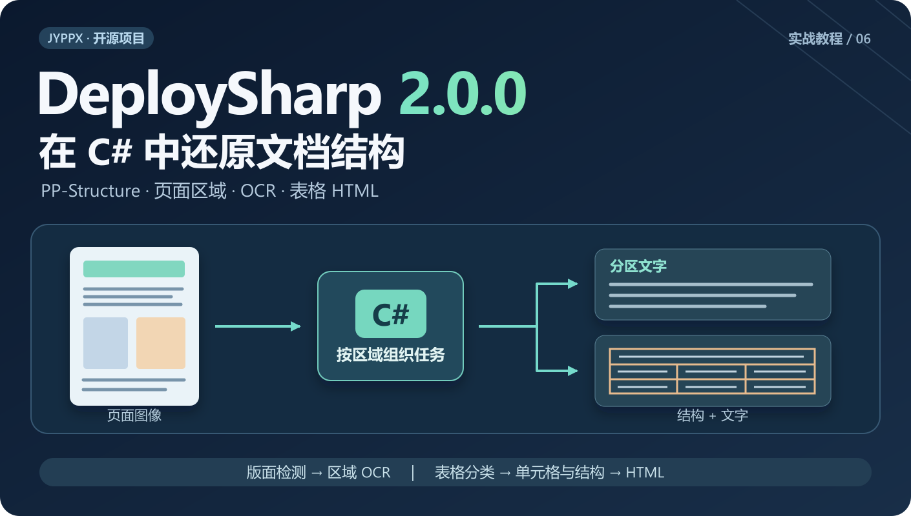
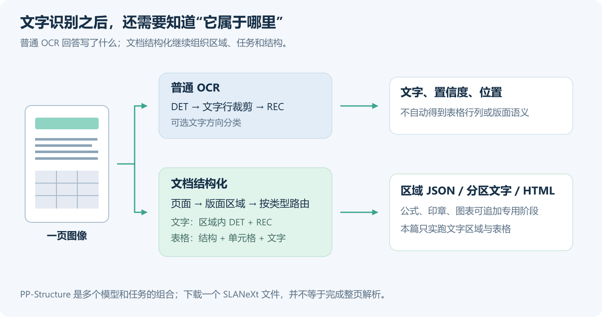
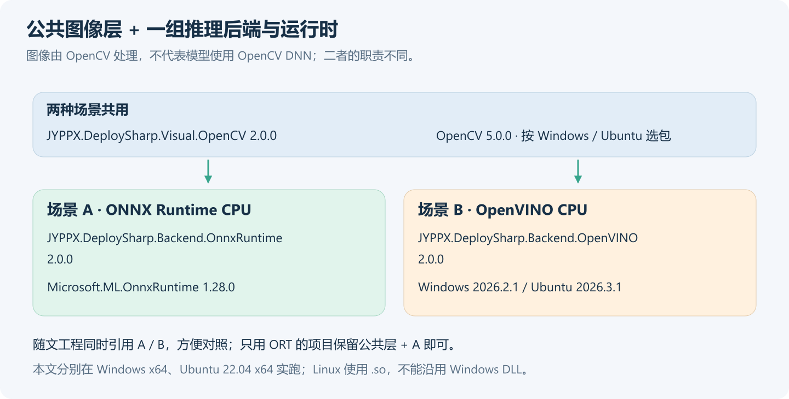
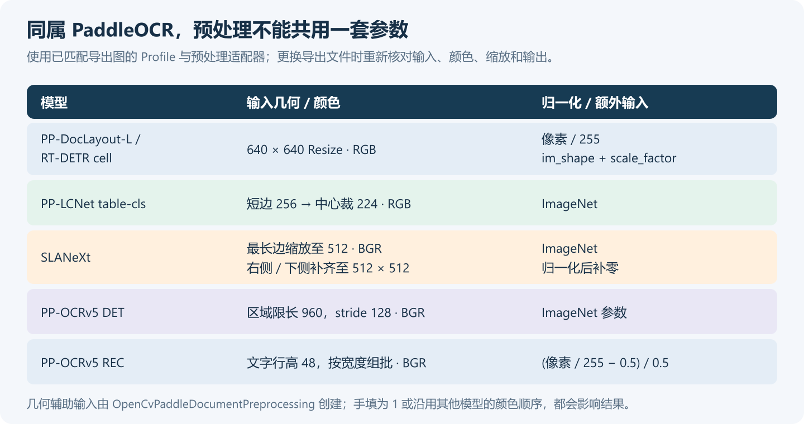
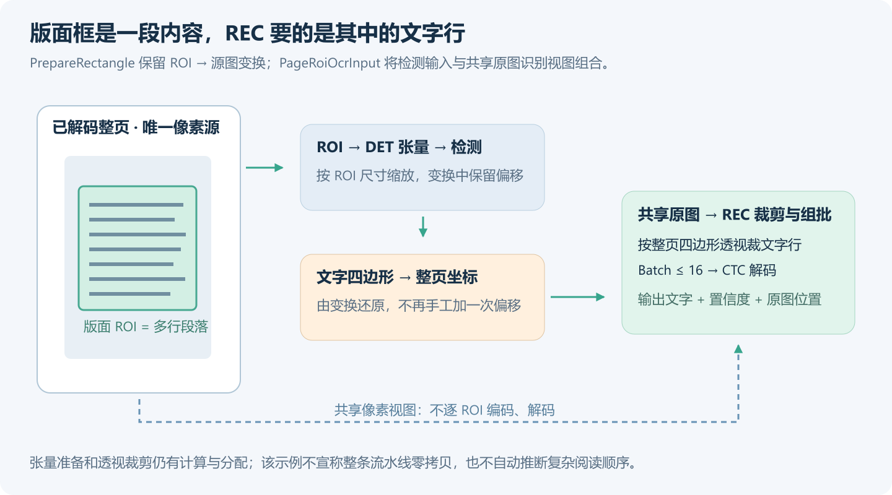
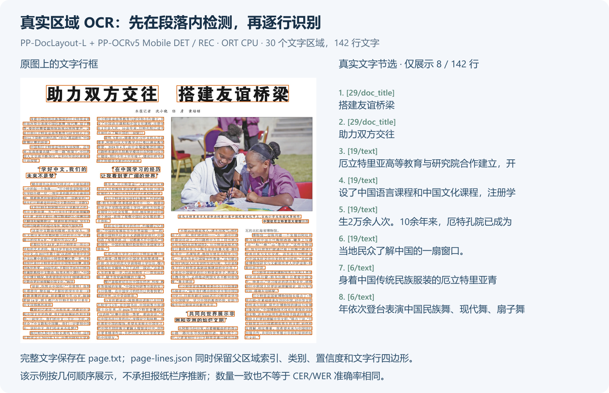
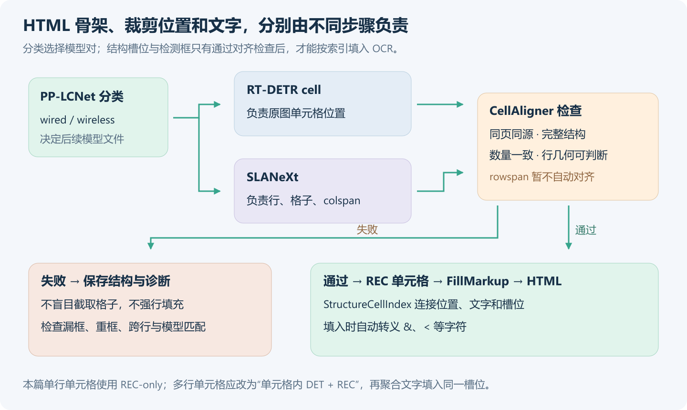
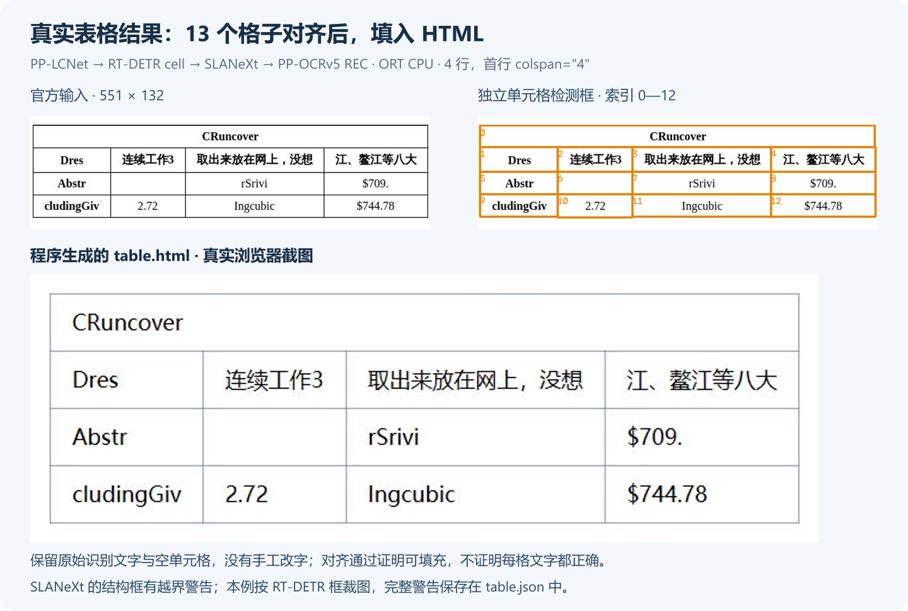
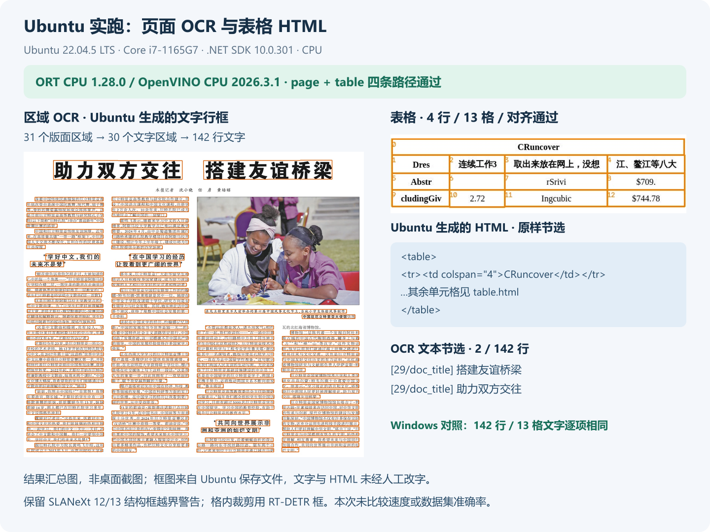

# 在 C# 中使用 PP-Structure：从页面区域到表格 HTML

> DeploySharp 2.0.0 系列 · 第 06 篇实战教程，使用正式 NuGet `2.0.0`。



## 一、DeploySharp 项目简介

**DeploySharp** 是一个面向 **C#/.NET 开发者**的开源模型部署框架，由「椒颜皮皮虾」开发，项目源码遵循 **Apache License 2.0**。项目封装了 **ONNX Runtime、OpenVINO、TensorRT、OpenCV DNN** 等推理引擎，提供模型加载、图像前处理、推理和结果后处理接口，方便大家在桌面软件、工业视觉和文档应用中部署模型。

目前项目已接入目标检测、分类、实例分割、关键点、旋转框、异常检测、背景移除等视觉任务，也提供 **PP-OCRv4/v5/v6、PP-Structure 文档处理**及部分图文、本地语言模型的使用入口。常用模型可以直接使用配套前后处理，自有模型可以配置输入输出、缩放、颜色和归一化，也可以扩展自己的解码器和结果类。

2.0 版本增加了按需安装的 NuGet 包、Batch 批量推理、独立 Session 会话池、异步输入、感兴趣区域（ROI）管理和大图重叠切片等功能。文档处理也可以通过这些接口组合多个模型，保留各阶段的结果与坐标。

**项目源码与 NuGet：**

```text
项目源码：
https://github.com/guojin-yan/DeploySharp/tree/DeploySharpV2.0

NuGet（搜索 JYPPX.DeploySharp）：
https://www.nuget.org/packages?q=JYPPX.DeploySharp
```

第 03 篇介绍了完整 OCR。这一篇继续处理文档结构：先在多栏页面中找到标题、正文和图片，再识别各区域的文字；对表格恢复行列和单元格，生成带文字的 HTML。

## 二、从“识别文字”到“组织文档”

### 2.1 为什么只有 OCR 还不够

普通 OCR 返回文字、置信度和文字框。做文档应用时，还需要区分标题、正文、图片和表格，并将表格文字放回对应的行列。

这些任务需要多个模型配合，处理过程如下：



**PP-Structure 是一组文档处理能力的组合。** 本篇使用 PaddleOCR 体系中的版面、表格及文字模型，在 DeploySharp 中组装两条可以独立运行的路径：

| 命令 | 输入 | 处理路径 | 最终产物 |
| --- | --- | --- | --- |
| `page` | 多栏文档页面 | PP-DocLayout-L → 文字类区域 → 区域内 DET + REC | 版面框图、文字行框图、分区 TXT、区域与文字 JSON |
| `table` | 已裁出的单张表格 | 表格分类 → 单元格检测 → SLANeXt → 对齐 → REC → HTML | 单元格图、结构 JSON、对齐诊断、文字 JSON、带文字 HTML |

两条命令分别运行页面和表格处理。需要处理整页中的表格时，可以将版面检测得到的 `table` 区域裁出，再交给表格流程，并保留裁剪坐标变换。

### 2.2 其他文档模块放在哪里

方向分类用于纠正整页方向，UVDoc 用于文本图像矫正；公式、印章和图表区域需要各自的模型与结果处理。PaddleOCR-VL 则属于视觉语言解析路径，有独立的 Bundle、生成配置和运行成本。

| 模块 | 在实际应用中的位置 | 本例使用情况 |
| --- | --- | --- |
| 文档方向、UVDoc 矫正 | 页面分析之前，按输入质量选择 | 可选前置阶段，本例未启用 |
| PP-DocLayout | 确定页面有哪些区域 | PP-DocLayout-L |
| PP-OCR DET / REC | 对文字区域定位文字行，再识别 | v5 Mobile DET + REC |
| 表格分类、单元格、SLANeXt | 选择表格模型，恢复结构，定位格子 | 有线表格 |
| 公式、印章、Chart2Table | 按版面类型进入专用阶段 | 后续可扩展，本例未启用 |
| PaddleOCR-VL | 独立的视觉语言解析任务 | 本例未启用 |

这两张输入的朝向已经正确，因此省去方向分类。页面文字区域包含多行，采用 DET + REC；表格单元格主要是单行文字，采用 REC-only。自己的表格若有多行单元格，再增加格内文字检测。

## 三、环境与 NuGet：按使用场景安装

### 3.1 运行环境

| 项目 | Windows 实测 | Ubuntu 实测 |
| --- | --- | --- |
| 操作系统 | Windows 11 x64，`10.0.26200` | Ubuntu `22.04.5 LTS` x86_64 |
| CPU | AMD Ryzen 7 5800H，8 核 16 线程 | Intel Core i7-1165G7，4 核 8 线程 |
| .NET | SDK `10.0.401`，运行时 `10.0.12` | SDK `10.0.301`，运行时 `10.0.9` |
| DeploySharp | 正式 NuGet `2.0.0`，`net10.0` | 同一份 C# 源码与正式 NuGet `2.0.0` |
| ORT | `Microsoft.ML.OnnxRuntime 1.28.0`，CPU | 同版本，CPU |
| OpenVINO | Windows runtime `2026.2.1`，CPU | Ubuntu runtime `2026.3.1`，CPU |
| 图像组件 | JYPPX OpenCV Windows x64 runtime `5.0.0` | JYPPX OpenCV Ubuntu 22.04 x64 runtime `5.0.0` |
| 调度 | 文档模型 Batch=1；REC 上限 16；单 Session，区域按顺序执行 | 相同配置 |

我在 Windows 和 Ubuntu 上分别使用 ORT CPU、OpenVINO CPU 运行了这两个案例，下面介绍依赖和实现。

### 3.2 Windows：只用 ONNX Runtime CPU

先创建一个 x64 控制台工程，然后安装图像层和 ORT 后端：

```powershell
dotnet new console -n DeploySharpStructureDemo -f net10.0
cd DeploySharpStructureDemo

dotnet add package JYPPX.DeploySharp.Visual.OpenCV --version 2.0.0
dotnet add package JYPPX.OpenCV.runtime.win-x64 --version 5.0.0
dotnet add package JYPPX.DeploySharp.Backend.OnnxRuntime --version 2.0.0
dotnet add package Microsoft.ML.OnnxRuntime --version 1.28.0
```

在 `.csproj` 的 `PropertyGroup` 中增加 `<PlatformTarget>x64</PlatformTarget>`。Visual、Core 等基础依赖由 NuGet 自动引入。

### 3.3 Windows：需要 OpenVINO，或者想切换两个后端

OpenVINO 场景保留公共图像层，选择 OpenVINO 后端和原生运行时。**随文完整工程同时引用 ORT 和 OpenVINO**，所以在上面的基础上再安装：

```powershell
dotnet add package JYPPX.DeploySharp.Backend.OpenVINO --version 2.0.0
dotnet add package OpenVINO.runtime.win --version 2026.2.1
```

只保留 ORT 的业务项目可以使用前面四个包，同时删除示例中的 `using JYPPX.DeploySharp.Backends.OpenVINO`、`openvino` 分支和 `UseOpenVino()` 调用。直接下载完整示例时保留六个包，即可按参数切换，不必先改源码。

OpenCV 负责读图、裁剪和绘制，ORT 或 OpenVINO 执行模型，各组件的关系如下：



### 3.4 Ubuntu：保留 C# 代码，选择 Linux 原生包

同一份工程可以在 Ubuntu 22.04 x64 构建。托管层和 ORT 包保持不变，图像层与 OpenVINO 换成对应的 Linux 运行时：

| 职责 | Windows 包 | Ubuntu 包 |
| --- | --- | --- |
| 图像原生库 | `JYPPX.OpenCV.runtime.win-x64 5.0.0` | `JYPPX.OpenCV.runtime.ubuntu.22.04-x64 5.0.0` |
| OpenVINO 原生库 | `OpenVINO.runtime.win 2026.2.1` | `OpenVINO.runtime.ubuntu.22-x86_64 2026.3.1` |

随文 `.csproj` 根据当前系统选包，也可以通过 `RuntimeIdentifier` 指定 `win-x64` 或 `linux-x64`。Linux 配置使用上表中的 Ubuntu 22.04 x64 原生包。

工程通过 MSBuild 将 `.so` 复制到输出目录：OpenCV 放在 `native/opencv`，OpenVINO 放在 `native/openvino`。运行前将这两个目录加入进程的 `LD_LIBRARY_PATH`，第八节有完整命令。

从空工程开始时，可以直接采用随文 `.csproj`，其中已经配置好条件选包和原生文件复制。两套系统都安装 .NET 10 SDK 即可。

## 四、准备模型、图片与随文源码

### 4.1 按任务下载模型

模型集中存放在 `models-paddleocr` Release。进入页面后，按文件名下载需要的 ONNX 和识别字典：

```text
https://github.com/guojin-yan/DeploySharp/releases/tag/models-paddleocr

单文件地址前缀（后面接完整文件名）：
https://github.com/guojin-yan/DeploySharp/releases/download/models-paddleocr/
```

| 文件 | `page` | `table` | 用途 |
| --- | --- | --- | --- |
| `pp-doclayout-l.onnx` | 必需 | — | 23 类版面检测 |
| `ppocrv5-mobile-det.onnx` | 必需 | 单行表格不需要 | 区域内文字检测 |
| `ppocrv5-mobile-rec.onnx` | 必需 | 必需 | 文字行或单元格文字识别 |
| `ppocrv5_dict.txt` | 必需 | 必需 | 与 v5 REC 配套的字典 |
| `pp-lcnet-x1-0-table-cls.onnx` | — | 必需 | 有线 / 无线表格分类 |
| `rt-detr-l-wired-cell-det.onnx` | — | 有线表格必需 | 独立单元格位置 |
| `slanext-wired.onnx` | — | ORT 有线表格必需 | 表格结构序列 |
| `slanext-wired-openvino-compat.onnx` | — | OpenVINO 有线表格必需 | 与当前 OpenVINO 路径匹配的兼容图 |

本篇演示有线表格。处理无线表格时，还要准备 `rt-detr-l-wireless-cell-det.onnx`、`slanext-wireless.onnx`，以及 OpenVINO 使用的 `slanext-wireless-openvino-compat.onnx`，代码根据 `wireless_table` 分类结果选择模型，再用自己的输入测试。

例如，只下载一个版面模型可以这样写：

```powershell
New-Item -ItemType Directory -Force models, images | Out-Null
$base = 'https://github.com/guojin-yan/DeploySharp/releases/download/models-paddleocr'
Invoke-WebRequest "$base/pp-doclayout-l.onnx" -OutFile models/pp-doclayout-l.onnx
```

Ubuntu 的 Bash 对应写法：

```bash
mkdir -p models images
model_base='https://github.com/guojin-yan/DeploySharp/releases/download/models-paddleocr'
curl -fL "$model_base/pp-doclayout-l.onnx" -o models/pp-doclayout-l.onnx
```

其他模型按上表文件名下载到 `models` 目录，已有本地文件时直接复制即可。更换模型时，同步调整 Profile、类别、张量名和前处理。

### 4.2 使用官方公开示例图

本文页面图为 `1524 × 1368` 的多栏报纸，包含标题、正文和图片；表格图为 `551 × 132`，含中英文、数字和首行合并单元格。图片地址如下：

```text
多栏页面：
https://paddle-model-ecology.bj.bcebos.com/paddlex/imgs/demo_image/pp_structure_v3_demo.png

有线表格：
https://paddle-model-ecology.bj.bcebos.com/paddlex/imgs/demo_image/table_recognition.jpg
```

保存到 `images` 目录：

```powershell
Invoke-WebRequest 'https://paddle-model-ecology.bj.bcebos.com/paddlex/imgs/demo_image/pp_structure_v3_demo.png' `
  -OutFile images/pp_structure_v3_demo.png
Invoke-WebRequest 'https://paddle-model-ecology.bj.bcebos.com/paddlex/imgs/demo_image/table_recognition.jpg' `
  -OutFile images/table_recognition.jpg
```

Ubuntu 使用同样的两张输入：

```bash
mkdir -p images
curl -fL 'https://paddle-model-ecology.bj.bcebos.com/paddlex/imgs/demo_image/pp_structure_v3_demo.png' \
  -o images/pp_structure_v3_demo.png
curl -fL 'https://paddle-model-ecology.bj.bcebos.com/paddlex/imgs/demo_image/table_recognition.jpg' \
  -o images/table_recognition.jpg
```

换成自己的图片时，修改命令中的输入路径。PDF 先通过渲染组件转成页面图，再逐页处理。

### 4.3 完整代码在哪里

为了让正文集中解释关键环节，参数处理、模型配置、绘图和文件保存放在随文工程里。下载目录中的 `.csproj` 和三个 `.cs` 文件后，可直接还原运行；也可以将三个源码文件放入前面创建的工程。

```text
https://github.com/guojin-yan/DeploySharp/tree/DeploySharpV2.0/docs/blog/2.0.0/2026-10/examples/06-paddle-structure
```

```text
06-paddle-structure/
  PaddleStructure.csproj     # 正式 NuGet 2.0.0，按系统选择原生包，含两个后端
  Program.cs                # 命令、取消、退出码
  StructureDemo.cs          # 模型、两条任务路径、结果保存与绘图
  PageRoiOcrInput.cs         # 共享原图的区域 DET + REC 输入适配器
  models/                   # 自行下载，或放入自己的匹配模型
  images/                   # 输入图片
  results/                  # 程序实际生成
```

后面的代码段摘自该工程，涉及的辅助方法也都在其中。

## 五、配置各模型的前处理

这几个模型虽然都属于 PaddleOCR 文档体系，输入约定却不同。比如 PP-DocLayout-L 使用 RGB 直接缩放，而 SLANeXt 使用 BGR、最长边等比例缩放和右下补齐。LCNet 又需要先短边缩放，再中心裁剪。



版面模型通过以下 Profile 选择类别、输入大小、几何辅助输入和阈值：

```csharp
var descriptor = PaddleDocumentModelCatalog.Get("paddle-doc/pp-doclayout-l");
var profile = PaddleDocumentProfiles.CreatePaddleNmsRegions(
    descriptor,
    PaddleDocumentProfiles.Layout23Labels,
    new VisualSize(640, 640),
    includeGeometryInputs: true,
    scoreThreshold: .5f);
```

这里的模型包含后置 NMS，结果按 `[class, score, x1, y1, x2, y2]` 解析，并有对应的数量输出。类别顺序使用 `Layout23Labels`，更换 Plus-L 等其他模型时，一起选择其专用类别表。

图像输入交给文档预处理适配器创建，辅助张量也随之生成：

```csharp
var factory = new OpenCvVisualInputFactory();
OpenCvImageSource source = OpenCvImageSource.FromFile(Path.GetFullPath(imagePath));
using OpenCvDecodedRoiImage image = factory.DecodeForRois(source);

using PreparedVisualInput input =
    OpenCvPaddleDocumentPreprocessing.CreateFromPage(
        image, profile, source.Sha256, cancellationToken);

VisualInferenceResult inference =
    await layout.RunAsync(input, cancellationToken: cancellationToken);
DetectionResult regions = inference.GetValue<DetectionResult>();
```

`DocumentSession` 注册 Profile，按本地路径创建 `ModelArtifact`，再创建 `VisualPipeline`。`source.Sha256` 由图像对象自动生成，用来关联同一页的阶段结果。

`CreateFromPage` 同时生成图像输入和 `im_shape/scale_factor`，让辅助张量与实际缩放保持一致，供解码器还原坐标。

## 六、页面路径：版面区域 → 区域内 OCR

### 6.1 先看真实版面结果

本次 `PP-DocLayout-L` 在 `0.5` 阈值下返回 **31 个区域**：30 个属于本文选取的文字类别，另一个是 `image`。下面左边为输入，右边为同一次推理的原图坐标结果。


代码依据 `Category` 决定是否进入 OCR，选择了正文、文档标题、段落标题、页眉页脚等文字类型；图片区域不进入文字识别。其他业务可以在这里将表格、公式、印章区域交给专用处理器。

### 6.2 在版面区域内执行 DET + REC

REC 通常以单条文字行为输入，而一个版面框可能包含十几行。这里**先在段落内执行 DET，得到各文字行，再按四边形裁剪、组批 REC**，保留每行的内容和位置。

这时还涉及两套坐标：检测器处理的是区域图像，最终业务需要的是整页位置。随文示例让 `PrepareRectangle` 保留裁剪与缩放变换，decoder 将文字框还原到整页；REC 则共享原图，直接按整页四边形裁文字行。



循环内的主要代码如下，`Clip`、`ocr` 和 `det` 的完整定义见 `StructureDemo.cs`：

```csharp
RectangleF box = Clip(region.Bounds, image.SourceSize);
var options = OpenCvStage19Preprocessing
    .CreatePaddleOcrOfficialInferenceDetectionOptions(
        new VisualSize((int)box.Width, (int)box.Height), resizeLong: 960);

PreparedVisualInput detectorInput = image.PrepareRectangle(
    new RectangleRoiGeometry(box),
    det.VisualProfile.Input.Name, options, cancellationToken);

using var input = new PageRoiOcrInput(image, detectorInput);
OcrResult result = await ocr.RunAsync(
    input, cancellationToken: cancellationToken);
```

`PageRoiOcrInput` 是随文提供的输入适配器，实现 `IOcrImageInput`。它将 ROI 检测张量和 `image.CreateRecognitionInput()` 提供的整页识别视图组合在一起；识别组批直接委托给该视图。它拥有这两个对象，`Dispose()` 时释放它们，整页图像由外层 `using` 维护。

ROI 视图共享源图，省去了中间 JPEG/PNG 的编码和解码。前处理继续完成张量准备、透视裁剪和归一化，返回的文字框已经是整页坐标，可以直接绘制。

### 6.3 用文档流水线连接阶段

文档编排负责顺序、依赖、页码和阶段结果；每个阶段仍由我们调用对应模型。页面案例注册版面阶段，再注册依赖版面输出的文字阶段：

```csharp
var pipeline = new PaddleDocumentPipeline(
    new IPaddleDocumentPipelineStage[] { layoutStage, ocrStage });

PaddleDocumentPipelineResult result = await pipeline.RunAsync(
    new PaddleDocumentPage(source, image.SourceSize), cancellationToken);

var layoutResult = result.GetRequired<PaddleDocumentRegionResult>(
    PaddleDocumentModule.LayoutDetection);
var textResult = result.GetRequired<PaddleDocumentTextResult>(
    PaddleDocumentModule.TextRecognition);
```

`layoutStage` 使用 `PaddleDocumentPipelineStage` 调用版面模型，`ocrStage` 通过 `PaddleDocumentDependentStage` 声明依赖，再遍历文字类版面框。完整实现见 `RunPageAsync`。

每个 OCR 区域保存父版面索引，逐行保存四边形、文字和置信度。界面可以根据这些关系定位原文，或者继续提取业务字段。

### 6.4 页面 OCR 运行结果

此次 Windows、Ubuntu 的两种后端均得到 **30 个文字区域、142 行文字**。下面展示 Windows ORT 的文字行框及前 8 行输出，其余内容由程序保存，不在文章中全部展开。



```text
[29/doc_title] 搭建友谊桥梁
[29/doc_title] 助力双方交往
[19/text] 厄立特里亚高等教育与研究院合作建立，开
[19/text] 设了中国语言课程和中国文化课程，注册学
……此处仅节选，完整结果见 page.txt 和 page-lines.json
```

这里按框的 `Y/X` 位置排列输出，页面右侧的标题会排在前面。恢复整篇文章的栏序时，还需要在版面结果上增加阅读顺序和段落关联逻辑。

## 七、表格路径：分类 → 单元格与结构 → 文字填充

### 7.1 三类结果分别负责什么

表格处理要同时解决结构、位置和内容。**SLANeXt 输出结构序列；RT-DETR cell 输出可裁剪的格子位置；REC 输出文字。** 表格分类在前面决定使用 wired 还是 wireless 模型对。

下面这张图将模型路径和失败出口一起画出。只有对齐通过，才能把文字写进结构槽位。



分类与结构 Profile 的创建分别是：

```csharp
var clsProfile = PaddleDocumentProfiles.CreateClassification(
    PaddleDocumentModelCatalog.Get("paddle-table/pp-lcnet-x1-0-table-cls"),
    new[] { "wired_table", "wireless_table" },
    VisualTaskId.TableClassification);

var structureProfile = PaddleDocumentProfiles.CreateTableStructure(
    PaddleDocumentModelCatalog.Get("paddle-table/slanext-wired"),
    modelSize: new VisualSize(512, 512));
```

代码根据分类标签选择 wired 或 wireless 模型。RT-DETR 的 Profile 同样使用 `CreatePaddleNmsRegions`，类别为 `table-cell`，输入为 `640 × 640`，包含几何辅助输入，阈值设为 `0.3`。

### 7.2 先检查对齐，再裁图识别

表格的结构顺序和检测输出顺序不一定一致。示例使用 `PaddleDocumentTableCellAligner`，检查同页同源、结构完整、单元格数量以及行几何，再建立 `StructureCellIndex → DetectionIndex` 对应。

```csharp
var table = result.GetRequired<PaddleDocumentTableResult>(
    PaddleDocumentModule.TableStructureRecognition);
var cells = result.GetRequired<PaddleDocumentRegionResult>(
    PaddleDocumentModule.TableCellDetection);

var alignment = PaddleDocumentTableCellAligner.Align(
    table, cells, image.SourceSize.Width, image.SourceSize.Height);

if (!alignment.Succeeded)
{
    // 完整工程先保存结构、检测图和诊断，再返回非零退出码。
    throw new InvalidOperationException(
        "Cell alignment failed: " + string.Join(", ", alignment.Diagnostics));
}
```

例如，结构有 13 个槽位、检测只有 12 个框时，对齐器会返回诊断，程序保留结构和检测结果，供进一步排查。

当前对齐器支持本例的 `colspan`；`rowspan` 跨行布局尚不支持。遇到跨行、格子漏检或重复框时，根据诊断增加匹配策略，或转为人工处理。

### 7.3 从匹配的格子识别文字，再填 HTML

对齐后，根据 RT-DETR 检测框构造 `TextRegion`，用 `StructureCellIndex` 作为区域索引。`CellRegion` 将框裁到图内，保留小数坐标并创建四边形。

```csharp
using IOcrRecognitionImageInput input = image.CreateRecognitionInput();
var regions = alignment.Matches
    .Select(match => CellRegion(match, image.SourceSize)).ToArray();

IReadOnlyList<OcrRegionResult> recognized =
    await recognizer.RecognizeOnlyAsync(input, regions, cancellationToken);

var byIndex = recognized.ToDictionary(x => x.Region.SourceIndex);
string[] texts = Enumerable.Range(0, alignment.StructureCellCount)
    .Select(i => byIndex[i].Recognition.Text).ToArray();

string tableElement = PaddleDocumentTableCellAligner.FillMarkup(
    table, alignment, texts);
```

`recognizer` 使用 v5 Mobile REC、对应字典和 `CreateRecognitionOnly` 创建，Batch 上限 16。`FillMarkup` 按结构索引填充，并转义文字里的 HTML 特殊字符。保存时再添加 UTF-8 声明、页面外壳和样式，得到可由浏览器打开的 `table.html`。

这里的单元格多数只有一行，因此直接使用 REC。自己的表格如果包含多行，可以复用页面案例的思路：以单元格为 ROI 运行 DET + REC，将格内各行合并后，仍按同一个结构索引填充。

### 7.4 表格识别结果与问题分析

本次表格分类为 `wired_table`，结构为 **4 行、13 个单元格**，第一行 `colspan="4"`。下图分别展示原图、独立单元格框，以及实际生成的 HTML 浏览器截图。



控制台输出如下：

```text
table: backend=ort-cpu; type=wired; rows=4; cells=13; alignment=True
Structure warnings: table-cell-geometry-outside-source:12/13
```

本次 SLANeXt 返回的结构单元格中，有 12/13 个几何范围超出源图。因此代码使用 SLANeXt 的结构序列，另用 RT-DETR 框定位、裁剪文字。两者对齐后完成 HTML 填充，结构框越界的信息保存在诊断中。

图中的 `连续工作3` 等文字有识别误差，空字符串也需要与原图核对，区分空白单元格和漏识别。金额、编号等关键字段，可以再结合置信度、格式规则和人工复核后入库。

## 八、直接运行，并找到完整结果

### 8.1 Windows：四条实际执行命令

进入完整随文工程目录，按前面的文件名准备 `models` 和 `images`，执行：

```powershell
dotnet restore

dotnet run -c Release -- page images/pp_structure_v3_demo.png models ort-cpu # 页面：ORT CPU

dotnet run -c Release --no-build -- table images/table_recognition.jpg models ort-cpu # 表格：ORT CPU

dotnet run -c Release --no-build -- page images/pp_structure_v3_demo.png models openvino # 页面：OpenVINO

dotnet run -c Release --no-build -- table images/table_recognition.jpg models openvino # 表格：OpenVINO
```

OpenVINO 表格路径会自动选择 Release 中的 `-openvino-compat.onnx`。该派生图用于处理当前 OpenVINO 路径对原始 SLANeXt `Loop` 的导入限制，需要单独下载对应文件。

输入替换为自己的文件，例如：

```powershell
dotnet run -c Release --no-build -- page images/my-document.png models ort-cpu
dotnet run -c Release --no-build -- table images/my-cropped-table.jpg models ort-cpu
```

程序支持 `Ctrl+C` 取消；成功退出码为 `0`，取消为 `2`，其他失败为 `1`。表格对齐失败时停止文字填充，保留诊断和结构文件。

### 8.2 Ubuntu：同一份源码运行两种 CPU 后端

在 Ubuntu 22.04 x64 安装 .NET SDK 10，进入随文工程目录，准备相同的模型与图片。先构建，再把输出目录中的两组原生库加入**当前终端进程**的搜索路径：

```bash
dotnet --info
dotnet restore
dotnet build -c Release --no-restore

export LD_LIBRARY_PATH="$PWD/bin/Release/net10.0/native/opencv:$PWD/bin/Release/net10.0/native/openvino:${LD_LIBRARY_PATH:-}"

dotnet run -c Release --no-build -- page images/pp_structure_v3_demo.png models ort-cpu
dotnet run -c Release --no-build -- table images/table_recognition.jpg models ort-cpu
dotnet run -c Release --no-build -- page images/pp_structure_v3_demo.png models openvino
dotnet run -c Release --no-build -- table images/table_recognition.jpg models openvino
```

上面的原生库路径对应 `Release/net10.0` 输出。更改输出目录时，相应调整搜索路径；部署到服务时，将路径配置到服务进程中。

这四条命令已在前述 Ubuntu 设备实际执行成功。下面节选自 ORT CPU 的控制台输出；OpenVINO 的计数和对齐结果相同：

```text
page: backend=ort-cpu; layout_regions=31; ocr_blocks=30; text_lines=142
table: backend=ort-cpu; type=wired; rows=4; cells=13; alignment=True
Structure warnings: table-cell-geometry-outside-source:12/13
```

下面汇总了 Ubuntu 上生成的文字行框、单元格框，以及对应的文字和 HTML 片段：



### 8.3 输出目录与用途

```text
results/
  ort-cpu/
    page/
      page.json             # 文档阶段结果、页码、版面和分区文字
      page-lines.json       # 每条文字的父区域、类别、置信度、源图四边形
      page.txt              # 按版面区域保存的文字
      layout.jpg            # 版面检测框与类型
      page-ocr.jpg          # 文字行框
    table/
      table.json            # 分类、单元格、结构、原始警告
      alignment.json        # 数量、结构索引、检测索引与诊断
      cell-texts.json       # 成功时保存各格文字与置信度
      cells.jpg             # 独立单元格框与结构索引
      table.html            # 成功时为带文字表格；失败时显示结构及失败提示
  openvino/
    page/                   # 同样的文件布局
    table/
```

再次运行会覆盖同目录下的同名结果。处理多张图时，可以为每个输入创建独立输出子目录。

### 8.4 四组运行结果汇总

| 系统与后端 | 页面版面 / 文字区域 / 文字行 | 有线表格行 / 格子 | HTML 填充 | 结构框警告 |
| --- | --- | --- | --- | --- |
| Windows · ORT CPU `1.28.0` | 31 / 30 / 142 | 4 / 13 | 对齐通过并填充 | 12/13 框越界 |
| Windows · OpenVINO CPU `2026.2.1` | 31 / 30 / 142 | 4 / 13 | 使用兼容图，对齐通过并填充 | 12/13 框越界 |
| Ubuntu · ORT CPU `1.28.0` | 31 / 30 / 142 | 4 / 13 | 对齐通过并填充 | 12/13 框越界 |
| Ubuntu · OpenVINO CPU `2026.3.1` | 31 / 30 / 142 | 4 / 13 | 使用兼容图，对齐通过并填充 | 12/13 框越界 |

逐项比较保存的结果，四组的 **142 行 OCR 文字和 13 个单元格字符串均与 Windows ORT CPU 结果相同**。

其他模型和后端的测试状态可以查看仓库矩阵：

```text
https://github.com/guojin-yan/DeploySharp/blob/DeploySharpV2.0/docs/model-backend-verification-matrix.md
```

## 九、接入自己的文档应用

### 9.1 常见现象与检查位置

| 现象 | 优先检查 | 处理方向 |
| --- | --- | --- |
| 提示缺少模型或字典 | 传入的 `models` 路径、Release 文件名、分类结果 | 只下载需要的文件；wireless 输入准备对应模型对 |
| 提示缺少输入张量，或者框错位 | 是否用了正确 Profile 和文档预处理适配器 | 同步 `image/im_shape/scale_factor`，检查缩放与坐标变换 |
| 版面类别明显不对 | 模型与标签顺序 | 使用对应模型的类别表，L/M/S 默认使用 23 类 |
| 一个段落只识别出零碎文字 | 是否把多行版面块直接交给 REC | 改为区域内 DET + REC，检查输入清晰度和缩放 |
| Ubuntu 提示无法加载 OpenCV 或 OpenVINO `.so` | 系统架构、选包、输出文件和进程搜索路径 | 使用完整 `.csproj`，检查 `native` 目录与 `LD_LIBRARY_PATH`，再用 `ldd` 查缺失依赖 |
| 构建出现 `NETSDK1206` | OpenCV 包中的发行版 RID `ubuntu.22.04-x64` | .NET 8+ 不默认选择该 RID；本例显式复制原生文件，继续确认输出和加载结果 |
| OpenVINO 导入 SLANeXt 失败 | 是否实际加载了兼容 ONNX | 下载并使用 Release 中的对应兼容图 |
| `alignment.Succeeded == false` | `alignment.json` 的诊断和 `cells.jpg` | 根据诊断检查漏框、重复框、跨行结构与行几何 |
| 表格可以显示，但格内文字有误 | 原图、字典、裁剪、REC 结果 | 多行格改走 DET + REC；关键字段增加规则与复核 |

Ubuntu 构建出现过 `NETSDK1206` 警告，本例通过 `.csproj` 显式复制原生文件完成部署。排查 Linux 动态依赖时，可以在工程目录执行：

```bash
ldd bin/Release/net10.0/native/opencv/libJYPPX.OpenCV.Native.so
ldd bin/Release/net10.0/native/openvino/libopenvino_c.so
```

根据 `not found` 补齐缺失依赖，并确认原生库与进程架构相同。本次两个入口的 `ldd` 检查均未发现缺失项。

### 9.2 生命周期、坐标和业务结果

随文工程按“Session → 页面输入 → 单次张量”的层次管理资源。常驻应用可以复用模型 Session，每页图像、ROI 视图和单次张量在局部 `using` 中释放。

页面文字结果保留整页坐标。从整页裁出表格后，表格结果属于裁剪图坐标，通过保存的裁剪变换映射回整页。前面若做了方向纠正或 UVDoc 矫正，还要组合对应的旋转或变形映射。

多页场景中，应用先完成文件解码或 PDF 渲染，再为每页创建 `PaddleDocumentPage`，指定 `pageIndex`，通过 `RunManyAsync` 编排。阅读顺序、跨页表格拼接和字段规则继续在应用层实现，并根据 Session 数量和内存预算配置并发。

## 十、总结与后续

本篇完成了**版面检测与区域 OCR**、**表格结构与文字填充**两条流程，并在 Windows、Ubuntu 的 ORT 和 OpenVINO CPU 上运行。做文档应用时，可以从这两条路径开始，再根据输入增加方向、矫正、公式或图表处理。

下一篇通过 **NanoDet 单模型**介绍自定义模型接入：配置输入输出、前处理和结果类型，完成距离分布解码、坐标还原与 NMS。多个模型联合的完整案例另设应用系列，包括园区巡检、文档结构化归档和商品图片整理。

```text
本篇完整示例：
https://github.com/guojin-yan/DeploySharp/tree/DeploySharpV2.0/docs/blog/2.0.0/2026-10/examples/06-paddle-structure

PP-Structure 使用指南：
https://github.com/guojin-yan/DeploySharp/blob/DeploySharpV2.0/docs/articles/visual-paddle-structure.md

系列文章索引：
https://github.com/guojin-yan/DeploySharp/tree/DeploySharpV2.0/docs/blog/2.0.0
```
