# 用 C# 做园区车辆与人员巡检：自定义 NanoDet，联合 CLIP 输出区域事件与复核台

> DeploySharp 2.0.0 系列 · 第 07 篇实战教程，使用正式 NuGet `2.0.0`。

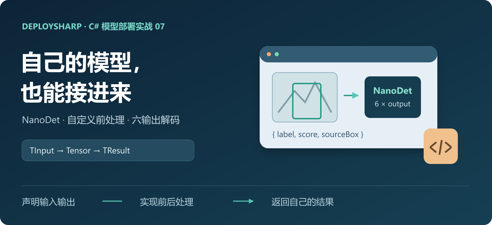

## 一、DeploySharp 项目简介

**DeploySharp** 是一个面向 **C#/.NET 开发者**的开源模型部署框架，由「椒颜皮皮虾」开发，项目源码遵循 **Apache License 2.0**。项目封装了 **ONNX Runtime、OpenVINO、TensorRT、OpenCV DNN** 等推理引擎，提供模型加载、图像前处理、推理和结果后处理接口，方便大家在桌面软件、工业视觉和文档应用中部署模型。

目前项目已接入目标检测、分类、实例分割、关键点、旋转框、异常检测、背景移除等视觉任务，也提供 **PP-OCRv4/v5/v6、PP-Structure 文档处理**及部分图文、本地语言模型的使用入口。常用模型有配套的前后处理，自有模型也可以通过扩展接口接入。

2.0 版本增加了按需安装的 NuGet 包、Batch 批量推理、独立 Session 会话池、异步输入、感兴趣区域（ROI）管理和大图重叠切片等功能。本篇重点介绍其中的**自定义模型接入**：怎样配置模型输入输出，编写自己的前后处理，再把多个模型组合到一个应用中。

**项目源码与 NuGet：**

```text
项目源码：
https://github.com/guojin-yan/DeploySharp/tree/DeploySharpV2.0

NuGet（搜索 JYPPX.DeploySharp）：
https://www.nuget.org/packages?q=JYPPX.DeploySharp
```

前面几篇文章讲了已有模型的使用方法。这一篇我们接入 **NanoDet-Plus**，联合 **CLIP** 做一个园区车辆与人员巡检示例，完成目标检测、区域统计、车型匹配和事件记录，最后生成一个可以直接打开的 HTML 复核页面。

## 二、巡检场景与实现思路

### 2.1 这个案例要做什么

做园区巡检时，通常需要在画面中划定车辆通道、人员通行区等关注区域，统计区域内的目标，并在达到条件时保存截图。车辆还可以进一步细分，方便后续检索和复核。

这里用两组公开的固定视角视频模拟两台相机，各取 **0 s、4 s、8 s** 三张截图。一组是道路车辆，一组是建筑庭院内的行人，共六张输入图。

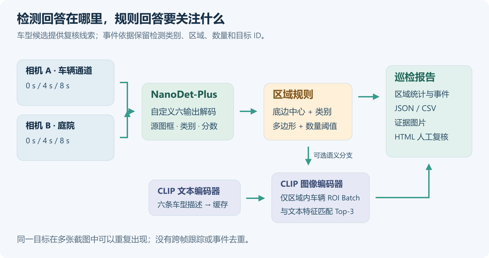

| 环节 | 实现 | 输出 |
| --- | --- | --- |
| 接收截图 | `inspection.json` 绑定相机、文件和来源时间 | 相机与截图信息 |
| 找到目标 | 自定义 NanoDet-Plus | COCO 类别、分数、源图检测框 |
| 应用区域规则 | 多边形、类别过滤、底边中心点与数量阈值 | 每区域目标 ID、计数及是否触发 |
| 补充车型候选 | CLIP 图像与文本编码器 | 区域内车辆的 Top-3 候选和分差 |
| 保存结果 | 图片、CSV、JSON、HTML | 检测图、区域统计、事件清单和复核页面 |

示例中，近侧车辆通道检测到至少两个车辆目标时，生成一条待复核事件；人员通行区达到两个人员目标时，也保存事件。区域、类别和数量阈值都放在配置文件中，可以按现场需求修改。

事件根据区域内的检测类别和数量触发，CLIP 则为车辆补充车型候选，供查看截图时参考。

### 2.2 自定义模型从哪里接入

NanoDet-Plus 还没有内置到 DeploySharp 中，这里通过 `VisualModelDefinitionBuilder<TInput, TResult>` 定义它的输入输出、前处理器、解码器和结果类，直接在应用项目中完成接入。

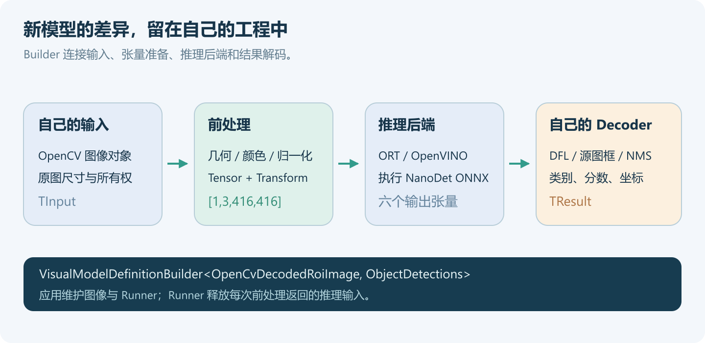

已有模型的缩放、颜色和归一化可以通过 `profile.WithPreprocessing(...)` 调整；新模型的输出结构不同，则需要编写对应的 Decoder。接入后，区域规则、车型匹配和报告生成都在应用层完成。

## 三、准备工程与 NuGet 依赖

### 3.1 获取随文完整工程

完整源码、配置和六张输入图都放在下面的目录中。可以先下载运行，再结合正文阅读关键实现。

```text
随文工程：
https://github.com/guojin-yan/DeploySharp/tree/DeploySharpV2.0/docs/blog/2.0.0/2026-10/examples/07-custom-visual

自定义视觉模型教程：
https://github.com/guojin-yan/DeploySharp/blob/DeploySharpV2.0/docs/articles/visual-custom-model.md
```

```text
07-custom-visual/
  CustomVisual.csproj       # NuGet 依赖与原生库部署配置
  Program.cs               # 会话初始化与多截图任务编排
  NanoDetModel.cs           # 自定义检测模型与六输出解码
  ClipModels.cs             # 图文编码、英文 tokenizer、相似度
  Inspection.cs             # 配置、区域规则与业务结果
  InspectionOutput.cs       # JSON、CSV、静态 HTML 复核台
  PreviewWriter.cs          # 区域、检测框与 ROI 图片
  inspection.json
  prompts.json
  demo-inputs/              # 六张输入图及来源说明
  models/                   # 下载的模型与词表
  results/                  # 运行结果
```

随文工程使用 `net10.0`，需要安装 .NET 10 SDK，并在 x64 环境运行。

### 3.2 按运行场景选择依赖

如果自行创建项目，先安装 ONNX Runtime（下文简称 ORT）的 CPU 后端和图像适配器；使用随文工程时，直接执行 `dotnet restore` 即可。

```powershell
dotnet new console -n CustomVisual -f net10.0
cd CustomVisual
dotnet add package JYPPX.DeploySharp.Visual.OpenCV --version 2.0.0
dotnet add package JYPPX.DeploySharp.Backend.OnnxRuntime --version 2.0.0
dotnet add package Microsoft.ML.OnnxRuntime --version 1.28.0
```

图像适配器负责解码、变换和绘图，推理后端负责运行模型。两者依赖的原生包按操作系统选择：

| 使用场景 | 额外安装的包 | 作用 |
| --- | --- | --- |
| Windows x64，ORT CPU | `JYPPX.OpenCV.runtime.win-x64 5.0.0` | 解码、图像变换、绘图 |
| Ubuntu 22.04 x64，ORT CPU | `JYPPX.OpenCV.runtime.ubuntu.22.04-x64 5.0.0` | 对应系统的图像原生库 |
| 增加 OpenVINO 后端 | `JYPPX.DeploySharp.Backend.OpenVINO 2.0.0` | 注册 OpenVINO 推理能力 |
| Windows OpenVINO | `OpenVINO.runtime.win 2026.2.1` | Windows 推理原生库 |
| Ubuntu OpenVINO | `OpenVINO.runtime.ubuntu.22-x86_64 2026.3.1` | Ubuntu 推理原生库 |

`Microsoft.ML.Tokenizers 2.0.0` 来自 Visual 的传递依赖。随文 `.csproj` 已按 Windows/Linux 选择原生包，并显式复制 Ubuntu 的原生文件到 `native/opencv` 和 `native/openvino`。

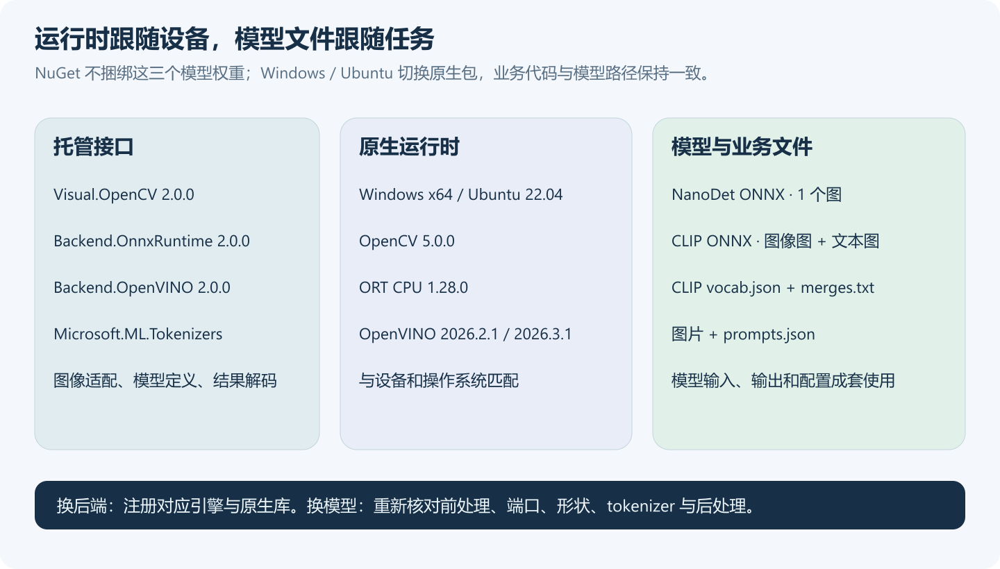

只运行 ORT 时，可以删除 OpenVINO 的包、原生文件复制项及注册代码。NuGet 安装好后，再单独下载模型文件。

## 四、准备模型、截图与相机区域

### 4.1 下载三个模型和 CLIP 词表

NanoDet 使用 OpenCV Zoo 提供的 ONNX 模型，CLIP 使用项目模型 Release 中的图像、文本双编码器。将下面的文件下载到 `models` 目录，保持文件名不变。

```text
NanoDet 固定版本目录：
https://github.com/opencv/opencv_zoo/tree/48b10fa505aeb51fbd127fc60a5c660040e823b7/models/object_detection_nanodet

NanoDet ONNX：
https://media.githubusercontent.com/media/opencv/opencv_zoo/48b10fa505aeb51fbd127fc60a5c660040e823b7/models/object_detection_nanodet/object_detection_nanodet_2022nov.onnx

CLIP 图像编码器：
https://github.com/guojin-yan/DeploySharp/releases/download/models-visual.1/clip-vit-b-32.image-encoder.onnx

CLIP 文本编码器：
https://github.com/guojin-yan/DeploySharp/releases/download/models-visual.1/clip-vit-b-32.text-encoder.onnx

CLIP 词表与 BPE 合并表：
https://github.com/guojin-yan/DeploySharp/releases/download/models-visual.1/clip-vit-b-32.vocab.json
https://github.com/guojin-yan/DeploySharp/releases/download/models-visual.1/clip-vit-b-32.merges.txt

CLIP 许可：
https://github.com/guojin-yan/DeploySharp/releases/download/models-visual.1/clip-vit-b-32.LICENSE
```

NanoDet 模型约 3.8 MB，CLIP 的图像、文本 FP32 模型分别约 352 MB、254 MB。NanoDet 目录采用 Apache 2.0，CLIP 资产采用 MIT 许可。随文 README 提供了 PowerShell 和 Bash 下载命令，也可以直接用浏览器下载。

已有这些模型的本地文件时，直接复制到目录中即可。更换其他导出版本时，需要同步调整输入输出名称、形状和前后处理。

### 4.2 六张输入随工程提供

道路图为 1920×1080，庭院图为 768×576。配置中的 `SourceSeconds` 记录截图在原视频中的位置。

```text
道路素材：
https://media.roboflow.com/supervision/video-examples/vehicles.mp4

庭院素材：
https://github.com/opencv/opencv/blob/4.x/samples/data/vtest.avi
```

素材来源与截图方式记录在 `demo-inputs/README.md`，素材使用遵循其各自的许可。

使用自己的截图时，修改 `inspection.json` 中的 `Image` 和 `CameraId`。图像相对路径以配置文件所在目录解析，区域按对应相机的视角配置。

### 4.3 区域规则采用归一化多边形

下面是车辆通道的一条规则。多边形使用 `[0,1]` 的归一化坐标，横、纵坐标分别对应图像宽、高的比例。

```json
{
  "Id": "vehicle-lane",
  "Name": "近侧车辆通道",
  "Polygon": [[0.01,0.99],[0.30,0.40],[0.44,0.40],[0.49,0.99]],
  "ClassIds": [2,5,7],
  "TriggerAtLeast": 2,
  "Reason": "vehicle-occupancy-review"
}
```

本例 COCO 标签中，`0` 为 person，`2/5/7` 为 car/bus/truck。同一多边形可以分别配置车辆规则与人员规则；每条规则独立筛选类别、计数和触发。

判断目标是否进入区域时，这里取检测框的**底边中心点**，近似表示行人脚部或车辆落地点。相比检测框与多边形求交，这种方式更适合本例的地面通行区域。

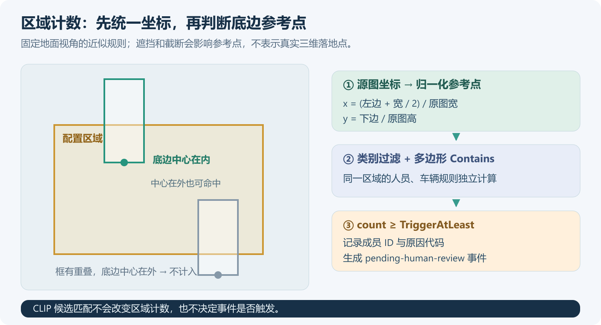

区域判断的核心代码如下，完整实现位于 `InspectionRules.Evaluate`：

```csharp
var anchor = new PointF(
    (box.X + box.Width / 2) / sourceSize.Width,
    Math.Min(sourceSize.Height - .001f, box.Y + box.Height)
        / sourceSize.Height);

bool belongs = zone.ClassIds.Contains(classId)
    && InspectionConfig.Geometry(zone).Contains(anchor);
```

程序先做整图检测，再按区域过滤结果。图中黄色线表示配置区域，青绿色框表示命中区域规则的目标，灰框表示其他检测，圆点标出了底边参考点。

## 五、自定义 NanoDet 的输入、前处理与六输出解码

### 5.1 查看模型输入输出

先通过 `--inspect` 查看三个模型的输入输出名称、类型和形状：

```powershell
dotnet run -c Release -- --inspect
```

NanoDet 的输入是 `input.1`，形状为 `[1,3,416,416]`。本次使用的模型有 **8、16、32 三个 stride、六个输出**，每个尺度各输出一组分类概率和一组边框距离。

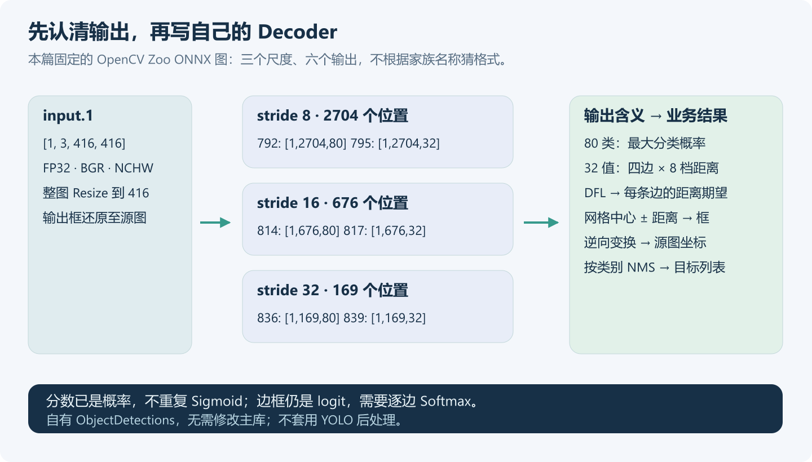

| stride | 位置数 | 分类概率 | 边框距离 logit |
| --- | --- | --- | --- |
| 8 | 2704 | `792`：`[1,2704,80]` | `795`：`[1,2704,32]` |
| 16 | 676 | `814`：`[1,676,80]` | `817`：`[1,676,32]` |
| 32 | 169 | `836`：`[1,169,80]` | `839`：`[1,169,32]` |

分类输出已经是概率，可以直接与阈值比较。32 个边框值对应四条边，每边八档距离分布，分别做 Softmax 后求期望，就能得到目标框到当前位置的距离。

### 5.2 配置 NanoDet 与 CLIP 的前处理

OpenCV Zoo 的 `demo.py` 先做 BGR→RGB 和居中黑边 Letterbox，再由 `nanodet.py` 完成 mean/std 归一化。接入时要把这两部分一起配置。

本例采用 **RGB、416×416 Letterbox、短边尺寸向下取整、黑色填充**。适配器使用 Linear 插值，官方 demo 使用 Area，缩放后的像素会有差异。CLIP 则从源图裁剪目标区域，单独执行 RGB 转换、短边缩放和中心裁剪。

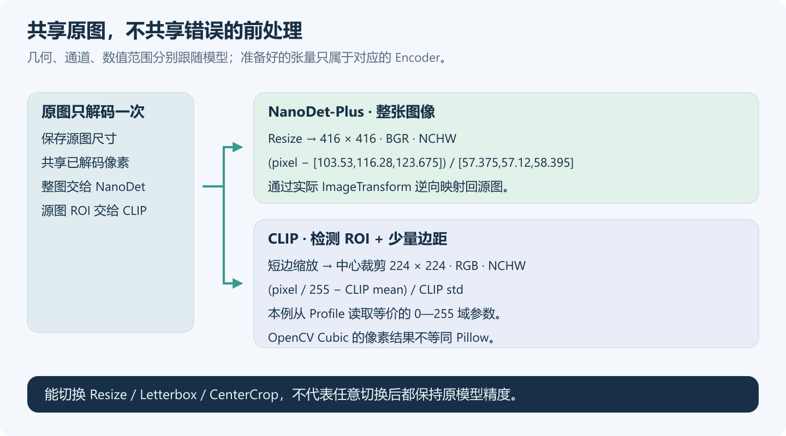

```csharp
var processing = new VisualPreprocessingOptions(
    new VisualSize(416, 416),
    VisualResizeMode.Letterbox,
    VisualColorOrder.Rgb,
    VisualNormalizationOptions.MeanStandardDeviation(
        [103.53f, 116.28f, 123.675f],
        [57.375f, 57.12f, 58.395f]),
    VisualTensorLayout.Nchw,
    paddingColor: VisualRgbColor.Black,
    dimensionRounding: VisualDimensionRounding.Floor,
    interpolation: VisualInterpolationMode.Linear);
```

这里的 mean/std 对应 0—255 像素值，归一化时不再除以 255。CLIP 的 mean/std 也换算到了相同的像素域，缩放采用 OpenCV Cubic，与官方 Pillow 处理器存在插值差异。

换模型时，可以通过这组参数选择 `Resize/Letterbox/CenterCrop`、颜色顺序和归一化方式，按照模型训练及导出时的处理方式配置。

### 5.3 定义结果类并组合模型

这里用三个普通 C# 记录保存目标框、类别、分数和检测结果：

```csharp
public sealed record PixelBox(
    float X, float Y, float Width, float Height);

public sealed record DetectedObject(
    int ClassId, string Label, float Score, PixelBox Box);

public sealed record ObjectDetections(
    IReadOnlyList<DetectedObject> Objects);
```

框统一使用源图 `x/y/width/height`，右、下边采用半开区间。区域判断、CLIP 裁剪与绘图都使用这个坐标系。

下面是 Builder 的关键部分；`levels` 对应上表三个尺度，完整代码在 `NanoDetModel.cs`：

```csharp
var builder = new VisualModelDefinitionBuilder<
        OpenCvDecodedRoiImage, ObjectDetections>(
        "blog.nanodet-plus-416",
        new ModelId("blog/nanodet-plus-416"),
        NanoDetModel.Task, "1", "onnx")
    .WithInput("input.1", TensorElementType.Float32,
        new TensorShape(1, 3, 416, 416), VisualTensorLayout.Nchw)
    .WithPreprocessing(processing)
    .WithInputPreprocessor((image, profile, ct) =>
        image.PrepareRectangle(
            new RectangleRoiGeometry(new RectangleF(
                0, 0, image.SourceSize.Width, image.SourceSize.Height)),
            profile.Input.Name,
            profile.Preprocessing!.ToOpenCvOptions(), ct))
    .WithDecoder(new NanoDetDecoder(levels, threshold, nmsThreshold));

foreach (var level in levels)
{
    int count = level.Rows * level.Columns;
    builder.AddOutput(level.Scores, TensorElementType.Float32,
        new TensorShape(1, count, 80));
    builder.AddOutput(level.Distances, TensorElementType.Float32,
        new TensorShape(1, count, 32));
}

var definition = builder.Build();
```

`VisualTaskId` 使用自定义任务标识。前处理可以像上面这样传入委托，也可以实现 `IVisualInputPreprocessor<TInput>`，把已有的处理代码封装成独立类。

### 5.4 距离分布与坐标还原

每个位置取最大类别分数，低于默认 `0.35` 时跳过距离解码；四条边分别求分布期望：

```text
边距离 = stride × Σ[k × softmax(logits)[k]]，k = 0…7
中心 x = 网格列 × stride + (stride − 1) / 2
中心 y = 网格行 × stride + (stride − 1) / 2
模型框 = [中心 x − 左, 中心 y − 上, 中心 x + 右, 中心 y + 下]
```

得到模型坐标后，通过 `context.Input.Transform.ToSource(...)` 去掉 padding、还原缩放，并将框裁到源图范围内。最后按类别执行非极大值抑制（NMS），阈值由 `--nms` 指定，默认为 `0.6`。

Decoder 读取后端输出，将最终类别、分数和源图框保存到自定义结果中。返回的结果独立于后端缓冲区，后面可以直接用于区域判断、裁剪和绘图。

## 六、联合 CLIP 匹配车型

### 6.1 提前编码六条车型描述

`prompts.json` 为 COCO 车辆类别 `2/5/7` 配置了六条描述：passenger-car、suv、delivery-van、pickup、box-truck、bus。下面节选其中一组的三条候选，完整文件按候选组数组组织。

```json
{
  "Name": "vehicle-body",
  "ClassIds": [2,5,7],
  "Candidates": [
    { "Key": "passenger-car", "Text": "a photo of a passenger car." },
    { "Key": "suv", "Text": "a photo of a sport utility vehicle." },
    { "Key": "box-truck", "Text": "a photo of a large box truck transporting goods." }
  ]
}
```

文本编码器有 `input_ids` 与 `attention_mask` 两个 INT64 输入，形状为 `[候选数,77]`，输出为 `[候选数,512]` 的 `text_embedding`。随文 tokenizer 使用配套词表和字节对编码（BPE），支持可打印 ASCII 英文，超长输入会报错。中文描述需要更换对应的 tokenizer 和模型。

六条候选在启动时编码一次，缓存归一化后的特征，然后释放文本 Session。之后每张截图只运行检测和图像编码，减少重复的文本推理。

### 6.2 将区域内车辆组成 ROI Batch

检测完成后，先计算区域归属，再把**命中区域且有候选组**的目标送入 CLIP。这样道路中关注区外的车辆可以跳过图像编码，庭院人员则直接参与区域计数。

推理阶段每张原图解码一次，目标框每侧默认扩展 `0.06` 的边距，再裁到图内。多个 ROI 一起组成 CLIP 的 `[B,3,224,224]` 输入：

```csharp
// regions 来自命中区域的车辆源图框。
ImageEmbeddings embeddings = await imageRunner.RunAsync(
    new RoiBatch(decoded, regions),
    cancellationToken: cancellationToken);
```

`--batch` 支持 `1—16`，默认 4，最后一批按实际数量输入。`--max-rois 16` 限制单张图进入 CLIP 的目标数，超出部分仍保留检测结果，并记录跳过原因。

这六张图中，道路首图有两个 ROI，组成一个 Batch；末图有一个 ROI，按 Batch=1 运行，其余图没有进入 CLIP 的目标。可以改用 `--batch 1`，将首图的两个 ROI 分开推理。

### 6.3 怎样看车型匹配结果

图像与文本的 512 维特征先 L2 归一化，用点积计算余弦相似度，再在当前候选组内计算 Softmax 分数。

| 字段 | 含义 |
| --- | --- |
| `Detection.Score` | NanoDet 对当前类别的检测分数 |
| `Cosine` | ROI 与候选文本的余弦相似度 |
| `CandidateScore` | 当前组内的相对匹配分数，改变候选会改变它 |
| `Margin` / `RequiresReview` | Top-1 与 Top-2 分差，以及是否需要额外查看候选，默认分差阈值 0.1 |
| `Events[].Status` | 区域规则触发后统一为 `pending-human-review` |

CLIP 会在给定的六条描述中选出最相近的候选，因此候选的写法和覆盖范围会影响结果。Top-1 与 Top-2 太接近时，`RequiresReview` 会标记出来，方便重点查看。区域事件统一保存为 `pending-human-review`，车型候选作为复核时的补充信息。

## 七、复用会话并保存结果

### 7.1 多张截图共用模型会话

检测和图像 Runner 放在截图循环外创建，文本特征提前缓存。循环中依次执行检测、区域判断、ROI 编码和报告生成。

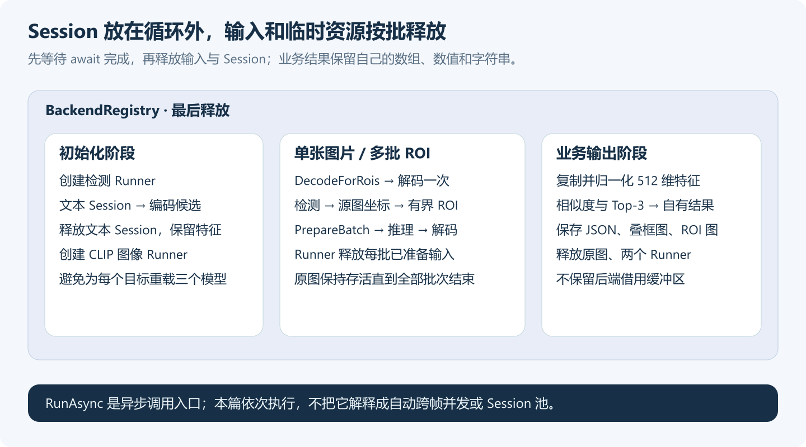

| 资源 | 所有者与释放时机 |
| --- | --- |
| 注册中心、检测与图像 Runner | 应用拥有，六张截图处理结束后释放 |
| 文本 Session | 候选编码函数拥有，编码完成后释放 |
| 已解码原图 | 当前截图拥有，所有 ROI 调用与输出完成后释放 |
| `PreparedVisualInput` | 返回后由 Runner 接管，该次推理与解码后释放 |
| 文本特征、检测与报告 | 独立的托管数据，由应用继续使用 |

检测、区域判断和 CLIP 之间有数据依赖，代码按顺序 `await`，等当前图的调用全部结束后再释放图像。保存检测图和 ROI 时，绘图工具会另外读取原图。常驻服务中，可以把 Runner 和文本特征放到服务生命周期内复用。

运行中按 `Ctrl+C` 可以取消，程序会等待当前调用返回后释放资源。正常完成、运行错误和取消的退出码分别为 `0`、`1`、`2`。

### 7.2 生成报告与复核页面

```text
results/ort-cpu/
  index.html                # 摄像头与事件筛选、证据入口
  summary.json              # 汇总与逐图完整报告
  observations.csv          # 每张图、每条区域规则的观测
  review.csv                # 待人工复核事件
  road-00/
    scene.json
    scene.jpg
    roi-00.jpg
    roi-02.jpg
  road-04/...
  courtyard-00/...
```

单图 `scene.json` 保存相机、区域配置、来源时间、完整检测、区域成员、CLIP Top-3 和事件。`roi-XX.jpg` 保存从源图裁出的目标区域，方便查看车型匹配的输入内容。跳过 CLIP 的目标会记录 `outside-zones`、`no-prompt-group` 或 `max-rois-limit`。

CSV 使用 UTF-8 BOM 和带引号字段，可以用表格软件打开；HTML 页面可以按相机和事件筛选截图，查看区域统计，并打开对应的检测图、ROI 和 JSON 报告。

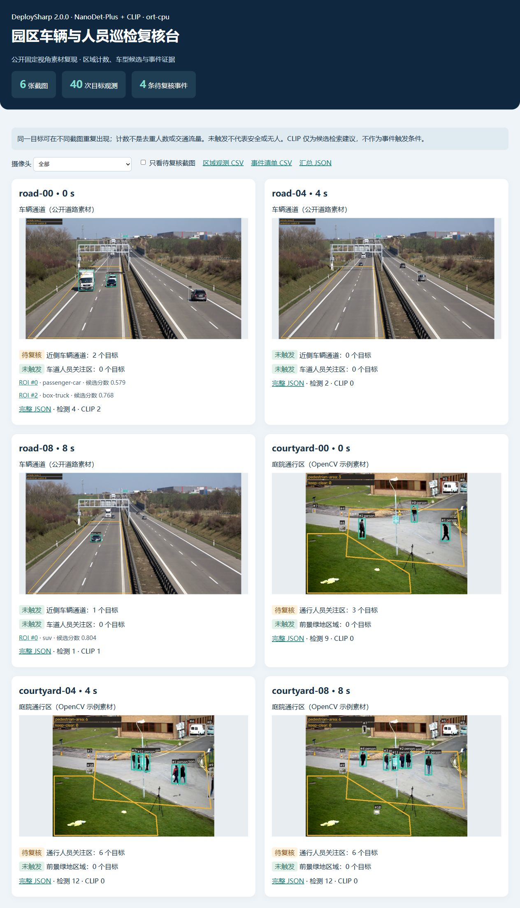

同一截图中的事件共用 `scene.jpg`，每条事件保存截图 ID、区域 ID 和当前图内的目标 ID。后续接入业务系统时，可以根据这些字段定位到图像和对应目标。

## 八、在 Windows 与 Ubuntu 实际运行

### 8.1 Windows 命令

下载好模型后，在随文工程目录运行下面的命令，分别使用 ORT CPU 和 OpenVINO CPU 处理六张截图：

```powershell
dotnet restore
dotnet build -c Release

dotnet run -c Release --no-build -- --backend ort-cpu `
  --manifest inspection.json --models models --prompts prompts.json `
  --batch 4 --out results

dotnet run -c Release --no-build -- --backend openvino `
  --manifest inspection.json --models models --prompts prompts.json `
  --batch 4 --out results
```

完成后打开 `results/ort-cpu/index.html` 或 `results/openvino/index.html`。选择相机，或者勾选“只看待复核截图”，就能筛选对应结果。

### 8.2 Ubuntu 22.04 命令

Ubuntu x64 使用同一份源码，构建时会选择 Linux 原生包。安装 .NET 10 SDK 和原生包所需的系统库后，执行：

```bash
dotnet restore
dotnet build -c Release

export LD_LIBRARY_PATH="$PWD/bin/Release/net10.0/native/opencv:$PWD/bin/Release/net10.0/native/openvino:${LD_LIBRARY_PATH:-}"

dotnet bin/Release/net10.0/CustomVisual.dll \
  --backend ort-cpu --manifest inspection.json --models models \
  --prompts prompts.json --batch 4 --out results

dotnet bin/Release/net10.0/CustomVisual.dll \
  --backend openvino --manifest inspection.json --models models \
  --prompts prompts.json --batch 4 --out results
```

Ubuntu 的 OpenCV 入口为 `libJYPPX.OpenCV.Native.so`，OpenVINO C 入口为 `libopenvino_c.so`。如果提示找不到库，先检查输出目录中的原生文件，以及 `LD_LIBRARY_PATH` 是否包含对应目录。

### 8.3 两套设备、两个 CPU 后端的结果

我分别在 Windows 和 Ubuntu 上运行了这套工程，两个系统都测试了 ORT CPU 和 OpenVINO CPU。四组使用相同的三个模型、六张截图、六条车型候选及默认阈值，构建均为 0 警告、0 错误。

| 项目 | Windows 设备 | Ubuntu 设备 |
| --- | --- | --- |
| 系统 / 架构 | Windows 11，Build 26200，x64 | Ubuntu 22.04.5 LTS，x64 |
| CPU | AMD Ryzen 7 5800H | Intel Core i7-1165G7 |
| .NET SDK / Runtime | 10.0.401 / 10.0.12 | 10.0.301 / 10.0.9 |
| DeploySharp / OpenCV 原生包 | 2.0.0 / 5.0.0 | 2.0.0 / 5.0.0 |
| ORT CPU / OpenVINO CPU 原生包 | 1.28.0 / 2026.2.1 | 1.28.0 / 2026.3.1 |

| 系统 | 后端 | 截图 | 目标观测 | CLIP ROI | 待复核事件 |
| --- | --- | --- | --- | --- | --- |
| Windows | ORT CPU | 6 | 40 | 3 | 4 |
| Windows | OpenVINO CPU | 6 | 40 | 3 | 4 |
| Ubuntu | ORT CPU | 6 | 40 | 3 | 4 |
| Ubuntu | OpenVINO CPU | 6 | 40 | 3 | 4 |

表中检测数按六张截图累计，同一目标可能出现在多张图中，非业务类别和误报也计入其中。四组的区域计数、事件成员和三条车型 Top-1 一致，浮点分数有细微差异。

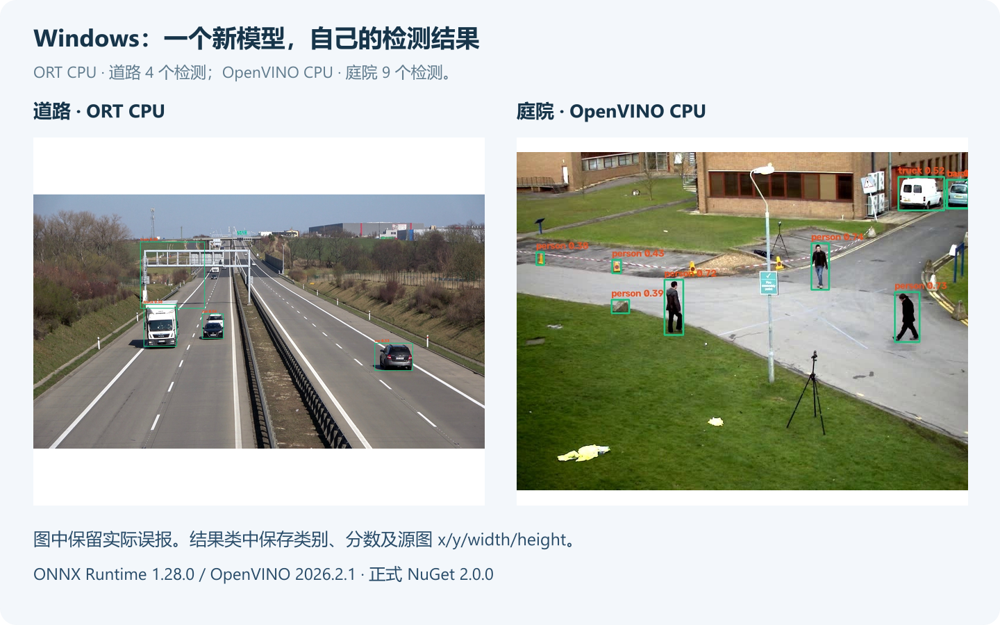

逐图结果如下。`road-00` 产生车辆数量关注事件，三张庭院截图分别产生人员数量关注事件。

| 截图 | 检测总数 | 区域内目标 | CLIP ROI | 事件数 |
| --- | --- | --- | --- | --- |
| road-00 | 4 | 2 | 2 | 1 |
| road-04 | 2 | 0 | 0 | 0 |
| road-08 | 1 | 1 | 1 | 0 |
| courtyard-00 | 9 | 3 | 0 | 1 |
| courtyard-04 | 12 | 6 | 0 | 1 |
| courtyard-08 | 12 | 6 | 0 | 1 |

道路首图两辆区域内车辆的 Top-1 分别为 `passenger-car` 和 `box-truck`，末图为 `suv`。打开对应的 ROI 图片，可以对照查看匹配结果。

下面是 Ubuntu 上生成的检测图和区域统计，使用的配置与 Windows 相同：

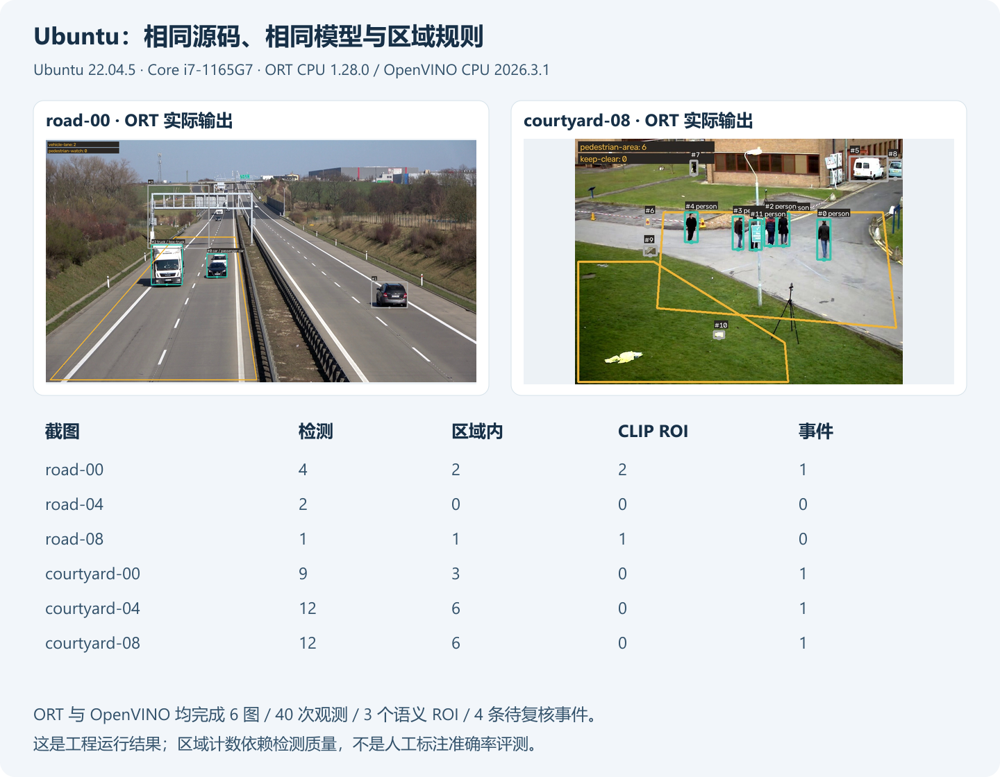

### 8.4 从运行结果看，还有哪些地方需要调整

从道路结果可以看到，远处车辆较小，整图缩到 416 后出现了漏检。首图的支架附近还出现了一处 `train` 误报，因类别不匹配，被区域规则过滤掉了。这类远处小目标，可以进一步尝试更大输入尺寸的模型或切片检测。

庭院的路锥和标牌附近有部分低分 `person` 误报，其中一些进入了区域计数。因此表中的人数是模型检测结果，还需要结合原图复核。提高阈值能减少部分误报，但也可能漏掉遮挡目标，实际使用时要根据现场标注数据调整模型和阈值。

这组公开截图主要用于演示完整流程，准确率还需要在实际场景的标注集上评估。复核页面中保留了原图、检测框和区域成员，调试时可以直接追查是哪一个目标触发了事件。

## 九、换成自己的模型和巡检场景

| 需求或现象 | 先检查 | 修改位置 |
| --- | --- | --- |
| 换相机、换截图 | 视角、尺寸与关注区是否改变 | `inspection.json`，重新画多边形 |
| 调整关注类别与数量 | COCO 类别顺序、阈值含义 | `ClassIds`、`TriggerAtLeast`、`Reason` |
| 更换检测模型 | 真实端口、shape、颜色、几何和输出含义 | Builder、前处理与 Decoder 一起修改 |
| 框整体偏移 | padding、实际缩放、模型/源图坐标 | `ImageTransform` 与坐标还原 |
| CLIP 高分但候选不合适 | 候选覆盖、ROI 上下文、中心裁剪 | `prompts.json` 和 CLIP 前处理，用标注数据验证 |
| 目标多，语义开销大 | 是否只处理必要 ROI | `--batch`、`--max-rois`，复用会话和文本特征 |
| 原生库加载失败 | OS、架构、文件部署、Linux 搜索路径 | 匹配的运行时包与输出目录 |
| 想统计停留、越线、去重人数 | 连续帧、跟踪 ID 和时间状态 | 增加目标跟踪与时序规则 |

当前工程按截图进行巡检。如果要接入连续视频，可以在此基础上增加视频解码、目标跟踪和事件去重，再根据轨迹计算停留时长或越线。HTML 用于本地查看，审核结果回写和告警通知则接到自己的业务服务中。

## 十、总结

本篇通过 NanoDet 和 CLIP，完成了一个多模型联合的区域巡检示例。NanoDet 找到人和车，区域规则负责计数与事件判断，CLIP 补充车型候选，最后把结果保存为图片、CSV、JSON 和 HTML 页面。

接入自己的模型时，可以参考这里的 Builder、前处理和 Decoder 写法；用于自己的现场时，先调整相机区域、候选描述和触发规则。下一篇继续介绍 **Batch、独立 Session 池和异步预取**，看看在批量图片和连续输入中怎样安排推理任务。

```text
DeploySharp 项目：
https://github.com/guojin-yan/DeploySharp/tree/DeploySharpV2.0

系列文章目录：
https://github.com/guojin-yan/DeploySharp/tree/DeploySharpV2.0/docs/blog/2.0.0

本篇完整代码：
https://github.com/guojin-yan/DeploySharp/tree/DeploySharpV2.0/docs/blog/2.0.0/2026-10/examples/07-custom-visual
```
