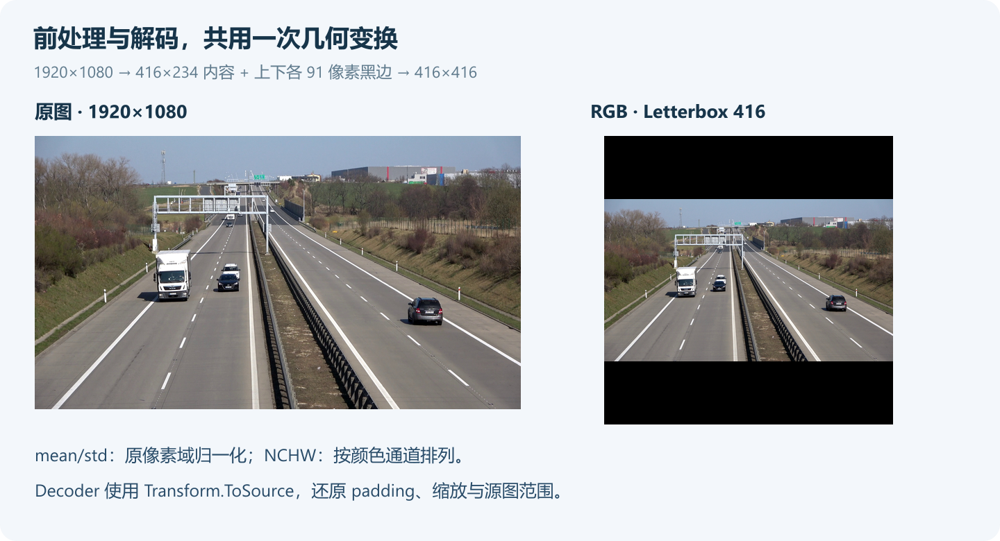

# DeploySharp 自定义模型实战：用 C# 接入 NanoDet 的前处理、后处理与结果类

> DeploySharp 2.0.0 系列 · 第 07 篇实战教程，使用正式 NuGet `2.0.0`。


## 一、DeploySharp 项目简介

**DeploySharp** 是一个面向 **C#/.NET 开发者**的开源模型部署框架，由「椒颜皮皮虾」开发，项目源码遵循 **Apache License 2.0**。项目封装了 **ONNX Runtime、OpenVINO、TensorRT、OpenCV DNN** 等推理引擎，提供模型加载、图像前处理、推理和结果后处理接口，方便大家在桌面软件、工业视觉和文档应用中部署模型。

目前项目已接入目标检测、分类、实例分割、关键点、旋转框、异常检测、背景移除等视觉任务，也提供 **PP-OCRv4/v5/v6、PP-Structure 文档处理**及部分图文、本地语言模型的使用入口。2.0 版本增加了按需安装的 NuGet 包、Batch、独立 Session 池、异步输入、ROI 和大图切片等功能。

常用模型可以使用配套的前后处理。遇到新的输出结构时，也可以在自己的项目中定义输入、前处理、Decoder 和结果类，继续复用 DeploySharp 的模型执行能力。

```text
项目源码：
https://github.com/guojin-yan/DeploySharp/tree/DeploySharpV2.0

NuGet（搜索 JYPPX.DeploySharp）：
https://www.nuget.org/packages?q=JYPPX.DeploySharp
```

这一篇用 **NanoDet-Plus** 走完一次新模型接入：读懂六个输出，配置图像处理，编写距离分布解码和按类 NMS，最后输出自己的 C# 检测结果，并保存检测图与 JSON。

## 二、新模型需要自己实现哪些部分

已有模型只调整输入尺寸、缩放、颜色和归一化，可以使用 `profile.WithPreprocessing(...)`。如果模型的输出结构和内置 Decoder 不同，就需要进一步定义自己的模型。

本次采用 OpenCV Zoo 的 NanoDet-Plus ONNX。这个导出返回三种尺度的分类概率和边框距离分布，需要专门解码。


| 部分 | 本例的实现 | 主要职责 |
| --- | --- | --- |
| 输入类型 | `OpenCvDecodedRoiImage` | 拥有已解码图像，提供尺寸和张量准备方法 |
| 模型定义 | `VisualModelDefinitionBuilder<TInput,TResult>` | 声明任务、输入输出和前后处理 |
| 前处理 | 自定义委托 + `VisualPreprocessingOptions` | RGB、Letterbox、归一化和 NCHW |
| 后处理 | `NanoDetDecoder` | 分类筛选、DFL、坐标还原与 NMS |
| 结果类型 | `ObjectDetections` | 保存独立的类别、分数和源图框 |

这些代码都在随文工程中，使用正式 NuGet，不需要修改 DeploySharp 源码。

## 三、创建工程，选择推理后端

### 3.1 获取完整代码

```text
https://github.com/guojin-yan/DeploySharp/tree/DeploySharpV2.0/docs/blog/2.0.0/2026-10/examples/07-custom-visual
```

```text
07-custom-visual/
  CustomVisual.csproj    # 正式 NuGet 与原生库部署
  Program.cs            # 参数、初始化、推理、绘图和 JSON
  NanoDetModel.cs       # 自定义结果、前处理、模型定义和 Decoder
  demo-inputs/          # 道路与庭院的两张示例图，附来源
  models/              # 自行下载的 ONNX
  results/             # 程序输出
```

本例使用 .NET 10 SDK、x64 进程。完整工程同时配置 ORT CPU 和 OpenVINO CPU，按照当前系统选择原生包。

### 3.2 从空工程开始：ORT CPU

```powershell
dotnet new console -n CustomVisual -f net10.0
cd CustomVisual
dotnet add package JYPPX.DeploySharp.Visual.OpenCV --version 2.0.0
dotnet add package JYPPX.DeploySharp.Backend.OnnxRuntime --version 2.0.0
dotnet add package Microsoft.ML.OnnxRuntime --version 1.28.0
```

在 `.csproj` 中设置 `<PlatformTarget>x64</PlatformTarget>`，图像原生包按系统选择：

| 场景 | 额外依赖 |
| --- | --- |
| Windows x64 + ORT CPU | `JYPPX.OpenCV.runtime.win-x64 5.0.0` |
| Ubuntu 22.04 x64 + ORT CPU | `JYPPX.OpenCV.runtime.ubuntu.22.04-x64 5.0.0` |
| 增加 OpenVINO 后端 | `JYPPX.DeploySharp.Backend.OpenVINO 2.0.0` |
| Windows OpenVINO 原生库 | `OpenVINO.runtime.win 2026.2.1` |
| Ubuntu OpenVINO 原生库 | `OpenVINO.runtime.ubuntu.22-x86_64 2026.3.1` |

直接使用随文工程时执行 `dotnet restore` 即可；它还配置了 Ubuntu 原生文件的显式复制。自己的项目只保留 ORT 时，可以移除 OpenVINO 包、原生文件复制项、`using` 和注册分支。

## 四、准备 ONNX，确认真实输入输出

### 4.1 下载固定导出版本

本例模型约 3.8 MB，来自 OpenCV Zoo 的固定提交。对应模型目录采用 Apache 2.0。

```text
模型目录：
https://github.com/opencv/opencv_zoo/tree/48b10fa505aeb51fbd127fc60a5c660040e823b7/models/object_detection_nanodet

ONNX：
https://media.githubusercontent.com/media/opencv/opencv_zoo/48b10fa505aeb51fbd127fc60a5c660040e823b7/models/object_detection_nanodet/object_detection_nanodet_2022nov.onnx
```

PowerShell 下载：

```powershell
New-Item -ItemType Directory -Force models | Out-Null
Invoke-WebRequest 'https://media.githubusercontent.com/media/opencv/opencv_zoo/48b10fa505aeb51fbd127fc60a5c660040e823b7/models/object_detection_nanodet/object_detection_nanodet_2022nov.onnx' `
  -OutFile models/object_detection_nanodet_2022nov.onnx
```

Ubuntu 对应命令：

```bash
mkdir -p models
curl -fL 'https://media.githubusercontent.com/media/opencv/opencv_zoo/48b10fa505aeb51fbd127fc60a5c660040e823b7/models/object_detection_nanodet/object_detection_nanodet_2022nov.onnx' \
  -o models/object_detection_nanodet_2022nov.onnx
```

两张示例图已经随代码提供，也可以通过 `--image` 换成自己的图片。

### 4.2 用程序查看模型端口

```powershell
dotnet run -c Release -- --inspect
```

输入为 `input.1`，FP32，形状 `[1,3,416,416]`。输出如下：

| stride | 位置数 | 分类概率 | 边框距离 logit |
| --- | --- | --- | --- |
| 8 | 2704 | `792`：`[1,2704,80]` | `795`：`[1,2704,32]` |
| 16 | 676 | `814`：`[1,676,80]` | `817`：`[1,676,32]` |
| 32 | 169 | `836`：`[1,169,80]` | `839`：`[1,169,32]` |


80 对应 COCO 类别数；32 是四条边、每条边八档距离。分类值已经是概率，边框值仍然是 logit，二者的处理方式不同。

## 五、定义输入与图像前处理

### 5.1 配置几何、颜色和归一化

OpenCV Zoo 的 `demo.py` 在调用模型封装前执行 BGR→RGB、黑边居中 Letterbox，封装再执行 mean/std 归一化。接入时把这些处理一起配置：

```csharp
var processing = new VisualPreprocessingOptions(
    new VisualSize(416, 416),
    VisualResizeMode.Letterbox,
    VisualColorOrder.Rgb,
    VisualNormalizationOptions.MeanStandardDeviation(
        [103.53f, 116.28f, 123.675f],
        [57.375f, 57.12f, 58.395f]),
    VisualTensorLayout.Nchw,
    paddingColor: VisualRgbColor.Black,
    dimensionRounding: VisualDimensionRounding.Floor,
    interpolation: VisualInterpolationMode.Linear);
```

这里的 mean/std 属于 0—255 像素域，执行的是 `(pixel - mean) / std`。适配器使用 Linear 插值，官方示例使用 Area，两者缩放像素存在差异。



`Resize/Letterbox/CenterCrop`、颜色顺序、均值和标准差都可以配置，选择时仍以模型训练、导出的输入约定为准。本例保持黑边 Letterbox。

### 5.2 把自己的输入对象变成推理张量

模型定义中的前处理委托接收图像、Profile 和取消标记。本例从整图范围准备张量：

```csharp
.WithInputPreprocessor((image, profile, ct) =>
    image.PrepareRectangle(
        new RectangleRoiGeometry(new RectangleF(
            0, 0, image.SourceSize.Width, image.SourceSize.Height)),
        profile.Input.Name,
        profile.Preprocessing!.ToOpenCvOptions(), ct))
```

委托真正使用了 `profile.Preprocessing`，因此配置会作用到张量。返回的 `PreparedVisualInput` 同时带有 `Transform`，记录这次处理的实际尺寸、缩放与偏移。已有处理代码也可以封装为 `IVisualInputPreprocessor<TInput>`，再交给 Builder。

## 六、定义自己的结果类型和 Decoder

### 6.1 结果类由应用决定

本例只保存业务需要的检测字段，用三个普通 C# record：

```csharp
public sealed record PixelBox(
    float X, float Y, float Width, float Height);
public sealed record DetectedObject(
    int ClassId, string Label, float Score, PixelBox Box);
public sealed record ObjectDetections(
    IReadOnlyList<DetectedObject> Objects);
```

框统一使用源图 `x/y/width/height`。这些对象持有自己的托管数据，推理结束后可以继续序列化、绘图和传给业务层。

### 6.2 从距离分布得到候选框

`NanoDetDecoder` 实现 `IVisualResultDecoder<ObjectDetections>`。每个尺度先取最大类别分数，低于默认 `0.35` 的位置直接跳过；其余位置再计算四边距离。

```text
边距离 = stride × Σ[k × softmax(logits)[k]]，k = 0…7
中心 x = 网格列 × stride + (stride − 1) / 2
中心 y = 网格行 × stride + (stride − 1) / 2
模型框 = [中心 x − 左, 中心 y − 上, 中心 x + 右, 中心 y + 下]
```

完整实现中的 `Distance` 使用减去最大值的稳定 Softmax，再求八档距离的期望。分类输出直接比较阈值。

### 6.3 还原源图坐标，执行按类别 NMS

模型框处于 416×416 画布中，通过前处理保存的变换还原：

```csharp
var source = context.Input.Transform.ClipToSource(
    context.Input.Transform.ToSource(
        new RectangleF(x1, y1,
            Math.Max(0, x2 - x1), Math.Max(0, y2 - y1))));
```

这一步同时处理 Letterbox 的 padding 和缩放。随后按分数降序做 NMS，只在同类别之间比较 IoU。`--nms` 默认 `0.6`，最多返回 100 个目标，完整实现见 `NanoDetModel.cs`。

## 七、用 Builder 组合并执行模型

### 7.1 注册输入、输出、前处理与 Decoder

`levels` 是第四节三个尺度的声明。下面摘自完整工程，`processing`、`threshold`、`nmsThreshold` 均在 `NanoDetModel.Create` 内定义：

```csharp
var builder = new VisualModelDefinitionBuilder<
        OpenCvDecodedRoiImage, ObjectDetections>(
        "blog.nanodet-plus-416",
        new ModelId("blog/nanodet-plus-416"),
        NanoDetModel.Task, "1", "onnx")
    .WithInput("input.1", TensorElementType.Float32,
        new TensorShape(1, 3, 416, 416), VisualTensorLayout.Nchw)
    .WithPreprocessing(processing)
    .WithInputPreprocessor((image, profile, ct) => image.PrepareRectangle(
        new RectangleRoiGeometry(new RectangleF(
            0, 0, image.SourceSize.Width, image.SourceSize.Height)),
        profile.Input.Name, profile.Preprocessing!.ToOpenCvOptions(), ct))
    .WithDecoder(new NanoDetDecoder(levels, threshold, nmsThreshold));

foreach (var level in levels)
{
    int count = level.Rows * level.Columns;
    builder.AddOutput(level.Scores, TensorElementType.Float32,
        new TensorShape(1, count, 80));
    builder.AddOutput(level.Distances, TensorElementType.Float32,
        new TensorShape(1, count, 32));
}
return builder.Build();
```

`VisualTaskId` 使用自定义任务标识，返回类型就是前面定义的 `ObjectDetections`。更换其他模型时，把端口、形状、标签和解码逻辑一同替换。

### 7.2 创建 Runner 并读取结果

完成后端注册后，应用只需要创建模型工件、Runner 和图像：

```csharp
var definition = NanoDetModel.Create(options.Threshold, options.Nms);
using var runner = definition.CreateRunner(backends,
    new ModelArtifact(definition.Profile.ModelId, "onnx", options.Model), request);
using var image = new OpenCvVisualInputFactory().DecodeForRois(
    OpenCvImageSource.FromFile(options.Image), cancellation.Token);

ObjectDetections result = await runner.RunAsync(
    image, cancellationToken: cancellation.Token);
```

`backends`、`request` 和 `options` 的完整初始化位于 `Program.cs`。切换 ORT/OpenVINO 时调整注册和请求，NanoDet 的前处理、Decoder 与结果类保持相同。

Runner 接管前处理返回的单次输入并释放；外层图像由应用维护，必须等 `RunAsync` 完成后再释放。批量处理多张图时，可以把 Runner 放到循环外复用。`Ctrl+C` 取消，完成、错误、取消分别返回退出码 `0/1/2`。

## 八、运行与检测结果

### 8.1 Windows：运行两个后端

```powershell
dotnet restore
dotnet build -c Release
dotnet run -c Release --no-build -- --backend ort-cpu --image demo-inputs/road-00.jpg
dotnet run -c Release --no-build -- --backend openvino --image demo-inputs/courtyard-00.jpg
```

道路图返回四个目标，其中支架附近有 `train` 误报；庭院图返回九个目标，其中有低分误报。检测框与分数保存在结果中，可以直接对照原图调整阈值。


```text
car: 0.5406; box=(718.2,508.0,89.5,102.2)
car: 0.5284; box=(1452.6,632.8,159.8,115.0)
truck: 0.3839; box=(470.7,467.8,138.1,176.4)
train: 0.3780; box=(455.1,201.8,272.0,280.7)
Completed: backend=ort-cpu; detections=4
```

### 8.2 Ubuntu：使用同一份 C# 实现

随文工程针对 Ubuntu 22.04 x64 复制原生文件，运行前将对应目录加入当前进程搜索路径：

```bash
dotnet restore
dotnet build -c Release
export LD_LIBRARY_PATH="$PWD/bin/Release/net10.0/native/opencv:$PWD/bin/Release/net10.0/native/openvino:${LD_LIBRARY_PATH:-}"
dotnet bin/Release/net10.0/CustomVisual.dll --backend ort-cpu --image demo-inputs/road-00.jpg
dotnet bin/Release/net10.0/CustomVisual.dll --backend openvino --image demo-inputs/courtyard-00.jpg
```

### 8.3 输出文件与实跑环境

```text
results/
  ort-cpu/road-00/
    result.jpg        # 源图检测框、标签和分数
    detections.json   # 模型、环境、阈值和自定义结果
  openvino/courtyard-00/
    result.jpg
    detections.json
```

同一输入再次运行会覆盖对应结果目录中的同名文件。换自己的图片时修改 `--image`，换 ONNX 时还需同步 `NanoDetModel.cs` 中的输入输出和解码配置。

| 环境 | 实际执行 | 结果 |
| --- | --- | --- |
| Windows 11 x64 · Ryzen 7 5800H · SDK 10.0.401 | ORT CPU 1.28.0 道路图；OpenVINO CPU 2026.2.1 庭院图 | 4 / 9 个检测，保存绘图和自定义 JSON |
| Ubuntu 22.04.5 x64 · i7-1165G7 · SDK 10.0.301 | ORT CPU 1.28.0 道路图；OpenVINO CPU 2026.3.1 庭院图 | 同样为 4 / 9 个检测，保存绘图和自定义 JSON |

本例用于验证接入路径，未进行标注集准确率评测或速度排名。远处小目标、遮挡和低分误报需要结合自己的数据调整。

## 九、接入自己的模型时，优先改哪里

| 需求或现象 | 修改位置 |
| --- | --- |
| 输入不是 416×416，或使用 NHWC | `WithInput`、布局、前处理尺寸 |
| 使用 BGR、直接缩放或另一组 mean/std | `VisualPreprocessingOptions` 与前处理实现 |
| 输出名称、类别数、分布档数不同 | `AddOutput`、标签表、Decoder 的索引和解码逻辑 |
| 想返回其他结果结构 | 自己的 `TResult` 与 `IVisualResultDecoder<TResult>` |
| 检测框整体偏移 | 实际 padding、缩放及 `Transform.ToSource` |
| 需要辅助输入或特殊张量处理 | 自定义前处理器，声明对应的输入输出约定 |
| Linux 原生库加载失败 | x64、原生包、输出文件和 `LD_LIBRARY_PATH` |

这一套接口也适用于新的分类、分割或其他视觉输出。实现自己的输入准备和结果解码后，应用仍然通过 Runner 执行模型。

下一篇基础教程继续介绍 **Batch、独立 Session 池和异步预取**。如果想看模型如何组合成实际应用，可以阅读独立的应用系列：园区巡检、文档结构化归档和商品图片整理。

```text
自定义模型使用指南：
https://github.com/guojin-yan/DeploySharp/blob/DeploySharpV2.0/docs/articles/visual-custom-model.md

本篇完整工程：
https://github.com/guojin-yan/DeploySharp/tree/DeploySharpV2.0/docs/blog/2.0.0/2026-10/examples/07-custom-visual

应用实战系列：
https://github.com/guojin-yan/DeploySharp/tree/DeploySharpV2.0/docs/blog/2.0.0/applications
```
