# 从单帧到并发流水线：DeploySharp 批量与视频推理实战

> 基于 DeploySharp 2.0.0 正式 NuGet；库源码 Tag：`v2.0.0`；创建日期：2026-10-30；同日补充 ORT CUDA 与 TensorRT 对照。

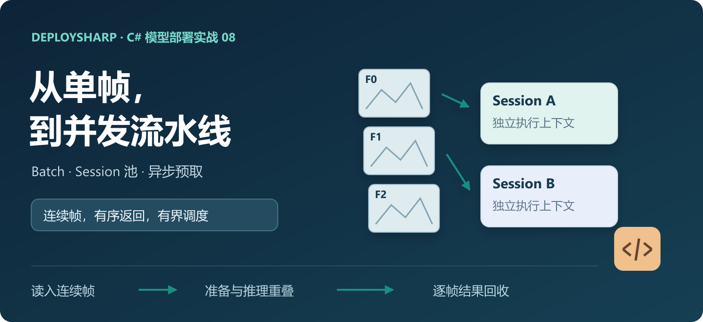

## 一、DeploySharp 项目简介

DeploySharp 是面向 C#/.NET 应用的模型部署工具，提供统一的模型加载、输入配置、后端调用和结果解码接口。开发者可以使用 ONNX Runtime、OpenVINO、TensorRT、OpenCV DNN 等推理引擎，完成目标检测、分类、分割、关键点、OCR、文档分析等任务，也可以接入自己的模型和前后处理。

2.0 增加了独立 Session 池、批量调度、异步预取、ROI 和滑动窗口等能力。单张图片跑通后，接下来就可以把这些接口用到相机、多路视频、图片队列和批量任务中。

```text
GitHub：
https://github.com/guojin-yan/DeploySharp

正式版源码：
https://github.com/guojin-yan/DeploySharp/tree/v2.0.0

NuGet：
https://www.nuget.org/profiles/JYPPX

当前模型与后端支持情况：
https://github.com/guojin-yan/DeploySharp/blob/DeploySharpV2.0/docs/model-backend-verification-matrix.md
```

前面几篇已经介绍了模型安装、后端切换和自定义前后处理。这次用 YOLO26n 处理一段真实视频，在 Windows、Ubuntu 上分别使用 ORT CPU、OpenVINO CPU、ORT CUDA 和 TensorRT，运行串行、Session 池、异步预取和真正的模型 Batch，看看连续帧任务应该怎样组织。

## 二、Batch、Session 池和预取，各自解决什么问题

最直接的视频程序是一个循环：读取一帧、前处理、推理、后处理，然后读取下一帧。逻辑清楚，但前处理时推理器可能在等待，推理时 CPU 也可能有余量。

DeploySharp 提供了三种可以组合的处理方式：

| 方式 | 实际发生的事情 | 模型要求 | 本例配置 |
| --- | --- | --- | --- |
| 真正模型 Batch | 一次调用提交 `[B,3,H,W]`，输出逐行解码 | 模型、输入输出合同和 Decoder 都支持对应 Batch | `B=4`，1 个 Session |
| Session 池 | 多个独立 Session 同时处理不同输入 | 固定 Batch=1 也能使用 | 2 个 Session，每次仍是一帧 |
| 异步预取 | 当前帧推理时，提前准备后续输入 | 前处理可独立运行，输入缓冲不互相覆盖 | 1 或 2 个 Session，预取量 2 |

下面的图只表达调度关系，方块宽度不代表实测耗时。

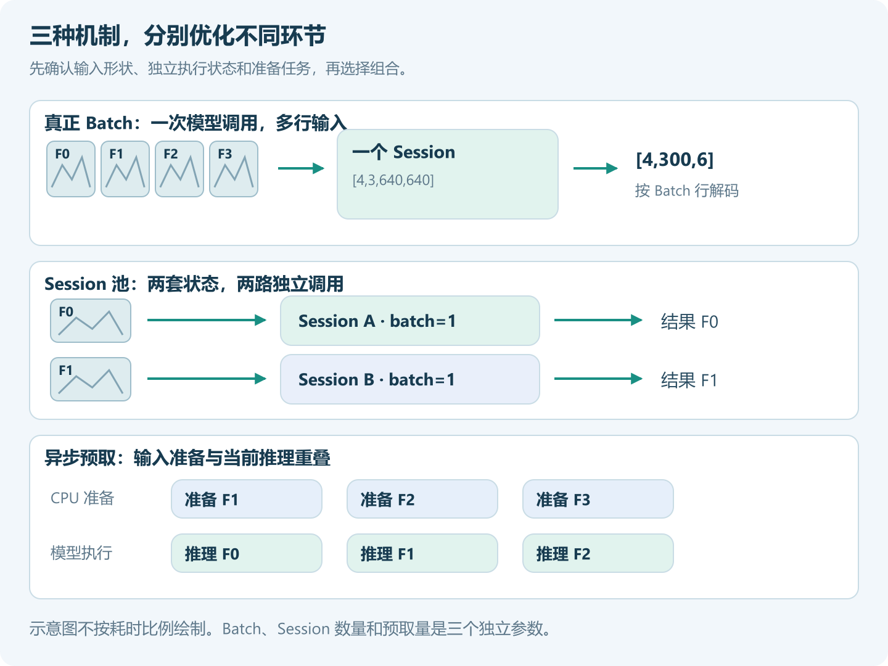

`SessionOptions(maxConcurrency: 2)` 会创建两个独立 Session。只给同一个非线程安全的推理对象套两个 Task，无法获得这个效果。

预取也不会自动改变模型 Batch，更不代表每个后端都使用了 GPU 原生异步调用。它在应用层重叠准备与推理；真正能获得多少收益，要看模型、后端和设备。

## 三、创建工程，按场景安装依赖

### 3.1 完整工程

随文工程使用 .NET 10、x64 进程和正式 NuGet 2.0.0，同时配置 Windows 与 Ubuntu 的原生依赖。

```text
https://github.com/guojin-yan/DeploySharp/tree/DeploySharpV2.0/docs/blog/2.0.0/2026-10/examples/08-batch-video-inference
```

```text
08-batch-video-inference/
  BatchVideo.csproj        # NuGet 与 Windows/Ubuntu 原生依赖
  Program.cs               # 调度、结果校验、测量与绘图
  FfmpegFrameReader.cs     # 原视频 → 独立 BGR Mat
  FramePreparer.cs         # Letterbox、RGB、归一化、NCHW 和缓冲租约
  models/                 # 自己下载或导出的 ONNX
  videos/                 # 原视频
  results/                # 程序输出
```

直接使用这个工程时，在工程目录执行 `dotnet restore`。如果从空工程开始，可以按下面的组合安装。

### 3.2 ONNX Runtime CPU

```powershell
dotnet new console -n BatchVideo -f net10.0
cd BatchVideo
dotnet add package JYPPX.DeploySharp.Visual.OpenCV --version 2.0.0
dotnet add package JYPPX.DeploySharp.Backend.OnnxRuntime --version 2.0.0
dotnet add package Microsoft.ML.OnnxRuntime --version 1.28.0
```

图像原生包按系统选一个。Windows：

```powershell
dotnet add package JYPPX.OpenCV.runtime.win-x64 --version 5.0.0
```

Ubuntu 22.04：

```bash
dotnet add package JYPPX.OpenCV.runtime.ubuntu.22.04-x64 --version 5.0.0
```

项目设置 `<PlatformTarget>x64</PlatformTarget>`，本例的指针写入还需要 `<AllowUnsafeBlocks>true</AllowUnsafeBlocks>`。完整 `.csproj` 已配置；Ubuntu 原生文件显式复制到 `native/opencv`。

### 3.3 增加 OpenVINO CPU

```powershell
dotnet add package JYPPX.DeploySharp.Backend.OpenVINO --version 2.0.0
```

| 系统 | OpenVINO 原生包 |
| --- | --- |
| Windows x64 | `OpenVINO.runtime.win 2026.2.1` |
| Ubuntu 22.04 x64 | `OpenVINO.runtime.ubuntu.22-x86_64 2026.3.1` |

对应的包安装在运行所在系统，Linux 原生文件复制配置同样已经包含在随文工程中。只用 ORT 时，可以移除 OpenVINO 包、注册分支及原生复制项。

### 3.4 ONNX Runtime CUDA

ORT 适配器不变，原生运行库换成 GPU 版本。已有 CUDA 12 环境时，使用 **Managed 1.28.0 + 官方同版本 CUDA 12 发行包**；CPU 原生包不再同时安装。本次两台机器使用 CUDA 12.9、cuDNN 9.22。

| 系统 | 官方原生发行包 |
| --- | --- |
| Windows x64 | `onnxruntime-win-x64-gpu_cuda12-1.28.0.zip` |
| Ubuntu x64 | `onnxruntime-linux-x64-gpu_cuda12-1.28.0.tgz` |

```text
官方下载：
https://github.com/microsoft/onnxruntime/releases/tag/v1.28.0
```

随文工程接受 `OrtCuda12NativeDir`，指向发行包的 `lib` 目录，会选择 Managed 包并复制整套 ORT、shared、CUDA 原生库。Windows 是三个 DLL；Linux 还保留 `libonnxruntime.so` 的版本文件和符号链接。第六节给出两种系统的完整命令。

如果目标机已经匹配 CUDA 13，也可以使用 `-p:UseCuda=true`，由工程选择 `Microsoft.ML.OnnxRuntime.Gpu.Windows` 或 `Gpu.Linux 1.28.0`。这两个 NuGet 的原生文件使用 CUDA 13，与本次实测组合不同。不能只替换一个 provider 文件，也不能把 1.23 的原生库和 1.28 的 Managed 混在一起。

### 3.5 TensorRT：托管接口、Bridge 和 NVIDIA 环境

```powershell
dotnet add package JYPPX.DeploySharp.Backend.TensorRT --version 2.0.0
```

Bridge 选择与目标机 TensorRT 主版本匹配的包，完整工程已按系统配置：

| 本例环境 | Bridge 包，版本均为 `4.0.0` |
| --- | --- |
| Windows，TensorRT 10.11 / CUDA 12.9 | `JYPPX.TensorRT.CSharp.API.Runtime.win-x64.trt10.11.cuda12.9.cudnn9.22.Bridge` |
| Ubuntu 22.04，TensorRT 11.0 / CUDA 12.9 | `JYPPX.TensorRT.CSharp.API.Runtime.linux-x64.ubuntu22.04.trt11.0.cuda12.9.cudnn9.22.Bridge` |

Bridge 不包含 CUDA、cuDNN 和 TensorRT 本体，需要目标机已有对应环境。程序通过 `--trt-api 10` 或 `11` 选择 API，Windows 默认 10，Linux 默认 11；更换主版本时，也要更换 Bridge。

所有后端仍共用 CPU 图像准备和结果解码。GPU 执行路径是：CPU 准备张量 → 上传输入 → GPU 模型推理 → 回读输出 → CPU Decoder。预取在应用层重叠准备与推理，本篇没有启用专用 CUDA 图像前处理或零拷贝。

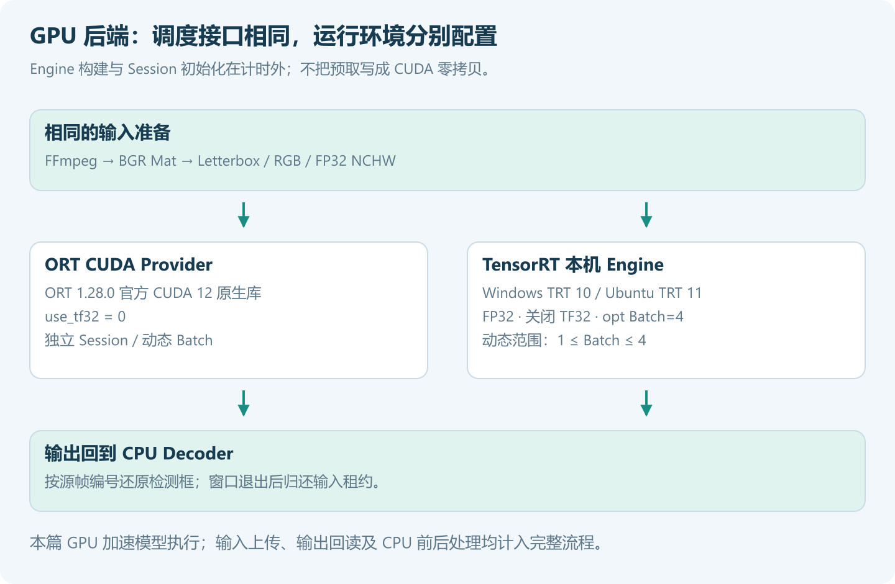

### 3.6 视频解码使用 FFmpeg

推理引擎不负责读取 MP4、AVI。这里使用 FFmpeg 输出 BGR 原始像素，OpenCV 负责缩放和绘图，避免依赖 OpenCV 原生包是否编入某个视频编解码器。

Windows 安装后重新打开终端：

```powershell
winget install --id Gyan.FFmpeg --exact
ffmpeg -version
ffprobe -version
```

Ubuntu：

```bash
sudo apt update
sudo apt install ffmpeg
ffmpeg -version
ffprobe -version
```

已有 FFmpeg 的电脑直接使用。也可以通过 `--ffmpeg`、`--ffprobe` 传入可执行文件路径。

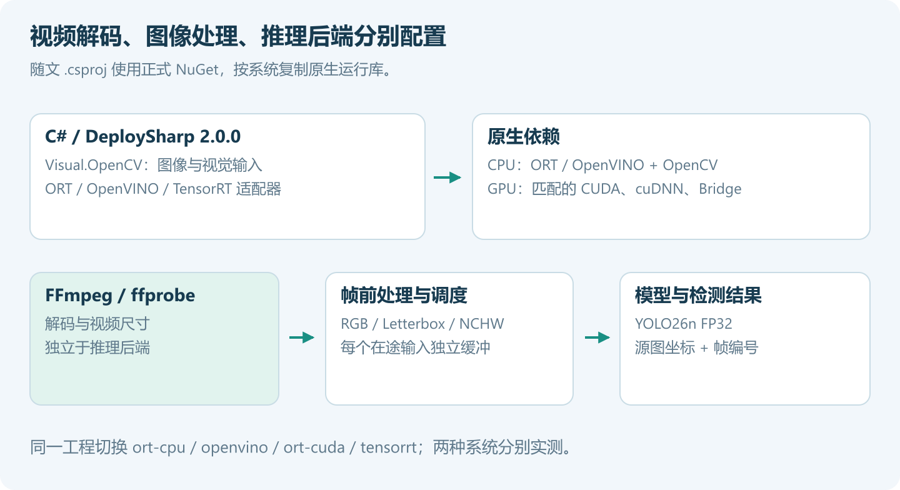

## 四、准备视频和模型

### 4.1 使用连续帧，保留源帧编号

本例使用 OpenCV 示例视频 `vtest.avi`，画面为固定机位下的行人场景，分辨率为 768×576。默认读取从第 0 帧开始的 48 个连续帧，不抽样、不跳帧。

```text
视频来源：
https://github.com/opencv/opencv/blob/4.x/samples/data/vtest.avi

下载地址：
https://raw.githubusercontent.com/opencv/opencv/4.x/samples/data/vtest.avi
```

PowerShell 下载：

```powershell
New-Item -ItemType Directory -Force videos, models | Out-Null
Invoke-WebRequest 'https://raw.githubusercontent.com/opencv/opencv/4.x/samples/data/vtest.avi' `
  -OutFile videos/vtest.avi
```

Ubuntu 下载：

```bash
mkdir -p videos models
curl -fL 'https://raw.githubusercontent.com/opencv/opencv/4.x/samples/data/vtest.avi' -o videos/vtest.avi
```

换自己的视频时传入 `--video` 即可。视频必须至少包含 `--frames` 指定的帧数。本例处理文件视频，帧号来自输入顺序，不是跟踪 ID。

### 4.2 固定 Batch=1：直接下载模型

已有第二篇模型的读者可以继续使用。没有模型时，下载到 `models/yolo26n.onnx`：

```text
https://github.com/guojin-yan/DeploySharp/releases/download/models-visual.1/yolo-v26-detect-n.model.onnx
```

```powershell
Invoke-WebRequest 'https://github.com/guojin-yan/DeploySharp/releases/download/models-visual.1/yolo-v26-detect-n.model.onnx' `
  -OutFile models/yolo26n.onnx
```

```bash
curl -fL 'https://github.com/guojin-yan/DeploySharp/releases/download/models-visual.1/yolo-v26-detect-n.model.onnx' \
  -o models/yolo26n.onnx
```

这个导出的端口为 `images [1,3,640,640]`、`output0 [1,300,6]`。使用它时，程序运行串行、Session 池和预取，自动跳过真 Batch。

### 4.3 真正模型 Batch：重新导出动态模型

固定 Batch=1 的 ONNX 不能只改 Profile 就传入 4 张图。需要从支持 Batch 的原始模型重新导出。本次采用 Ultralytics `8.4.193` 和官方 `yolo26n.pt`，使用下面的参数：

```bash
python -m pip install 'ultralytics==8.4.193' 'onnx==1.19.1'
```

在工程的 `models` 目录运行以下 Python 代码。导出过程使用子目录，保留前面下载的固定 Batch 模型：

```python
from pathlib import Path
import os
from ultralytics import YOLO

Path("batch-export").mkdir(exist_ok=True)
os.chdir("batch-export")
exported = YOLO("yolo26n.pt").export(
    format="onnx", imgsz=640, batch=4, dynamic=True,
    nms=False, opset=17, simplify=False, device="cpu")
Path(exported).rename(Path.cwd().parent / "yolo26n-dynamic.onnx")
```

这里显式传入 `nms=False`，保留本次 YOLO26 导出的 end-to-end 检测分支，运行输出为 `[B,300,6]`。该版本使用默认 NMS 参数时可能导出原始 Head，输出合同就不同了。本工程要求 end-to-end 输出，不直接解码 `[B,84,N]`。

Python 只用于导出，后续 C# 推理不依赖 Python。模型和视频来自各自上游，使用时遵循对应的许可条件。

程序支持先查看端口：

```powershell
dotnet run -c Release -- --model models/yolo26n-dynamic.onnx --inspect
```

动态模型的元数据会显示：

```text
input images: [-1,3,-1,-1]
output output0: [-1,-1,-1]
```

`-1` 表示尚未确定的维度。本例始终准备 640×640 输入，并在实际运行时校验输出首维、六字段结构和逐行结果，不把元数据中的动态维度当作任意输出都能接收。

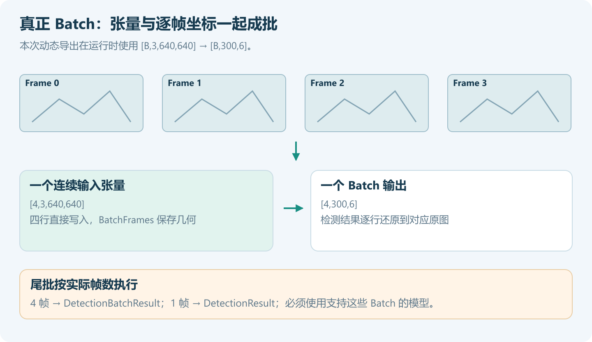

## 五、把视频组织成有界的推理流水线

### 5.1 读取窗口，控制内存

本例每次只读取 12 帧。当前窗口完成、结果取出并释放图像后，再读下一组，文件再长也不会一次缓存整段视频的像素。示例会累计结果元数据，长视频业务可以在每个窗口结束后写入文件或数据库。

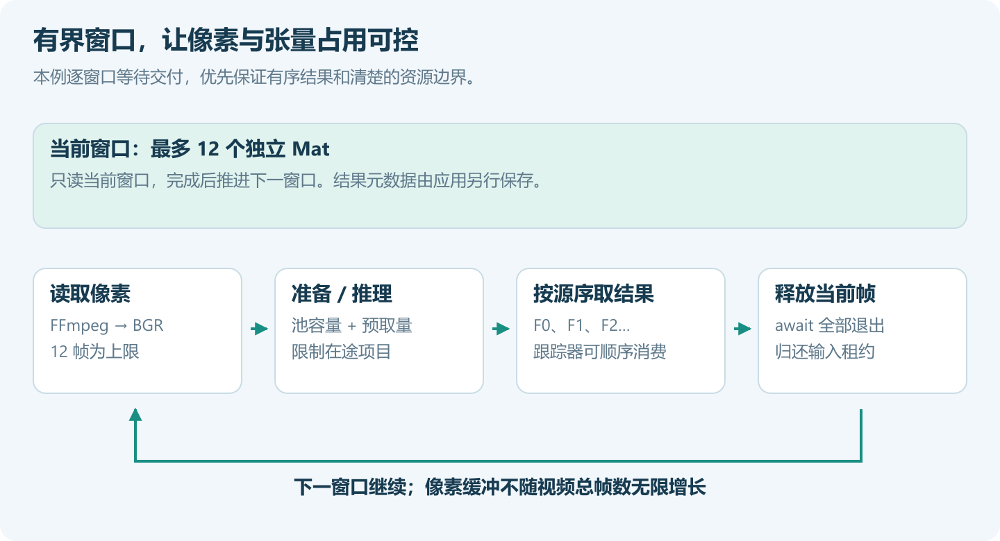

FFmpeg 输出 `bgr24` 原始像素，程序直接读入每帧独立的 Mat。前处理完成 Letterbox、BGR→RGB、除以 255 和 NCHW 写入，模型输入始终为 FP32、640×640，填充值为 114。

帧进入推理队列后，不能继续覆盖同一块像素或张量。`FramePreparer` 为每个在途输入租用一个独立的等长数组，返回的 `PreparedVisualInput` 持有归还租约。原生 BGR 像素转成模型 FP32 张量仍然需要一次格式写入，这里主要减少额外的整帧复制与中转。

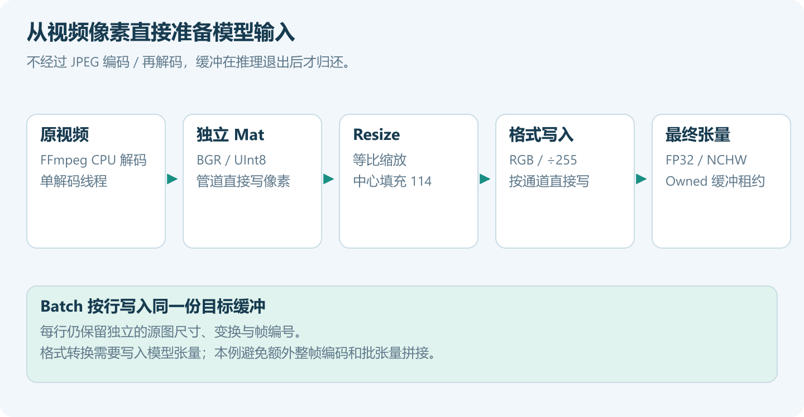

下面的代码摘自随文工程，`frames` 是当前窗口，`preparer` 是工程中的视频前处理器。

### 5.2 两个独立 Session，处理多张图片

Pipeline 初始化时配置池容量。CPU 后端同时限制每个 Session 的线程数，避免每个 Session 都争抢全部核心。

```csharp
backends.UseOnnxRuntime(new OnnxRuntimeOptions(
    intraOpThreads: 2, interOpThreads: 1));

using var pipeline = new VisualPipeline(
    backends, selection, request,
    new SessionOptions(maxConcurrency: 2));
```

准备当前窗口后交给 `RunManyAsync`。结果顺序与输入顺序一致，已准备的输入由本段代码负责释放：

```csharp
var prepared = new List<PreparedVisualInput>();
try
{
    foreach (Frame frame in frames)
        prepared.Add(preparer.Prepare(new[] { frame }, token));

    IReadOnlyList<VisualInferenceResult> results =
        await pipeline.RunManyAsync(prepared, cancellationToken: token);
}
finally
{
    foreach (PreparedVisualInput input in prepared)
        input.Dispose();
}
```

对于已经准备好的一组图片，这个入口很直接。本例一次准备 12 帧，因此同时持有 12 份模型输入；视频还可以用下面的预取方式收紧占用。

### 5.3 当前帧推理时，准备下一帧

```csharp
IReadOnlyList<VisualInferenceResult> results =
    await pipeline.RunPrefetchedAsync(
        frames,
        (frame, ct) => preparer.Prepare(new[] { frame }, ct),
        prefetch: 2,
        cancellationToken: token);
```

回调在线程池执行。库最多安排 `MaximumConcurrency + prefetch` 个在途项目：一个 Session、预取量 2 时，上限为 3；两个 Session 时为 4。它们包含准备中、等待推理或已经执行的项目，不是额外增加 3 或 4 个推理 Session。

本例预取输入标记为 `Owned`，由预取方法在成功、失败或取消后释放。回调返回后不能自己立即归还数组。`Borrowed` 输入则始终由调用方管理。

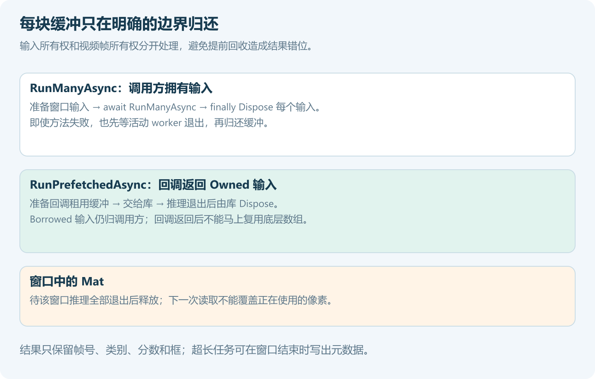

### 5.4 多帧组成一个真正的 Batch

动态模型使用相同的 `VisualPipeline`，但输入合同的 Batch 首维是动态的，并声明允许的最大值：

```csharp
var inputBinding = new VisualInputBinding(
    "images", TensorElementType.Float32,
    new TensorShape(-1, 3, 640, 640),
    VisualTensorLayout.Nchw,
    minimumBatch: 1, maximumBatch: 4);
```

本例把当前窗口按 4 帧分组，直接往 `[B,3,640,640]` 张量的对应位置写入，不先生成四个完整张量再拼接。每行通过 `BatchFrames` 保存自己的尺寸和坐标变换，`YoloDetectionDecoder` 返回 `DetectionBatchResult`；尾批只有一帧时返回 `DetectionResult`。

这里只配置一个 Session，便于单独观察 Batch 的影响。要组合 Batch 与多个 Session，可以增加池容量，再按显存、内存和吞吐调优。通用张量模型也可以使用 `InferenceBatchScheduler<TInput,TOutput>`，自行提供批输入准备和批输出解码委托。

### 5.5 取消与释放

程序支持 `Ctrl+C`，令牌同时传给视频读取和推理调用。取消后停止派发后续输入，等待已启动调用退出，再归还缓冲、释放当前窗口和 Session。已经进入 native 的工作能否立刻停止，取决于后端。

窗口的 `finally` 检查输入租约是否全部归还；出现遗漏会直接报错。业务接入时保持同一顺序：停止提交 → 取消或等待 → 等待活动调用退出 → 释放 Pipeline → 释放注册表。不能在调用仍在执行时先释放它借用的资源。

## 六、Windows 与 Ubuntu 实际运行

### 6.1 Windows

在完整工程目录运行，同一个 ONNX 会完成五种模式：

```powershell
dotnet run -c Release -- `
  --model models/yolo26n-dynamic.onnx `
  --video videos/vtest.avi `
  --backend ort-cpu --threads 2 `
  --frames 48 --window 12 --repeats 3 `
  --output results/ort-cpu
```

切换 OpenVINO：

```powershell
dotnet run -c Release -- `
  --model models/yolo26n-dynamic.onnx `
  --video videos/vtest.avi `
  --backend openvino --threads 2 `
  --output results/openvino
```

GPU 使用独立输出目录，避免上一次 CPU 构建留下的 DLL 被继续加载。假设官方 CUDA 12 压缩包已经解压到 `runtime/`，并已安装对应 NVIDIA 环境：

```powershell
$ortLib = (Resolve-Path 'runtime/onnxruntime-win-x64-gpu_cuda12-1.28.0/lib').Path
dotnet publish -c Release "-p:OrtCuda12NativeDir=$ortLib" -o bin/cuda12

$env:JYPPX_TENSORRT_ROOT = '你的 TensorRT 10.11 安装目录'
$env:JYPPX_CUDA_ROOT = '你的 CUDA 12.9 安装目录'
$env:JYPPX_CUDNN_ROOT = '你的 cuDNN 9.22 安装目录'
$env:PATH = "$env:JYPPX_TENSORRT_ROOT\lib;$env:JYPPX_CUDA_ROOT\bin;$env:JYPPX_CUDNN_ROOT\bin;$env:PATH"

dotnet bin/cuda12/BatchVideo.dll `
  --model models/yolo26n-dynamic.onnx --video videos/vtest.avi `
  --backend ort-cuda --threads 2 --output results/ort-cuda

dotnet bin/cuda12/BatchVideo.dll `
  --model models/yolo26n-dynamic.onnx --video videos/vtest.avi `
  --backend tensorrt --trt-api 10 --batch 4 --output results/tensorrt
```

第一次使用 TensorRT 会在计时外转换模型。默认 Engine 名包含系统、TensorRT API、FP32 和 Batch 上限，也可以用 `--engine models/local-b4.engine` 指定路径。更换模型、显卡、原生版本或 Batch 配置时，使用新路径重新构建，Engine 不跨设备分发。

### 6.2 Ubuntu 22.04

先构建，并把原生目录加入动态库搜索路径：

```bash
dotnet build -c Release
export LD_LIBRARY_PATH="$PWD/bin/Release/net10.0/native/opencv:$PWD/bin/Release/net10.0/native/openvino:${LD_LIBRARY_PATH:-}"

dotnet bin/Release/net10.0/BatchVideo.dll \
  --model models/yolo26n-dynamic.onnx \
  --video videos/vtest.avi \
  --backend ort-cpu --threads 2 \
  --frames 48 --window 12 --repeats 3 \
  --output results/ort-cpu

dotnet bin/Release/net10.0/BatchVideo.dll \
  --model models/yolo26n-dynamic.onnx \
  --video videos/vtest.avi \
  --backend openvino --threads 2 \
  --output results/openvino
```

首次还原可能出现 `NETSDK1206`，原因是 OpenCV 包采用发行版 RID。本工程通过 `.csproj` 显式复制原生文件，仍需保留上面的搜索路径配置。

GPU 版本先取得官方 CUDA 12 原生库，再发布到独立目录：

```bash
mkdir -p runtime
curl -fL -o runtime/ort-cuda12.tgz \
  https://github.com/microsoft/onnxruntime/releases/download/v1.28.0/onnxruntime-linux-x64-gpu_cuda12-1.28.0.tgz
tar -xzf runtime/ort-cuda12.tgz -C runtime
dotnet publish -c Release \
  -p:OrtCuda12NativeDir="$PWD/runtime/onnxruntime-linux-x64-gpu_cuda12-1.28.0/lib" \
  -o bin/cuda12
export LD_LIBRARY_PATH="$PWD/bin/cuda12:$PWD/bin/cuda12/native/opencv:$PWD/bin/cuda12/native/openvino:/usr/local/cuda-12.9/lib64:${LD_LIBRARY_PATH:-}"

dotnet bin/cuda12/BatchVideo.dll \
  --model models/yolo26n-dynamic.onnx --video videos/vtest.avi \
  --backend ort-cuda --threads 2 --output results/ort-cuda

dotnet bin/cuda12/BatchVideo.dll \
  --model models/yolo26n-dynamic.onnx --video videos/vtest.avi \
  --backend tensorrt --trt-api 11 --batch 4 --output results/tensorrt
```

本次 Linux 的 TensorRT、cuDNN 已由系统动态加载器找到。使用其他安装位置时，将实际包含 `.so` 的目录加入 `LD_LIBRARY_PATH`。

### 6.3 动态 Batch Engine 怎样配置

`--batch 4` 对应 TensorRT 的范围是 **min=1、opt=4、max=4**，空间尺寸固定为 640×640。一个 Engine 同时接受串行的 Batch=1、测试中的 Batch=4，以及不足四帧的尾批。

```csharp
var inputProfile = new TensorRtOnnxInputProfile(
    "images",
    new TensorShape(1, 3, 640, 640),
    new TensorShape(4, 3, 640, 640),
    new TensorShape(4, 3, 640, 640));
```

Engine 使用 FP32，关闭 TF32，构建优化等级为 3。TensorRT 10 通过 `Float32` 构建策略配置；TensorRT 11 使用强类型网络，由 FP32 ONNX 决定类型，同时显式关闭 TF32。构建和首次 Session 初始化均不计入性能表。

### 6.4 输出与结果校验

```text
results/ort-cpu/
  benchmark.json          # 环境、协议、三轮总耗时、窗口统计和结果一致性
  frame-0000.jpg          # 单独预览阶段绘制，不计入测速
  frame-0012.jpg
  frame-0024.jpg
  frame-0036.jpg
  serial/frames.json      # 每一帧的编号、类别、置信度和源图框
  pool-2/frames.json
  prefetch-1/frames.json
  prefetch-2/frames.json
  batch-4/frames.json
```

程序检查帧数与编号，报告保留每种模式最后一轮的逐帧结果。每种模式先记录是否与同后端串行结果逐值相同，再按同帧、同类别、最高 IoU 配对，要求没有未配对项、IoU 至少 0.99、分数差不超过 0.001。GPU 的 Batch 或独立上下文可能出现微小浮点差异，因此是否通过以这组容差为准，`exactWithSerial` 仍保留实际值。超过容差直接报错，不继续把该组数字当成有效性能结果。

本次八组后端环境、每组五种模式，共 40 组配置，均返回 48 帧、298 次目标观测。38 组与各自后端串行结果逐值一致；两台设备的 ORT CUDA Batch=4 存在微小浮点差异，最低 IoU 约 0.999995，最大分数差约 0.0000154，均通过同一组容差。所有窗口退出后活动输入均为 0。

另外用 Windows ORT CPU 和 TensorRT 检查了五帧输入形成 `4+1` 尾批；ORT CPU 还检查了定时取消后的资源退出。这些补充检查不混入性能表。

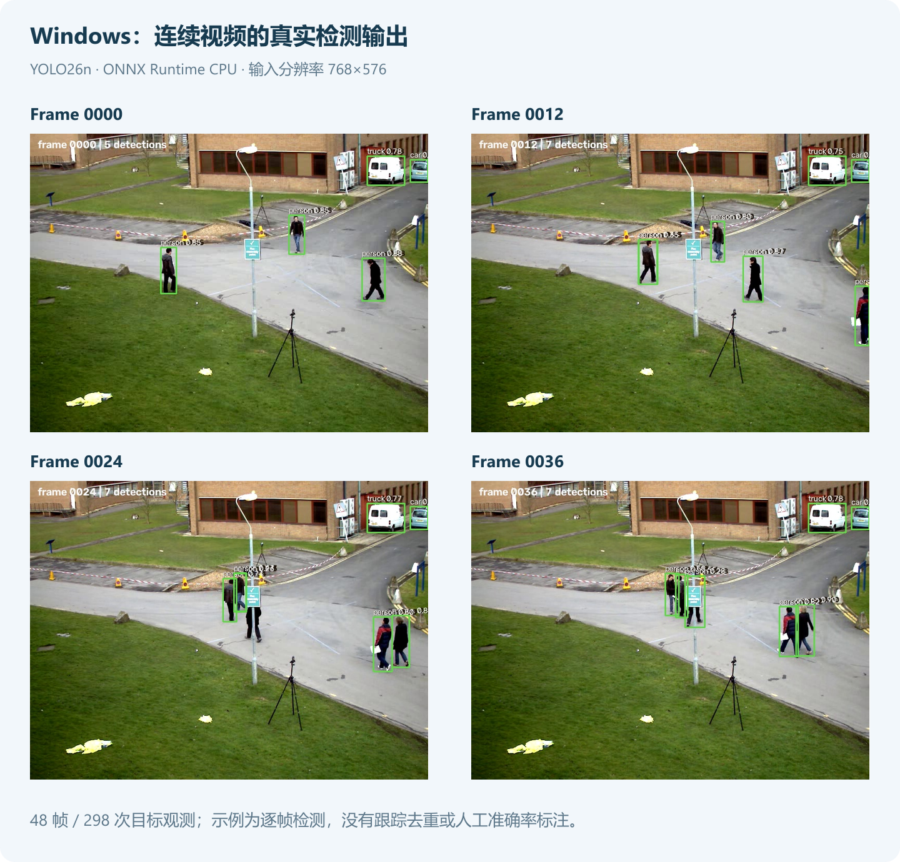

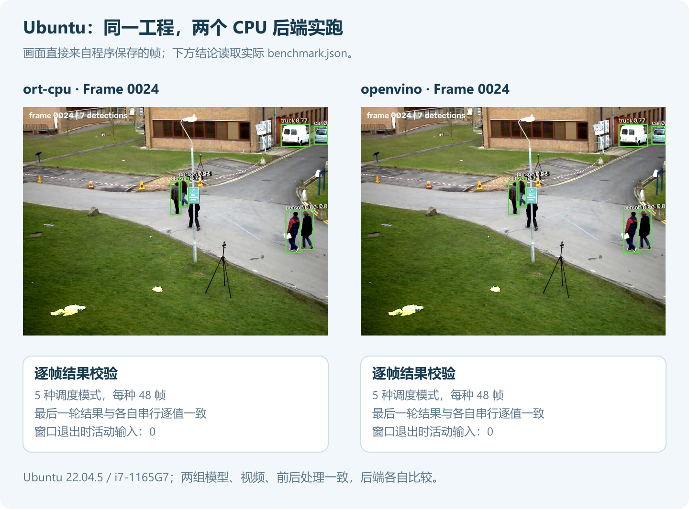

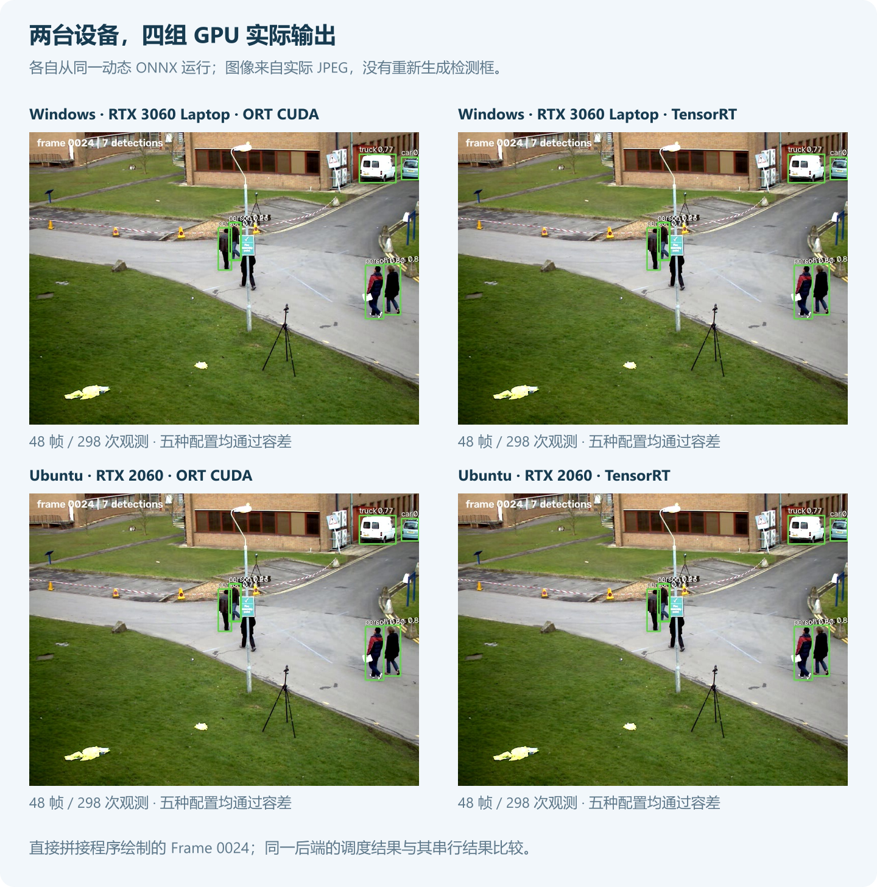

这里展示的是每帧目标观测，同一个人可以在多帧出现；没有引入跟踪器，不能用它直接统计去重人数，也没有将检测输出当作人工标注准确率。

## 七、性能实测：先看口径，再选配置

> **测试说明**：本次使用的两台设备性能有限，测试时还有多个其他任务同时运行，CPU/GPU 资源并未独占。这一轮主要验证示例程序在不同系统和后端下能否正常运行，下面的数据仅记录当时的表现，不代表最佳性能。
>
> 欢迎大家在自己的电脑上运行随文示例，实测不同 Batch、Session 数量和预取配置的效果，选择适合自己设备的组合。

### 7.1 测什么

所有后端测试均使用本次导出的同一个动态 ONNX、同一视频前 48 帧、同一前后处理与阈值；TensorRT 在各自设备从该 ONNX 构建 Engine。OpenVINO 配置为 CPU、Latency、单 stream、单 request；ORT 使用 inter-op 1，CPU 推理线程数为 2，CUDA 分支也保留这项主机线程设置。它不限制 GPU kernel 的线程数。

每种模式先预热两个完整的 12 帧窗口，再测量 3 轮。每轮重新打开视频，包含 4 个窗口。表中的吞吐按三轮总耗时的中位数计算；窗口 P50/P95 从 12 个窗口样本计算，采用最近秩法。


FFmpeg 采用单解码线程，通过有界管道输出像素；像素格式转换和等待计入读取阶段。进程创建、关闭、ffprobe 和窗口 Mat 释放在计时外，首次读取等待仍在计时内。下面是上述范围内的离线吞吐，窗口耗时也包含调度等待，不能当作单帧推理延迟。12 个样本的 P95 仅用于本次演示，生产容量评估需要更长时间的采样。

### 7.2 设备和运行时

实测设备与结果见下表；两台设备分别比较各自的配置，不据此判断操作系统优劣。

| 项目 | Windows 开发机 | Ubuntu 测试机 |
| --- | --- | --- |
| 系统 | Windows 11，Build 26200，x64 | Ubuntu 22.04.5，Linux 6.8，x64 |
| CPU | AMD Ryzen 7 5800H，8 核 16 线程 | Intel Core i7-1165G7，4 核 8 线程 |
| NVIDIA GPU / 显存 | RTX 3060 Laptop / 6 GiB | RTX 2060 / 6 GiB |
| NVIDIA 驱动 | 576.02 | 580.178.04 |
| .NET SDK / Runtime | 10.0.401 / 10.0.12 | 10.0.301 / 10.0.9 |
| ORT / OpenCV | 1.28.0 / 5.0.0 | 1.28.0 / 5.0.0 |
| OpenVINO 原生包 | 2026.2.1 | 2026.3.1 |
| ORT CUDA 原生来源 | 官方 1.28.0 CUDA 12 发行包 | 官方 1.28.0 CUDA 12 发行包 |
| CUDA / cuDNN | 12.9 / 9.22.0 | 12.9 / 9.22.0 |
| TensorRT | 10.11.0.33，FP32 | 11.0.0.114，强类型 FP32 |
| FFmpeg | Gyan essentials 9.0.2 | static 7.0.2 |

本轮未修改锁频和功耗设置，也未做系统后台任务隔离。ORT CUDA 和 TensorRT 均关闭 TF32，TensorRT 两种主版本使用相同的 FP32 ONNX，但优化器与执行策略仍可能不同。表中数字是具名设备上的完整视频流程记录，不作为设备性能上限。

程序在计时外记录 GPU 快照，另以 500ms 周期采集频率、功耗与利用率。Windows 推理后的快照显示核心约 1327～2002MHz、显存 7000MHz；Ubuntu 两个 GPU 后端推理后约 1005MHz、显存 5500MHz。Ubuntu 空闲时会回到 P8、300MHz，不能把空闲频率当作推理频率，也不能只凭一次 P0 判断已经达到最高性能。

### 7.3 Windows 实测

| 后端 | 模式 | FPS | 12 帧窗口 P50（毫秒） | 窗口 P95（毫秒） |
| --- | --- | ---: | ---: | ---: |
| ORT CPU | 串行 | 17.83 | 675.06 | 761.61 |
| ORT CPU | Session 池 ×2 | 25.86 | 450.22 | 512.70 |
| ORT CPU | 1 Session + 预取 2 | 18.12 | 664.93 | 777.04 |
| ORT CPU | 2 Sessions + 预取 2 | 25.37 | 452.00 | 517.22 |
| ORT CPU | Batch=4，1 Session | 16.45 | 723.67 | 914.70 |
| OpenVINO CPU | 串行 | 14.54 | 774.81 | 990.02 |
| OpenVINO CPU | Session 池 ×2 | 19.73 | 604.76 | 889.37 |
| OpenVINO CPU | 1 Session + 预取 2 | 14.78 | 801.60 | 962.00 |
| OpenVINO CPU | 2 Sessions + 预取 2 | 24.65 | 487.50 | 572.98 |
| OpenVINO CPU | Batch=4，1 Session | 14.55 | 801.31 | 956.31 |
| ORT CUDA，TF32 关闭 | 串行 | 60.67 | 188.53 | 250.51 |
| ORT CUDA，TF32 关闭 | Session 池 ×2 | 62.80 | 171.43 | 270.26 |
| ORT CUDA，TF32 关闭 | 1 Session + 预取 2 | 73.25 | 150.31 | 242.44 |
| ORT CUDA，TF32 关闭 | 2 Sessions + 预取 2 | 82.89 | 133.42 | 190.57 |
| ORT CUDA，TF32 关闭 | Batch=4，1 Session | 111.97 | 91.64 | 159.75 |
| TensorRT FP32，TF32 关闭 | 串行 | 95.84 | 113.16 | 196.25 |
| TensorRT FP32，TF32 关闭 | Session 池 ×2 | 100.28 | 104.45 | 171.65 |
| TensorRT FP32，TF32 关闭 | 1 Session + 预取 2 | 101.20 | 106.62 | 179.00 |
| TensorRT FP32，TF32 关闭 | 2 Sessions + 预取 2 | 124.17 | 80.31 | 162.96 |
| TensorRT FP32，TF32 关闭 | Batch=4，1 Session | 138.09 | 73.51 | 155.97 |

本次 Windows 记录中，两个 CPU 后端的 Batch=4 吞吐均低于串行，两个 GPU 后端则高于串行。ORT CUDA 的串行和 Batch=4 分别为 60.67 FPS、111.97 FPS，TensorRT 分别为 95.84 FPS、138.09 FPS。TensorRT 的双 Session 加预取为 124.17 FPS，只使用双 Session 为 100.28 FPS。由于后台还有其他任务，这些差异不能直接作为独占设备上的加速比。

### 7.4 Ubuntu 实测

| 后端 | 模式 | FPS | 12 帧窗口 P50（毫秒） | 窗口 P95（毫秒） |
| --- | --- | ---: | ---: | ---: |
| ORT CPU | 串行 | 27.65 | 427.83 | 475.36 |
| ORT CPU | Session 池 ×2 | 43.31 | 270.38 | 286.71 |
| ORT CPU | 1 Session + 预取 2 | 29.96 | 397.99 | 432.76 |
| ORT CPU | 2 Sessions + 预取 2 | 39.92 | 299.57 | 316.91 |
| ORT CPU | Batch=4，1 Session | 24.66 | 484.63 | 509.61 |
| OpenVINO CPU | 串行 | 27.79 | 429.49 | 444.51 |
| OpenVINO CPU | Session 池 ×2 | 26.96 | 443.13 | 454.04 |
| OpenVINO CPU | 1 Session + 预取 2 | 27.85 | 429.85 | 438.71 |
| OpenVINO CPU | 2 Sessions + 预取 2 | 27.29 | 438.38 | 447.96 |
| OpenVINO CPU | Batch=4，1 Session | 26.17 | 457.08 | 464.93 |
| ORT CUDA，TF32 关闭 | 串行 | 83.86 | 139.37 | 195.31 |
| ORT CUDA，TF32 关闭 | Session 池 ×2 | 93.12 | 123.29 | 195.10 |
| ORT CUDA，TF32 关闭 | 1 Session + 预取 2 | 92.27 | 128.76 | 168.52 |
| ORT CUDA，TF32 关闭 | 2 Sessions + 预取 2 | 103.69 | 112.67 | 142.22 |
| ORT CUDA，TF32 关闭 | Batch=4，1 Session | 106.75 | 109.28 | 124.60 |
| TensorRT FP32，TF32 关闭 | 串行 | 82.18 | 145.81 | 152.94 |
| TensorRT FP32，TF32 关闭 | Session 池 ×2 | 96.55 | 122.78 | 134.71 |
| TensorRT FP32，TF32 关闭 | 1 Session + 预取 2 | 87.08 | 136.45 | 146.23 |
| TensorRT FP32，TF32 关闭 | 2 Sessions + 预取 2 | 101.52 | 117.17 | 124.50 |
| TensorRT FP32，TF32 关闭 | Batch=4，1 Session | 107.58 | 108.54 | 127.65 |

本次 Ubuntu 记录中，ORT CPU 的双 Session 吞吐高于串行，OpenVINO CPU 的五种配置则较接近。ORT CUDA 的 Batch=4 为 106.75 FPS，TensorRT 为 107.58 FPS，均高于各自的单帧串行记录。这组完整流程还包含 CPU 解码、前后处理和数据传输，也受后台任务影响，不能由吞吐接近推断两个后端的纯模型计算速度相同。

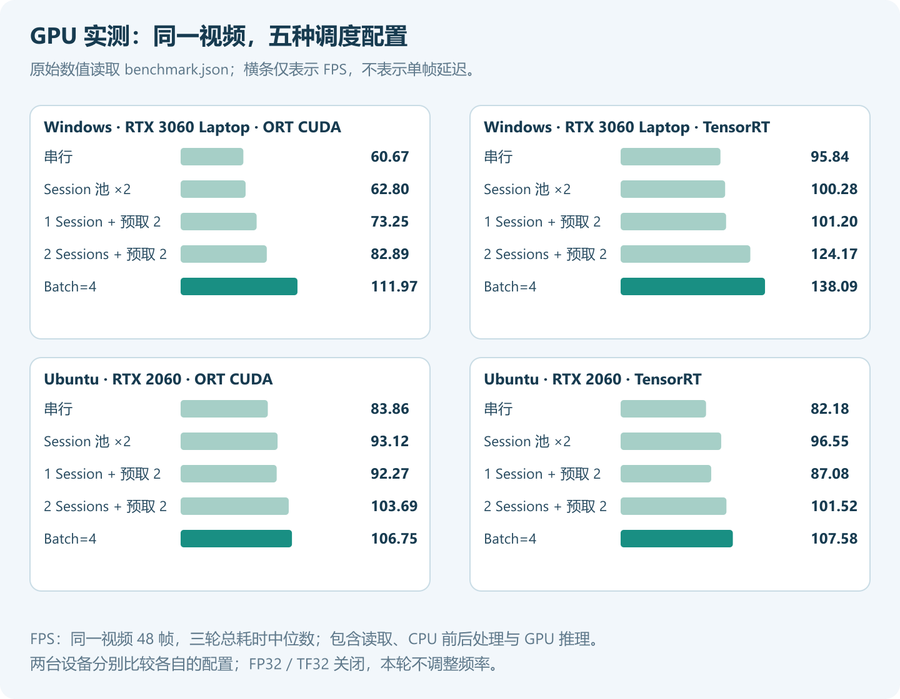

预取还有一项可直接观察的收益：本次运行中，两个 Session 的预取方式最多同时租用 4 份输入，预先准备整个窗口的方式为 12 份。

| 模式 | 峰值张量份数 | 同时容纳的帧数 | 对应 FP32 张量容量（MiB） |
| --- | ---: | ---: | ---: |
| 串行 | 1 | 1 | 4.69 |
| Session 池 ×2，先准备 12 帧 | 12 | 12 | 56.25 |
| 1 Session + 预取 2 | 3 | 3 | 14.06 |
| 2 Sessions + 预取 2 | 4 | 4 | 18.75 |
| Batch=4，先准备 3 批 | 3 | 12 | 56.25 |

容量按 `帧数 × 3 × 640 × 640 × 4 字节` 计算，只表示峰值活动输入张量，不是进程总内存；不包含原图、模型、后端工作区、结果和缓冲池缓存。

### 7.5 怎样用于自己的项目

图片队列已经准备好时，可以从 `RunManyAsync` 开始；视频前处理有一定占用、又需要限制在途张量时，可以使用 `RunPrefetchedAsync`。只有模型确实支持 Batch，并且实测收益合适时，再提高 Batch。

多 Session 会增加模型状态和工作缓冲占用，CPU 还要协调每 Session 的线程数。预取增加的是准备任务，不是设备算力；前处理占比低或线程争用明显时，吞吐可能没有提升。

本例保留所有帧并按输入顺序返回。直播预览如果要求“只显示最新帧”，需要在输入侧另做丢帧策略；有状态跟踪器应在有序消费端逐帧更新。当前窗口中有一帧很慢时，也可能拖住窗口交付，不能把这里的批量返回直接当成逐帧低延迟回调。

## 八、接入业务时的几个检查点

| 现象 | 优先检查 |
| --- | --- |
| Batch=4 被跳过 | `--inspect` 是否仍然显示固定首维 1；需要真正的动态导出 |
| 输出结构报错 | 是否忘记显式 `nms=False`，或换成原始 Head、分割、Pose 等不同输出 |
| FFmpeg 无法启动 | `ffmpeg`、`ffprobe` 是否在 PATH，或通过参数给出正确路径 |
| Linux 找不到 `.so` | 原生复制目录、`LD_LIBRARY_PATH` 和 Ubuntu 版本是否匹配 |
| ORT 提示 CUDA 未启用 | 是否加载旧的 CPU DLL；使用匹配的完整 GPU 原生库和独立输出目录 |
| CUDA provider 加载失败 | ORT 的 CUDA 主版本、驱动、cuDNN 与依赖搜索路径是否匹配 |
| TensorRT 构建或加载失败 | Bridge、`--trt-api` 与安装版本是否匹配；Engine 是否由当前设备生成 |
| Session 增加后更慢 | 总线程数、模型内存、CPU 争用；先对比 1、2 个 Session |
| 画面与检测结果错位 | 是否反复覆盖同一 Mat/数组，或忽略结果与输入的顺序对应 |

程序另提供 `--cancel-after`，单位为毫秒，方便验证中途停止；正式业务通常使用相机关闭、窗口退出或服务停止的令牌。取消不会产生半份成功报告，应以完整写出的 `benchmark.json` 为准，复用输出目录前也要留意上一轮文件。

本篇的解码器、帧窗口和结果保存属于随文应用代码，推理调度与 Batch Decoder 使用 DeploySharp 正式包。接入多路相机时，每路保留自己的解码和帧号，推理器可以按设备共享有界池；跟踪、报警和 UI 更新放在各路有序消费端。

下一篇继续介绍 ROI：把整张画面中的检测区域独立配置，再将结果映射回原图，接入实际的区域规则。

```text
Batch、Session 池与并发接口说明：
https://github.com/guojin-yan/DeploySharp/blob/DeploySharpV2.0/docs/articles/batch-session-concurrency.md

随文完整工程：
https://github.com/guojin-yan/DeploySharp/tree/DeploySharpV2.0/docs/blog/2.0.0/2026-10/examples/08-batch-video-inference
```
