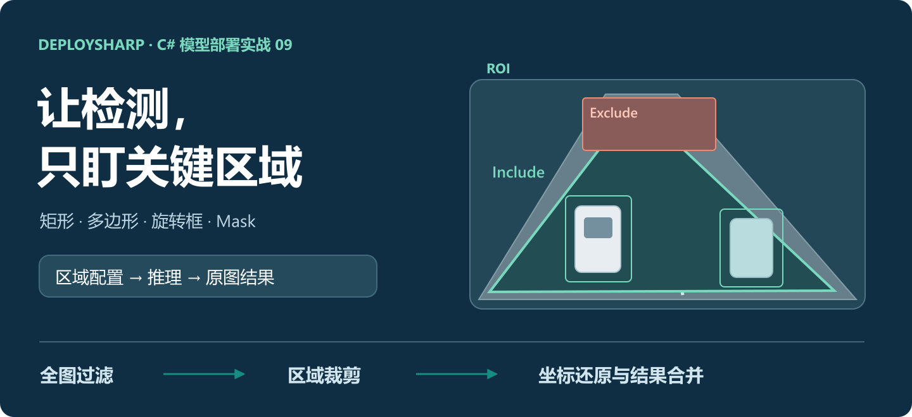
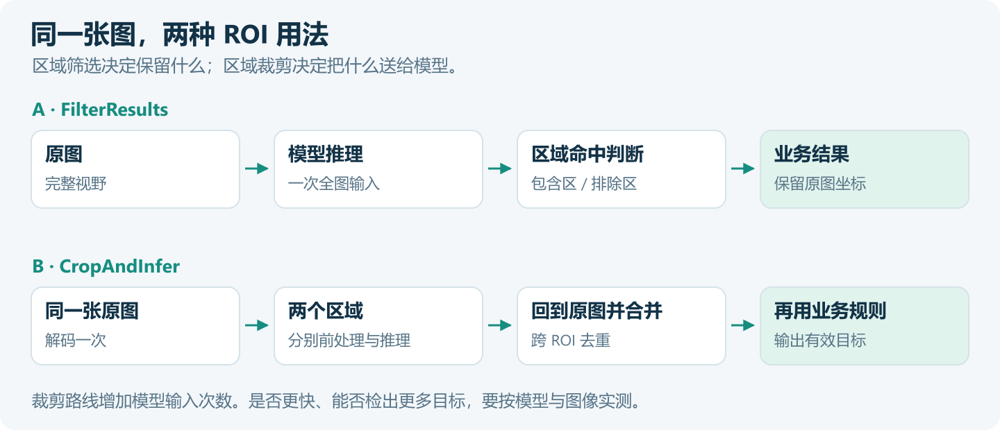
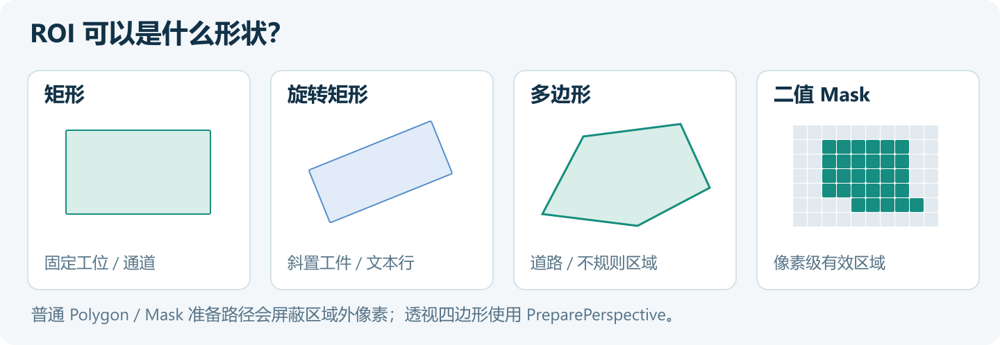
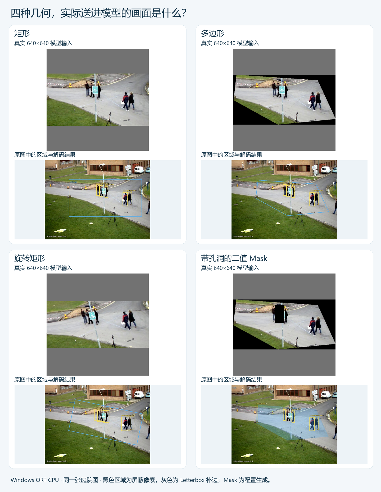
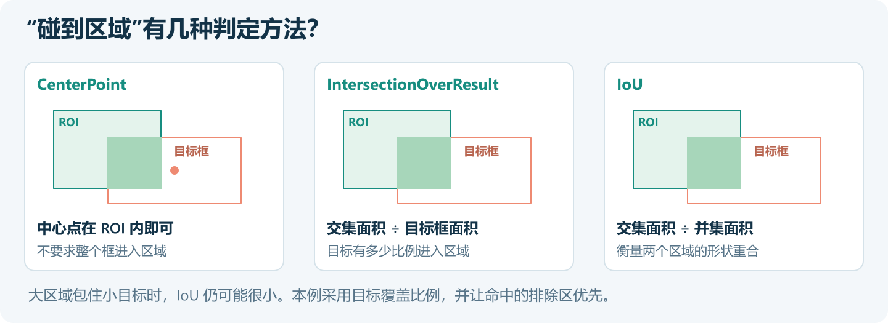
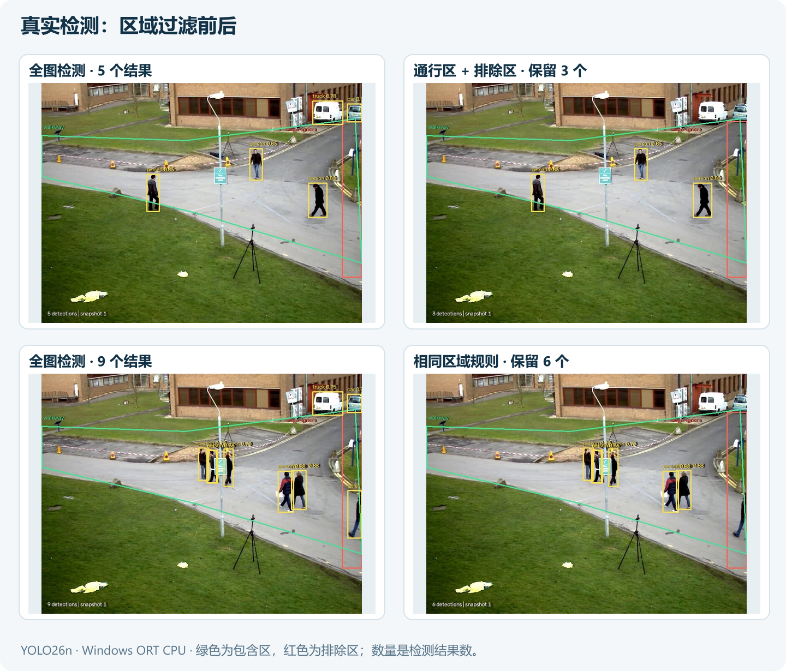
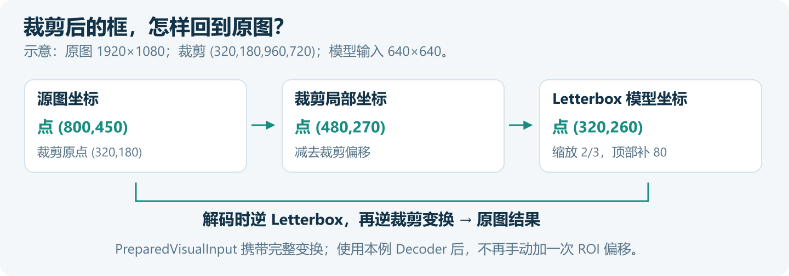
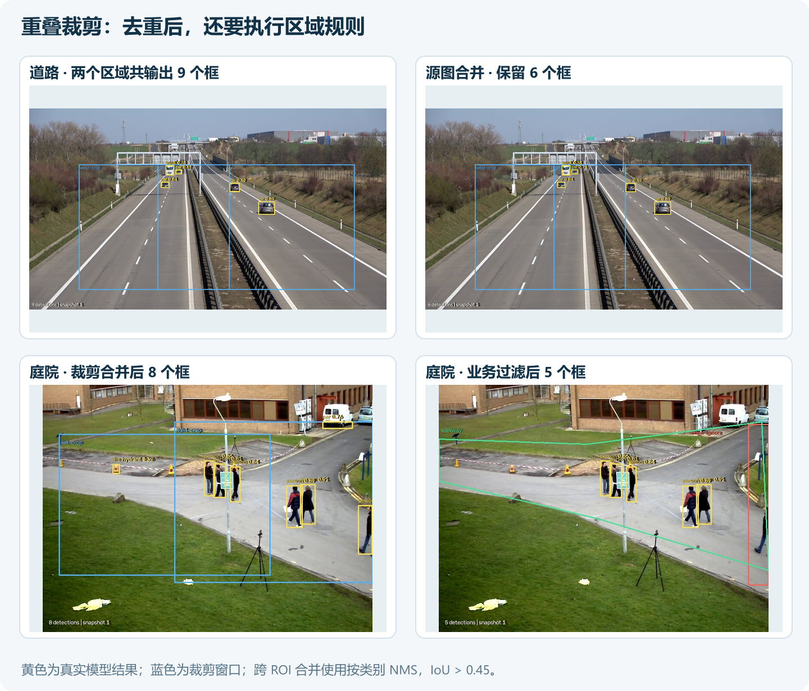
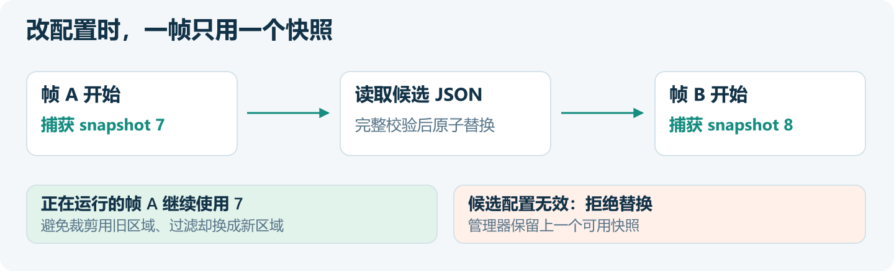
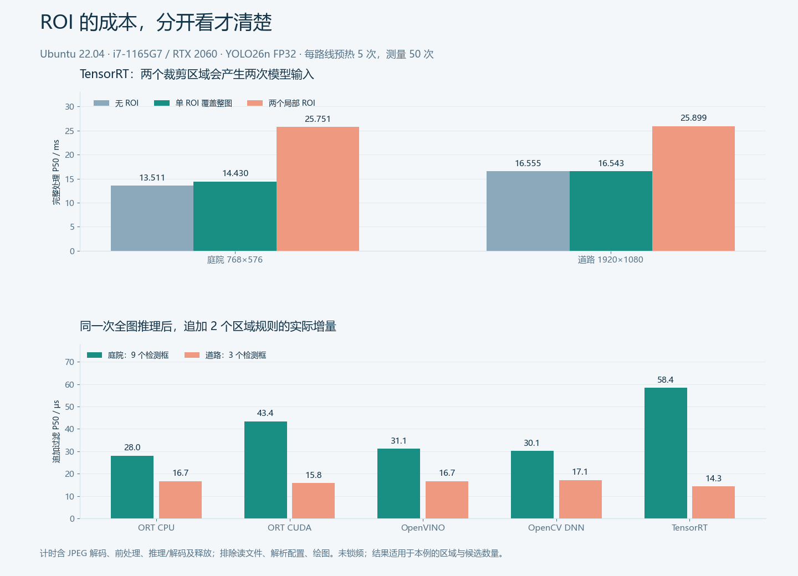

# 让检测只盯关键区域：DeploySharp ROI 工程实战

> 基于 DeploySharp 2.0.0 正式 NuGet；库源码 Tag：`v2.0.0`；创建日期：2026-11-03；同日补充 ROI 性能对照与几何实跑。



## 一、DeploySharp 项目简介

DeploySharp 是面向 C#/.NET 应用的模型部署工具，由作者维护并按 Apache License 2.0 开源。它将模型加载、输入处理、后端调用和结果解码组织成统一接口，支持 ONNX Runtime、OpenVINO、TensorRT、OpenCV DNN 等推理引擎，覆盖目标检测、分类、分割、关键点、OCR、文档分析等任务，也允许开发者接入自己的模型和前后处理。

2.0 增加了独立 Session 池、批量调度、异步预取、ROI 和滑动窗口等能力。同一个模型可以根据应用需求处理整张图片、指定区域或连续视频帧，后端配置与业务规则分别管理。

```text
GitHub：
https://github.com/guojin-yan/DeploySharp

正式版源码：
https://github.com/guojin-yan/DeploySharp/tree/v2.0.0

NuGet：
https://www.nuget.org/profiles/JYPPX

模型与后端支持情况：
https://github.com/guojin-yan/DeploySharp/blob/DeploySharpV2.0/docs/model-backend-verification-matrix.md
```

前几篇已经完成模型部署、后端切换和视频并发。这次继续向实际应用推进：相机看得见整片场地，程序往往只关心其中一条通道、一个工位或一块作业区域。怎样把这些区域交给推理程序，又怎样让结果回到原图上，就是本篇要解决的问题。

## 二、给检测加上区域规则

道路监控只统计指定路段，厂区相机忽略边缘停车位，工件检测只检查有效表面……这些需求都会用到 ROI（Region of Interest，感兴趣区域）。

本例使用 YOLO26n 和道路、庭院的四张真实截图，完成两条处理流程：

| 处理方式 | 完整流程 | 适合的需求 |
| --- | --- | --- |
| 全图检测后过滤 | 原图 → 模型 → 包含区、排除区和类别规则 → 有效结果 | 保留完整视野，按业务区域决定哪些结果需要处理 |
| 裁剪区域后推理 | 原图 → 多个 ROI → 分别推理 → 原图坐标合并 → 业务过滤 | 只处理指定工位，或让局部目标占据更多模型输入像素 |



第一条路线不会减少全图推理的计算量。第二条路线会改变模型看到的图像，一张原图也可能变成多次推理；裁剪窗口越多，总计算量未必越小。

这两种方式可以组合。例如道路上设置两个相互重叠的推理窗口，检测完成后仍按道路多边形过滤，并忽略远端观察区。**推理窗口决定送给模型什么，业务区域决定最终保留什么。**

## 三、创建工程，准备模型与图片

### 3.1 随文工程

完整工程使用 .NET 10、x64 和正式 NuGet 2.0.0，包含后端注册、模型配置、区域管理、检测结果绘图与 JSON 输出。

```text
https://github.com/guojin-yan/DeploySharp/tree/DeploySharpV2.0/docs/blog/2.0.0/2026-11/examples/09-visual-roi
```

```text
09-visual-roi/
  RoiDemo.csproj             # 正式 NuGet 与两种系统的原生依赖
  Program.cs                 # 全图、裁剪、合并与输出
  RoiBenchmark.cs            # 无 ROI / 过滤 / 裁剪的配对计时
  RoiGeometryShowcase.cs     # 四种几何与显式透视裁剪
  RoiConfigurationStore.cs   # 配置加载、尺寸检查、快照替换
  RoiDrawing.cs              # 原图叠加区域和检测结果
  configs/
    road.json
    courtyard.json
  demo-inputs/               # 四张真实 JPG 与来源说明
  models/                    # 下载后的 ONNX，本地保留
  results/                   # 运行生成的图片与 JSON
```

如果使用完整工程，直接在这个目录执行 `dotnet restore`。如果从空工程开始，依赖按场景选择。

### 3.2 最小组合：OpenCV 图像处理 + ORT CPU

```powershell
dotnet new console -n RoiDemo -f net10.0
cd RoiDemo
dotnet add package JYPPX.DeploySharp.Visual.OpenCV --version 2.0.0
dotnet add package JYPPX.DeploySharp.Backend.OnnxRuntime --version 2.0.0
dotnet add package Microsoft.ML.OnnxRuntime --version 1.28.0
```

图像处理原生包按系统选一个：

| 系统 | 安装命令 |
| --- | --- |
| Windows x64 | `dotnet add package JYPPX.OpenCV.runtime.win-x64 --version 5.0.0` |
| Ubuntu 22.04 x64 | `dotnet add package JYPPX.OpenCV.runtime.ubuntu.22.04-x64 --version 5.0.0` |

ROI 几何、过滤与 JSON 配置来自 `JYPPX.DeploySharp.Visual`，图像裁剪来自 `Visual.OpenCV`。后者会带入前者，**不用再安装独立的 ROI 或配置包**。

### 3.3 增加其他后端

| 执行路径 | DeploySharp 包，均为 `2.0.0` | 本例原生运行环境 |
| --- | --- | --- |
| OpenVINO CPU | `JYPPX.DeploySharp.Backend.OpenVINO` | Windows：`OpenVINO.runtime.win 2026.2.1`；Ubuntu：`OpenVINO.runtime.ubuntu.22-x86_64 2026.3.1` |
| OpenCV DNN CPU | `JYPPX.DeploySharp.Backend.OpenCV` | 与图像处理共用上述 OpenCV 原生包 |
| ORT CUDA | 仍为 `JYPPX.DeploySharp.Backend.OnnxRuntime` | Managed/native 版本一致的 ORT GPU、对应 CUDA 和 cuDNN |
| TensorRT | `JYPPX.DeploySharp.Backend.TensorRT` | 对应 TensorRT 主版本的 C# Bridge，以及 CUDA、cuDNN、TensorRT 本体 |

例如添加 OpenCV DNN：

```powershell
dotnet add package JYPPX.DeploySharp.Backend.OpenCV --version 2.0.0
```

完整工程配置了这些后端，命令行切换即可。只需要 ORT CPU 时，可以删除其他后端的包引用和注册分支。GPU 安装与运行命令放在第八节，先把区域处理讲清楚。

### 3.4 模型和输入

本例采用固定 Batch=1 的 YOLO26n：`images [1,3,640,640] → output0 [1,300,6]`。预处理为 RGB、Letterbox、像素除以 255，补边颜色为 114；检测阈值为 0.25，使用端到端输出 Decoder。

Windows 下载：

```powershell
New-Item -ItemType Directory -Force models | Out-Null
curl.exe -L --fail "https://github.com/guojin-yan/DeploySharp/releases/download/models-visual.1/yolo-v26-detect-n.model.onnx" -o models/yolo26n.onnx
```

Ubuntu 下载：

```bash
mkdir -p models
curl -L --fail 'https://github.com/guojin-yan/DeploySharp/releases/download/models-visual.1/yolo-v26-detect-n.model.onnx' -o models/yolo26n.onnx
```

四张图片已放入 `demo-inputs`。两张道路图为 1920×1080，两张庭院图为 768×576，分别取自 Roboflow 的 vehicles 视频和 OpenCV 的 vtest 视频。原始来源：

```text
https://media.roboflow.com/supervision/video-examples/vehicles.mp4
https://github.com/opencv/opencv/blob/4.x/samples/data/vtest.avi
```

这些图片用于展示区域规则和检测输出，没有人工真值标注，后文的目标数量也不代表准确率。

## 四、把区域从代码中独立出来

### 4.1 几何、坐标与执行方式

DeploySharp 的 ROI 把区域形状、坐标空间、包含/排除、命中规则和执行方式放在同一个对象里。



| 形状 | 类型 | 常见用法 |
| --- | --- | --- |
| 矩形 | `RectangleRoiGeometry` | 工位、通道、固定相机窗口 |
| 旋转矩形 | `RotatedRectangleRoiGeometry` | 斜置工件、倾斜文本行 |
| 多边形 | `PolygonRoiGeometry` | 道路、作业区、不规则轮廓 |
| 二值 Mask | `MaskRoiGeometry` | 按像素指定有效表面或忽略区域 |

下面定义一个归一化矩形，横向从 20% 开始，宽 50%；纵向从 25% 开始，高 50%：

```csharp
using JYPPX.DeploySharp.Geometry;
using JYPPX.DeploySharp.Visual;

var roi = new VisualRoi(
    "inspection-zone",
    new RectangleRoiGeometry(new RectangleF(.20f, .25f, .50f, .50f)),
    coordinateSpace: RoiCoordinateSpace.Normalized,
    executionMode: RoiExecutionMode.FilterResults,
    hitTestMode: RoiHitTestMode.IntersectionOverResult,
    hitThreshold: .5f);

var snapshot = new VisualRoiSnapshot(
    new VisualSize(1920, 1080), new[] { roi });

IVisualRoiGeometry pixels = snapshot.Resolve(roi);
// 源图像素矩形：(384, 270, 960, 540)
```

`SourcePixels` 直接使用原图像素；`Normalized` 按快照的源图宽高解析。归一化坐标适合复用同一相机视野中的规则，但仍要给快照提供当前图像尺寸，不能把旧的 1920×1080 快照直接当成新的 1280×720 快照使用。

随文程序默认拒绝图像与配置尺寸不一致。只有全部区域都是 `Normalized`，并显式传入 `--rebind-normalized`，才会按当前尺寸重建快照。相机视角发生变化时，仍需要重新调整区域。

### 4.2 JSON 保存与加载

区域可以在程序中创建，再通过库内序列化器保存：

```csharp
using JYPPX.DeploySharp.Visual.Configuration.Json;

File.WriteAllText("camera.json", VisualRoiJsonSerializer.Serialize(snapshot));
VisualRoiSnapshot loaded = VisualRoiJsonSerializer.Deserialize(
    File.ReadAllText("camera.json"));
```

例如，一个可加载的完整矩形区域配置如下。正式工程中的 `road.json`、`courtyard.json` 还配置了多边形业务区、排除区与两个裁剪窗口。

```json
{
  "schemaVersion": "1.0",
  "source": { "width": 1920, "height": 1080 },
  "version": 1,
  "rois": [{
    "id": "inspection-zone", "name": "检测区",
    "enabled": true, "priority": 0,
    "coordinateSpace": "Normalized",
    "inclusionMode": "Include",
    "executionMode": "FilterResults",
    "hitTestMode": "IntersectionOverResult", "hitThreshold": 0.5,
    "margin": 0,
    "taskFilter": ["object-detection"], "classFilter": [],
    "tags": [], "metadata": {},
    "geometry": {
      "type": "Rectangle", "x": 0.2, "y": 0.25,
      "width": 0.5, "height": 0.5
    }
  }]
}
```

当前 JSON Schema 的这些字段需要保留；不使用的数组、元数据分别写为 `[]`、`{}`。由 `Serialize` 生成初始文件，再修改坐标和规则，比手动删减字段方便。

本例道路包含区的类别为 COCO 中的 car、motorcycle、bus、truck，庭院包含区只接收 person。类别编号来自当前模型的标签表，换成自训练模型时也要同步修改，不能照搬 COCO 编号。

### 4.3 让四种几何真正经过模型

只看几何示意还不够。本次补充了 `--geometry-demo`：同一张庭院图分别经过矩形、多边形、旋转矩形和带孔洞的 Mask，再送入同一个 YOLO26n。下图上半部分直接从程序生成的 RGB、NCHW 张量恢复，展示模型实际收到的画面；下半部分是映射回原图的检测结果。



```powershell
dotnet bin/Release/net10.0/RoiDemo.dll --backend ort-cpu --geometry-demo --output results/geometry
```

这个开关已在 Windows ORT CPU 实跑。另有一个显式 `PreparePerspective` 四边形案例，输出到 `perspective-input.png`、`perspective-source.jpg`；五条区域输入均完成推理与源图坐标检查。黑色是被屏蔽的像素，灰色是 Letterbox 补边，Mask 由配置几何生成，包含一个人为指定的忽略孔洞。

多边形裁剪、Mask 裁剪与透视矫正的输入不同，模型的输出也可能变化；即使输入里屏蔽了背景，模型仍可能预测出误检框。业务上只允许区域内目标时，继续执行结果过滤。

`geometry.json` 还保存同一组全图检测结果在五种命中规则、person 类别筛选、0.9 区域置信度阈值、禁用区域及矩形扩边后的数量。`margin` 的单位是源图像素，正式 2.0.0 只支持矩形、旋转矩形扩边；多边形和 Mask 需要应用自己生成新的几何。

## 五、全图检测后，只保留有效区域内的结果

### 5.1 先明确“在区域内”的含义

一个人刚跨入通道，中心点可能已经进入，但身体大部分仍在外面；一个小目标完全位于大区域内，和区域的 IoU 也可能很小。不同业务要选不同判定方式。



| 命中方式 | 判断条件 | 适合的规则 |
| --- | --- | --- |
| `CenterPoint` | 目标框中心位于区域内 | 简单区域归属、边缘排除 |
| `AnyIntersection` | 与区域存在正面积交集 | 目标一触及区域就处理 |
| `IntersectionOverResult` | 交集面积 / 目标框面积达到阈值 | 至少一半目标进入有效区域 |
| `IntersectionOverRoi` | 交集面积 / ROI 面积达到阈值 | 关注一个小区域被覆盖的程度 |
| `IoU` | 交集面积 / 并集面积达到阈值 | 关注目标框与区域的整体重合 |

本例庭院包含区采用 `IntersectionOverResult = 0.5`，右侧边缘排除区采用中心点判定。存在适用的 Include 区时，目标需要命中至少一个 Include；只要同时命中适用的 Exclude，就被移除。若没有适用的 Include，则保留未命中 Exclude 的目标。

`classFilter`、`taskFilter` 会参与规则适用判断。庭院 Include 只允许 person，因此背景车辆也不会进入最终人员结果。`confidenceOverride` 可进一步提高某区域的保留阈值，但无法找回已经被 Decoder 阈值删掉的候选。

### 5.2 执行全图推理与过滤

先复用工程中的 YOLO26 Profile 创建 `pipeline`。同一个配置文件同时包含两种执行方式，应用先拆成两个快照：

```csharp
var filterSnapshot = new VisualRoiSnapshot(snapshot.SourceSize,
    snapshot.Rois.Where(r => r.ExecutionMode == RoiExecutionMode.FilterResults),
    snapshot.Version);

var cropSnapshot = new VisualRoiSnapshot(snapshot.SourceSize,
    snapshot.Rois.Where(r => r.ExecutionMode == RoiExecutionMode.CropAndInfer),
    snapshot.Version);
```

`VisualRoiDetectionFilter` 使用传入快照中的适用规则，不会替应用按执行方式分组。这样拆分后，推理窗口就不会误变成另一个业务包含区。

```csharp
var factory = new OpenCvVisualInputFactory();
using var decoded = factory.DecodeForRois(OpenCvImageSource.FromFile(file));

var whole = new RectangleRoiGeometry(new RectangleF(
    0, 0, decoded.SourceSize.Width, decoded.SourceSize.Height));

using var input = decoded.PrepareRectangle(
    whole, "images", preprocessing.ToOpenCvOptions());

var full = (DetectionResult)pipeline.Run(input).Value;
RoiDetectionResult kept = VisualRoiDetectionFilter.Filter(
    full, filterSnapshot, VisualTaskId.ObjectDetection);

foreach (RoiDetection item in kept.Detections)
{
    Console.WriteLine($"{item.Detection.Label.Label}: " +
        $"{string.Join(',', item.RoiIds)}");
}
```

`kept` 保留原图坐标和命中的包含区 ID，可以继续用于区域计数、截图存档和业务消息。过滤只选择结果，不会沿区域边界把目标框切成半个框。

### 5.3 真实图片上的效果

下图来自 Windows ORT CPU 的实际输出。绿色为人员通行区，红色为右侧边缘排除区，黄色为检测框。



第一张图从 5 个检测结果保留 3 个，移除了背景车辆；第二张图从 9 个结果保留 6 个，除车辆外，也排除了右侧边缘的人。需要统计的是区域内人员时，后续程序直接读取过滤结果即可。

## 六、裁剪多个区域推理，再回到原图合并

### 6.1 一张图解码一次

两个 ROI 不需要分别读取和解码同一张 JPG。`DecodeForRois` 持有一张已解码图像，后续准备工作从它创建区域输入。

```csharp
var runner = new VisualRoiRunner(pipeline);

RoiInferenceBatchResult batch = await runner.RunCropAsync(
    cropSnapshot,
    (_, geometry, ct) => Task.FromResult(decoded.Prepare(
        geometry, "images", preprocessing.ToOpenCvOptions(), ct)),
    new RoiExecutionOptions(
        maximumRois: 8,
        prefetch: 2,
        maximumPreparedPixels: 16_000_000,
        mergeMode: RoiResultMergeMode.ClassAwareNms),
    cancellationToken: token);

RoiMergedDetectionResult merged = new RoiDetectionResultMerger().Merge(
    batch, iouThreshold: .45f);

RoiDetectionResult final = VisualRoiDetectionFilter.Filter(
    merged.Detections, filterSnapshot, VisualTaskId.ObjectDetection);
```

回调收到的 `geometry` 已解析为源图像素几何。Runner 会管理回调返回的 `PreparedVisualInput`，因此不要在回调里先 `using` 再返回；外层 `decoded` 应保持存活，直到异步运行完成。

本例用固定 Batch=1 的模型，每个裁剪区域分别推理。`prefetch: 2` 让后续区域准备与当前推理重叠，`--sessions 2` 则可创建两个独立 Session；这两者都不会把固定 Batch=1 自动改成真正 Batch=2。动态 Batch、Session 池的具体区别见第八篇。

轴对齐矩形准备使用源图视图，仍需缩放和生成模型张量。普通多边形、Mask 在外接框内屏蔽区域外像素；旋转矩形可经透视处理，有序四边形需要显式使用 `PreparePerspective`。这些都是通用 OpenCV CPU 准备路径，选择 TensorRT 后端也不等于自动启用 GPU 裁剪。

### 6.2 坐标还原交给输入变换

裁剪之后的局部坐标还要经过 Letterbox。只给模型输出加一个裁剪偏移，遇到补边就会画错位置。



`PreparedVisualInput` 携带这些变换。本例的 `YoloDetectionDecoder` 解码时已经逆变换到原图，`RoiDetectionResultMerger` 接收的也是原图坐标。**不要再给 `Detection.Box` 手动添加一次 ROI 的 X、Y。**

如果接入自己的 Decoder，需要遵守相同的结果坐标约定；自定义结果如何转换和追溯，可结合第七篇的输入、解码接口实现。

### 6.3 重叠区域为什么还需要合并

同一辆车落在两个裁剪窗口里，就可能得到两个检测框。本例采用按类别 NMS：同类别、IoU 大于 0.45 的跨 ROI 重复候选，保留较高得分结果并记录贡献区域。

YOLO26 采用端到端输出，本例不在单次模型结果上重复执行模型内 NMS。这里处理的是**多次区域推理之间**的重复框，发生在另一个阶段。也可以选择 `KeepAll` 检查所有候选，或按任务使用其他合并策略。



道路第二张图的两个区域共输出 9 个框，跨区域合并后为 6 个；庭院第二张图合并后为 8 个，再按人员区与边缘排除规则保留 5 个。

裁剪改变了上下文和目标尺度，因此它的结果不会保证与全图检测相同。本例庭院第二张图，全图过滤保留 6 个，裁剪后过滤保留 5 个；道路第一张图则分别为 3 个和 4 个。需要严格考察漏检与误检时，应使用自己的标注集评估，不能仅以框数增多判断效果更好。

合并结果的 `Items` 中保留 `RoiId`、`ContributingRoiIds`。随文程序也把这些信息写入 JSON，复核时能看到一个框来自哪个推理窗口，而不只是看到一个总数。

## 七、区域配置更新，不打断正在处理的帧

实际项目常把区域放在相机配置中。修改区域时，模型本身不需要重新加载，但同一帧的裁剪与过滤应该使用同一个配置快照。



库提供 `VisualRoiManager` 和原子替换接口：

```csharp
var manager = new VisualRoiManager(initialSnapshot);

// 配置更新入口：完整解析与校验成功后才安装。
VisualRoiJsonSerializer.LoadAndReplace(manager, File.ReadAllText("camera.json"));

// 每帧开始时只读取一次；后续裁剪、过滤、输出都传递这一份。
VisualRoiSnapshot frameSnapshot = manager.Snapshot;
```

管理器会分配单调递增的快照版本，JSON 文件里的 `version` 是文件元数据。保存一次旧快照，再加载回来，不会让运行中的管理器版本倒退。

随文的 `RoiConfigurationStore` 还增加了图像尺寸检查，先校验候选配置和当前源图是否匹配，再替换管理器。已有可用配置时，读取失败或无效 JSON 会打印原因并继续使用旧快照；首次加载失败则直接报错。

运行时带上 `--watch`，修改 `configs` 中的文件，按 Enter 再处理四张图；配置改变时输出中的 `snapshotVersion` 随之增加，输入 `q` 退出。这里使用手动触发来方便观察，项目里可以由设置界面的“保存”动作触发，或自行接入文件监听和防抖。库不附带可视化区域编辑器。

## 八、Windows 与 Ubuntu，多后端实际运行

### 8.1 Windows：先运行 CPU 路径

在随文工程目录执行：

```powershell
dotnet build -c Release
dotnet bin/Release/net10.0/RoiDemo.dll --model models/yolo26n.onnx --backend ort-cpu
dotnet bin/Release/net10.0/RoiDemo.dll --model models/yolo26n.onnx --backend openvino
dotnet bin/Release/net10.0/RoiDemo.dll --model models/yolo26n.onnx --backend opencv
```

三条命令分别输出到 `results/ort-cpu`、`results/openvino`、`results/opencv`。查看配置更新：

```powershell
dotnet bin/Release/net10.0/RoiDemo.dll --model models/yolo26n.onnx --backend ort-cpu --watch
```

### 8.2 Ubuntu：相同模型、图片与配置

```bash
dotnet build -c Release
export LD_LIBRARY_PATH="$PWD/bin/Release/net10.0/native/opencv:$PWD/bin/Release/net10.0/native/openvino:${LD_LIBRARY_PATH:-}"

dotnet bin/Release/net10.0/RoiDemo.dll --backend ort-cpu
dotnet bin/Release/net10.0/RoiDemo.dll --backend openvino
dotnet bin/Release/net10.0/RoiDemo.dll --backend opencv
```

完整 `.csproj` 已把对应 `.so` 复制到这两个 `native` 目录。OpenCV 原生包仍使用 Ubuntu 22.04 RID，.NET 10 可能给出 `NETSDK1206` 提醒；本例通过显式复制与加载目录运行，不能因此直接忽略真正的 `.so` 缺失错误。

### 8.3 ORT CUDA：使用同版本的完整 GPU 原生库

两台测试机使用 CUDA 12.9、cuDNN 9.22，选择 ORT Managed 1.28.0 与官方同版本的 CUDA 12 发行包：

| 系统 | 官方发行包 |
| --- | --- |
| Windows x64 | `onnxruntime-win-x64-gpu_cuda12-1.28.0.zip` |
| Ubuntu x64 | `onnxruntime-linux-x64-gpu_cuda12-1.28.0.tgz` |

```text
https://github.com/microsoft/onnxruntime/releases/tag/v1.28.0
```

解压到工程的 `runtime` 中。Windows 先为当前终端设置实际安装目录，再构建到独立目录：

```powershell
$env:JYPPX_CUDA_ROOT = '你的 CUDA 12.9 安装目录'
$env:JYPPX_CUDNN_ROOT = '你的 cuDNN 9.22 安装目录'
$env:PATH = "$env:JYPPX_CUDA_ROOT\bin;$env:JYPPX_CUDNN_ROOT\bin;$env:PATH"

dotnet build -c Release -o bin/cuda12 -p:OrtCuda12NativeDir=runtime/onnxruntime-win-x64-gpu_cuda12-1.28.0/lib
dotnet bin/cuda12/RoiDemo.dll --backend ort-cuda
```

Ubuntu：

```bash
dotnet build -c Release -o bin/cuda12 \
  -p:OrtCuda12NativeDir=runtime/onnxruntime-linux-x64-gpu_cuda12-1.28.0/lib
export LD_LIBRARY_PATH="$PWD/bin/cuda12:$PWD/bin/cuda12/native/opencv:$PWD/bin/cuda12/native/openvino:/usr/local/cuda-12.9/lib64:${LD_LIBRARY_PATH:-}"
dotnet bin/cuda12/RoiDemo.dll --backend ort-cuda
```

`OrtCuda12NativeDir` 会选择 Managed 包并复制整套 ORT、shared、CUDA 库；Linux 还需保留主库版本文件和符号链接。cuDNN 若不在系统搜索路径中，也要将其 `.so` 目录加入 `LD_LIBRARY_PATH`。

这次没有用 NuGet 1.28.0 的 CUDA 13 原生包去加载 CUDA 12 环境，也没有混用其他版本的 provider。目标机已配好 CUDA 13 时，完整工程另支持 `-p:UseCuda=true`，但那是另一组环境。

### 8.4 TensorRT：目标机转换 Engine

Bridge 按本例两台设备选择，版本均为 `4.0.0`，工程已按系统配置：

| 系统 | Bridge 包 |
| --- | --- |
| Windows | `JYPPX.TensorRT.CSharp.API.Runtime.win-x64.trt10.11.cuda12.9.cudnn9.22.Bridge` |
| Ubuntu 22.04 | `JYPPX.TensorRT.CSharp.API.Runtime.linux-x64.ubuntu22.04.trt11.0.cuda12.9.cudnn9.22.Bridge` |

Windows 在上述 CUDA/cuDNN 环境基础上增加 TensorRT：

```powershell
$env:JYPPX_TENSORRT_ROOT = '你的 TensorRT 10.11 安装目录'
$env:PATH = "$env:JYPPX_TENSORRT_ROOT\lib;$env:PATH"
dotnet bin/Release/net10.0/RoiDemo.dll --backend tensorrt --trt-api 10
```

Ubuntu 已让动态加载器找到 TensorRT 11.0、cuDNN 后，在前述 Linux 环境下运行：

```bash
dotnet bin/cuda12/RoiDemo.dll --backend tensorrt --trt-api 11
```

缺少 Engine 时，程序调用 `TensorRtOnnxEngineBuilder` 从本地 ONNX 转换并保存，再加载推理。本例固定输入，无需动态 Batch Profile；Windows 用 FP32 构建，TensorRT 11 使用对应强类型运行默认配置，均关闭 TF32。Engine 按目标机生成，不把 Windows/其他 GPU 的 Engine 直接拷过去代用。

### 8.5 本次结果

两台设备都使用正式 NuGet `2.0.0`、相同 ONNX、四张 JPG、相同 JSON 和阈值。每张图完成一次全图推理、两次区域推理，以及过滤、坐标检查与结果合并。

| 环境 | CPU / GPU | SDK / 驱动 | 原生引擎 |
| --- | --- | --- | --- |
| Windows 11 x64 | Ryzen 7 5800H / RTX 3060 Laptop 6GB | .NET SDK 10.0.401；NVIDIA 576.02 | ORT 1.28.0；OpenVINO 2026.2.1；OpenCV 5.0.0；TensorRT 10.11 |
| Ubuntu 22.04.5 x64 | i7-1165G7 / RTX 2060 6GB | .NET SDK 10.0.301；NVIDIA 580.178.04 | ORT 1.28.0；OpenVINO 2026.3.1；OpenCV 5.0.0；TensorRT 11.0 |

| 系统 | ORT CPU | ORT CUDA | OpenVINO CPU | OpenCV DNN CPU | TensorRT |
| --- | --- | --- | --- | --- | --- |
| Windows | ✓ | ✓ | ✓ | ✓ | ✓ |
| Ubuntu | ✓ | ✓ | ✓ | ✓ | ✓ |

表中结果对应本文的 YOLO26n、矩形裁剪、多边形/矩形业务过滤和通用 OpenCV CPU 前处理。

十条执行路径的输出数量相同：

| 图片 | 全图检测 | 全图后过滤 | 两个裁剪结果合计 | 跨 ROI 合并 | 裁剪合并后再过滤 |
| --- | ---: | ---: | ---: | ---: | ---: |
| courtyard-00 | 5 | 3 | 6 | 5 | 3 |
| courtyard-04 | 9 | 6 | 11 | 8 | 5 |
| road-00 | 3 | 3 | 6 | 5 | 4 |
| road-04 | 3 | 3 | 9 | 6 | 3 |

另外按同图、同处理阶段、同类别和 ROI 来源做一对一框匹配，与 Windows ORT CPU 对照。全图、过滤、裁剪原始结果、合并和最终过滤五组输出均无未匹配项；最小框 IoU 大于 0.99999，最大得分差小于 0.000003，最大坐标分量差不超过 0.0002 像素。这是本次输入的数值一致性检查，不是模型精度评测。

本次用于程序功能验证。测试设备性能有限，且还有其他任务运行，没有把这些运行当成最优性能排名。欢迎在自己的相机图片与设备上运行，按实际目标尺寸选择 ROI、Session 数量和后端。

### 8.6 ROI 对总时间影响有多大

这里要把“追加一条区域规则”和“多裁几块图再跑模型”分开测。补测使用上表的 Ubuntu 设备、正式 NuGet 2.0.0，以及 `courtyard-04.jpg`、`road-04.jpg`：

- 五条后端路径各使用 1 个独立 Session，固定 Batch=1、输入 640×640；ROI 预取为 2。ORT、OpenVINO、OpenCV 的 CPU 推理线程参数设为 2，这个参数不决定 CUDA 线程数。
- 每条路线预热 5 次、测量 50 次，三条路线轮换执行顺序。包含 JPEG 解码、前处理、推理及 Decoder、ROI 操作和资源释放；模型加载、Engine 构建、配置解析、磁盘读写与绘图在计时之外。
- 无 ROI 和追加过滤使用同一次模型推理：先记录全图结果完成时间，再执行两个业务区域的过滤，记录实际增量。这样不会把两次 GPU 推理的波动误算成过滤成本。
- 单 ROI 路线使用一个覆盖整张图的矩形，输入像素与全图相同，用于观察 ROI 调度、输入变换和合并路径；两个局部 ROI 则沿用正文实际配置。

CPU 使用系统 `powersave` 策略，Turbo 开启；GPU 未主动锁频。GPU 运行前后采样为 P0、核心约 1005 MHz、显存约 5500 MHz；测试结束空闲后回到 P8。它们是采样状态，不代表全程固定频率。



下表单位均为 **ms，P50 / P95**。“追加过滤”是计入总时间的增量，两个区域分别为包含区、排除区。

| 图片 | 后端 | 无 ROI 总时间 | 追加过滤 | 含过滤总时间 |
| --- | --- | ---: | ---: | ---: |
| 庭院，9 个框 | ORT CPU | 37.8450 / 41.0977 | 0.0280 / 0.0569 | 37.8754 / 41.1336 |
| 庭院，9 个框 | ORT CUDA | 12.7498 / 17.1413 | 0.0434 / 0.0687 | 12.8001 / 17.2003 |
| 庭院，9 个框 | OpenVINO CPU | 34.3150 / 35.9485 | 0.0311 / 0.0755 | 34.3557 / 35.9813 |
| 庭院，9 个框 | OpenCV DNN CPU | 66.4427 / 71.3665 | 0.0301 / 0.0481 | 66.4638 / 71.3897 |
| 庭院，9 个框 | TensorRT | 13.5114 / 16.7841 | 0.0584 / 0.0736 | 13.5670 / 16.8473 |
| 道路，3 个框 | ORT CPU | 42.2793 / 43.0412 | 0.0167 / 0.0183 | 42.2961 / 43.0592 |
| 道路，3 个框 | ORT CUDA | 17.3911 / 19.2964 | 0.0158 / 0.0214 | 17.4061 / 19.3120 |
| 道路，3 个框 | OpenVINO CPU | 39.8763 / 41.4557 | 0.0167 / 0.0178 | 39.8938 / 41.4715 |
| 道路，3 个框 | OpenCV DNN CPU | 71.6108 / 73.7252 | 0.0171 / 0.0199 | 71.6276 / 73.7432 |
| 道路，3 个框 | TensorRT | 16.5545 / 17.8539 | 0.0143 / 0.0202 | 16.5685 / 17.8683 |

本例过滤增量 P50 为 **0.014–0.058 ms**。按增量均值除以无 ROI 总时间均值计算，占比为 **0.025%–0.363%**。缓存一组模型结果单独过滤 1000 次时，每次托管分配约为 8.6 KiB（道路）和 19.4 KiB（庭院）。对于当前两个简单区域和少量候选框，结果过滤的时间与分配都比较小。

所有总时间的分位数都从逐次总样本计算，没有把两个 P50 或 P95 相加。大量 ROI、复杂多边形、像素 Mask 和稠密任务的成本需要分别测量，不能直接套用这组数字。

再看 TensorRT 的裁剪路线，单位为完整处理 **P50，ms**：

| 图片 | 无 ROI，一次模型输入 | 单 ROI 覆盖整图，一次模型输入 | 两个局部 ROI，两次模型输入 |
| --- | ---: | ---: | ---: |
| 庭院 | 13.511 | 14.430 | 25.751 |
| 道路 | 16.555 | 16.543 | 25.899 |

庭院的单整图 ROI 路线比直接全图多约 0.919 ms，道路差值接近采样波动；这条路线还有任务调度和输入变换成本。两个局部区域的前处理和模型输入次数都增加了，完整时间约为 25.8–25.9 ms，即使区域过滤只花几十微秒，也不能据此说整条裁剪流程的影响很小。

所以，只有筛选需求时，优先使用全图后过滤；确实需要改变目标尺度、检查局部工位时再裁剪，并根据完整耗时选择窗口数量、Batch 与 Session 数量。

复测使用随文工程新增的开关。下面在前述 Ubuntu CUDA 12 环境下运行，输出包含逐次样本、均值、P50/P95、极值、托管分配、进程内存和 GPU 采样：

```bash
mkdir -p benchmark-inputs
cp demo-inputs/courtyard-04.jpg demo-inputs/road-04.jpg benchmark-inputs/

dotnet bin/cuda12/RoiDemo.dll --backend tensorrt --benchmark \
  --images benchmark-inputs --warmup 5 --iterations 50 \
  --revision "$(git rev-parse HEAD)" --output results/benchmark-tensorrt
```

把 `--backend` 换成 `ort-cpu`、`ort-cuda`、`openvino`、`opencv` 可测其他路径；`--images` 可限制要测的 JPG 目录，默认测四张演示图。配置在测量前解析一次，`--benchmark` 与默认的绘图模式分开。

### 8.7 到哪里查看输出

每张图片会保存区域图、全图检测、过滤结果、裁剪原始框、裁剪合并结果和最终过滤图；`detections.json` 保存完整原图坐标、得分及 ROI 来源，`roi.snapshot.json` 保存实际使用的配置。根目录的 `results.json` 汇总运行环境、参数和全部图片结果。

```text
results/ort-cpu/
  results.json
  courtyard-04/
    01-regions.jpg
    02-full.jpg
    03-filtered.jpg
    04-crop-raw.jpg
    04-crop-merged.jpg
    05-crop-filtered.jpg
    detections.json
    roi.snapshot.json
```

修改输入图片时，文件名以相机配置名开头，例如 `road-10.jpg` 对应 `configs/road.json`。换自己的目录也可以：

```powershell
dotnet bin/Release/net10.0/RoiDemo.dll --model models/yolo26n.onnx --backend ort-cpu --images my-images --configs my-configs --output results/my-camera
```

## 九、接到实际项目里

这一篇已经跑通通用 ROI 的主要处理流程，但整个库的 ROI 还包含任务专用投影、合并、视频事件和设备路径。按功能分开看，覆盖情况如下：

| 功能 | 本篇展示情况 | 继续使用时的入口或约束 |
| --- | --- | --- |
| 矩形、多边形、旋转矩形、Mask、显式透视裁剪 | `--geometry-demo` 五条真实区域推理及输入预览 | Mask 是像素区域；普通四边形与透视四边形要显式区分 |
| 源像素、归一化与尺寸复用 | 代码、JSON、尺寸拒绝及显式重绑定已运行 | ModelInput 需要真实输入变换；TileLocal/World 需要切片或标定上下文 |
| 包含/排除、类别、任务、置信度、启停及命中规则 | 主案例与 `geometry.json` 保存真实结果 | `margin` 只适用于矩形、旋转矩形；图形不同，命中分母也不同 |
| 坐标还原、跨 ROI 合并与来源追溯 | 主案例按类别 NMS；基准中的单 ROI 使用 KeepAll | 其他融合策略按任务选择，不能对所有结果统一套 NMS |
| JSON 校验、原子快照与更新 | 已运行错误配置保留、有效更新、尺寸检查 | 设置界面与文件监听由应用连接，库不带可视化编辑器 |
| Session 池、预取、数量/像素预算与诊断 | 主案例、双 Session 检查；几何例验证像素超限在准备前拒绝 | `Diagnostics` 的 Pipeline 调用计数不等于原生模型调用次数 |
| 超时、取消、逐 ROI 失败策略 | 本例使用默认 FailFast；其他策略有 API 入口 | 可按应用选 `ReturnPartialResults` 或 `CompleteThenFail`，本例不做故障注入演示 |
| ROI 真正模型 Batch | 本例固定 Batch=1，未展示多行 ROI Batch | 使用 `RunCropBatchAsync`，模型和 Decoder 必须支持；调度基础见第八篇 |
| ROI 内滑动窗口 | 下一篇展开 | 窗口覆盖、重叠、边缘与跨窗口合并一起处理 |
| OCR、OBB、Pose、实例/语义分割、异常与 Alpha 结果 | 本篇未逐任务实跑 | 使用任务专用 Filter / Projector / Merger，详见 ROI 使用文档 |
| 视频事件、SAM 提示/视频、VLM/VQA 区域策略 | 仅说明接入方向，未作为本例验证范围 | 分别需要跟踪、提示模型或生成模型的完整输入和状态 |
| TensorRT CUDA ROI 专用路径 | 本例测通用 OpenCV CPU 准备 + TensorRT 推理 | CUDA 专用 ROI 有几何和 Decoder 范围，GPU 优化专题单独展开 |

固定相机可以按相机保存一份配置，启动时加载，处理每帧时捕获一次快照。结果同时带上相机 ID、帧号、快照版本和 ROI 来源，后续统计、复核和问题追踪就有了依据。

区域计数可以直接建立在过滤结果上。进入、离开、停留和越线事件还需要跨帧关联：先由跟踪器分配稳定的 Track ID，再把轨迹交给事件判断；单帧里连续出现几个检测框，不能直接当成几个人进出了区域。

如果只是限定有效工位，用本篇的区域配置即可；如果面对大幅面图像，需要自动生成大量重叠窗口、覆盖边缘并控制批量内存，接下来就要使用滑动窗口。下一篇继续把这一条路线展开。

完整示例与 ROI 使用文档：

```text
https://github.com/guojin-yan/DeploySharp/tree/DeploySharpV2.0/docs/blog/2.0.0/2026-11/examples/09-visual-roi
https://github.com/guojin-yan/DeploySharp/blob/DeploySharpV2.0/docs/articles/visual-roi-configuration.md
```
