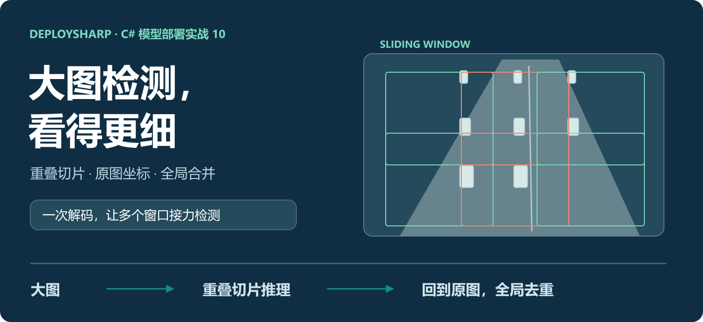
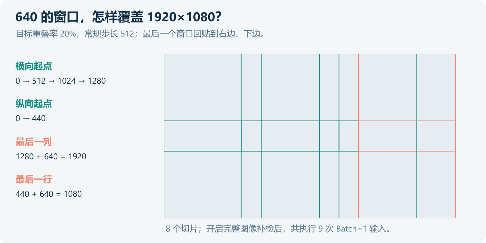
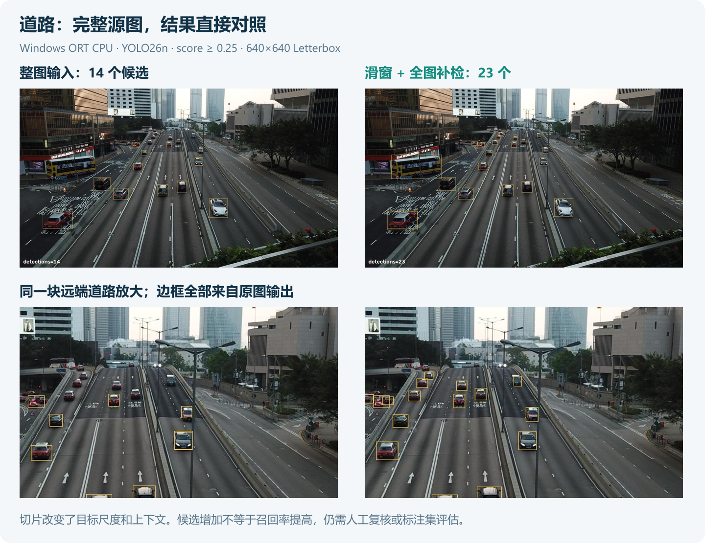
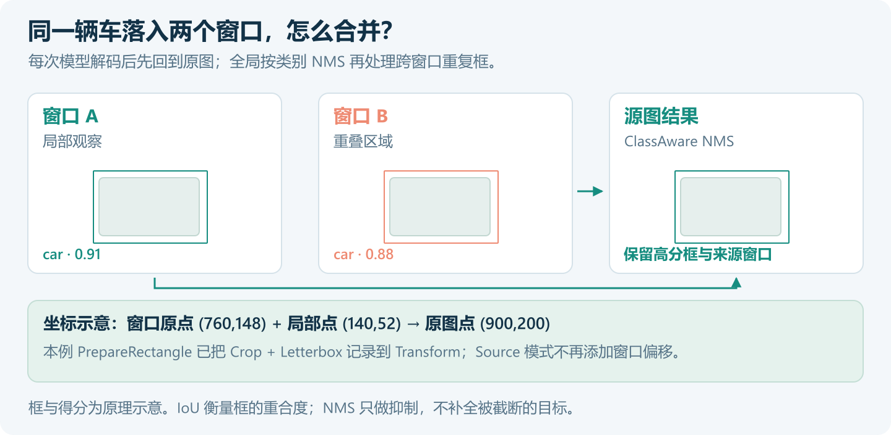
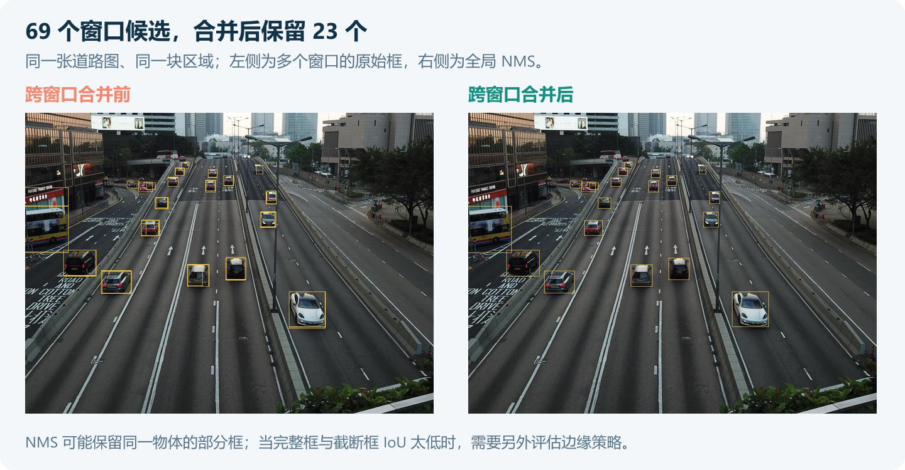
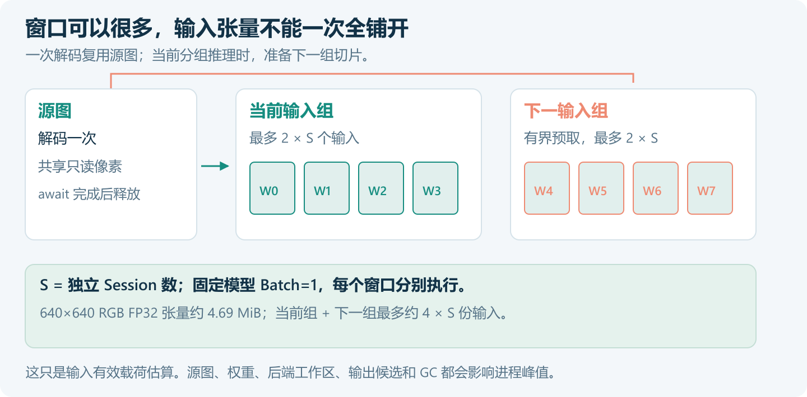
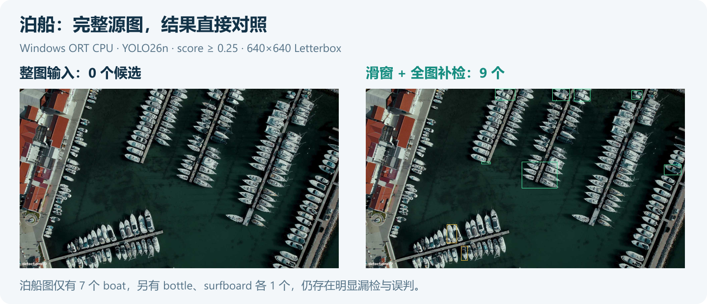
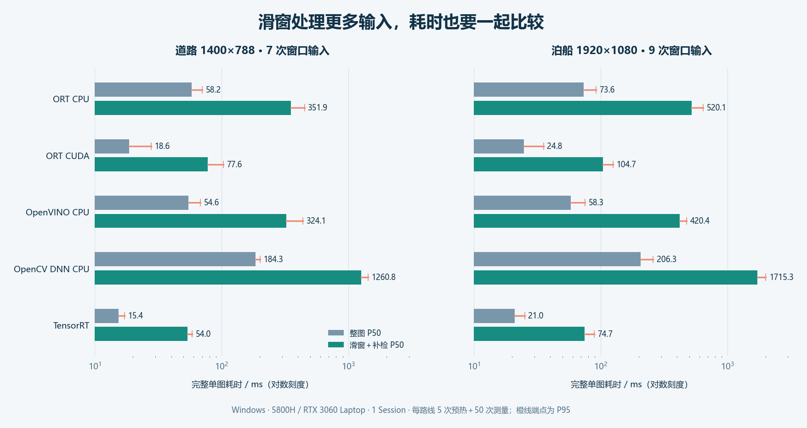
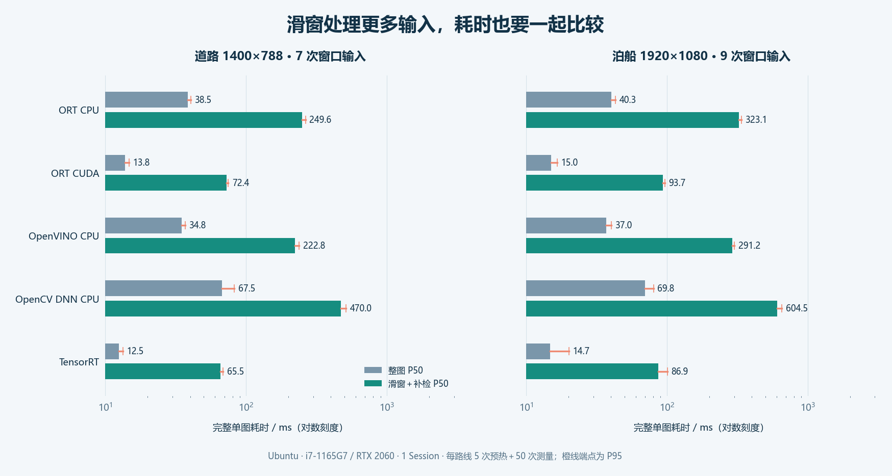

# 让大图检测看得更细：DeploySharp 滑动窗口实战

> 基于 DeploySharp 2.0.0 正式 NuGet；库源码 Tag：`v2.0.0`；创建日期：2026-11-09。



## 一、DeploySharp 项目简介

DeploySharp 是面向 C#/.NET 应用的模型部署工具，由作者维护，按 Apache License 2.0 开源。它把模型加载、图像处理、后端推理和结果解码组织成统一接口，支持 ONNX Runtime、OpenVINO、TensorRT、OpenCV DNN 等推理引擎，覆盖目标检测、分类、分割、关键点、OCR、文档分析等任务，也支持自定义模型和前后处理。

2.0 增加了独立 Session 池、批量调度、异步预取、ROI 和滑动窗口。前两篇分别介绍连续帧调度和区域处理，这次继续解决一个常见问题：**图片很大，目标很小，整图缩放后检测不出来怎么办？**

```text
GitHub：
https://github.com/guojin-yan/DeploySharp

正式版源码：
https://github.com/guojin-yan/DeploySharp/tree/v2.0.0

NuGet：
https://www.nuget.org/profiles/JYPPX

本篇完整工程：
https://github.com/guojin-yan/DeploySharp/tree/DeploySharpV2.0/docs/blog/2.0.0/2026-11/examples/10-sliding-window
```

本文使用 YOLO26n、两张真实图片和正式 NuGet 工程，从窗口规划开始，完成重叠切片、并发推理、坐标还原、跨窗口合并和性能对照。后端仍由配置选择，业务代码共用一套。

## 二、大图缩小之后，小目标还剩几个像素

以一张 1920×1080 图片为例，整图 Letterbox 到 640×640 时，图像内容的缩放比例约为 1/3。原本 18 像素宽的小目标，只剩约 6 像素。模型看到的细节少了，降低置信度门槛也不能把丢掉的细节补回来。

滑动窗口把源图分成多个区域，分别送入模型。窗口选为 640×640 时，大部分切片无需缩小，小目标在模型输入里会占据更多像素。相邻切片保留重叠区域，减少目标刚好落在切口上的影响。



图中一共 8 个切片。再加一次全图补检，就是 9 次模型输入。**滑窗增加了局部观察，也增加了计算量。** 它适合大图小目标、巡检截图、工业表面检测等场景，是否值得启用，要把结果变化和耗时放在一起看。

先看本例道路图。两边使用同一个模型、同一置信度阈值，左边整图推理，右边重叠切片加全图补检。下方放大的是同一块远端道路，检测框直接取自程序输出。



整图保留 14 个候选，滑窗合并后保留 23 个。这里没有人工标注，候选增加不能换算成召回率；右图仍需检查漏检、误判和重复框。后面也会保留一张效果不理想的泊船图，看看滑窗解决不了什么。

## 三、准备工程、模型和图片

### 3.1 按运行场景安装

随文工程使用 .NET 10、x64，所有 DeploySharp 包固定为正式版 `2.0.0`。只使用 OpenCV 处理图像、ORT CPU 推理时，从下面的组合开始：

```powershell
dotnet new console -n SlidingDemo -f net10.0
cd SlidingDemo
dotnet add package JYPPX.DeploySharp.Visual.OpenCV --version 2.0.0
dotnet add package JYPPX.DeploySharp.Backend.OnnxRuntime --version 2.0.0
dotnet add package Microsoft.ML.OnnxRuntime --version 1.28.0
```

OpenCV 图像处理原生包按系统选择一个：

| 系统 | 原生包 |
| --- | --- |
| Windows x64 | `JYPPX.OpenCV.runtime.win-x64 5.0.0` |
| Ubuntu 22.04 x64 | `JYPPX.OpenCV.runtime.ubuntu.22.04-x64 5.0.0` |

例如 Windows：

```powershell
dotnet add package JYPPX.OpenCV.runtime.win-x64 --version 5.0.0
```

滑窗运行器在 `JYPPX.DeploySharp.Visual` 中，`Visual.OpenCV` 已经引用它，不需要再找一个“滑窗包”。切换推理引擎时，再添加对应后端：

| 需求 | DeploySharp 后端包 | 配套运行环境 |
| --- | --- | --- |
| OpenVINO CPU | `JYPPX.DeploySharp.Backend.OpenVINO` | Windows `OpenVINO.runtime.win 2026.2.1`；Ubuntu `OpenVINO.runtime.ubuntu.22-x86_64 2026.3.1` |
| OpenCV DNN CPU | `JYPPX.DeploySharp.Backend.OpenCV` | 共用上述 OpenCV 原生包 |
| ORT CUDA | 仍用 `JYPPX.DeploySharp.Backend.OnnxRuntime` | 匹配的 ORT GPU native、CUDA、cuDNN |
| TensorRT | `JYPPX.DeploySharp.Backend.TensorRT` | 匹配 TRT 主版本的 Bridge、TensorRT 本体及 CUDA |

完整工程已配置这些依赖，并根据目标 RID 选择 Windows 或 Ubuntu 原生包。直接下载随文工程即可；从空工程开始时，把其中的 `DemoRuntime.cs` 等文件一并加入，下面的代码片段只展开滑窗相关调用。

### 3.2 使用自己的模型，也从输入输出合同开始

本例模型为 YOLO26n，合同如下：

| 项目 | 设置 |
| --- | --- |
| 输入 | `images`，Float32，`[1,3,640,640]`，NCHW |
| 输出 | `output0`，Float32，`[1,300,6]`，端到端检测框 |
| 前处理 | RGB、Letterbox、像素除以 255、补边 114 |
| 类别与阈值 | COCO80，score ≥ 0.25 |
| 跨窗口合并 | 按类别 NMS，IoU=0.45，最终最多 1000 个框 |

Windows 下载模型：

```powershell
New-Item -ItemType Directory -Force models | Out-Null
curl.exe -L --fail https://github.com/guojin-yan/DeploySharp/releases/download/models-visual.1/yolo-v26-detect-n.model.onnx -o models/yolo26n.onnx
```

Ubuntu 使用同一个地址，把 `New-Item` 改为 `mkdir -p models`，`curl.exe` 改为 `curl`。直接给 `--model` 传入文件即可，不要求额外计算校验值。换成自己的模型时，还要调整输入尺寸、颜色与归一化、输出名称、类别和 Decoder。

两张输入图片已放在工程的 `demo-inputs` 中，保留原始尺寸：

| 文件 | 尺寸 | 场景与用途 |
| --- | --- | --- |
| `traffic.jpg` | 1400×788 | 多车道道路、远近车辆，观察切片前后的输出变化 |
| `boats.jpg` | 1920×1080 | 密集泊船，检查小目标、边缘和模型适用性 |

原始来源如下。道路图来自 MMDetection 的 `demo/large_image.jpg`，本例只重命名文件。

```text
https://github.com/open-mmlab/mmdetection/blob/main/demo/large_image.jpg
https://github.com/ultralytics/assets/blob/main/im/boats.jpg
```

### 3.3 先跑出一组完整结果

在随文工程目录执行：

```powershell
dotnet build -c Release
dotnet bin/Release/net10.0/SlidingDemo.dll --backend ort-cpu --compare
```

`--compare` 会多运行两组设置，方便对照重叠率和全图补检。输出目录大致如下：

```text
results/ort-cpu/
  results.json
  traffic/
    01-full.jpg               # 直接整图推理
    sliding-windows.jpg        # 窗口覆盖
    sliding-raw.jpg            # 合并前的窗口候选
    sliding-merged.jpg         # 全局 NMS 后
    no-full-merged.jpg         # 省略全图补检
    zero-overlap-merged.jpg    # overlap=0，尾窗仍可能重叠
    detections.json            # 每个窗口及最终框
  boats/
    ...
```

默认流程记录原始输出张量、窗口位置、类别、得分和来源窗口，绘图不修改检测结果。性能模式会关闭这部分观察记录。

## 四、一次解码，把窗口交给运行器

### 4.1 窗口尺寸是源图尺寸

滑窗的 `windowSize` 表示从源图中裁多大的区域，模型输入仍由 Profile 决定。两者都设为 640×640，便于本例观察小目标；也可以裁 1024×1024 再缩到模型输入，但目标会再次缩小。

下面的 `runtime` 是随文工程中已初始化的 `DemoRuntime`，包含后端注册、Profile、独立 Session 池和预处理配置：

```csharp
using JYPPX.DeploySharp.Geometry;
using JYPPX.DeploySharp.Visual;
using JYPPX.DeploySharp.Visual.OpenCV;

using var runtime = new DemoRuntime(
    "ort-cpu", Path.GetFullPath("models/yolo26n.onnx"),
    Path.GetFullPath("models/local.engine"),
    sessions: 1, threads: 2, trtApi: 10);

var factory = new OpenCvVisualInputFactory();
using var decoded = factory.DecodeForRois(
    OpenCvImageSource.FromFile(Path.GetFullPath("demo-inputs/traffic.jpg")));

var runner = new SlidingWindowDetectionRunner(runtime.Pipeline);
var options = new SlidingWindowDetectionOptions(
    windowSize: new VisualSize(640, 640),
    overlap: 0.20f,
    globalIouThreshold: 0.45f,
    nmsMode: DetectionNmsMode.ClassAware,
    maximumWindows: 128,
    maximumDetections: 1000,
    includeFullImagePass: true,
    coordinateMode: SlidingWindowCoordinateMode.Source,
    maximumPreparedPixels: 64_000_000);

SlidingWindowDetectionResult result = await runner.RunAsync(
    decoded.SourceSize,
    options,
    (window, token) => decoded.PrepareRectangle(
        new RectangleRoiGeometry(window.Bounds),
        "images", runtime.Preprocessing, token));

foreach (var item in result.DetectionsWithProvenance)
{
    var box = item.Detection.Box;
    Console.WriteLine(
        $"window={item.Window.Index}, " +
        $"{item.Detection.Label.Label}, " +
        $"({box.X:F1}, {box.Y:F1}, {box.Width:F1}, {box.Height:F1})");
}
```

`DecodeForRois` 只解码一次。每次准备回调复用同一张源图，裁出本窗口并生成输入。运行器负责释放回调返回的 Owned 输入；源图要一直保留到 `await` 完成，不能在回调仍使用它时提前释放。

### 4.2 重叠比例和边缘回贴

640 窗口、20% 重叠时，常规步长为 `640 × (1−0.2) = 512`。为覆盖右侧和下侧，最后一个窗口会回贴边缘。因此 1920×1080 的横向起点是 `0、512、1024、1280`，纵向起点是 `0、440`。

末尾实际重叠可能超过 20%。同理，`overlap=0` 也可能因为尾窗回贴产生重叠，不能据此省略跨窗口合并。API 还支持单独指定横向、纵向重叠，长条工件可按目标方向调整；本例命令行使用相同的两个方向比例。

### 4.3 坐标只还原一次

裁剪原点、Letterbox 比例和补边都参与坐标变换。本例 `PrepareRectangle` 把这些信息写入 Transform，模型 Decoder 已将框还原到完整源图，所以选择 `Source`。



| 坐标模式 | 适用输入 | 运行器怎样处理 |
| --- | --- | --- |
| `Source` | Decoder 已输出完整源图坐标 | 不再加窗口偏移 |
| `TileLocal` | Decoder 输出切片局部坐标 | 加窗口原点；准备输入的 SourceSize 必须是切片尺寸 |
| `Auto` | 根据准备输入的 SourceSize 判断 | 在局部与完整源图模式之间选择 |

已有完整源图 Transform 时，再写一次 `box.X += window.X`，就会把框移错位置。调试时先看窗口来源和 JSON 中的坐标，比只看最终画图更容易找到问题。

### 4.4 全局 NMS 怎样处理重复框

同一辆车可能被两个切片和一次整图补检同时检测到。运行器把结果放到同一坐标系，再执行 Non-Maximum Suppression（非极大值抑制，NMS），本例只在相同类别之间按 IoU 抑制重复框。



这张图的 69 个原始候选合并后保留 23 个。NMS 挑选高分框，不会把两个框拼成完整物体；完整框与截断框的 IoU 太低时，两者仍可能同时保留。当前路径没有 NMM、IoS 或加权框融合，边缘重复目标需要结合业务数据继续检查。

YOLO26 的单次输出已是端到端框，本例不再给单窗口额外套一次普通 YOLO NMS；上面的 NMS 用于合并不同输入的结果。即使只有一个窗口，全局 NMS 也可能进一步减少其候选。

## 五、全图补检、ROI 和有界调度

### 5.1 大目标需要保留完整上下文

切片能放大小目标，但也可能把整辆车或整个工件切开。`includeFullImagePass: true` 额外推理一次完整图像，将全图结果与切片结果一起合并。本例道路图的三组设置如下：

| 设置 | 模型输入次数 | 原始候选 | 最终保留 |
| --- | --- | --- | --- |
| overlap=0，无全图补检 | 6 | 47 | 22 |
| overlap=0.2，无全图补检 | 6 | 55 | 21 |
| overlap=0.2，加全图补检 | 7 | 69 | 23 |

本图两种重叠率恰好都生成 6 个切片，窗口位置不同，结果也不同。不能用“重叠越大、数量越多”选参数，应逐个检查目标完整性、重复框和误判，再决定是否保留补检。

### 5.2 只在指定 ROI 内滑窗

上一篇配置的 ROI 可以继续使用。整幅相机图很大，但业务只关心其中一个工作区时，先限定区域，再在区域内生成窗口：

```csharp
var geometry = new RectangleRoiGeometry(
    new RectangleF(250, 100, 900, 600));
var roi = new VisualRoi(
    "inspection", geometry,
    executionMode: RoiExecutionMode.SlidingWindow);

var regional = await runner.RunRoiAsync(
    decoded.SourceSize, roi, geometry, options,
    (window, token) => Task.FromResult(decoded.PrepareRectangle(
        new RectangleRoiGeometry(window.Bounds),
        "images", runtime.Preprocessing, token)));
```

这段代码接在上一节初始化之后。随文程序用下面的参数额外输出矩形 ROI 滑窗图，默认整图对照仍会执行：

```powershell
dotnet bin/Release/net10.0/SlidingDemo.dll --backend ort-cpu --sessions 2 --roi 250,100,900,600 --output results/roi
```

`RunRoiAsync` 的补检范围是 ROI 的外接区域。多边形、带孔 Mask 等不规则区域还要配合精确图像适配与结果过滤，窗口规划本身不能替代这些规则。多个 ROI 可用 `RunRoisAsync`，继续进行跨 ROI 合并。

### 5.3 窗口可以很多，输入不能全部堆进内存

当前运行器按 `2 × Session 数` 分组，并预取下一组。源图复用，已准备的切片有上限，CPU 可以在当前组推理时准备后续输入。



本例固定模型 Batch=1，`--sessions 2` 表示两个独立推理 Session，不是把输入改成 Batch=2。每份 640×640×3 的 FP32 张量约 4.69 MiB，按两组最多约 `4 × Session 数` 份估算输入有效载荷；源图、权重、工作区、输出和 GC 还会增加内存。

三个预算的含义也不同：

| 配置 | 限制的内容 |
| --- | --- |
| `maximumWindows` | 总窗口数，包含补检；超出时在准备回调前拒绝 |
| `maximumPreparedPixels` | 所有源窗口的面积之和，包含重叠和补检；单位为像素 |
| `maximumDetections` | 全局 NMS 后的最终结果数量 |

像素预算不是显存上限，最终结果上限也不是全部原始候选的内存上限。Session 越多，权重与后端工作区也可能更多，应从 1 个开始测试。

## 六、真实结果：窗口有效，模型也要选对

Windows、Ubuntu 的 ORT CPU、ORT CUDA、OpenVINO CPU、OpenCV DNN CPU、TensorRT，共十条路径均已运行两张图。默认设置结果一致：

| 图片 | 整图候选 | 切片＋补检输入次数 | 合并前候选 | 最终保留 |
| --- | --- | --- | --- | --- |
| 道路 1400×788 | 14 | 7 | 69 | 23 |
| 泊船 1920×1080 | 0 | 9 | 10 | 9 |

除了检查数量，还检查了每个窗口的 `[1,300,6]` 输出形状、全部原始输出有限值、源图边界与窗口覆盖。以 Windows ORT CPU 为基线，跨设备、跨后端按类别做逐框一对一匹配，坐标容差 0.5 像素、score 容差 0.001，本次均通过。另在 ORT CPU 上验证 1/2 Session 输出一致、矩形 ROI、单窗口覆盖，以及窗口与累计像素预算拒绝。

泊船图需要单独看结果：



滑窗最终保留了 9 个框，但其中只有 7 个类别为 boat，另外两个被判成 bottle、surfboard，图上也有大量船只没有检出。**把 COCO 模型放到密集俯视泊船图上，仅靠切片还不够。** 工程上应进一步选择适合俯视场景的模型、调整训练数据和窗口尺度，再用标注集测量准确率。

这也是保留两种输入的原因：道路图展示局部观察带来的变化，泊船图说明模型与场景不匹配时，滑窗仍有边界。

## 七、整图和滑窗，时间差多少

### 7.1 统一测完整单图处理时间

本轮 Windows 设备为 Ryzen 7 5800H、16 个逻辑处理器、RTX 3060 Laptop 6 GB，Windows 11（Build 26200），SDK 10.0.401，运行时 .NET 10.0.12。原生环境为 ORT 1.28.0、OpenCV 5.0.0、OpenVINO 2026.2.1、TensorRT 10.11.0.33、CUDA 12.9、cuDNN 9.22、驱动 576.02。

每张图、每条路线预热 5 次，再测量 50 次；整图和滑窗交错运行。均为 1 Session，CPU 推理线程参数为 2，模型为 FP32，ORT CUDA/TensorRT 关闭 TF32。测试包含一次 JPG 解码、准备输入、数据传输、完成推理、结果解码、坐标合并、全局 NMS 和释放，不含磁盘 I/O、绘图、模型加载与 Engine 构建。

这里的滑窗使用通用 OpenCV CPU 前处理和 CPU 合并，没有启用 GPU 专用图像准备或设备端 NMS。准备与推理存在重叠，不能把各阶段或各切片的 P50 直接相加得到总 P50。



下表均为 **P50 / P95，单位 ms**：

| 执行路径 | 道路：整图 | 道路：滑窗＋补检 | 泊船：整图 | 泊船：滑窗＋补检 |
| --- | --- | --- | --- | --- |
| ORT CPU | 58.18 / 70.35 | 351.88 / 451.00 | 73.64 / 91.67 | 520.14 / 641.52 |
| ORT CUDA | 18.65 / 27.87 | 77.62 / 102.79 | 24.84 / 35.46 | 104.67 / 125.41 |
| OpenVINO CPU | 54.63 / 68.10 | 324.15 / 438.49 | 58.30 / 75.17 | 420.42 / 477.92 |
| OpenCV DNN CPU | 184.34 / 200.86 | 1260.80 / 1424.61 | 206.30 / 258.97 | 1715.30 / 2007.18 |
| TensorRT | 15.40 / 17.16 | 54.02 / 58.65 | 20.95 / 25.12 | 74.73 / 88.69 |

道路图在 TensorRT 上，从整图 15.40 ms 增加到滑窗 54.02 ms，处理了 7 次模型输入，保留的候选也由 14 个变成 23 个。对这一场景，应该判断新增候选是否有业务价值，再决定是否承担额外耗时。

**本次设备上还有其他任务运行，没有锁频；以上数据用于程序和方案对照，不代表设备极限。欢迎在自己的电脑上使用同一工程复测。**

### 7.2 内存同样需要看

道路图的平均托管分配，ORT CPU 整图约 4.72 MiB、滑窗约 33.08 MiB；TensorRT 整图约 9.45 MiB、滑窗约 66.03 MiB。它们是一次处理过程中的累计分配量，不是同时驻留的内存，也不包含 native/GPU 分配。

对应进程累计峰值工作集，ORT CPU 约 266.56 MiB，TensorRT 约 508.84 MiB。这是各后端整个测试进程的累计峰值，不能拆成整图或滑窗的独立峰值。程序还保存测前/测后的 GPU 状态，但两次采样不能代表过程显存峰值。

复制到新设备后，可用同一入口生成自己的原始样本和统计：

```powershell
dotnet bin/Release/net10.0/SlidingDemo.dll --backend ort-cpu --benchmark --warmup 5 --iterations 50 --revision your-commit --output results/benchmark-ort
```

`benchmark.json` 包含 mean、P50、P95、最小值、最大值、分组阶段时间、分配与每次原始样本，模型和图片身份由程序自动记录。切换后端时保持模型、窗口、重叠率、补检与 Session 设置一致。

## 八、Windows GPU 与 Ubuntu 运行

### 8.1 ORT CUDA：Managed 与 native 使用同版本

CUDA 12 环境选择官方 ORT 1.28.0 CUDA 12 发行包，不能把不匹配的 provider DLL 混进输出目录。完整工程的 `OrtCuda12NativeDir` 会切换到 Managed 引用并复制完整 native 集合。

```text
Windows CUDA 12：
https://github.com/microsoft/onnxruntime/releases/download/v1.28.0/onnxruntime-win-x64-gpu_cuda12-1.28.0.zip

Ubuntu CUDA 12：
https://github.com/microsoft/onnxruntime/releases/download/v1.28.0/onnxruntime-linux-x64-gpu_cuda12-1.28.0.tgz
```

Windows 把发行包解压到工程 `runtime` 下，在当前 PowerShell 中给 `$cudaLib`、`$cudnnLib`、`$trtLib` 设置实际 DLL 目录，再执行：

```powershell
$env:PATH = "$cudaLib;$cudnnLib;$trtLib;" + $env:PATH
dotnet build -c Release -o bin/cuda12 -p:OrtCuda12NativeDir=runtime/onnxruntime-win-x64-gpu_cuda12-1.28.0/lib
dotnet bin/cuda12/SlidingDemo.dll --backend ort-cuda --compare
dotnet bin/cuda12/SlidingDemo.dll --backend tensorrt --trt-api 10 --compare
```

TensorRT 首次没有 Engine 时，由正式库 Builder 在当前设备构建；Engine 创建不计入上一节稳态时间。换 GPU、模型或 TensorRT 版本后，使用新 Engine 路径重新构建，不直接复制另一台机器的 Engine。

### 8.2 Ubuntu：源代码构建或自包含交付

Ubuntu 22.04 使用同一组图片和 ONNX。先准备 OpenCV 编解码依赖，再构建 CPU 版本：

```bash
sudo apt-get install libopenexr25 libilmbase25 libglib2.0-0 libgl1
dotnet build -c Release
export LD_LIBRARY_PATH="$PWD/bin/Release/net10.0/native/opencv:$PWD/bin/Release/net10.0/native/openvino:${LD_LIBRARY_PATH:-}"
dotnet bin/Release/net10.0/SlidingDemo.dll --backend ort-cpu --compare
dotnet bin/Release/net10.0/SlidingDemo.dll --backend openvino --compare
dotnet bin/Release/net10.0/SlidingDemo.dll --backend opencv --compare
```

目标机没有 .NET SDK 时，也可以在开发机发布 Linux 自包含目录：

```powershell
dotnet publish -c Release -r linux-x64 --self-contained true -o publish/linux-x64
```

将 `publish/linux-x64`、`models`、`demo-inputs` 一起复制到目标机，保持在工程根目录运行：

```bash
chmod +x publish/linux-x64/SlidingDemo
export LD_LIBRARY_PATH="$PWD/publish/linux-x64/native/opencv:$PWD/publish/linux-x64/native/openvino:${LD_LIBRARY_PATH:-}"
./publish/linux-x64/SlidingDemo --backend ort-cpu --compare
```

本轮 Ubuntu 实际使用这条自包含交付路线，不要求目标机安装 SDK。系统库仍需要准备，缺少 `libIlmImf-2_5.so.25` 或 `libImath-2_5.so.25` 时，先检查 OpenEXR/IlmBase，不能只复制托管 DLL。

Ubuntu GPU 运行时，解压同版本 ORT CUDA 12 发行包，设置实际 `CUDA_HOME`、`CUDNN_HOME` 和 TensorRT 库目录，再构建独立输出：

```bash
dotnet build -c Release -o bin/cuda12 -p:OrtCuda12NativeDir="$PWD/runtime/onnxruntime-linux-x64-gpu_cuda12-1.28.0/lib"
export LD_LIBRARY_PATH="$PWD/bin/cuda12:$PWD/bin/cuda12/native/opencv:$PWD/bin/cuda12/native/openvino:$CUDA_HOME/lib64:$CUDNN_HOME/lib:$TENSORRT_HOME/lib:${LD_LIBRARY_PATH:-}"
dotnet bin/cuda12/SlidingDemo.dll --backend ort-cuda --compare
dotnet bin/cuda12/SlidingDemo.dll --backend tensorrt --trt-api 11 --compare
```

### 8.3 Ubuntu 实跑与时间对照

Ubuntu 设备为 22.04.5 LTS、i7-1165G7（8 逻辑处理器）、RTX 2060 6 GB、驱动 580.178.04。自包含程序使用 .NET 10.0.12，ORT 1.28.0 CUDA 12、OpenVINO 2026.3.1、OpenCV 5.0.0、TensorRT 11.0.0.114 / Bridge 4.0.0。

这台设备原有 CUDA 工具链为 12.6.3，cuBLAS 12.6.4.1、cuDNN 9.10.2.21。首次加载 ORT CUDA 12 provider 时提示缺少 `cudaLibraryGetKernel`，补入官方 CUDA Runtime 12.9.79，并将它的库目录放到当前进程搜索路径最前面后通过。没有更换模型或降低到 CPU，也没有修改其他任务的全局 CUDA 环境。

| 执行路径 | 道路：整图 P50/P95 | 道路：滑窗＋补检 P50/P95 | 泊船：整图 P50/P95 | 泊船：滑窗＋补检 P50/P95 |
| --- | --- | --- | --- | --- |
| ORT CPU | 38.48 / 40.58 | 249.63 / 264.21 | 40.26 / 43.14 | 323.08 / 339.61 |
| ORT CUDA | 13.77 / 14.74 | 72.43 / 74.56 | 15.02 / 16.62 | 93.67 / 96.74 |
| OpenVINO CPU | 34.82 / 36.99 | 222.81 / 238.24 | 36.96 / 40.40 | 291.17 / 300.99 |
| OpenCV DNN CPU | 67.50 / 82.48 | 470.03 / 513.97 | 69.76 / 80.32 | 604.47 / 655.03 |
| TensorRT | 12.53 / 13.35 | 65.47 / 68.79 | 14.74 / 20.05 | 86.93 / 100.89 |

单位均为 ms，沿用 5 次预热、50 次测量和第七节的完整计时范围。Session=1，线程参数=2，输入、阈值、窗口和补检相同；两张图的窗口原始候选、全局结果均与 Windows 基线做了逐框核对。



Ubuntu CPU governor 为 powersave，Turbo 开启；GPU 未主动锁频，GPU 两条路径的测前/后采样为 P0、核心 1005 MHz、显存 5500 MHz，不能据此认为全程频率固定。两台设备的 CPU、运行时版本和负载不同，表格用于复现各自的方案，不据此给显卡或操作系统排名。

## 九、怎样把参数落到自己的项目上

开始时先保留一条直接整图路线，选几张有远近目标、边缘目标和密集区域的图片，再增加 640 窗口、20% 重叠与全图补检。逐个检查新增框、截断框、重复框和误判，确认有收益后再测完整耗时。

| 遇到的问题 | 优先检查 |
| --- | --- |
| 小目标仍然漏检 | 模型是否适合场景、裁剪后目标尺度、训练数据；不能只降低阈值 |
| 大物体被切断 | 窗口是否过小，是否需要全图补检或更大的窗口 |
| 边缘出现重复框 | 还原坐标是否正确，完整框与截断框 IoU 是否足够，NMS 是否按类别 |
| 框整体偏移 | Crop/Letterbox 的 Transform 是否完整，是否重复添加窗口偏移 |
| 输入数突然变多 | 重叠率、窗口尺寸和尾窗；设置窗口数与累计像素预算 |
| CPU 或 GPU 占用高、尾延迟增加 | 先减少 Session，检查线程竞争、源图解码和其他设备任务 |
| 想把此接口用于分割或旋转框 | 当前运行器接收目标检测结果，实例 Mask、Pose、OBB 需要各自的跨切片合并策略 |

本篇完成了整图与重叠切片对照、源图坐标还原、全局去重、ROI 内滑窗、独立 Session 与完整时间测量。下一篇继续看 TensorRT 的 Engine、CUDA 前后处理和数据复用，分析怎样减少这条流程中额外的数据搬运。

```text
项目：
https://github.com/guojin-yan/DeploySharp

异步与滑窗使用指南：
https://github.com/guojin-yan/DeploySharp/blob/DeploySharpV2.0/docs/articles/visual-async-and-sliding-window.md

设备性能实测：
https://github.com/guojin-yan/DeploySharp/blob/DeploySharpV2.0/docs/articles/device-performance-benchmarks.md

问题反馈：
https://github.com/guojin-yan/DeploySharp/issues
```
