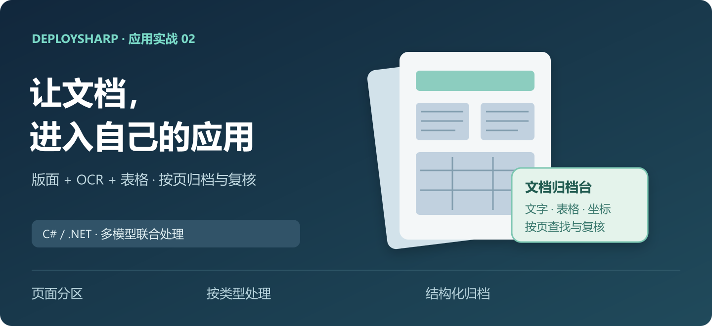
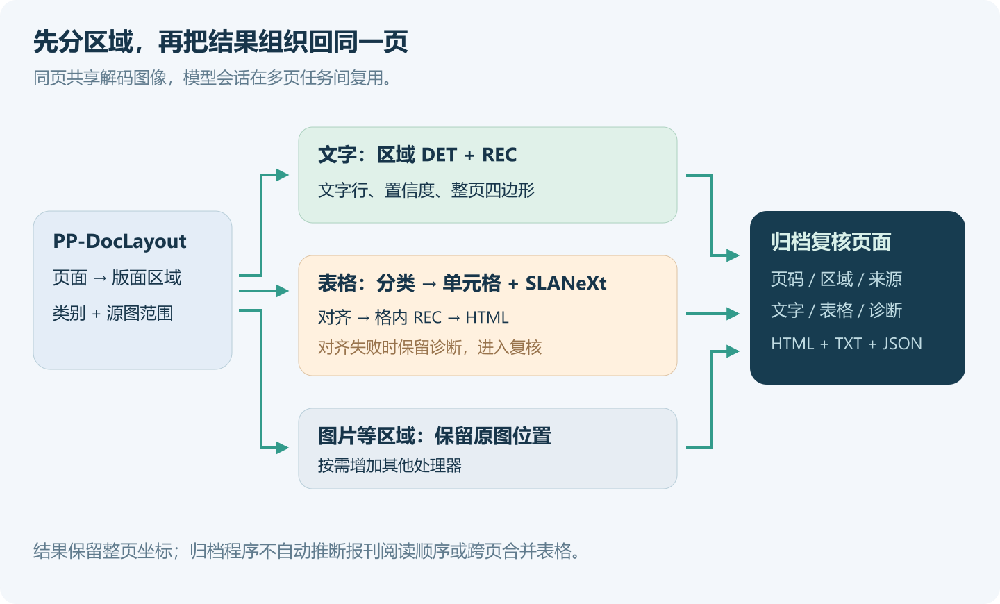
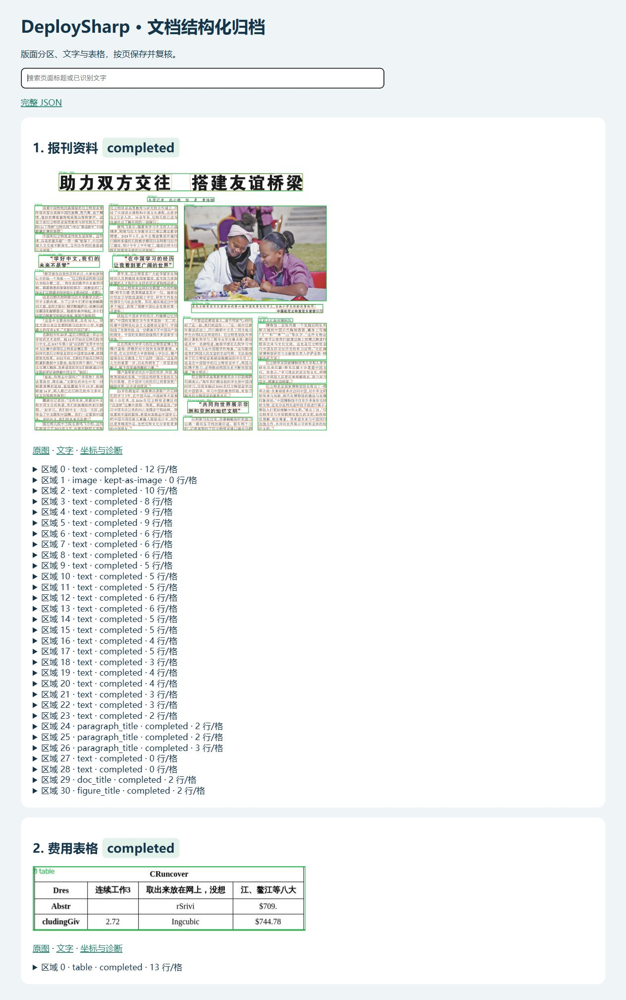
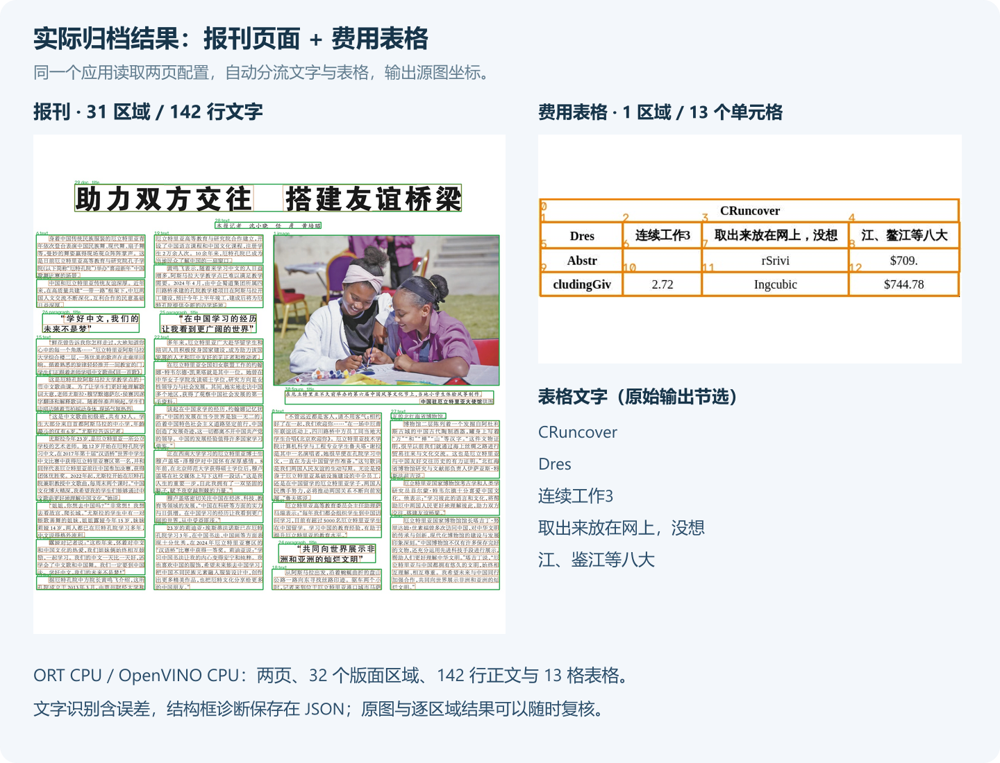

# DeploySharp 应用实战二：版面 + OCR + 表格，用 C# 做文档结构化归档

> DeploySharp 2.0.0 应用系列 · 第 02 篇，使用正式 NuGet `2.0.0`。



## 一、DeploySharp 项目简介

**DeploySharp** 是一个面向 **C#/.NET 开发者**的开源模型部署框架，由「椒颜皮皮虾」开发，项目源码遵循 **Apache License 2.0**。项目封装了 **ONNX Runtime、OpenVINO、TensorRT、OpenCV DNN** 等推理引擎，提供模型加载、图像前处理、推理和结果后处理接口，方便大家在桌面软件、工业视觉和文档应用中部署模型。

目前项目接入了目标检测、分类、分割、关键点、旋转框、异常检测、背景移除等视觉任务，也提供 **PP-OCRv4/v5/v6、PP-Structure 文档处理**及部分图文和本地语言模型入口。2.0 版本增加了按需安装的 NuGet 包、Batch、独立 Session 池、异步输入、ROI 和大图切片，便于按应用需要组合模型。

```text
项目源码：
https://github.com/guojin-yan/DeploySharp/tree/DeploySharpV2.0

NuGet（搜索 JYPPX.DeploySharp）：
https://www.nuget.org/packages?q=JYPPX.DeploySharp
```

应用系列第一篇用 NanoDet + CLIP 做园区巡检。这一篇换成文档场景：**将一批页面变成可以查询、查看原图和打开表格的归档结果**。基础第 06 篇已经介绍过各模型的使用，这里把它们接成一个程序，由配置决定处理哪些页面，再按版面类型自动分流。

## 二、这个归档程序要解决什么问题

### 2.1 保存文字，还要保留它来自哪里

整理报刊、扫描资料或费用表时，经常需要把识别文字导入业务系统。只有一份 TXT，后续发现错误时还得重新翻原图；表格如果直接按行拼字符串，列关系也会丢失。

这个案例同时保存**内容、结构和来源**：每页有稳定 ID，每个区域保留类别与原图范围，文字保留四边形和置信度，表格另外保存 HTML、单元格和诊断。最后用一个本地 HTML 页面把这些结果串起来。



| 环节 | 使用的模型或代码 | 输出 |
| --- | --- | --- |
| 页面分区 | PP-DocLayout-L | 标题、正文、图片、表格等区域 |
| 文字区域 | PP-OCRv5 Mobile DET + REC | 段落内文字行、置信度和整页坐标 |
| 表格分型 | PP-LCNet 表格分类 | wired / wireless 模型选择 |
| 单元格定位 | RT-DETR cell | 独立的单元格范围 |
| 结构恢复 | SLANeXt | 行列和单元格结构 |
| 文字填充 | 对齐器 + REC | 带文字的表格 HTML |
| 归档与复核 | C# 应用层 | HTML 索引、TXT、JSON 和结果图 |

程序按配置顺序逐页处理。文字类区域进入区域 DET + REC；`table` 区域进入表格路径；图片等其他区域保留类型和坐标，供界面定位。

### 2.2 先看最终效果

默认任务有两页：一张多栏报刊、一张费用表格。执行完成后打开 `results/ort-cpu/index.html`，可以搜索标题或已识别文字，再展开区域，查看原图、文字、坐标和表格。



这个页面是程序生成的静态文件，不需要数据库或 Web 服务。后续接入 WPF、WinForms 或自己的管理平台时，可以读取相同的 `archive.json` 和逐页 JSON，换成业务界面。

## 三、准备工程与 NuGet 依赖

### 3.1 随文完整工程

```text
https://github.com/guojin-yan/DeploySharp/tree/DeploySharpV2.0/docs/blog/2.0.0/applications/2026-10/examples/02-document-archive
```

```text
02-document-archive/
  DocumentArchive.csproj   # 正式 NuGet，按系统选原生包
  Program.cs              # 参数、后端、取消和退出码
  DocumentArchive.cs      # 多页、区域分流、表格、输出页面
  OcrService.cs           # 复用一套 DET + REC
  PageRoiOcrInput.cs      # ROI 检测与整页识别共享输入
  documents.json          # 页面清单
  demo-inputs/            # 两张官方示例图及来源
  models/                 # 自行下载的模型
  results/                # 程序输出
```

需要 .NET 10 SDK、x64 进程。随文工程同时配置 ONNX Runtime（ORT）CPU 和 OpenVINO CPU，使用时通过 `--backend` 切换。

### 3.2 按场景安装

自己创建 ORT CPU 工程时，先装图像层、后端和 ORT：

```powershell
dotnet new console -n DocumentArchive -f net10.0
cd DocumentArchive
dotnet add package JYPPX.DeploySharp.Visual.OpenCV --version 2.0.0
dotnet add package JYPPX.DeploySharp.Backend.OnnxRuntime --version 2.0.0
dotnet add package Microsoft.ML.OnnxRuntime --version 1.28.0
```

`.csproj` 设置 `<PlatformTarget>x64</PlatformTarget>`，原生包按系统选择。需要 OpenVINO 时再增加对应后端和运行时：

| 使用场景 | 额外安装 |
| --- | --- |
| Windows x64 的图像处理 | `JYPPX.OpenCV.runtime.win-x64 5.0.0` |
| Ubuntu 22.04 x64 的图像处理 | `JYPPX.OpenCV.runtime.ubuntu.22.04-x64 5.0.0` |
| 增加 OpenVINO | `JYPPX.DeploySharp.Backend.OpenVINO 2.0.0` |
| Windows OpenVINO | `OpenVINO.runtime.win 2026.2.1` |
| Ubuntu OpenVINO | `OpenVINO.runtime.ubuntu.22-x86_64 2026.3.1` |

使用完整工程只需执行 `dotnet restore`，其中已配置条件选包和 Linux 原生文件复制。只用 ORT 的业务项目，可以一起删除 OpenVINO 包、复制项及 `Program.cs` 中的注册分支。

## 四、准备模型与页面清单

### 4.1 模型按文件下载

所有文档模型都在 `models-paddleocr` Release 中。默认两页使用有线表格，所需文件如下：

| 模型文件 | 职责 |
| --- | --- |
| `pp-doclayout-l.onnx` | 版面检测 |
| `ppocrv5-mobile-det.onnx` | 文字行检测 |
| `ppocrv5-mobile-rec.onnx`、`ppocrv5_dict.txt` | 文字识别与字典 |
| `pp-lcnet-x1-0-table-cls.onnx` | 表格分类 |
| `rt-detr-l-wired-cell-det.onnx` | 有线表格单元格检测 |
| `slanext-wired.onnx` | ORT 表格结构 |
| `slanext-wired-openvino-compat.onnx` | OpenVINO 表格结构兼容图 |

```text
模型 Release：
https://github.com/guojin-yan/DeploySharp/releases/tag/models-paddleocr
```

在工程目录运行：

```powershell
New-Item -ItemType Directory -Force models | Out-Null
$release = 'https://github.com/guojin-yan/DeploySharp/releases/download/models-paddleocr'
$files = @('pp-doclayout-l.onnx','ppocrv5-mobile-det.onnx','ppocrv5-mobile-rec.onnx','ppocrv5_dict.txt',
  'pp-lcnet-x1-0-table-cls.onnx','rt-detr-l-wired-cell-det.onnx','slanext-wired.onnx','slanext-wired-openvino-compat.onnx')
foreach ($file in $files) { Invoke-WebRequest "$release/$file" -OutFile "models/$file" }
```

Ubuntu 的 Bash 下载命令放在随文 README，也可以从浏览器逐文件下载。已有本地文件直接复制；只运行一个后端时，可以省去另一个 SLANeXt 文件。

无线表格需另外准备 `rt-detr-l-wireless-cell-det.onnx`、`slanext-wireless.onnx` 或 OpenVINO 对应兼容图。程序按分类结果选模型，缺少文件会记录失败信息。

### 4.2 两张图片和自己的输入

示例图片已在 `demo-inputs` 中，分别是 PaddleX 公开的多栏页面和表格。原始地址如下，图片使用遵循其来源条件：

```text
https://paddle-model-ecology.bj.bcebos.com/paddlex/imgs/demo_image/pp_structure_v3_demo.png
https://paddle-model-ecology.bj.bcebos.com/paddlex/imgs/demo_image/table_recognition.jpg
```

`documents.json` 定义页面顺序和输入：

```json
{
  "Pages": [
    { "Id": "news", "Title": "报刊资料", "Image": "demo-inputs/news-page.png", "Kind": "auto" },
    { "Id": "expenses", "Title": "费用表格", "Image": "demo-inputs/expense-table.jpg", "Kind": "auto" }
  ]
}
```

`Image` 相对配置文件目录解析。`Id` 唯一，使用小写字母、数字和短横线；它同时决定输出子目录。`Kind=auto` 先运行版面模型；已经裁好的表格可以指定 `Kind=table`，省去版面检测。

默认配置的两页都走 `auto`，第二页由版面模型检出表格后进入完整表格路径。PDF 需要先渲染成页面图，再按页加入清单。

## 五、从版面区域进入文字与表格处理

### 5.1 一页解码，多区域共享

每页先用 `DecodeForRois` 解码，模型会话则放到应用生命周期中复用。页面内的前处理从同一份像素创建张量，避免每个区域先存图、再重新读取。

```csharp
var source = OpenCvImageSource.FromFile(path);
using var image = new OpenCvVisualInputFactory().DecodeForRois(source, token);
```

这里的解码图像在整页处理结束后释放。保存原图和绘制预览会另读一次图片；模型输入仍共享前面这份解码结果。

`DocumentArchive.InferAsync` 按模型文件缓存 `VisualPipeline`。同一批中遇到第二个标题、第二张表格或下一页时，直接复用已经创建的会话。

### 5.2 按类别分流

版面模型返回源图范围后，程序先裁到合法图像范围，再决定执行路径。下面摘自完整工程的分流逻辑：

```csharp
if (region.Category == "table")
{
    outputs.Add(await RunTableAsync(
        index, pageIndex, image, original, bounds, tableDir, token));
}
else if (TextLabels.Contains(region.Category))
{
    var text = await Ocr.RecognizeAsync(image, bounds, token);
    // 完整实现将文字、置信度、整页四边形写入 ArchiveRegion。
}
```

`TextLabels` 包含正文、文档标题、段落标题、页眉页脚等文字类。其他类别标记为 `kept-as-image`，仍保存类别和原图范围。

### 5.3 区域内 DET + REC，坐标仍属于整页

一个正文区域可能含多行文字，先运行 DET，再按四边形裁文字行送入 REC。`OcrService` 复用一套 v5 Mobile 模型，识别 Batch 上限为 16，区域上限为 512。

```csharp
var detectionInput = image.PrepareRectangle(
    new RectangleRoiGeometry(bounds),
    _detection.VisualProfile.Input.Name, settings, token);

using var input = new PageRoiOcrInput(image, detectionInput);
return await Pipeline.RunAsync(input, cancellationToken: token);
```

这段代码来自 `OcrService.RecognizeAsync`，`settings` 根据 ROI 尺寸生成。`PrepareRectangle` 保存 ROI 的位置与缩放变换，检测 Decoder 将文字框还原到整页。`PageRoiOcrInput` 把这份检测输入与整页识别视图组合起来，让 REC 直接按整页四边形裁图。

区域先后和行内 `Y/X` 排序用于展示。多栏报刊的完整阅读顺序还需要增加栏序和段落关联逻辑，当前保存的区域类型与坐标可作为输入。

## 六、表格区域怎样恢复为带文字的 HTML

### 6.1 分类、位置和结构分别处理

LCNet 先判断有线或无线表格，随后选择对应的单元格模型与 SLANeXt。

RT-DETR cell 给出独立单元格位置；SLANeXt 给出行列与单元格结构；REC 识别格内文字。三个结果最终通过结构索引对应起来。

本例对文档模型统一使用 ROI 的 `PrepareRectangle`。对于需要几何辅助输入的模型，在实际张量准备后绑定 `im_shape/scale_factor`：

```csharp
using var input = image.PrepareRectangle(
    new RectangleRoiGeometry(bounds), profile.VisualProfile.Input.Name,
    profile.VisualProfile.Preprocessing!.ToOpenCvOptions(), token);
using var geometry = profile.VisualProfile.AuxiliaryInputs.Count == 0
    ? null
    : OpenCvPaddleDocumentPreprocessing.RebindWithGeometryInputs(input, profile);
return await pipeline.RunAsync(geometry ?? input, cancellationToken: token);
```

`profile`、`pipeline` 和 `bounds` 均由完整工程的 `InferAsync` 提供。ROI 的变换保留整页偏移，模型输出经 Decoder 后仍处于整页坐标。表格裁剪图另外保存为 `crop.png`，供复核使用。

### 6.2 对齐后再填充文字

`PaddleDocumentTableCellAligner.Align` 检查结构、格子数、来源页和几何关系，再建立结构槽位与检测框的对应。

```csharp
var alignment = PaddleDocumentTableCellAligner.Align(
    tableResult, cellResult, image.SourceSize.Width, image.SourceSize.Height);
```

对齐通过后，按 `StructureCellIndex` 组装文字请求，调用识别器：

```csharp
using var recognition = image.CreateRecognitionInput();
var requested = alignment.Matches.Select(m => CellRegion(m)).ToArray();
var recognized = await Ocr.Pipeline.RecognizeOnlyAsync(
    recognition, requested, token);
var byIndex = recognized.ToDictionary(x => x.Region.SourceIndex);
string[] texts = Enumerable.Range(0, alignment.StructureCellCount)
    .Select(i => byIndex[i].Recognition.Text).ToArray();
string markup = PaddleDocumentTableCellAligner.FillMarkup(
    tableResult, alignment, texts);
```

`CellRegion` 将检测范围变成整页四边形，完整实现位于 `DocumentArchive.cs`。本例表格大多是单行单元格，因此直接 REC；多行格可以增加格内 DET + REC，再按相同结构索引合并填入。

### 6.3 出错时留下可以继续处理的结果

对齐失败时，程序保存结构、检测图与诊断，跳过文字填充，将区域标记为 `needs-review`。单页异常记录到 `page.json`，然后继续下一页；用户取消则结束整个任务。

当前对齐器支持本例的 `colspan`，`rowspan` 跨行单元格尚不支持。表格数量、漏格、重复格或行几何不一致时，也会进入复核路径。

## 七、在 Windows 与 Ubuntu 运行

### 7.1 Windows

在随文目录准备好模型，执行：

```powershell
dotnet restore
dotnet build -c Release
dotnet run -c Release --no-build -- --backend ort-cpu --manifest documents.json
dotnet run -c Release --no-build -- --backend openvino --manifest documents.json
```

OpenVINO 自动选用 `slanext-*-openvino-compat.onnx`，对应原始图 `Loop` 导入限制的兼容路径。

### 7.2 Ubuntu 22.04 x64

同一份 C# 代码，构建时选择 Linux 原生包。运行前设置当前进程的库搜索路径：

```bash
dotnet restore
dotnet build -c Release
export LD_LIBRARY_PATH="$PWD/bin/Release/net10.0/native/opencv:$PWD/bin/Release/net10.0/native/openvino:${LD_LIBRARY_PATH:-}"
dotnet bin/Release/net10.0/DocumentArchive.dll --backend ort-cpu --manifest documents.json
dotnet bin/Release/net10.0/DocumentArchive.dll --backend openvino --manifest documents.json
```

程序参数还包括 `--models` 和 `--out`。完成后打开 `results/<backend>/index.html`，输入关键词即可筛选页面，展开区域查看识别结果。

### 7.3 两套设备上的实际结果

我在下面两套环境运行了默认配置：

| 项目 | Windows | Ubuntu |
| --- | --- | --- |
| 系统 | Windows 11 x64，Build 26200 | Ubuntu 22.04.5 LTS x64 |
| CPU | Ryzen 7 5800H | Core i7-1165G7 |
| .NET SDK / Runtime | 10.0.401 / 10.0.12 | 10.0.301 / 10.0.9 |
| ORT CPU | 1.28.0 | 1.28.0 |
| OpenVINO CPU | 2026.2.1 | 2026.3.1 |
| DeploySharp / OpenCV 原生包 | 2.0.0 / 5.0.0 | 2.0.0 / 5.0.0 |

四组都完成了两页处理：

| 系统与后端 | 报刊区域 / 文字行 | 表格区域 / 单元格 | 表格 HTML |
| --- | --- | --- | --- |
| Windows · ORT CPU | 31 / 142 | 1 / 13 | 已填充 |
| Windows · OpenVINO CPU | 31 / 142 | 1 / 13 | 已填充 |
| Ubuntu · ORT CPU | 31 / 142 | 1 / 13 | 已填充 |
| Ubuntu · OpenVINO CPU | 31 / 142 | 1 / 13 | 已填充 |



报刊的 31 个区域中有 30 个文字类区域和 1 个图片区域。表格恢复为四行、13 个单元格，首行跨四列。两页合计保存 32 个版面区域、142 行区域 OCR 和 13 格表格文字。

表格仍有识别误差，例如 `CRuncover`、`Dres` 等原始字符串，金额和关键字段要对照原图。SLANeXt 的结构框越界诊断也保留在 JSON 中；实际裁剪用独立单元格检测框，不用这些异常结构框。

## 八、输出怎样接入业务系统

### 8.1 文件组织

```text
results/ort-cpu/
  index.html                 # 搜索页面，打开原图、文字和表格
  archive.json               # 整批页面与区域索引
  news/
    source.jpg
    regions.jpg              # 版面和文字框
    page.json                # 页码、区域、文字、整页坐标和状态
    page.txt
  expenses/
    page.json
    page.txt
    source.jpg
    regions.jpg
    table-00/
      crop.png               # 实际表格 ROI
      structure.json         # 结构、单元格对齐和诊断
      cells.jpg
      cells.json
      table.html
```

页面 `PageIndex` 来自输入顺序，`Regions[].Index` 对应原始版面输出索引。文字 `Polygon`、单元格和区域范围均保留整页坐标。界面需要定位原文时，可以直接在源图上绘制这些坐标。

同 ID、同后端再次执行会覆盖对应的结果文件。正式应用可以为每批任务指定不同 `--out`，再将生成目录和数据库任务 ID 关联。

### 8.2 状态与退出码

| 状态或退出码 | 含义 |
| --- | --- |
| `completed` | 当前页面或区域的处理流程完成 |
| `kept-as-image` | 保留版面位置，未执行文字或表格处理 |
| `needs-review` | 表格未完成对齐等，需要查看诊断 |
| `failed` | 单页执行异常，信息写入页面 JSON |
| 退出 `0 / 1 / 2 / 3` | 全部完成 / 执行失败 / 用户取消 / 存在待复核表格 |

`completed` 表示处理步骤完成。识别正确性还要结合置信度、字段规则和原图判断。页面索引可以继续写入数据库，表格 HTML 可以嵌入自己的复核界面。

## 九、扩展自己的资料处理流程

| 需求 | 扩展位置 |
| --- | --- |
| 已经裁好的表格 | 清单设 `Kind=table`，直接进入表格路径 |
| 无线表格 | 准备 wireless 单元格和结构模型 |
| 多行单元格 | 在格子 ROI 内增加 DET + REC |
| 发票号、金额等字段 | 在 `ArchiveRegion` 文字结果上增加匹配和校验 |
| PDF 或多页扫描件 | 应用先解码为页面图，再创建页面清单 |
| 多栏阅读顺序、跨页表格 | 根据版面坐标、页码和结构另行合并 |
| 批量处理吞吐 | 先确定内存预算，再配置有界并发和独立 Session |

这一篇从页面清单开始，将版面、文字和表格模型组合成了可保存、查询与复核的归档结果。下一篇继续做**商品图片整理**，组合背景移除、图文分类和 OCR，生成透明素材与商品图册。

```text
本篇完整工程：
https://github.com/guojin-yan/DeploySharp/tree/DeploySharpV2.0/docs/blog/2.0.0/applications/2026-10/examples/02-document-archive

基础第 06 篇：PP-Structure 模型与接口：
https://github.com/guojin-yan/DeploySharp/blob/DeploySharpV2.0/docs/blog/2.0.0/2026-10/2026-10-29-06-paddle-structure.md

应用系列目录：
https://github.com/guojin-yan/DeploySharp/tree/DeploySharpV2.0/docs/blog/2.0.0/applications
```
