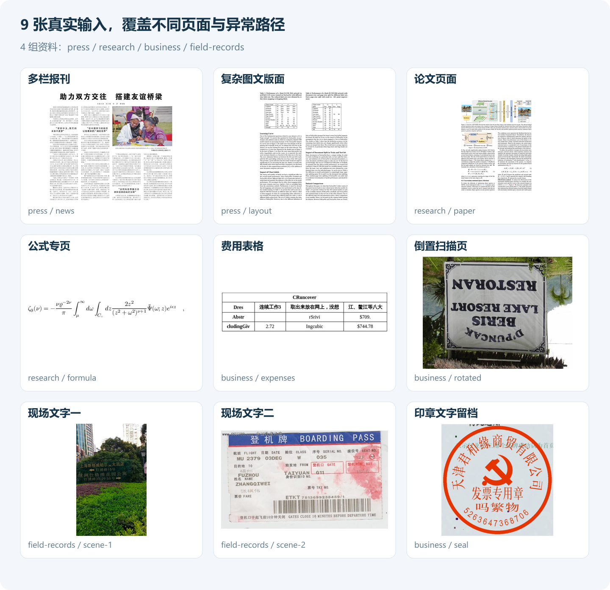
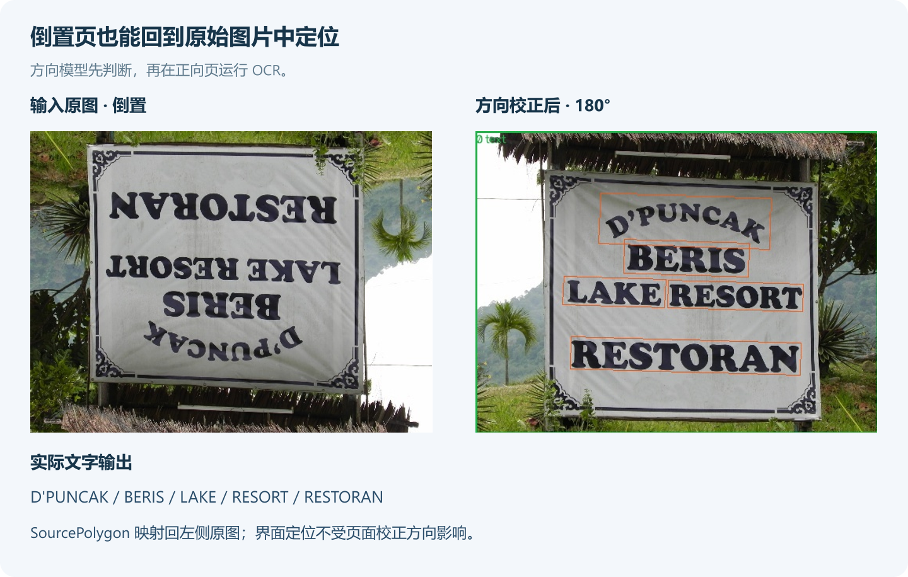
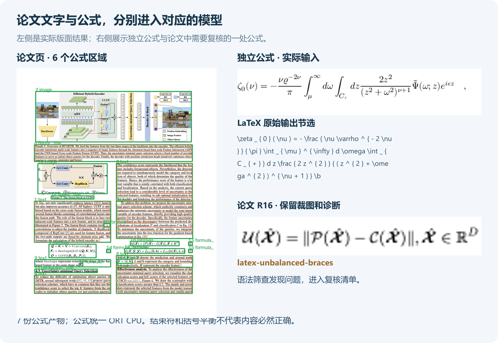
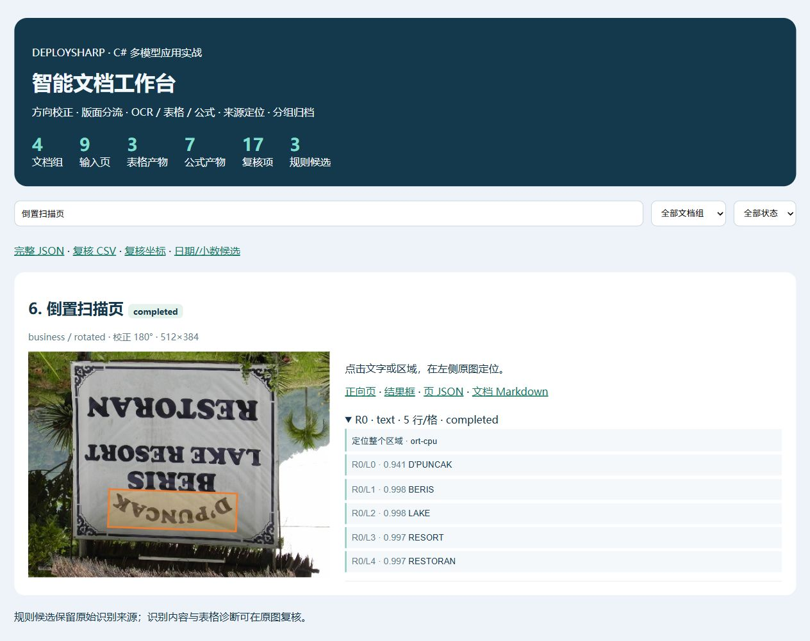
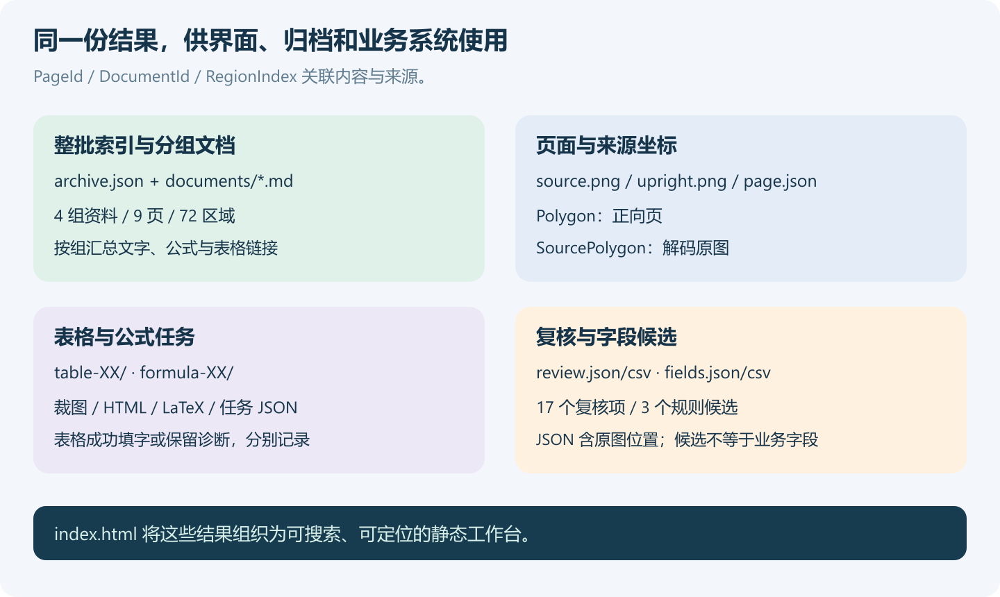

# 让整批文档变成可检索数据：DeploySharp 多模型智能文档工作台实战

> DeploySharp 2.0.0 应用系列 · 第 02 篇，使用正式 NuGet `2.0.0`。创建与修订日期：2026-10-29。


## 一、DeploySharp 项目简介

**DeploySharp** 是一个面向 **C#/.NET 开发者**的开源模型部署框架，由「椒颜皮皮虾」开发，项目源码遵循 **Apache License 2.0**。项目封装了 **ONNX Runtime、OpenVINO、TensorRT、OpenCV DNN** 等推理引擎，提供模型加载、图像前处理、推理和结果后处理接口，方便大家在桌面软件、工业视觉和文档应用中部署模型。

项目接入了目标检测、分类、分割、关键点、旋转框、异常检测、背景移除等视觉任务，也提供 **PP-OCRv4/v5/v6、PP-Structure 文档处理**及部分图文和本地语言模型入口。2.0 版本增加了按需安装的 NuGet 包、Batch、独立 Session 池、异步输入、ROI 和大图切片，便于根据实际任务组合模型。

```text
项目源码：
https://github.com/guojin-yan/DeploySharp/tree/DeploySharpV2.0

NuGet（搜索 JYPPX.DeploySharp）：
https://www.nuget.org/packages?q=JYPPX.DeploySharp
```

基础第 06 篇已经介绍过版面检测、区域 OCR 和表格重建。这一篇继续往应用层走：**把报刊、论文、表格、倒置页和现场照片放进同一个批次，输出可以搜索、定位和复核的文档工作台**。

我准备了 9 张真实图片，分成 4 组资料。同一个程序要处理方向不同、内容不同的页面，保留公式与表格，还要告诉使用者哪些结果可以继续导出，哪些地方需要回到原图确认。

## 二、从几张图片，到一个文档工作台

### 2.1 这次把哪些环节连起来

资料归档时，识别出文字只是第一步。论文里有公式，表格里有行列，扫描页可能倒置，遇到错字还得知道文字来自哪个位置。因此，这个案例同时处理**内容、结构、来源和状态**。


| 环节 | 模型或实现 | 保存的结果 |
| --- | --- | --- |
| 文档分组 | 页面清单中的 `DocumentId` | 同一组资料的多页 Markdown |
| 方向校正 | PP-LCNet 文档方向分类 | 旋转角度、置信度、原图与正向图 |
| 页面分区 | PP-DocLayout-L | 标题、正文、表格、公式、图片等区域 |
| 文字识别 | PP-OCRv5 Mobile DET + REC | 文字、分数、正向页和原图两套坐标 |
| 表格处理 | 表格分类 + RT-DETR cell + SLANeXt | 单元格、结构、填字 HTML 或诊断 HTML |
| 公式识别 | PP-FormulaNet_plus-S + 官方 tokenizer | 公式裁图、LaTeX、解码结果 |
| 字段候选 | C# 正则规则 | 日期、小数候选及其文字来源 |
| 检索与复核 | 静态 HTML + JSON/CSV | 文档组筛选、状态筛选、原图定位、复核清单 |

页面依次处理，模型会话跨区域、跨页面复用。文字、表格、公式分别调用对应模型，最终统一回到页面记录中。后面想换 OCR 或表格模型，也可以单独改对应环节。

### 2.2 先看最后生成的界面

程序结束后打开 `results/ort-cpu/index.html`。顶部显示输入页、文档组、表格和公式产物、复核项数量；下面可以按资料组、处理状态和关键词筛选。


展开一个区域，点击文字，左侧就在原图上标出来源位置。表格可以打开 HTML，公式可以查看 LaTeX 和任务 JSON，结果目录还保留公式裁图。界面是静态文件，不需要安装数据库或启动 Web 服务。

接入自己的 WPF、WinForms 或管理平台时，可以直接读取 `archive.json`，复用这套处理结果。

## 三、准备工程和 NuGet 包

### 3.1 完整工程

```text
https://github.com/guojin-yan/DeploySharp/tree/DeploySharpV2.0/docs/blog/2.0.0/applications/2026-10/examples/02-document-archive
```

```text
02-document-archive/
  DocumentArchive.csproj   # 正式 NuGet，按系统选择原生包
  Program.cs              # 后端、参数、取消和退出码
  DocumentArchive.cs      # 页面校正、任务分流、表格与公式
  OcrService.cs           # 复用 DET + REC
  PageRoiOcrInput.cs      # 区域检测与整页识别共享输入
  PageCoordinateMap.cs    # 正向页坐标 → 原图坐标
  WorkbenchOutput.cs      # 检索页面、字段、复核、分组导出
  documents.json          # 9 页 / 4 组资料
  demo-inputs/            # 公开输入图片与来源
  models/                 # 下载的模型
  results/                # 程序生成
```

工程需要 **.NET 10 SDK、x64 进程**，已配置 Windows 与 Ubuntu 22.04 的原生依赖。下载完整工程后可以直接还原；自己创建项目时，按下面的场景安装。

### 3.2 ORT CPU：先把所有任务跑起来

ONNX Runtime，下面简称 ORT。先安装图像适配层、ORT 后端和运行时：

```powershell
dotnet new console -n DocumentArchive -f net10.0
cd DocumentArchive
dotnet add package JYPPX.DeploySharp.Visual.OpenCV --version 2.0.0
dotnet add package JYPPX.DeploySharp.Backend.OnnxRuntime --version 2.0.0
dotnet add package Microsoft.ML.OnnxRuntime --version 1.28.0
```

项目中设置 `<PlatformTarget>x64</PlatformTarget>`，再根据系统安装 OpenCV 原生包：

| 系统 | 图像处理原生包 |
| --- | --- |
| Windows x64 | `JYPPX.OpenCV.runtime.win-x64 5.0.0` |
| Ubuntu 22.04 x64 | `JYPPX.OpenCV.runtime.ubuntu.22.04-x64 5.0.0` |

只用 ORT 时，不需要安装 OpenVINO、CUDA 或 TensorRT。

### 3.3 OpenVINO：切换主流程，公式单独选后端

增加 `JYPPX.DeploySharp.Backend.OpenVINO 2.0.0`，并安装对应系统的原生包：

| 系统 | OpenVINO 原生包 |
| --- | --- |
| Windows x64 | `OpenVINO.runtime.win 2026.2.1` |
| Ubuntu 22.04 x64 | `OpenVINO.runtime.ubuntu.22-x86_64 2026.3.1` |

本例指定 `--backend openvino` 后，方向、版面、OCR、表格走 OpenVINO CPU，**公式仍走 ORT CPU**。当前模型 Release 提供了 SLANeXt 的 OpenVINO 兼容图，尚未提供本例公式的兼容图，因此工程明确为公式创建 ORT 会话，输出中也记录 `Engine=ort-cpu`。

这也是组合多个模型的实际用法：主流程选择一个后端，个别模型根据可用文件使用另一个后端。完整工程保留两个后端的依赖与注册。

## 四、准备 9 张图片和模型

### 4.1 输入不再只有一张报纸和一张表

这次输入包含报刊、图文版面、论文、长公式、混合文字表格、倒置图、两张现场文字图片和印章。全部来自 PaddleX 官方公开示例，原图已经放入工程。



| 文档组 | 页面 ID | 场景 | 执行方式 |
| --- | --- | --- | --- |
| `press` | `news` | 多栏报刊 | 方向判断 → 版面 → 区域 OCR |
| `press` | `layout` | 文字、图片、两张表格混排 | 方向判断 → 版面 → 文字/表格分流 |
| `research` | `paper` | 含多个公式的论文页 | 方向判断 → 版面 → 文字/公式分流 |
| `research` | `formula` | 单独的公式图片 | 直接公式识别 |
| `business` | `expenses` | 中英文混合费用表 | 版面 → 表格 → 格内多行 OCR |
| `business` | `rotated` | 倒置页面 | 方向校正 → 整页 OCR |
| `field-records` | `scene-1/scene-2` | 现场文字照片 | 整页 OCR |
| `business` | `seal` | 印章文字 | 普通 OCR，保留不可靠结果供复核 |

印章这张使用普通 DET + REC，用来观察曲线文字和低置信度结果；没有将它当成专业印章识别已完成的证明。

图片原始目录如下，逐文件来源见工程的 `demo-inputs/README.md`：

```text
https://paddle-model-ecology.bj.bcebos.com/paddlex/imgs/demo_image/
```

### 4.2 下载模型

模型按文件获取，不需要把整个 PaddleOCR Release 全部下载。

| 文件 | 用途 |
| --- | --- |
| `pp-lcnet-x1-0-doc-ori.onnx` | 页面方向 |
| `pp-doclayout-l.onnx` | 版面分区 |
| `ppocrv5-mobile-det.onnx` | 文字检测 |
| `ppocrv5-mobile-rec.onnx`、`ppocrv5_dict.txt` | 文字识别和字典 |
| `pp-lcnet-x1-0-table-cls.onnx` | 有线/无线表格分类 |
| `rt-detr-l-wired-cell-det.onnx`、`rt-detr-l-wireless-cell-det.onnx` | 两类单元格检测 |
| `slanext-wired.onnx`、`slanext-wireless.onnx` | ORT 表格结构 |
| `slanext-wired-openvino-compat.onnx`、`slanext-wireless-openvino-compat.onnx` | OpenVINO 表格结构 |
| `pp-formulanet-plus-s.onnx` | 公式识别 |
| `pp-formulanet-plus-s.inference.yml` | 从官方配置获取公式 tokenizer |

Windows 在工程目录执行：

```powershell
New-Item -ItemType Directory -Force models | Out-Null
$release = 'https://github.com/guojin-yan/DeploySharp/releases/download/models-paddleocr'
$files = @(
  'pp-lcnet-x1-0-doc-ori.onnx','pp-doclayout-l.onnx',
  'ppocrv5-mobile-det.onnx','ppocrv5-mobile-rec.onnx','ppocrv5_dict.txt',
  'pp-lcnet-x1-0-table-cls.onnx',
  'rt-detr-l-wired-cell-det.onnx','rt-detr-l-wireless-cell-det.onnx',
  'slanext-wired.onnx','slanext-wireless.onnx',
  'slanext-wired-openvino-compat.onnx','slanext-wireless-openvino-compat.onnx',
  'pp-formulanet-plus-s.onnx'
)
foreach ($file in $files) {
  Invoke-WebRequest "$release/$file" -OutFile "models/$file"
}
Invoke-WebRequest 'https://huggingface.co/PaddlePaddle/PP-FormulaNet_plus-S/resolve/main/inference.yml' -OutFile 'models/pp-formulanet-plus-s.inference.yml'
```

Ubuntu 的对应命令在工程 README 中。已有模型可以直接复制，只用 ORT 时可以省去两份 `-openvino-compat.onnx`。公式 YAML 要保留完整配置，不能拿 OCR 字典代替。

```text
模型 Release：
https://github.com/guojin-yan/DeploySharp/releases/tag/models-paddleocr
```

### 4.3 用清单组织自己的资料

完整 `documents.json` 有 9 页，这里节选三条：

```json
{
  "MinimumTextConfidence": 0.8,
  "Pages": [
    { "Id": "paper", "DocumentId": "research", "Title": "论文页面",
      "Image": "demo-inputs/demo_paper.png", "Kind": "auto" },
    { "Id": "expenses", "DocumentId": "business", "Title": "费用表格",
      "Image": "demo-inputs/expense-table.jpg", "Kind": "auto",
      "AutoOrient": false, "CellTextMode": "lines" },
    { "Id": "rotated", "DocumentId": "business", "Title": "倒置扫描页",
      "Image": "demo-inputs/img_rot180_demo.jpg", "Kind": "text" }
  ]
}
```

`Image` 相对清单文件目录解析。页面 `Id` 唯一，`DocumentId` 相同的页面导出到同一份 Markdown。两种 ID 使用小写字母、数字和短横线。

| 配置 | 作用 |
| --- | --- |
| `Kind=auto` | 先检测版面，再按类别分流 |
| `Kind=text/table/formula` | 将整张图作为指定任务，省去版面检测 |
| `AutoOrient=true` | 先做方向判断；默认开启，分数低于 0.8 时不旋转并记录复核 |
| `CellTextMode=rec` | 将每格视为一个识别区域，Batch 调用 REC |
| `CellTextMode=lines` | 每格运行 DET + REC，按行合并，适用于多行单元格 |
| `MinimumTextConfidence` | 小于阈值的文字进入复核清单，原始结果仍保存 |

## 五、页面校正后，怎样回到原图定位

### 5.1 一页保留两个视图

程序先保存解码后的 `source.png`，再根据文档方向模型生成 `upright.png`。模型在正向页上处理，界面仍显示原始页面，使用者可以直接对照收到的资料。



这张图片被识别为 180°，校正后得到 `D'PUNCAK`、`BERIS`、`LAKE`、`RESORT`、`RESTORAN` 五行文字。

文字结果同时保存 `Polygon` 和 `SourcePolygon`：前者属于正向页，后者映射回 `source.png`。例如 180° 校正时，映射关系是：

```csharp
// PageCoordinateMap.ToSource 中的 180° 分支。
// 坐标使用连续像素边界 [0, Width] × [0, Height]。
180 => new PointF(Width - point.X, Height - point.Y)
```

完整类也处理 90° 和 270°。这里的“原图”指 OpenCV 解码并处理 EXIF 方向后的 `source.png`；业务需要回到带 EXIF 的原始文件像素时，应另外保留文件解码变换。

### 5.2 同一页里的区域共享输入

正向页通过 `DecodeForRois` 建立共享图像。文字区域用 `PrepareRectangle` 准备检测输入，`PageRoiOcrInput` 将 ROI 检测张量和整页识别视图交给 `OcrPipeline`：

```csharp
var detectionInput = image.PrepareRectangle(
    new RectangleRoiGeometry(bounds),
    _detection.VisualProfile.Input.Name, settings, token);

using var input = new PageRoiOcrInput(image, detectionInput);
return await Pipeline.RunAsync(input, cancellationToken: token);
```

这是完整工程 `OcrService.RecognizeAsync` 的节选。检测框还原到正向整页，REC 直接按整页四边形裁图，不必把每行先保存成文件再重新读取。识别 Batch 上限为 16。

方向判断、正向推理和预览导出仍各有必要的图像读写；本例复用的是页内 ROI 图像和模型会话。

## 六、把文字、表格和公式接成任务流水线

### 6.1 版面模型决定下一步做什么

`auto` 页面使用 PP-DocLayout-L。正文、标题等区域进入 OCR，表格进入表格任务，公式进入公式任务，图片等区域保留类别与坐标。

如果版面没有检出任何区域，程序回退为整页 OCR，同时记录 `layout-empty-text-fallback`。这样既能继续处理，也能让复核人员知道这一页没有使用版面分流结果。

模型会话以“后端 + 模型文件”为键缓存，第二个标题、第二张表格和下一页继续复用。应用退出时统一释放会话和 OCR 管线。

### 6.2 表格：分类、单元格、结构和文字分别负责

表格分类选择 wired 或 wireless；RT-DETR 提供格子范围，SLANeXt 提供行列结构。`PaddleDocumentTableCellAligner` 检查格数、来源和几何关系，再建立对应：

```csharp
var alignment = PaddleDocumentTableCellAligner.Align(
    tableResult, cellResult,
    image.SourceSize.Width, image.SourceSize.Height);
```

单行格直接批量 REC；多行格使用 `CellTextMode=lines`，逐格调用区域 OCR，按行合并后填入同一个结构槽位：

```csharp
// RunTableAsync 的 lines 分支节选。
var cellOcr = await Ocr.RecognizeAsync(image, match.Bounds, token);
var sorted = cellOcr.Regions
    .OrderBy(l => l.Region.Polygon.Vertices.Min(p => p.Y))
    .ThenBy(l => l.Region.Polygon.Vertices.Min(p => p.X))
    .ToArray();
string cellText = string.Join("\n", sorted.Select(l => l.Recognition.Text));
```

最终 `FillMarkup` 将文字放入结构。默认费用表走多行模式，输出 13 格；复杂版面里的两张表格未通过对齐，保存诊断 HTML 和裁图，继续后面的页面。

### 6.3 公式：从裁图到 LaTeX

论文页中的公式区域交给 PP-FormulaNet_plus-S。Tokenizer 从官方 `inference.yml` 创建，输入使用公式 Profile 对应的前处理：

```csharp
var tokenizer = PaddleDocumentFormulaTokenizer.FromPaddleInferenceYaml(
    Path.Combine(options.Models, "pp-formulanet-plus-s.inference.yml"));

var profile = PaddleDocumentProfiles.CreateFormula(
    PaddleDocumentModelCatalog.Get("paddle-formula/pp-formulanet-plus-s"),
    new PaddleDocumentFormulaSchema(
        tokenizer, endTokenId: 2, startTokenId: 0,
        padTokenId: 1, unknownTokenId: 3));
```

完整实现为公式固定选择 ORT CPU，保存 `crop.png`、`formula.tex` 和 `formula.json`。除了模型的结束状态，还增加花括号平衡检查，发现不平衡就进入复核。



这批图生成了 7 份公式产物，其中论文页贡献 6 份。论文的一处公式触发 `latex-unbalanced-braces`。花括号检查只是基础语法筛查，公式内容是否正确仍需对照裁图。

## 七、跑完以后，怎样检索与复核

### 7.1 在原图上找到结果

工作台使用 `SourcePolygon` 绘制高亮，文字、表格范围和公式区域都可以定位。方向校正后的结果也会映射回最初的输入方向。



复核清单包含 `PageId`、`DocumentId`、区域索引、文字行索引、原因、文字、分数和原图多边形。导入业务系统后，可以按这些信息生成自己的审核任务。

### 7.2 字段规则与归档文件

`WorkbenchOutput` 在文字结果上匹配日期和两位小数，生成 `fields.json/fields.csv`。默认输入得到三个小数候选：`0.95`、`2.72`、`744.78`。

它们是规则命中的候选，**没有自动判断哪一个是金额、总计或业务日期**。自己的业务可以继续根据版面标题、表格列名和字段关系校验。



```text
results/ort-cpu/
  index.html
  archive.json
  review.json / review.csv
  fields.json / fields.csv
  documents/
    press.md / research.md / business.md / field-records.md
  paper/
    source.png / upright.png / regions.jpg
    page.json / page.txt
    formula-XX/
      crop.png / formula.tex / formula.json
  expenses/
    source.png / upright.png / regions.jpg
    page.json / page.txt
    table-00/
      crop.png / structure.json / cells.jpg / cells.json / table.html
```

`page.json` 与 `archive.json` 中的文字保留两套坐标；`cells.json` 保存正向页单元格坐标，原图映射后的单元格结果在页面 JSON 中。`page.txt` 保存文字与表格文字，公式通过单独的 TEX 和分组 Markdown 保存。

再次使用相同输出目录会更新对应文件。业务批次可以使用不同 `--out` 目录，便于保留每次处理结果。

## 八、在 Windows 与 Ubuntu 上实际运行

### 8.1 运行命令

Windows 在工程目录执行：

```powershell
dotnet restore
dotnet build -c Release
dotnet run -c Release --no-build -- --backend ort-cpu --manifest documents.json
dotnet run -c Release --no-build -- --backend openvino --manifest documents.json
```

Ubuntu 22.04 x64 使用同一份 C# 代码，构建时条件选择 Linux 原生包：

```bash
dotnet restore
dotnet build -c Release
export LD_LIBRARY_PATH="$PWD/bin/Release/net10.0/native/opencv:$PWD/bin/Release/net10.0/native/openvino:$LD_LIBRARY_PATH"
dotnet bin/Release/net10.0/DocumentArchive.dll --backend ort-cpu --manifest documents.json
dotnet bin/Release/net10.0/DocumentArchive.dll --backend openvino --manifest documents.json
```

Ubuntu 首次构建可能出现旧 RID 的 `NETSDK1206` 警告，随文工程已显式复制原生文件。其他参数包括 `--models models`、`--out results`；`Ctrl+C` 取消当前批次。

### 8.2 测试设备与四组结果

| 项目 | Windows | Ubuntu |
| --- | --- | --- |
| 系统 | Windows 11 x64，Build 26200 | Ubuntu 22.04.5 LTS x64 |
| CPU | Ryzen 7 5800H | Core i7-1165G7 |
| .NET SDK / Runtime | 10.0.401 / 10.0.12 | 10.0.301 / 10.0.9 |
| ORT CPU | 1.28.0 | 1.28.0 |
| OpenVINO CPU | 2026.2.1 | 2026.3.1 |
| DeploySharp / OpenCV 原生包 | 2.0.0 / 5.0.0 | 2.0.0 / 5.0.0 |

四组都处理了同一份 9 页清单：

| 系统与执行路径 | 文档组 / 页 | 区域 / 文字行或格 | 表格：已填字 / 诊断 | 公式产物 | 复核项 |
| --- | --- | --- | --- | --- | --- |
| Windows · ORT CPU | 4 / 9 | 72 / 324 | 1 / 2 | 7 | 17 |
| Windows · OpenVINO 主流程 + ORT 公式 | 4 / 9 | 72 / 324 | 1 / 2 | 7 | 17 |
| Ubuntu · ORT CPU | 4 / 9 | 72 / 324 | 1 / 2 | 7 | 17 |
| Ubuntu · OpenVINO 主流程 + ORT 公式 | 4 / 9 | 72 / 324 | 1 / 2 | 7 | 17 |

324 条结果中包含 13 个表格单元格，其余为文字行；字段候选为 3 条。表格列分别统计成功填字和保留诊断的产物，没有把后者算作成功重建。


### 8.3 复杂输入暴露了哪些问题

费用表完成了四行、13 格和首行跨四列的 HTML。源图包含中英文混排和不完整单词，表格保留原始识别文字；空文字、低分文字由复核清单指出，方便逐格检查。

复杂版面中的两张表格分别返回 `detection-count-mismatch` 和 `incomplete-structure`；论文部分公式和印章曲线文字也有不可靠结果。程序继续完成其他页面，最后返回待复核退出码 `3`。

| 状态或退出码 | 含义 |
| --- | --- |
| `completed` | 当前处理步骤完成 |
| `kept-as-image` | 保留区域位置，未调用文字/表格/公式任务 |
| `needs-review` | 低分、空文字、结构失败或公式诊断等 |
| `failed` | 单页发生执行异常 |
| `0 / 1 / 2 / 3` | 全部流程完成 / 有失败页 / 用户取消 / 有待复核结果 |

这些图片用于复现功能和检查异常路径，没有提供人工标注，不能据此给出准确率结论。本例也未新增 GPU 性能数据。

## 九、接到自己的资料处理系统

这个工作台已经包含从混合输入到结构化归档的完整路径。替换自己的图片时，先按页面类型选择 `auto/text/table/formula`，再调整置信度规则、字段规则和文档分组。

| 业务需要 | 可以接入的位置 |
| --- | --- |
| PDF、多页扫描文件 | 先渲染为页面图，再创建清单 |
| 多行表格单元格 | 使用已经实现的 `CellTextMode=lines` |
| 合同编号、金额、日期 | 基于文字、坐标和结构扩展字段校验 |
| 人工复核 | 导入 `review.json`，按原图坐标定位并保存人工结果 |
| 自有界面或数据库 | 读取整批与逐页 JSON，关联业务任务 ID |
| 多栏阅读顺序、跨页表格 | 在现有页码、区域坐标和结构上继续实现合并 |

当前表格对齐器不支持 `rowspan`；程序没有实现跨页表格合并、完整多栏阅读顺序和人工审核回写。分组导出保留的是当前区域与行排序，这些业务规则可以独立增加。

应用系列的下一篇是**智能素材工厂**：把背景移除、图文分类和 OCR 接在一起，一张商品图输出透明素材、白底图、候选类别和文字清单。

```text
本篇完整工程：
https://github.com/guojin-yan/DeploySharp/tree/DeploySharpV2.0/docs/blog/2.0.0/applications/2026-10/examples/02-document-archive

应用系列目录：
https://github.com/guojin-yan/DeploySharp/tree/DeploySharpV2.0/docs/blog/2.0.0/applications

DeploySharp 使用文档：
https://github.com/guojin-yan/DeploySharp/tree/DeploySharpV2.0/docs/articles
```
