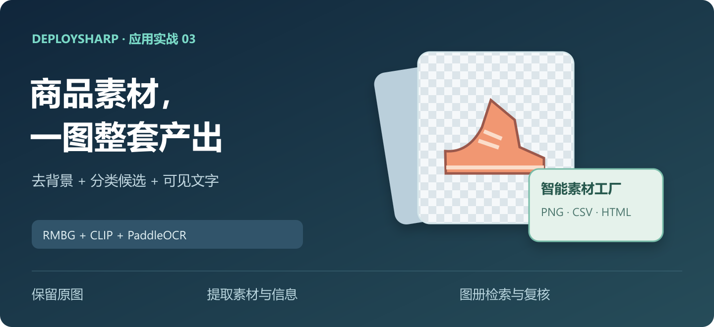
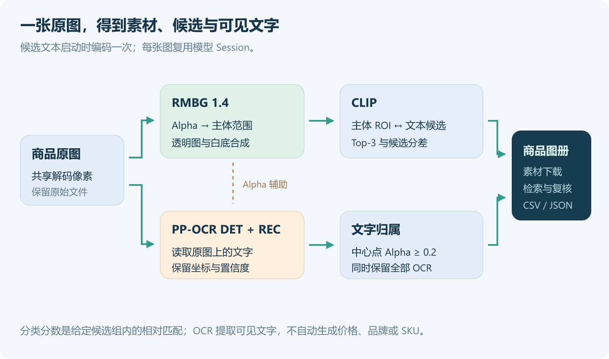
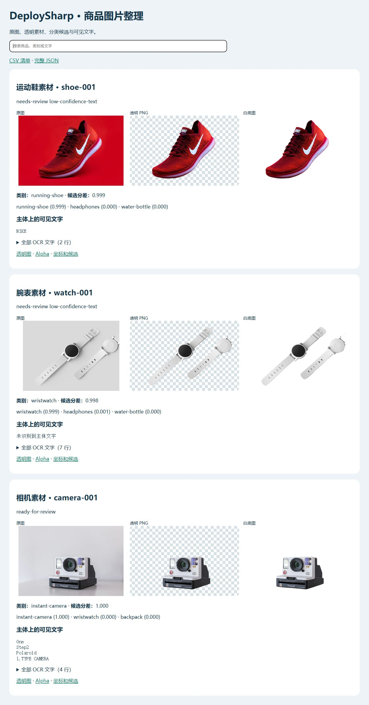
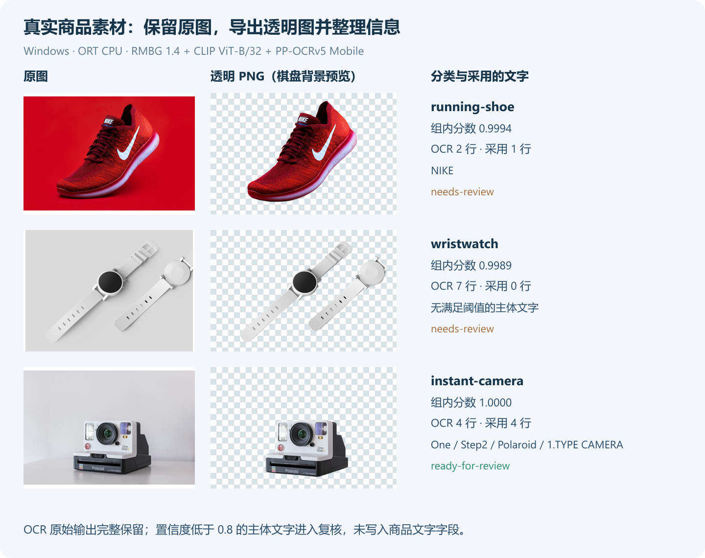

# DeploySharp 实战：一张图产出一整套商品素材，RMBG + CLIP + OCR 打造智能素材工厂

> DeploySharp 2.0.0 应用系列 · 第 03 篇，使用正式 NuGet `2.0.0`。



## 一、DeploySharp 项目简介

**DeploySharp** 是一个面向 **C#/.NET 开发者**的开源模型部署框架，由「椒颜皮皮虾」开发，项目源码遵循 **Apache License 2.0**。项目封装了 **ONNX Runtime、OpenVINO、TensorRT、OpenCV DNN** 等推理引擎，提供模型加载、图像前处理、推理和结果后处理接口，方便大家在桌面软件、工业视觉和文档应用中部署模型。

目前项目已接入目标检测、分类、分割、关键点、旋转框、异常检测、背景移除等视觉任务，也提供 **PP-OCRv4/v5/v6、PP-Structure 文档处理**及部分图文和本地语言模型入口。2.0 版本增加了按需安装的 NuGet 包、Batch、独立 Session 池、异步输入、ROI 和大图切片，便于围绕具体业务组合处理过程。

```text
项目源码：
https://github.com/guojin-yan/DeploySharp/tree/DeploySharpV2.0

NuGet（搜索 JYPPX.DeploySharp）：
https://www.nuget.org/packages?q=JYPPX.DeploySharp
```

应用系列前两篇分别做了园区巡检和文档归档。这一篇做一个**商品图片整理程序**：批量接收素材，提取透明图和白底图，匹配商品类别，识别图片上的文字，最后生成可查询的本地图册和 CSV 清单。

## 二、把几个模型用到同一个整理任务中

### 2.1 场景与最终产物

整理商品素材时，通常需要分别处理图片背景、目录分类、可见标签和文件清单。这里把这些操作组合在同一个 C# 程序中，保留每张原图，再为它生成配套素材和结构化结果。

| 环节 | 模型或实现 | 产物 |
| --- | --- | --- |
| 提取主体 | BRIA RMBG 1.4 | Alpha、透明 PNG、白底图 |
| 匹配类别 | CLIP ViT-B/32 图像与文本编码器 | Top-3 候选、余弦相似度和候选分差 |
| 读取文字 | PP-OCRv5 Mobile DET + REC | 文字行、置信度和源图四边形 |
| 文字筛选 | Alpha 归属 + 识别置信度 | 采用的主体文字、需要复核的原始结果 |
| 整理输出 | C# 应用层 | 商品 JSON、CSV 和可搜索 HTML 图册 |



RMBG 的 Alpha 同时用于透明图和主体范围。CLIP 从原图的主体范围提取特征；OCR 仍读取原图，避免背景合成改变小字。文字结果再通过 Alpha 标记是否位于主体上。

### 2.2 先看运行后的图册

默认输入是运动鞋、腕表和拍立得相机三张公开照片。程序为每个条目生成原图、透明图、白底图与信息卡，页面顶部支持按标题、类别和文字搜索。



透明 PNG 可以直接用于后续排版，CSV 用来批量导入，JSON 保留分类和 OCR 的完整字段。这个工程先把整理和复核做好；商品发布、审核回写和数据库管理可以继续接自己的服务。

## 三、获取工程，按场景安装依赖

### 3.1 完整工程

```text
https://github.com/guojin-yan/DeploySharp/tree/DeploySharpV2.0/docs/blog/2.0.0/applications/2026-10/examples/03-product-catalog
```

```text
03-product-catalog/
  ProductCatalog.csproj   # 正式 NuGet 与平台原生文件
  Program.cs             # 参数、后端注册、取消与退出码
  ProductCatalog.cs      # 主体、语义、文字和图册输出
  ClipModels.cs          # CLIP 前处理、英文 tokenizer 和匹配
  OcrService.cs          # PP-OCR DET + REC
  PageRoiOcrInput.cs      # 共享图像的 OCR 输入
  products.json          # 商品和类别候选
  demo-inputs/           # 三张公开照片及来源
  models/
  results/
```

需要 .NET 10 SDK、x64。工程使用正式 NuGet `2.0.0`，没有本地 `ProjectReference`，下载后可以直接还原。

### 3.2 ORT CPU 场景

从空工程创建时先装这三个包：

```powershell
dotnet new console -n ProductCatalog -f net10.0
cd ProductCatalog
dotnet add package JYPPX.DeploySharp.Visual.OpenCV --version 2.0.0
dotnet add package JYPPX.DeploySharp.Backend.OnnxRuntime --version 2.0.0
dotnet add package Microsoft.ML.OnnxRuntime --version 1.28.0
```

`.csproj` 设置 `<PlatformTarget>x64</PlatformTarget>`。图像与 OpenVINO 的原生包按系统选择：

| 使用场景 | 增加的包 |
| --- | --- |
| Windows x64 图像处理 | `JYPPX.OpenCV.runtime.win-x64 5.0.0` |
| Ubuntu 22.04 x64 图像处理 | `JYPPX.OpenCV.runtime.ubuntu.22.04-x64 5.0.0` |
| 增加 OpenVINO | `JYPPX.DeploySharp.Backend.OpenVINO 2.0.0` |
| Windows OpenVINO 原生库 | `OpenVINO.runtime.win 2026.2.1` |
| Ubuntu OpenVINO 原生库 | `OpenVINO.runtime.ubuntu.22-x86_64 2026.3.1` |

CLIP tokenizer 使用 Visual 传递引入的 `Microsoft.ML.Tokenizers 2.0.0`。完整 `.csproj` 已配置两种后端与对应系统原生库；直接使用随文代码执行 `dotnet restore` 即可。

只用 ORT 时，可以删除 OpenVINO 包、原生文件复制项和后端分支。OpenCV 在这里负责图像处理，实际模型推理由 ORT 或 OpenVINO 执行。

## 四、准备模型、图片和类别候选

### 4.1 按文件准备五个 ONNX

本例需要 RMBG、CLIP 图像和文本两个编码器，以及 OCR DET/REC，共五个 ONNX。CLIP 还要配套词表与合并表，OCR 要配套 v5 字典。

```powershell
New-Item -ItemType Directory -Force models | Out-Null
$visual = 'https://github.com/guojin-yan/DeploySharp/releases/download/models-visual.1'
foreach ($file in @('bria-rmbg-1.4.onnx','clip-vit-b-32.image-encoder.onnx','clip-vit-b-32.text-encoder.onnx',
  'clip-vit-b-32.vocab.json','clip-vit-b-32.merges.txt','clip-vit-b-32.LICENSE')) {
  Invoke-WebRequest "$visual/$file" -OutFile "models/$file"
}
$ocr = 'https://github.com/guojin-yan/DeploySharp/releases/download/models-paddleocr'
foreach ($file in @('ppocrv5-mobile-det.onnx','ppocrv5-mobile-rec.onnx','ppocrv5_dict.txt')) {
  Invoke-WebRequest "$ocr/$file" -OutFile "models/$file"
}
```

Ubuntu 的 `curl` 循环下载命令在随文 README 中。已有模型直接复制即可，保持名称与代码一致。

CLIP 使用附带的 MIT 许可，PP-OCR 使用 Apache 2.0；**BRIA RMBG 1.4 有自己的模型使用条款**，使用前按具体用途确认。项目代码的许可不替代模型许可。

```text
视觉模型 Release：
https://github.com/guojin-yan/DeploySharp/releases/tag/models-visual.1

OCR 模型 Release：
https://github.com/guojin-yan/DeploySharp/releases/tag/models-paddleocr

BRIA RMBG 1.4 模型与条款：
https://huggingface.co/briaai/RMBG-1.4
```

### 4.2 输入与配置

三张照片随 `demo-inputs` 提供，来源是 Unsplash 的公开图片，原始图片地址与使用条件记录在该目录 README 中。代码不根据文件名直接填写分类结果；`ExpectedCategory` 只参与推理后的结果核对。

`products.json` 的主要内容如下，完整文件还包含其他候选和两个商品：

```json
{
  "MinimumTextConfidence": 0.8,
  "Candidates": [
    { "Key": "running-shoe", "Text": "a product photo of a running shoe." },
    { "Key": "wristwatch", "Text": "a product photo of a wristwatch." },
    { "Key": "instant-camera", "Text": "a product photo of an instant camera." }
  ],
  "Items": [
    {
      "Id": "shoe-001", "Title": "运动鞋素材",
      "Image": "demo-inputs/running-shoe.jpg", "ExpectedCategory": "running-shoe"
    }
  ]
}
```

默认完整候选有运动鞋、腕表、相机、背包、水瓶和耳机六类。`Image` 相对配置目录解析，`Id` 唯一且只用小写字母、数字和短横线。没有预期类别时，可以将 `ExpectedCategory` 设为 `null`。

## 五、背景移除：同时生成素材和主体范围

### 5.1 创建 RMBG 模型会话

`BriaRmbgProfiles.CreateRmbg14` 描述本例 ONNX 的输入、输出与 Alpha 解码：

```csharp
var matte = BriaRmbgProfiles.CreateRmbg14(
    new ModelId("bria/rmbg-1.4"),
    new BriaRmbgProfileOptions(
        11, new VisualSize(1024, 1024), "input", "output",
        "", "", "onnx", "LicenseRef-BRIA-RMBG-1.4"));
```

随后通过 `VisualProfileRegistry` 和 `VisualPipeline` 创建会话，完整代码位于 `ProductCatalog.RunAsync`。每张图调用同一个会话，输出 `BackgroundRemovalResult`。

```csharp
using var input = image.PrepareRectangle(
    new RectangleRoiGeometry(whole), matte.VisualProfile.Input.Name,
    OpenCvStage19Preprocessing.CreateBriaRmbgOptions(matte), token);
var removed = (await _matting.RunAsync(input, cancellationToken: token))
    .GetValue<BackgroundRemovalResult>();
float[] alpha = removed.Alpha.ToArray();
```

其中 `whole` 是当前原图范围，`image` 是已经解码的图像。Decoder 返回源图尺寸的 Alpha，图像与 Alpha 的像素位置可以直接对应。

### 5.2 导出透明图和白底图

透明图保存为 BGRA PNG，Alpha 换算为 `0—255`；白底图按原像素与背景混合：

```text
合成通道值 = 原图通道值 × Alpha + 255 × (1 − Alpha)
```

工程中的 `SaveImages` 按行读取像素，按照每张 Mat 的实际 `Step` 访问，分别输出透明图、白底图和灰度 Alpha。Alpha 数组只取一次，避免在像素循环中反复复制整个掩码。

供 CLIP 使用的主体框则从 `Alpha ≥ 0.2` 的像素范围计算，四周扩展少量边距，保留鞋、表带和相机边缘。如果没有找到前景，先保留整图范围，同时标记 `empty-foreground` 进入复核。

## 六、CLIP 分类：候选文本复用，图片从主体范围编码

### 6.1 启动时先编码候选

CLIP 使用图像和文本两个编码器。候选描述在启动时编码一次，保存 L2 归一化后的 512 维特征，随即释放文本 Session：

```csharp
float[][] vectors = await ClipModels.EncodePromptsAsync(
    backends, request, options.Models, job.Candidates, token);
var textByKey = job.Candidates.Select((p, i) => (p.Key, Vector: vectors[i]))
    .ToDictionary(x => x.Key, x => x.Vector);
```

示例 tokenizer 使用配套词表和 BPE，支持可打印 ASCII 英文。描述超过长度上限会报错。使用中文描述时需要换成对应的模型和 tokenizer。

### 6.2 图像编码使用原图的主体 ROI

RMBG 返回主体范围后，CLIP 从**原图**裁剪该 ROI，单独执行 RGB、短边缩放中心裁剪和归一化：

```csharp
var embedding = await encoder.RunAsync(
    new RoiBatch(image, [new RectangleRoiGeometry(bounds)]),
    cancellationToken: token);
var candidates = ClipModels.Match(embedding.Values[0], group, textByKey);
```

`bounds` 来自 Alpha 的主体范围，`group` 包含本次配置的候选。原图中的上下文和主体保持原样，透明 PNG 只用于素材输出。

匹配时计算图像与文本的余弦相似度，再在当前候选组内生成相对分数。结果保留 Top-3，Top-1 与 Top-2 分差小于 `0.1` 时标记 `close-candidates`；配置了预期类别但不一致时标记 `category-mismatch`。

候选组改变会改变分数。高分表示在这一组描述中更相近，业务上还可以增加专用分类模型或自有标注集。

## 七、OCR 读取原图，低分文字保留复核

### 7.1 识别和文字归属分别做

OCR 使用 PP-OCRv5 Mobile DET + REC，识别 Batch 上限 16。`OcrService` 将原图检测输入与共享识别视图组合，返回文字和源图四边形。

```csharp
var ocr = await _ocr.RecognizeAsync(image, whole, token);
```

程序用文字四边形中心的 Alpha 判断归属：大于等于 `0.2` 视为主体文字，再按 `MinimumTextConfidence` 筛选。

```csharp
bool onForeground = alpha[cy * image.SourceSize.Width + cx] >= .2f;
bool accepted = onForeground
    && x.Recognition.Confidence >= job.MinimumTextConfidence
    && !string.IsNullOrWhiteSpace(x.Recognition.Text);
```

这段摘自文字结果转换过程，`cx/cy` 是框中心。中心点判断对主体孔洞、半透明边缘或复杂背景可能有偏差，所以 JSON 同时保留 `OnForeground`、`Accepted`、文字置信度和完整四边形。

### 7.2 为什么要保留低分结果

实际运行时，鞋上较大的 `NIKE` 可以识别，但鞋底斜向小字结果较差；腕表的孔位和细小刻度还产生了低分文字。若直接把全部输出写成商品说明，会把这些噪声带到后续系统。

本例默认阈值为 `0.8`，只将符合要求的主体文字写入 `product.txt`。低分、背景和空字符串仍保留在 `product.json`，在图册的“全部 OCR 文字”中查看。主体有非空低分结果时，商品标记 `low-confidence-text`。

OCR 得到的是可见文字。品牌、价格和 SKU 等字段需要另外做规则匹配、模型提取或人工确认，不能仅根据照片标题补写。

## 八、Windows 与 Ubuntu 实际运行

### 8.1 Windows 命令

在随文工程中下载好模型后，执行：

```powershell
dotnet restore
dotnet build -c Release
dotnet run -c Release --no-build -- --backend ort-cpu --manifest products.json
dotnet run -c Release --no-build -- --backend openvino --manifest products.json
```

### 8.2 Ubuntu 22.04 x64 命令

使用相同源码与配置，构建后设置库搜索路径：

```bash
dotnet restore
dotnet build -c Release
export LD_LIBRARY_PATH="$PWD/bin/Release/net10.0/native/opencv:$PWD/bin/Release/net10.0/native/openvino:${LD_LIBRARY_PATH:-}"
dotnet bin/Release/net10.0/ProductCatalog.dll --backend ort-cpu --manifest products.json
dotnet bin/Release/net10.0/ProductCatalog.dll --backend openvino --manifest products.json
```

模型路径支持 `--models`，输出目录支持 `--out`。打开 `results/<backend>/index.html` 可以查看图册，透明素材与清单入口都在页面中。

默认三张输入包含低分 OCR，所以程序返回 `3` 提示存在待复核项，同时正常保存全部结果。自动批处理时可以按退出码区分“程序失败”和“需要看一下识别内容”。

### 8.3 两套设备与四组执行结果

| 项目 | Windows | Ubuntu |
| --- | --- | --- |
| 系统 / CPU | Windows 11 x64，Ryzen 7 5800H | Ubuntu 22.04.5 LTS x64，i7-1165G7 |
| .NET SDK / Runtime | 10.0.401 / 10.0.12 | 10.0.301 / 10.0.9 |
| DeploySharp / OpenCV 原生包 | 2.0.0 / 5.0.0 | 2.0.0 / 5.0.0 |
| ORT CPU | 1.28.0 | 1.28.0 |
| OpenVINO CPU | 2026.2.1 | 2026.3.1 |

四组均完成五个 ONNX 的调用，三个商品的 Top-1、OCR 行数和复核状态一致：

| 输入 | CLIP Top-1 | OCR 原始行数 | 采用的主体文字 | 状态 |
| --- | --- | --- | --- | --- |
| 运动鞋 | `running-shoe` | 2 | `NIKE` | 其他小字低分，待复核 |
| 腕表 | `wristwatch` | 7 | 无达到阈值的文字 | 低分伪文字，待复核 |
| 相机 | `instant-camera` | 4 | `One / Step2 / Polaroid / 1.TYPE CAMERA` | 结果已整理，供人工查看 |



`1.TYPE CAMERA` 是模型原始输出，图册和 JSON 没有手工替换。鞋底小字和腕表噪声也完整保留，方便后续比较换模型、调阈值或重新裁剪后的效果。

这三张照片用于展示完整整理流程，没有进行商品数据集准确率或吞吐量评测。实际素材中的多主体、遮挡、复杂背景和细小文字，还需要按自己的质量要求验证。

## 九、输出文件与业务接入

### 9.1 每个商品都有一套独立结果

```text
results/ort-cpu/
  index.html             # 标题、类别、文字搜索
  catalog.csv            # 可导入的商品清单，UTF-8 BOM
  catalog.json           # 候选、阈值和全部商品结果
  shoe-001/
    source.jpg           # 原图预览
    transparent.png      # BGRA 透明素材
    white.jpg            # 白底合成
    alpha.png            # 灰度 Alpha
    product.json         # 分类、OCR、置信度与坐标
    product.txt          # 采用的主体文字
  watch-001/...
  camera-001/...
```

CSV 使用带引号字段，文字中的换行与引号按 CSV 规则转义。图册的内容按 HTML 编码输出，识别出的特殊字符可以正常显示。原图和 JSON 都保留在对应条目目录中，查错时可以追溯到输入。

### 9.2 把候选和待复核原因交给业务

| 字段 | 使用方式 |
| --- | --- |
| `Candidates` | Top-3 候选及各自余弦、组内分数 |
| `Margin` | Top-1/2 分差，用来找相近候选 |
| `ExpectedCategory` | 业务传入的可选预期类别，用于核对 |
| `Lines` | 全部原始文字、置信度、归属和四边形 |
| `ProductText` | 筛选后的主体文字 |
| `Reasons` | 候选接近、类别不符、前景异常或低分文字 |
| `Status` | `ready-for-review`、`needs-review` 或运行 `failed` |

退出码为完成 `0`、运行失败 `1`、用户取消 `2`、有待复核项 `3`。单个商品出错会保存错误并继续后续条目；`Ctrl+C` 会结束整批处理。

模型会话跨商品复用，文本特征仅编码一次。每张图等待 Alpha、CLIP 和 OCR 完成后再释放解码对象；像素导出和结果保存也在这个生命周期内完成。工程顺序处理商品，后续有吞吐需求时再增加有界并发，避免多个大模型同时抢占内存。

## 十、换成自己的素材，继续扩展应用

| 需求 | 建议修改 |
| --- | --- |
| 商品种类不同 | 调整候选描述；类别多时考虑专用分类或向量检索 |
| 一张图包含多个商品 | 先增加检测或分割，为每个实例独立整理 |
| 主体范围不完整 | 查看 Alpha、调整背景模型和范围规则 |
| 文字太小或斜向明显 | 增加文字 ROI、透视裁剪或匹配的 REC 模型 |
| 商品说明需要品牌和编号 | 在 OCR 结果后增加字段提取与校验 |
| 图库已有 ID 与目录 | 将输入清单、输出目录映射到现有记录 |

这一篇用五个 ONNX 完成了商品图的素材与信息整理。配合前两篇，应用系列已经覆盖**图像巡检、文档归档、商品素材**三类场景；每篇都可以从完整工程开始，再把结果接到自己的业务中。

```text
本篇完整工程：
https://github.com/guojin-yan/DeploySharp/tree/DeploySharpV2.0/docs/blog/2.0.0/applications/2026-10/examples/03-product-catalog

应用系列目录：
https://github.com/guojin-yan/DeploySharp/tree/DeploySharpV2.0/docs/blog/2.0.0/applications

DeploySharp 使用文档：
https://github.com/guojin-yan/DeploySharp/tree/DeploySharpV2.0/docs/articles
```
